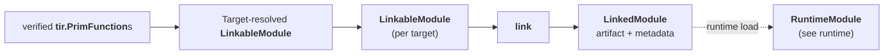

# TileFoundry Spec — Codegen

Codegen turns verified, lowered `tir.PrimFunction`s into a loadable artifact.
It owns the whole producer side of the build: emitting per-target source,
assembling each target's translation unit, and linking those units into one
host-callable shared library. Loading that artifact and exposing it as a
`RuntimeModule` is owned by [runtime](./runtime.md).



## 1. Pipeline

- **Input** is verified TIR for `emit="full"`. HIR `Function` signatures may
  enter codegen only with `emit="skeleton"`; HIR Ops are not emitted as bodies.
  Full emission encountering HIR reports its path and requires skeleton mode
  or prior lowering.
- `CodegenOptions.emit` is `"full"` (default) or `"skeleton"` and lives in the
  compile-wide `CodegenContext`. Emitters read it through
  `ctx.codegen_context.options`; a missing compile context is an error.
  Skeleton emission retains CUDA signatures, parameter views, specialization
  dispatch and launchers, replacing body statements with `// TODO: <fn>`.
- Program emission and linking are owned by [§4.3](#43-linkedmodule);
  runtime compilation entry points and loading are owned by
  [runtime §1.6](./runtime.md#16-compilepy).
- A module's functions are grouped by equal Target values in source order. Each
  group is emitted by the exact Target's resolved implementation into one
  `LinkableModule`.
- The link step compiles every `LinkableModule` with its own toolchain and
  links them into one `LinkedModule` — a host-callable shared library plus the
  host-visible metadata the loader needs.
- Codegen does not run passes, does not load or launch device code, and does
  not own the user-facing entry points (`compile` / `build` / `jit`).
- **Host / device boundary.** A host `LinkableModule` MUST NOT reference CUDA or
  CuTe symbols or types. A CUDA `LinkableModule` owns the kernels and their
  C-ABI launchers. The host module invokes device code only through that
  C-ABI launcher. The launcher MUST read the launch status right after the
  launch and return the CUDA error text when the device refuses the launch, or
  null otherwise. The host entry MUST raise when a launcher returns an error,
  so a refused launch never returns as though the kernel ran and no exception
  crosses the C ABI.

The target-specific generator behavior — how a CPU vs CUDA function emits,
program-shape / dynamic-CTA accessors, and the `ShardLayout` runtime mapping —
is owned by [target](./target.md).

## 2. Resolved code generation

Codegen base classes provide default `create` implementations; concrete Targets
bind their implementations through [target §1](./target.md#1-target).

### 2.1 Target resolution

```python
class EmitContext:
    @classmethod
    def create(cls, target: Target, view) -> EmitContext: ...


class LinkableModule:
    emits: ClassVar[frozenset[EmitGranularity]] = frozenset({"full"})

    @classmethod
    def create(cls, target: Target, owner: Module, functions, ctx) -> LinkableModule: ...
```

- constraints:
  - `link_program` MUST obtain each group's emission context through
    `target.resolve(EmitContext, view)`, then its translation unit through
    `target.resolve(LinkableModule, owner, functions, ctx)`. Factories MUST NOT
    independently settle the compile-wide symbols, ownership, or launch geometry.
  - `LinkableModule.create` MUST report `<target summary>: no code generator`
    when a Target has no bound implementation. Concrete factories MUST check
    their class's `emits` before emission and raise `UnsupportedCapabilityError`
    naming the Target and requested granularity when unsupported. CPU and CUDA
    factories support `"full"` and `"skeleton"`; CUDA skeleton emission MUST
    reject targets with `device_count` with its existing diagnostic.
  - CPU MUST bind `EmitContext` to `CpuCodegenContext` and `LinkableModule` to
    `HostLinkableModule`. CUDA MUST bind these bases to `CudaCodegenContext`
    and `CudaLinkableModule`. Bindings select classes, never strings.
  - A factory writes each function twice: once as the declaration a caller sees,
    without entering the body, and once as the definition, by walking it.
  - A second unequal device Target group MUST fail before any factory emits;
    multiple device architectures in one linked artifact are unsupported.
  - EmitContext and Linkable/Linked products MAY be subclassed through bindings.
    The compile-wide `CodegenContext` and `LinkableFunction` have no resolution
    hook in this interface.

### 2.2 Per-Op handler registry

```python
def handler(call: Call, ctx: CodegenContext) -> None: ...
```

- constraints:
  - a handler is registered inside a concrete generator against its own target
    ([visitor-registry §6](./visitor-registry.md#6-instance-3--codegen));
    dispatch (matching `Evaluate` and selecting the handler) is owned by
    visitor-registry.

Dispatch is owned by [visitor-registry §6](./visitor-registry.md#6-instance-3--codegen). A handler
receives the `Call` (the wrapped Op inside `Evaluate`) plus a `CodegenContext`,
and MUST emit through `ctx.emit(...)`; raw `print` / direct file writes are
prohibited.

### 2.3 `CodegenContext`

```python
class EmitContext:
    """The context one compile writes through, whatever targets it writes for."""

    symbols: Mapping[int, CallableSignature]
    exported: bool

    def signature_of(self, fn) -> CallableSignature: ...
    def register_kernel_param(self, var) -> None: ...
    def is_kernel_param(self, var) -> bool: ...
    def emit(self, line: str) -> None: ...
    def blank(self) -> None: ...
    def indent(self) -> None: ...
    def dedent(self) -> None: ...
    def name_for(self, var) -> str: ...
    def source(self) -> str: ...
    def link(self, project: CMakeProject) -> None: ...
    def capture(self, fn) -> str: ...
    def emit_node(self, node) -> None: ...
    def declare(
        self, signature, *, exported: bool = False
    ) -> tuple[str, ...]: ...
    def parameters(
        self, signature, *, exported: bool = False
    ) -> str: ...
    def local_value(self, signature) -> str: ...
    def local_extent(self, signature, axis: int) -> str: ...


class CudaCodegenContext(EmitContext):
    """A compile writing CUDA: the shared context plus what only CUDA states."""

    launches: Mapping[int, Geometry]
    dynamic_extents: dict[str, str]

    def bind_extents(self, params) -> None: ...
    def reset_barrier_ids(self) -> None: ...
    def alloc_barrier_id(self) -> int: ...
    def reset_smem_base(self) -> None: ...
    def smem_base(self) -> str: ...
    def dtype_to_cpp(self, dtype_name: str) -> str: ...


class CpuCodegenContext(EmitContext):
    """A compile writing the host unit: the shared context plus what a tensor is here."""
```

- constraints:
  - One context spans one whole compile rather than one translation unit: the
    symbol table it carries is read by every emitter, and the boundary of the
    unit being written is drawn by `capture`. There MUST NOT be a second
    per-unit context object.
  - `signature_of` answers from `symbols` ([§4.4](#44-signatures)) and from
    nowhere else; it MUST raise when the function has no row there.
  - `emit_node` dispatches `Evaluate(op, args)` by the wrapped Op class; all
    other nodes dispatch by their own class.
  - `source` returns accumulated source text, and `capture` temporarily isolates
    only the output buffer while preserving indentation and symbol bindings.
  - `declare` and `parameters` MUST use this context's own Target. Cross-target
    ABI selection MUST NOT occur in core: CUDA registers the CPU host writer
    for shared `Launch` at `(CpuTarget, Role.EMIT, Launch)` and directly invokes
    CUDA's CALLEE and CALLER writers using the host's local names.
  - Core statement traversal MUST use one `CppEmitter`. A registered
    `(target, Role.EMIT, statement type)` writer overrides core traversal;
    otherwise core uses its own statement visitor or reports a missing handler
    naming the node type and Target. Target-specific scalar calls use the same
    registry. CUDA registers `MeshScope` and `MeshCoord` there.
  - `exported` is set while a parameter list another translation unit will read
    is being written. A target whose types are its own MUST answer with what
    plain C states while it is set, because that is all the reading unit can
    spell.
  - `local_value` and `local_extent` are what the writing scope calls the value
    and the extent it passes; a scope that holds something richer than a plain
    parameter — a host entry holding a runtime tensor — states so by overriding
    them. They are the only place a caller's own vocabulary enters a call.
  - `dynamic_extents` says where the kernel being written reads each open
    dimension's extent, and is filled by `bind_extents` from the parameter
    types alone. `launches` is the geometry each device function is called at,
    keyed by `id(fn)`, settled where the `Launch` was written
    ([passes §7.3](./passes.md#73-insert_default_host_entry)).
  - `smem_base` declares and returns one byte-addressed dynamic shared-memory
    base per kernel. A numeric `TensorView` address adds its byte offset before
    converting the result to a CuTe shared-memory pointer.
  - A target subclass owns the type strings and hardware counters only it can
    state; a handler MUST reach them through the context rather than reading
    the IR for them. Other helpers MAY be added per target.

### 2.4 Effect Op dispatch

CUDA value emission lowers `TupleGetItem` according to its index form. A constant
index names the selected tuple element directly. A dynamic index requires the
homogeneous tuple established by type inference and emits
`cute::array{a, b, c}[index]`; dimension arithmetic in the index remains runtime
C++ arithmetic.

An IR `Tuple` is structural and has no target-side storage. A `LetStmt` binding
one emits no C++ variable and continues with its body; its authored name (for
example `lhs_stages`) therefore does not appear in generated C++. Each dynamic
`TupleGetItem` use constructs its own `cute::array`, so indexing the same tuple
N times constructs N arrays. Constant selection remains valid for heterogeneous
tuples because it does not materialize an aggregate. The codegen context records
the structural tuple by its fresh SSA `Var` identity so consumers can recover
its elements without target-side storage.

Effect Ops (`Copy`, `Fill`, `TiledMma`, `CopyAsyncBulk`, `CopyReduceAsyncTensor`, `LdMatrix`, `StMatrix`,
`tir.nn.*`, ...) appear in Stmt
position as `Evaluate(op, args)` rather than as Stmt subclasses. The
walker matches `Evaluate` and dispatches on `type(callable)` through
the handler registry. Handlers stay small; the runtime function they
call carries the semantic load.

CUDA emits `CopyAsyncBulk` and `LdMatrix` as the uniform runtime calls
`tilefoundry::ops::copy_async_bulk(...)` and
`tilefoundry::ops::ldmatrix(...)`. `CopyAsyncTensor` is nevertheless a public
TIR declaration, but CUDA emission MUST fail explicitly until the host can
construct and pass encoded tensor maps; it MUST NOT substitute a bulk or
thread-issued copy. `CopyReduceAsyncTensor` has the same explicit unsupported
boundary; it MUST NOT substitute a copy that drops the reduction. `StMatrix` likewise MUST fail explicitly until stmatrix
runtime support exists.

## 3. Runtime-owned op dispatch

Where more than one runtime template implements an op, codegen emits **one
uniform runtime op call**, passing the operand `ShardLayout`s (and any
codegen-static participant geometry) as compile-time template parameters. The
runtime template dispatches on those layouts at compile time; codegen does not
select a tier, compute a per-tier parameter, or carry the selection on the TIR
op. This is the codegen side of the runtime-owned dispatch principle, whose
contract lives in [runtime §2.6](./runtime.md#26-cudaops). The target-side
emission that produces these calls is owned by [target](./target.md).

## 4. Codegen products

### 4.1 `LinkableFunction`

Defined in `codegen/linkable_function.py`.

One lowered function's pre-link source, in both of its positions.

```python
class LinkableFunction:
    """One lowered function's pre-link source, in both of its positions.

    Attributes:
        name: attribute; function or kernel symbol.
        declaration: attribute; what a caller of this function must see.
        definition: attribute; the function's own implementation.
    """

    name: str
    declaration: str
    definition: str
```

- constraints:
  - `declaration` and `definition` MUST both be written from the one
    `CallableSignature` ([§4.4](#44-signatures)) that the compile settled for
    this function, so the two cannot state different parameters.

### 4.2 `LinkableModule`

Defined in `codegen/linkable_module.py`.

One target's pre-link translation unit.

```python
class LinkableModule:
    """One target's pre-link translation unit, assembled from its functions.

    Attributes:
        target: attribute; generator/linker backend label.
        language: attribute; source language.
        preamble: attribute; the part of the unit that is not a function.
        functions: attribute; constituent linkable functions in emission order.
    """

    target: str
    language: str
    preamble: str
    functions: tuple[LinkableFunction, ...] = field(default_factory=tuple)

    def source(self) -> str: ...
```

- constraints:
  - `target` MUST be the generator/linker backend label (`"cuda"` or `"cpu"`
    for the built-ins), never an external Target registration name.
  - MUST be the source language: `cu` for a CUDA translation unit, `cpp` for a
    host translation unit.
  - `LinkableModule` MAY be subclassed to override `link(project)`. The default
    implementation MUST add its source to the shared project, naming CPU output
    `host.cpp` and other output `<target>_<index>.<language>`. Backend subclasses
    MUST own their language, compiler options, and runtime include paths.
  - MUST list the module's constituent `LinkableFunction`s, in emission order.
  - `preamble` MUST carry what the unit states outside any function: includes,
    macros, unit-level template specializations, and device state emitted only
    where a function used it. It is a field because it is settled only once
    every function of the unit has been walked.
  - `source` is a read-only property and MUST be the only place a translation
    unit is assembled: the preamble, then every declaration, then every
    definition. A generator MUST NOT emit the unit a second time alongside
    `functions`.

A `LinkableModule` is a build artifact, not a runtime object and not a
user-callable.

### 4.3 `LinkedModule`

The link output: a loadable artifact plus the host-visible metadata the loader
needs. Defined in `codegen/linked_module.py`.
`codegen/linked_function.py` separates each registration name from its C++ host
signature:

```python
class LinkedFunction:
    """One linked function's registration name and host signature.

    Attributes:
        name: attribute; the dotted registration name.
        signature: attribute; the host C++ calling convention and name.
    """

    name: str
    signature: CallableSignature

class LinkedModule:
    """Linked library plus its exported functions.

    Attributes:
        library_path: attribute; produced shared-library path.
        source: attribute; assembled host and device source.
        functions: attribute; the linked functions exported by the library.
    """

    library_path: Path
    source: str
    functions: tuple[LinkedFunction, ...]
```

- constraints:
  - `LinkedFunction.name` MUST be the dotted registration name;
    `signature` MUST retain the host C++ calling convention and its C++ name
    ([§4.4](#44-signatures)). `link_function` creates this pair from a resolved `FunctionSymbol`.
  - `LinkedModule.functions` MUST list every emitted host export, in emission
    order. Compilation supplies one entry; scaffold projects supply every
    synthesized or selected CPU entry. The compiled runtime loader requires one
    ([runtime §1.4](./runtime.md#14-runtimeloaderpy)).
  - MUST carry the assembled host + device source — the diagnostic source the
    runtime exposes as `RuntimeModule.source` ([runtime](./runtime.md)).

`codegen/link_function.py` retains the per-function export helper;
`codegen/link_module.py` exposes the whole-program and translation-unit entries:

```python
def link_program(
    mod: Module, *, workdir: str | Path,
    options: CodegenOptions = CodegenOptions(), entries=None,
) -> LinkedModule: ...


def link_modules(
    modules: tuple[LinkableModule, ...], *, workdir: str | Path,
    lib_name: str, functions: tuple[LinkedFunction, ...], host: Target, host_cxx: str = "g++",
) -> LinkedModule: ...


def link_function(symbol: FunctionSymbol) -> LinkedFunction: ...


class CMakeProject:
    def __init__(self, workdir: str | Path, lib_name: str, host_cxx: str = "g++") -> None: ...
    def add_source(self, name: str, text: str) -> None: ...
    def enable_language(self, language: str) -> None: ...
    def include(self, *dirs) -> None: ...
    def append(self, cmake_text: str) -> None: ...
    def build(self, functions: tuple[LinkedFunction, ...]) -> LinkedModule: ...
```

- constraints:
  - `link_program` MUST emit one `LinkableModule` per device context group and
    combine all selected CPU entries into one host group and one `host.cpp`.
    Every group MUST use the same emission callback shape.
  - `link_modules` MUST create one `CMakeProject`, invoke each module's
    `link(project)`, then call `host.resolve(LinkedModule, project, functions)`.
    The default `LinkedModule.create` MUST call `project.build(functions)`.
    It MUST NOT select a
    backend's toolchain by Target type. `link_function` retains per-export
    metadata construction as the default `LinkedFunction.create`, reached through
    the entry Target's `resolve(LinkedFunction, symbol)`.
  - `CMakeProject` MUST write unique source names, collect enabled languages and
    include directories, and append target-owned CMake commands. Its `sources`
    mapping MUST preserve source insertion order. Reusing a source name MUST
    fail rather than overwrite the previous unit.
  - Core MUST assemble one CMake project and run one configure/build sequence.
    Compiler launcher settings such as ccache MUST remain effective. Backend
    `LinkableModule` subclasses own compiler flags and include directories;
    the resolution path MUST use class implementations, not callback fields.
  - CPU sources MUST include the packaged CPU runtime header directly. CUDA
    sources MUST include their packaged runtime header directly. Runtime include
    directories MUST be located through `importlib.resources`.
  - `CudaLinkableModule.link` MUST resolve CUTLASS from
    `TILEFOUNDRY_CUTLASS_INCLUDE` first; an explicitly invalid directory MUST
    fail naming the variable and value. Without the variable it MUST search
    source ancestors for `third_party/cutlass/include`, then fail naming the
    variable and searched paths if none exists.

`link_program` emits and links without loading. `entries=None` selects the
root entry; an explicit sequence selects those CPU entries, with launcher
declarations deduplicated. Sources are written directly in `workdir`; the
library is `workdir/build/lib<root Module name>.so`. The link step compiles each
source unit with its own toolchain and links the units into one library.
`LinkedModule` is consumed by the runtime loader ([runtime](./runtime.md));
the concrete compiler commands are an implementation detail and not part of
the contract. `build()` chooses a fresh
work directory ([runtime §1.6](./runtime.md#16-compilepy)); the scaffold command
chooses its output directory ([cli](./cli.md#scaffold)).

### 4.4 Signatures

A signature is what one IR `Type` becomes once its function is compiled to
C++. The two layers differ: an IR function returns a value, where a C++ entry
writes into trailing parameters, and a call may carry ids the IR never
declared. So codegen states the C++ side as its own family, mirroring
`Type` ([types §7](./types.md#7-callabletype)).

```python
class Signature:
    """One parameter, or one whole call, as C++ spells it."""

class TensorSignature(Signature):
    """A declared tensor: its pointer, and the extents its type leaves open."""

    name: str
    type: TensorType                # dtype / shape / storage / layout come from here

    @property
    def dynamic_axes(self) -> tuple[int, ...]: ...

class ProgramIdSignature(Signature):
    """The id of one topology level, told to a program that cannot read it."""

    name: str
    topology_level: str

class ProgramMetaSignature(Signature):
    """The block of ids a kernel hands to the runtime it was compiled against."""

    name: str

class LaunchSignature(Signature):
    """One of the geometry arguments a launch is told beyond the kernel's own."""

    name: str
    ctype: str

class TupleSignature(Signature):
    """The C++ side of a `TupleType`."""

    fields: tuple[Signature, ...] = ()

class UnitSignature(Signature):
    """The C++ side of `UnitType`: nothing is passed."""

class CallableSignature(Signature):
    """One calling convention of one IR function."""

    name: str
    params: tuple[Signature, ...] = ()      # what the IR declares, outputs last
    output_count: int = 0                   # trailing count of output parameters
    leading: tuple[Signature, ...] = ()     # hidden parameters ahead of `params`
    trailing: tuple[Signature, ...] = ()    # hidden parameters after `params`
```

- constraints:
  - `params` lists ALL declared parameters (inputs + outputs) in declaration
    order; `output_count` is the trailing count of outputs. `input_count` is
    `len(params) - output_count`; `input_params` / `output_params` are the
    corresponding slices; `all_params` is `leading + params + trailing`, the
    order the C++ declaration lists.
  - a `TensorSignature` reuses the IR type system instead of restating it: a
    dynamic dim is whatever `type.shape` carries (e.g. a `DimVar`), and there
    is no separate dynamic-dim sentinel. `dynamic_axes` are the axes it carries
    as a `DimVar`, and only those extents travel with the pointer.
  - a program id, a program-meta block and a launch argument have no IR
    counterpart on purpose: those parameters do not exist in the IR at all,
    which is what makes them hidden. Each is its own class, so whoever writes
    one out dispatches on the type instead of reading the name.
  - one compiled function has three C++ conventions — the host entry, the
    launcher and the device kernel — and they differ only in `leading` and
    `trailing`. They MUST be three `CallableSignature` values; the class MUST
    NOT be subclassed. Only the first two are reachable by name; the kernel's
    is derived inside the unit that defines it and is not in the table.
  - `function_path(root, fn)` MUST return the root Module name followed by the
    segments of the first DFS call path for each definition. Child
    segments are slot keys and, for indexed slots, decimal indices. Variant paths add
    the display name or `v<index>` when absent. A function outside the tree
    MUST be rejected.
  - `mangle(root, fn)` MUST be the unique source of generated function-symbol
    roots: `tilefoundry_` followed by encoded path segments. C identifier
    segments retain decimal length followed by spelling. Pure decimal index
    segments use `I<decimal length>_<digits>`; all other segments raise with the
    segment and complete path. The `I` tag distinguishes indices from identifier
    length prefixes, and the underscore delimits an index's length before its
    fixed-length payload, keeping the encoding injective.
  - `export_name(root, fn)` MUST join this same path with dots. For each HIR
    call path it equals `<root name>.<call path>`.
  - function paths reuse the IR definition traversal
    ([core-ir §1](./core-ir.md#1-module)). This
    traversal emits each definition once using its first DFS call path,
    including index segments. These naming functions live in
    `codegen/context_builder.py`, which produces FunctionSymbol
    identities. Target conventions supply suffixes: CUDA derives `_launch` and
    `_kernel`, while CPU functions use the mangled root. Conventions receive
    the resolved symbol and target rather than reconstructing them.
  - parameters codegen inserts (`tilefoundry_meta`,
    `tilefoundry_<level>_program_id`) and unit-owned state MUST carry the
    `tilefoundry_` prefix. Their spellings belong to their respective targets.
  - host wrappers use `export_name(root, fn)` registration names, registering
    through `Function::SetGlobal` with override enabled.
  - user parameter names are used verbatim. They MUST be C identifiers, MUST
    NOT be C++ keywords or start with `tilefoundry_`, and MUST NOT collide with
    another parameter or derived view name (`<name>_tensor`, each dynamic
    `<name>_shape_<axis>`, or a sharded parameter's `<name>_mesh`). Errors name
    the function path and parameter.
  - the entry the loader is handed ([§4.3](#43-linkedmodule)) is a fourth
    value of the same shape: its `name` is the TVM FFI registration name, which
    the loader combines with the `LinkedFunction`'s `signature` to obtain it,
    and each `leading` entry is a `ProgramIdSignature` whose `topology_level`
    names the level whose id the host must supply, because that caller reads
    the id out of a `Placement` ([shard §5](./shard.md#5-mesh)) instead of writing
    a C++ declaration.

```python
def program_id_params(
    module: Module, target: Target
) -> tuple[ProgramIdSignature, ...]:
    """The ids a call into *module* has to carry for *target* to run it."""
    ...


def symbol_table(module: Module, target: Target) -> Mapping[int, CallableSignature]:
    """What every function in the tree is called by, before anything is emitted."""
    ...
```

- constraints:
  - `program_id_params` is the one place that asks which levels supply their
    own program ids: the levels whose `TopologyFacts` entry is `from_target`
    ([target §1](./target.md#1-target)), intersected with the levels
    the module's program names. A level stated that way has no register the
    device can read, so its id arrives with the call.
  - `symbol_table` states one `CallableSignature` per function in the tree,
    keyed by `id(fn)`, so a call site holds its callee and never asks which
    module the callee lives in. Only device prototypes enter the Launch-target
    symbol map. Variant identities carry symbol metadata for HIR device bodies;
    their prototype selects them inside the kernel ([§5](#5-specialization-dispatch)).
  - a row is what a caller must write and nothing about what an emitter
    produced. A device function appears as its launcher, because that is
    the only convention a caller can reach; the kernel's own convention is not
    in the table.

`codegen/cuda/hir/function.py` owns HIR skeleton emission. An HIR function
enters codegen only as the callee a `Launch` names; Python wraps any other
function and calls the exported entries. Each launched function gets one
editable `__device__` body taking cute parameter views, one `__global__` entry
and one launcher.
Device bodies (including variants) precede all global entries, ordered stably
by increasing reachable-function count so callees precede callers. Prototypes
have empty bodies and variants receive their display-name path segment or
`v<index>` fallback. Global entries wrap parameters and dispatch by the same
range rules as TIR, trapping outside the specialization ranges.

HIR functions with equal effective topology hierarchies share a device unit,
including children that explicitly redeclare the same hierarchy; TIR grouping
is unchanged. HIR same-kernel context rules are owned by
[hir §1.1](./hir.md#11-function). An HIR function's parameters are the
arguments its `Launch` binds
([passes §7.3](./passes.md#73-insert_default_host_entry)), and its variants
take the same ones; generated names follow [§4.4](#44-signatures).
A synthesized host entry launching HIR uses that HIR function's symbol and
registration name; its own IR name does not add another path segment.

## 5. Specialization dispatch

A specialization prototype and its variants compile to one symbol, and which
variant runs is decided on the device.

- constraints:
  - The variants of one prototype MUST agree on launch geometry. A translation
    unit states its program dimensions once for every kernel in it
    ([target](./target.md)), so variants that disagreed could not share one
    unit -- and they have nothing else to disagree about that a launch could
    express.
  - Because the geometry is one, the host MUST NOT choose between variants: it
    writes the one call the symbol table names ([§4.4](#44-signatures)). There
    is no host-side chain over N launchers and no per-variant launcher.
  - The prototype's kernel holds every variant as a branch, taken on the extent
    the call already carries -- the parameter the open axis expands into. A
    shape outside every variant's range is a call-contract violation and the
    kernel traps.
