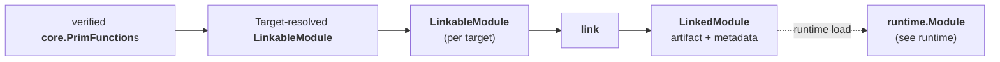

# TileFoundry Spec — Codegen

Codegen turns verified, lowered `core.PrimFunction`s into a loadable artifact.
It emits per-target source. It assembles the translation unit of each target.
It links the units into one host-callable shared library.
[runtime](./runtime.md) owns the loading of that artifact as a `runtime.Module`.



## 1. Pipeline

- **Input** is verified TIR for `emit="full"`. HIR `Function` signatures may
  enter codegen only with `emit="skeleton"`; HIR Ops are not emitted as bodies.
  Full emission encountering HIR reports its path and requires skeleton mode
  or prior lowering.
- `codegen.Options.emit` is `"full"` (default) or `"skeleton"` and lives in the
  compile-wide `codegen.Context`. Emitters read it through
  `ctx.codegen_context.options`; a missing compile context is an error.
  Skeleton emission retains callable signatures and replaces body statements
  with editable placeholders; target packages own their wrapper conventions.
- A module's functions are grouped by equal Target values in source order. Each
  group is emitted by the exact Target's resolved implementation into one
  `LinkableModule`.
- The link step compiles every `LinkableModule` with its own toolchain and
  links them into one `LinkedModule` ([§4.3](#43-linkedmodule)).
- Codegen does not run passes. Codegen does not load or launch device code.
  [runtime §1.6](./runtime.md#16-compiler) owns the user-facing entry points
  (`compile` / `build` / `jit`). Codegen does not own them.
- **Host / device boundary.** A host unit invokes device code through its
  exported C ABI. A host unit MUST NOT depend on device-only types. The target-owned
  launcher reports refused launches to the host; no exception crosses that ABI.

Target packages own generator behavior, runtime type mappings and device
accessors.

## 2. Resolved code generation

Codegen base classes provide default `create` implementations; concrete Targets
bind their implementations through [target §1](./target.md#1-target).

### 2.1 Target resolution

```python
class EmitContext:
    @classmethod
    def create(cls, target: Target, view) -> EmitContext: ...


class LinkableModule:
    emits: ClassVar[frozenset[EmitGranularity]] = frozenset({"full"})

    @classmethod
    def create(cls, target: Target, owner: core.Module, functions, ctx) -> LinkableModule: ...
```

- constraints:
  - `link_program` MUST obtain each group's emission context through
    `target.resolve(EmitContext, view)`, then its translation unit through
    `target.resolve(LinkableModule, owner, functions, ctx)`. Factories MUST NOT
    independently settle the compile-wide symbols, ownership, or launch geometry.
  - `LinkableModule.create` MUST report `<target summary>: no code generator`
    when a Target has no bound implementation. Concrete factories MUST check
    their class's `emits` before emission and raise `UnsupportedCapabilityError`
    naming the Target and requested granularity when unsupported. The CPU
    factory supports `"full"` and `"skeleton"`; device factories declare their
    supported granularities.
  - CPU MUST bind `EmitContext` to `cpu.Context` and `LinkableModule` to
    `HostLinkableModule`. Device packages bind their own implementations.
    Bindings select classes, never strings.
  - A factory writes each function twice: once as the declaration a caller sees,
    without entering the body, and once as the definition, by walking it.
  - A second unequal device Target group MUST fail before any factory emits.
    One linked artifact supports one device architecture only.
  - EmitContext and Linkable/Linked products MAY be subclassed through bindings.
    The compile-wide `codegen.Context` and `LinkableFunction` have no resolution
    hook in this interface.

### 2.2 Per-Op handler registry

```python
def handler(call: Call, ctx: EmitContext) -> None: ...
```

A handler is registered inside a concrete generator against its own target;
dispatch is owned by
[visitor-registry §6](./visitor-registry.md#6-instance-3--codegen). A handler
receives the `Call` (the wrapped Op inside `Evaluate`) and an `EmitContext`.
A handler MUST emit through `ctx.emit(...)`. Raw `print` and direct file writes
are prohibited.

### 2.3 `EmitContext`

```python
class EmitContext:
    """The context one compile writes through, whatever targets it writes for."""

    symbols: Mapping[int, CallableSignature]
    exported: bool

    def signature_of(self, fn) -> CallableSignature: ...
    def register_kernel_param(self, var) -> None: ...
    def is_kernel_param(self, var) -> bool: ...
    def emit(self, line: str) -> None: ...
    def blank(self) -> None: ...
    def indent(self) -> None: ...
    def dedent(self) -> None: ...
    def name_for(self, var) -> str: ...
    def source(self) -> str: ...
    def link(self, project: CMakeProject) -> None: ...
    def capture(self, fn) -> str: ...
    def emit_node(self, node) -> None: ...
    def declare(
        self, signature, *, exported: bool = False
    ) -> tuple[str, ...]: ...
    def parameters(
        self, signature, *, exported: bool = False
    ) -> str: ...
    def local_value(self, signature) -> str: ...
    def local_extent(self, signature, axis: int) -> str: ...


class Context(EmitContext):  # codegen.cpu.Context
    """A compile writing the host unit: the shared context plus what a tensor is here."""
```

- constraints:
  - One context spans one whole compile, not one translation unit. Every
    emitter reads the symbol table of the context. `capture` draws the boundary
    of the unit being written. There MUST NOT be a second per-unit context
    object.
  - `signature_of` answers from `symbols` ([§4.4](#44-signatures)) and from
    nowhere else; it MUST raise when the function has no row there.
  - `emit_node` dispatches `Evaluate(op, args)` by the wrapped Op class; all
    other nodes dispatch by their own class.
  - `source` returns accumulated source text, and `capture` temporarily isolates
    only the output buffer while preserving indentation and symbol bindings.
  - `declare` and `parameters` MUST use this context's own Target. Cross-target
    ABI selection MUST NOT occur in core: device packages register writers
    for cross-target calls using the caller's local names.
  - Core statement traversal MUST use one `CppEmitter`. A registered
    `(target, Role.EMIT, statement type)` writer overrides core traversal;
    otherwise core uses its own statement visitor or reports a missing handler
    naming the node type and Target. Target-specific scalar calls use the same
    registry.
  - `exported` is set while codegen writes a parameter list that another
    translation unit reads. While it is set, a target with its own types MUST
    answer with what plain C states. The reading unit can spell only plain C.
  - `local_value` and `local_extent` name the value and the extent that the
    writing scope passes. A scope that holds more than a plain parameter
    overrides them. A host entry that holds a runtime tensor is an example. They
    are the only place where a caller's own vocabulary enters a call.
  - A target subclass owns the type strings and hardware counters that only it
    can state. A handler MUST reach them through the context. A handler MUST NOT
    read the IR for them. Other helpers MAY be added per target.

### 2.4 Effect Op dispatch

Effect Ops such as `Copy` and `Fill` appear in Stmt position as
`Evaluate(op, args)`. The walker dispatches on `type(callable)` through the
handler registry.

## 3. Runtime-owned op dispatch

Target runtime contracts own dispatch between their layout-specific
implementations. Core only dispatches IR nodes to registered target handlers;
it MUST NOT select a target's runtime implementation tier.

## 4. Codegen products

### 4.1 `LinkableFunction`

Defined in `codegen/linkable_function.py`.

```python
class LinkableFunction:
    """One lowered function's pre-link source, in both of its positions.

    Attributes:
        name: attribute; function or kernel symbol.
        declaration: attribute; what a caller of this function must see.
        definition: attribute; the function's own implementation.
    """

    name: str
    declaration: str
    definition: str
```

- constraints:
  - `declaration` and `definition` MUST both come from the one
    `CallableSignature` ([§4.4](#44-signatures)) of this function. The compile
    settles that signature. Thus the two cannot state different parameters.

### 4.2 `LinkableModule`

Defined in `codegen/linkable_module.py`.

```python
class LinkableModule:
    """One target's pre-link translation unit, assembled from its functions.

    Attributes:
        target: attribute; generator/linker backend label.
        language: attribute; source language.
        preamble: attribute; the part of the unit that is not a function.
        functions: attribute; constituent linkable functions in emission order.
    """

    target: str
    language: str
    preamble: str
    functions: tuple[LinkableFunction, ...] = field(default_factory=tuple)

    @property
    def source(self) -> str: ...
```

- constraints:
  - `target` MUST be the generator/linker backend label, never an external
    Target registration name.
  - `language` MUST be the source-language extension; host units use `cpp`.
  - `functions` MUST list the module's constituent `LinkableFunction`s, in
    emission order.
  - `LinkableModule` MAY be subclassed to override `link(project)`. The default
    implementation MUST add its source to the shared project as
    `<target>_<index>.<language>`. `HostLinkableModule.link` MUST name its output
    `host.cpp`. Backend subclasses
    MUST own their language, compiler options, and runtime include paths.
  - `preamble` MUST carry what the unit states outside any function. This is
    includes, macros, unit-level template specializations, and device state.
    It MUST carry device state only where a function uses it. It is a
    field because codegen settles it only after it walks every function of the
    unit.
  - `source` is a read-only property. It MUST be the only place that
    assembles a translation unit. It assembles the preamble, then every
    declaration, then every definition. A generator MUST NOT emit the unit a second time alongside
    `functions`.

A `LinkableModule` is a build artifact, not a runtime object and not a
user-callable.

### 4.3 `LinkedModule`

The link output: a loadable artifact plus the host-visible metadata the loader
needs. Defined in `codegen/linked_module.py`.
`codegen/linked_function.py` separates each registration name from its C++ host
signature:

```python
class LinkedFunction:
    """One linked function's registration name and host signature.

    Attributes:
        name: attribute; the dotted registration name.
        signature: attribute; the host C++ calling convention and name.
    """

    name: str
    signature: CallableSignature

class LinkedModule:
    """Linked library plus its exported functions.

    Attributes:
        library_path: attribute; produced shared-library path.
        source: attribute; assembled host and device source.
        functions: attribute; the linked functions exported by the library.
    """

    library_path: Path
    source: str
    functions: tuple[LinkedFunction, ...]
```

- constraints:
  - `LinkedFunction.name` MUST be the dotted registration name;
    `signature` MUST retain the host C++ calling convention and its C++ name
    ([§4.4](#44-signatures)). `LinkedFunction.create` builds this pair from a resolved `FunctionSymbol`.
  - `LinkedModule.functions` MUST list all CPU hosts on the Module's call paths.
    It MUST put the `Module.entry` host first when present. The loader binds the
    first host ([runtime §1.4](./runtime.md#14-runtimeloaderpy)).
  - MUST carry the assembled host + device source — the diagnostic source the
    runtime exposes as `runtime.Module.source` ([runtime](./runtime.md)).

`codegen/link_module.py` exposes the whole-program and translation-unit entries:

```python
def link_program(
    mod: core.Module, *, workdir: str | Path,
    options: Options = Options(),
) -> LinkedModule: ...


def link_modules(
    modules: tuple[LinkableModule, ...], *, workdir: str | Path,
    lib_name: str, functions: tuple[LinkedFunction, ...], host: Target, host_cxx: str = "g++",
) -> LinkedModule: ...


class CMakeProject:
    def __init__(self, workdir: str | Path, lib_name: str, host_cxx: str = "g++") -> None: ...
    def add_source(self, name: str, text: str) -> None: ...
    def enable_language(self, language: str) -> None: ...
    def include(self, *dirs) -> None: ...
    def append(self, cmake_text: str) -> None: ...
    def build(self, functions: tuple[LinkedFunction, ...]) -> LinkedModule: ...
```

- constraints:
  - `link_program` MUST emit one `LinkableModule` per device context group.
    It MUST combine all selected CPU entries into one host group and
    one `host.cpp`.
  - `link_modules` MUST create one `CMakeProject`, invoke each module's
    `link(project)`, then call `host.resolve(LinkedModule, project, functions)`.
    The default `LinkedModule.create` MUST call `project.build(functions)`; it
    MUST NOT select a backend's toolchain by Target type. Per-export metadata
    comes from the entry Target's `resolve(LinkedFunction, symbol)`.
  - `CMakeProject` MUST write unique source names, collect enabled languages and
    include directories, and append target-owned CMake commands. Its `sources`
    mapping MUST preserve source insertion order. Reusing a source name MUST
    fail rather than overwrite the previous unit.
  - Core MUST assemble one CMake project and run one configure/build sequence.
    Compiler launcher settings such as ccache MUST remain effective. Backend
    `LinkableModule` subclasses own compiler flags and include directories.
  - Each target MUST directly include its packaged runtime header. Runtime
    include directories MUST be located through `importlib.resources`.

`link_program` emits and links all CPU hosts on the Module's call paths without
loading, placing the `Module.entry` host first when present, with launcher
declarations deduplicated. Sources are written directly in `workdir`; the
library is `workdir/build/lib<root Module name>.so`. The concrete compiler
commands are not part of the contract. `build()` chooses a fresh work directory
([runtime §1.6](./runtime.md#16-compiler)); the scaffold command chooses its
output directory ([cli](./cli.md#scaffold)).

### 4.4 Signatures

A signature is what one IR `Type` becomes once its function is compiled to
C++. The two layers differ. An IR function returns a value, but a C++ entry
writes into trailing parameters. A call may carry ids that the IR never
declares. So codegen states the C++ side as its own family, which mirrors
`Type` ([types §7](./types.md#7-callabletype)).

```python
class Signature:
    """One parameter, or one whole call, as C++ spells it."""

class TensorSignature(Signature):
    """A declared tensor: its pointer, and the extents its type leaves open."""

    name: str
    type: TensorType                # dtype / shape / storage / layout come from here

    @property
    def dynamic_axes(self) -> tuple[int, ...]: ...

class UnitIdSignature(Signature):
    """The unit id of one topology, told to a program that cannot read it."""

    name: str
    topology: str

class PlacementSignature(Signature):
    """The block of ids a kernel hands to the runtime it was compiled against."""

    name: str

class LaunchSignature(Signature):
    """One of the geometry arguments a launch is told beyond the kernel's own."""

    name: str
    ctype: str

class TupleSignature(Signature):
    """The C++ side of a `TupleType`."""

    fields: tuple[Signature, ...] = ()

class CallableSignature(Signature):
    """One calling convention of one IR function."""

    name: str
    params: tuple[Signature, ...] = ()      # what the IR declares, outputs last
    output_count: int = 0                   # trailing count of output parameters
    leading: tuple[Signature, ...] = ()     # hidden parameters ahead of `params`
    trailing: tuple[Signature, ...] = ()    # hidden parameters after `params`
```

- constraints:
  - `params` lists ALL declared parameters (inputs + outputs) in declaration
    order; `output_count` is the trailing count of outputs. `input_count` is
    `len(params) - output_count`; `input_params` / `output_params` are the
    corresponding slices; `all_params` is `leading + params + trailing`, the
    order the C++ declaration lists.
  - A `TensorSignature` reuses the IR type system. A dynamic dim is whatever
    `type.shape` carries (e.g. a `DimVar`). There is no separate dynamic-dim
    sentinel. `dynamic_axes` are the axes it carries
    as a `DimVar`, and only those extents travel with the pointer.
  - a program id, a program-meta block and a launch argument have no IR
    counterpart: they are hidden parameters. Each is its own class, so whoever
    writes one out dispatches on the type instead of reading the name.
  - one compiled function has three C++ conventions — the host entry, the
    launcher and the device kernel — and they differ only in `leading` and
    `trailing`. They MUST be three `CallableSignature` values; the class MUST
    NOT be subclassed. Only the first two are reachable by name; the kernel's
    is derived inside the unit that defines it and is not in the table.
  - `function_path(root, fn)` MUST return the root Module name followed by the
    segments of the first DFS call path for each definition. Child
    segments are slot keys and, for indexed slots, decimal indices. Variant paths add
    the display name or `v<index>` when absent. A function outside the tree
    MUST be rejected.
  - `mangle(root, fn)` MUST be the unique source of generated function-symbol
    roots: `tilefoundry_` followed by encoded path segments. C identifier
    segments retain decimal length followed by spelling. Pure decimal index
    segments use `I<decimal length>_<digits>`; all other segments raise with the
    segment and complete path. The `I` tag distinguishes indices from identifier
    length prefixes, and the underscore delimits an index's length before its
    fixed-length payload, keeping the encoding injective.
  - `export_name(root, fn)` MUST join this same path with dots. For each HIR
    call path it equals `<root name>.<call path>`.
  - function paths reuse the IR definition traversal
    ([core-ir §1](./core-ir.md#1-module)): each definition is visited once at
    its first DFS call path, including index segments. These naming functions
    live in `codegen/context_builder.py`, which produces `FunctionSymbol`
    identities. Target conventions receive the resolved symbol and target;
    they MAY append target-owned suffixes but MUST NOT reconstruct paths.
    CPU functions use the mangled root.
  - parameters codegen inserts (`tilefoundry_placement`,
    `tilefoundry_<topology>_unit_id`) and unit-owned state MUST carry the
    `tilefoundry_` prefix. Their spellings belong to their respective targets.
  - host wrappers use `export_name(root, fn)` registration names, registering
    through `Function::SetGlobal` with override enabled.
  - User parameter names are used verbatim. They MUST be C identifiers. They
    MUST NOT be C++ keywords. They MUST NOT start with `tilefoundry_`. They MUST
    NOT collide with another parameter. They MUST NOT collide with a derived
    view name (`<name>_tensor`, each dynamic `<name>_shape_<axis>`, or a sharded
    parameter's `<name>_mesh`). Errors name
    the function path and parameter.
  - The entry that the loader receives ([§4.3](#43-linkedmodule)) is a fourth
    value of the same shape. Its `name` is the TVM FFI registration name. The
    loader combines it with the `signature` of the `LinkedFunction` to obtain
    the entry. Each `leading` entry is a `UnitIdSignature`. Its `topology`
    names the topology whose unit id the host supplies. That caller reads the id
    out of a `Placement` ([shard §5](./shard.md#5-mesh)). It does not write a
    C++ declaration.

```python
def unit_id_params(
    module: core.Module, target: Target
) -> tuple[UnitIdSignature, ...]:
    """The ids a call into *module* has to carry for *target* to run it."""
    ...


class FunctionSymbolTable:
    """Separate IR and generated-name namespaces shared by every emitter."""

    by_function: Mapping[int, FunctionSymbol]

    @property
    def callables(self) -> Mapping[int, CallableSignature]:
        """What every function in the tree is called by, before anything is emitted."""
        ...
```

`build_context(module, options)` in `codegen/context_builder.py` builds the table once
per compile and holds it as `codegen.Context.symbols`. A `FunctionSymbol` pairs one
function with its `symbol`, `export_name`, `owner`, `target` and `callable`.

- constraints:
  - `unit_id_params` is the one place that asks which topology levels supply
    their own unit ids. These are the topology levels whose `TopologyFacts`
    entry is `from_target` ([target §1](./target.md#1-target)). The result keeps
    only the topology levels that the module's program names. A topology level
    stated that way has no register that the device can read. Its id arrives
    with the call.
  - `FunctionSymbolTable.by_function` holds one `FunctionSymbol` per function
    in the tree, CPU and device, variants included. `callables` holds the
    `CallableSignature` of each function. Both are keyed by `id(fn)`. Thus a
    call site holds its callee and never asks which module the callee lives in. A symbol's
    `callable` comes from `called_as` with the Target's callee convention.
    A prototype's variants are selected inside its kernel
    ([§5](#5-specialization-dispatch)).
  - A row is what a caller must write. A row holds nothing about what an emitter
    produced. The `symbols` that an emitter reads through `EmitContext`
    (`Context.for_group`) hold launcher conventions. A launcher convention
    (`trailing=LAUNCH_ABI`) exists for each function that a Launch names and
    whose caller or callee is in the group. It replaces the callee convention. The kernel's own
    convention is not in the table. `Context.launch_callables` also keeps the
    launcher signature of each Launch statement.

## 5. Specialization dispatch

A specialization prototype and its variants compile to one symbol, and which
variant runs is decided on the device.

- constraints:
  - The variants of one prototype MUST agree on launch geometry. A translation
    unit states its program dimensions once for every kernel in it
    ([target](./target.md)). Thus variants that disagree on geometry cannot
    share one unit. A launch can express no other difference between variants.
  - The geometry is one. The host MUST NOT choose between variants. The host
    writes the one call that the symbol table names ([§4.4](#44-signatures)). There
    is no host-side chain over N launchers and no per-variant launcher.
  - The prototype's kernel holds every variant as a branch, taken on the extent
    the call already carries -- the parameter the open axis expands into. A
    shape outside every variant's range is a call-contract violation and the
    kernel traps.
