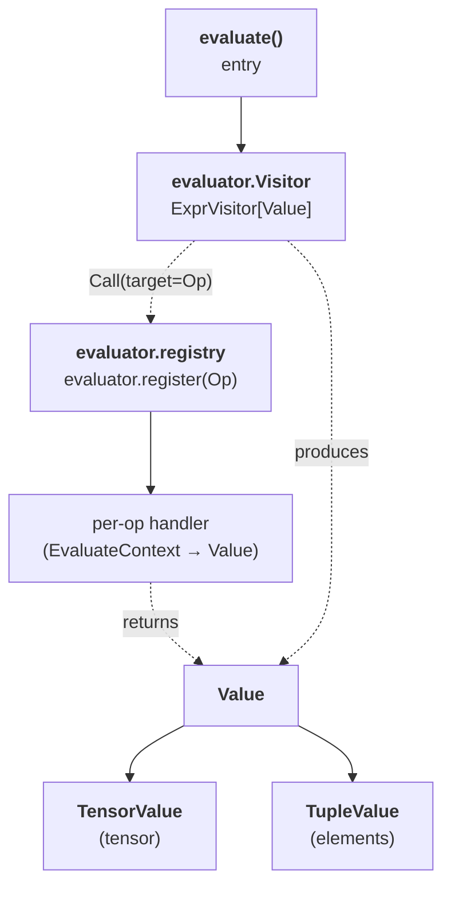

# TileFoundry Spec — evaluator (HIR reference interpreter)

The evaluator executes a HIR `Function`'s SSA-DAG on torch tensors
and returns concrete values. It is a codegen-independent reference
oracle for parser output, type inference, and op value semantics; it
does not lower to TIR or invoke codegen / runtime.



```python
def evaluate(
    target: "core.Function | core.Module | core.LoadedModule",
    *inputs: "torch.Tensor",
    context: "EvaluateContext | None" = None,
) -> "torch.Tensor | tuple[torch.Tensor, ...]":
    ...
```

`evaluate` walks the selected `Function`'s body and returns the logical tensor
for a single output or a tuple for a `TupleType` result; an output in a local
view is returned as its `ShardTensor`. Parameter binding, the `LoadedModule`
entry and the device rule are in [§2](#2-parameters-and-inputs).

## 1. `Value`

A single-output node produces a `TensorValue`; a multi-output node (a
`Tuple`, a `TupleType` `Call`, or a multi-carry `LoopRegion`) produces a
`TupleValue`.

```python
class Value:
    """Provide the base of every evaluated value."""
```

- constraints: none; abstract base.

### `TensorValue`

```python
class TensorValue(Value):
    """Hold one ShardTensor; its type is the tensor's.

    Attributes:
        tensor: attribute; The value, in a global or a local view.
        type: property; ``tensor.type``.
        data: property; The global view's tensor.
    """

    tensor: ShardTensor
```

- constraints:
  - `tensor` is a `ShardTensor` ([runtime §1.10](./runtime.md#110-shardtensor)).
    In a global view it holds the value in its **logical shape** -- the shape
    of `type` ([types §2](./types.md#2-tensortype)), not a layout-domain shape --
    and a `Partial` value as its reduced value, which every consumer type
    inference admits commutes with. In a local view it holds one piece per
    `Placement` ([§6](#6-layout-domain)).
  - `data` MUST raise `EvalError` for a local view: it has no single tensor.
  - A scalar value is a rank-0 `data` with a rank-0 `TensorType`.

### `TupleValue`

```python
class TupleValue(Value):
    """Aggregate evaluated values.

    Attributes:
        elements: attribute; Values in field order.
    """

    elements: tuple[Value, ...]
```

- constraints:
  - `tuple_get_item` projects one element by static index.
  - `type` is the `TupleType` of the element types, so a tuple argument is
    checked at a Function boundary like any other.

## 2. Parameters and inputs

`evaluate` binds each entry-`Function` parameter `Var` to the
corresponding positional input:

- An input MUST be a `ShardTensor` whose type is compatible with the
  parameter's, or convertible to a torch tensor; a torch input is the global
  view, cast to the parameter `TensorType`'s dtype.
- A `Function` weight is an ordinary parameter, bound like an activation.
- Each `DimVar` ([types §4](./types.md#4-dim--symbolic-shape-dimensions)) appearing in a parameter's
  `TensorType.shape` is bound from the corresponding axis of the input
  tensor's concrete shape. A later occurrence of the same `DimVar` MUST
  agree with the first binding.

- constraints:
  - The keyword-only `context` supplies the Module a `Function` entry's calls
    resolve from; a body that calls no function needs none. A `Module` entry
    sets `context.module` to itself; a `LoadedModule` entry sets it to its
    `module` and `context.loaded_module` to itself.
  - A `Function` or `Module` entry requires one input per declared parameter,
    `ConstTensor` ones included, even when `context` carries a reading. A
    `LoadedModule` entry runs its declared `entry`, takes
    activation inputs only, and reads each `ConstTensor` from that reading by
    name at first use; a loaded module without an `entry` is refused as having
    no default step. Another function or child is selected on the
    `LoadedModule` before evaluation; orchestration methods are host Python and
    are not evaluator targets.
  - The run happens where the inputs already are. Inputs on more than one device
    MUST be refused, naming which input is where. For a loaded reading, a weight
    on another device MUST be refused at its first use, naming the weight; a
    weight whose dtype or shape differs from its declaration is refused too.
    Evaluation moves no tensor, selects no tensor engine, and never picks a
    device the caller did not express; a run whose inputs carry no tensor
    leaves the device to torch's own default.

## 3. The evaluator registry and the eval context

Each op's value semantics are a handler registered against the op
class. The registry is `evaluator.registry`, a `Registry` of
[visitor-registry §3](./visitor-registry.md#3-registry) owned by
`tilefoundry.interfaces.evaluator`, which also exports its registration
function `evaluator.register`.

```python
evaluator.registry: Registry[type[Op], Callable]
def register(cls: type[Op]) -> Callable[[Callable], Callable]: ...
```

- constraints:
  - One registry answers for HIR Ops and for the TIR Ops a `tf.schedule`
    selects. For an HIR Op the handler answers how to execute it. For a TIR Op
    the handler answers which SSA value `tf.schedule` produces when it selects
    that instruction class; it is distinct from the in-place effects of
    executing the TIR instruction itself. The `ScheduleOp` evaluator performs
    this second dispatch and refuses an instruction with no handler.
  - Every `tf` Op has an entry
    ([visitor-registry §3.1](./visitor-registry.md#31-registry-instances)).

A handler receives an `EvaluateContext` and returns a `Value`:

```python
class EvaluateContext:
    """Carry one recursive evaluation and registered evaluator invocation.

    Attributes:
        op: attribute; Operation instance.
        args: attribute; Evaluated operands in Call-argument order.
        result_type: attribute; Call result type.
        module: attribute; Module that declares the running function and
            resolves the references it calls.
        loaded_module: attribute; Runtime module reading, when one is active.
        device: attribute; Where the inputs are, or None to leave it to torch.
        dim_bindings: attribute; concrete values for symbolic ShapeDims.
    """

    op: Any = None
    args: tuple[Any, ...] = ()
    result_type: Any = None
    module: Any | None = None
    loaded_module: Any | None = None
    device: str | None = None
    dim_bindings: Mapping[str, int] = field(default_factory=dict)

    def for_op(self, op: Any, args: tuple[Any, ...], result_type: Any) -> EvaluateContext: ...

def handler(ctx: EvaluateContext) -> Value:
    """Evaluate one registered Op invocation."""
    ...
```

Dtype promotion follows torch's own rules; a handler MUST NOT depend on type
inference having run. Every failed `Op` dispatch, including a missing handler
(the message names the op class) and an exception from the handler, MUST
surface as `EvalError` prefixed by `describe_value(call)`. When parser
provenance is available, that prefix identifies the authored physical source
location, binding, and op. Function-call, `LoopRegion`, and `Var` failures
retain their own contracts.

## 4. Node evaluation

Evaluation is an `ExprVisitor[Value]`
([visitor-mutator §1](./visitor-mutator.md#1-role)) memoized on `id(expr)` with
one memo per execution scope, so a shared sub-DAG
([hir §1.1](./hir.md#11-function)) is evaluated once per scope:

```python
# tilefoundry.interfaces.evaluator
class Visitor(ExprVisitor):
    """Evaluate expressions with identity-based memoization."""

    def visit(self, expr: Expr, ctx: EvaluateContext) -> Value: ...
    def visit_LoopRegion(self, region: LoopRegion, ctx: EvaluateContext) -> Value: ...
```

- A `Var` resolves to its binding in the current environment, and an unbound
  `Var` raises `EvalError`; a `Constant` ([core-ir §2](./core-ir.md#2-expr)) materialises to a torch
  tensor of its `TensorType` (a scalar becomes a rank-0 tensor).
- [`Empty`](./hir.md#empty) materializes deterministic zeros of its declared
  shape and dtype for reference evaluation.
- A `Call` whose `target` is an `Op` evaluates its operands, then
  dispatches through `evaluator.registry`
  ([§3](#3-the-evaluator-registry-and-the-eval-context)).
- `EvaluateContext` carries evaluated operands and concrete `dim_bindings` for
  call-invariant `ShapeDim` attributes. Expr-valued runtime data MUST be a Call
  operand; handlers MUST NOT re-enter the evaluator through an attribute.
- `Slice` consumes its evaluated `starts` tuple and resolves `sizes/strides`
  through `dim_bindings`. A window exceeding a runtime axis MUST raise
  `EvalError` rather than return a value whose data disagrees with its full-window type.
- A dim-arithmetic `Call` reached as an operand — a `Slice` start moved off a
  loop's induction variable is one — folds the values its operands evaluated to.
  It performs the arithmetic `resolve_dim` performs in a shape position; only the
  leaves differ, being operands rather than `DimVar` sizes.
- A `Call` whose `target` is a `FunctionRef` resolves the called definition
  from the context's `module` by `core.resolve`; a failure, a missing `module`
  included, raises `EvalError`. A non-empty path requires an active
  `LoadedModule` and enters the reached child's reading, which supplies an
  instance entry call's `ConstTensor` parameters; the reading never selects the
  definition. An empty path keeps the current Module and reading. The call binds the
  evaluated arguments to the callee's parameters in a fresh environment
  and evaluates the callee `body` — the same value semantics a call site
  has under type inference. A callee with variants evaluates the one variant
  whose range matches the runtime shapes; zero or several matches raise
  `EvalError`. Each evaluated argument's HIR type MUST be compatible with its
  parameter annotation under the Function-boundary rules in HIR; an
  incompatible value raises `EvalError` before the callee body is evaluated.
- A `MeshRegion` evaluates its boundary `args` in the enclosing scope, then its
  body in a fresh environment that binds only its `params`.
- An out-of-range run-time instance index raises `EvalError`.

## 5. `LoopRegion`

A `LoopRegion` ([hir §1.2](./hir.md#12-loopregion)) is a loop over its iteration
domain with an isolated entry block of `params` and `args`.

`evaluator.Visitor.visit_LoopRegion(region)` implements the loop. All `args`
are evaluated once in the enclosing scope. `start`, `extent` and `step` resolve
against the current `dim_bindings`; a negative `start` or `extent`, or a
non-positive `step`, raises `EvalError`, and iterations run over
`range(start, extent, step)`. With `k = len(yield_values)`:

- The first iteration binds `params[:k]` to `args[:k]`; later iterations bind
  them to the previous iteration's `yield_values`.
- Every iteration binds invariant `params[k:]` to the saved `args[k:]` values
  and `induction_var` to the current index (a rank-0 tensor). Its memo contains
  only these entry bindings; body Calls execute in that iteration.
- The result is the final carried value or a `TupleValue` of multiple carries.
- A no-carry loop (`k == 0`) yields the final `body` value and may capture
  values; with an empty iteration domain it raises `EvalError`.

## 6. Layout domain

A value is held in a global view -- one global logical tensor, a `Partial`
one as its reduced value -- unless it differs per placement. Values differ
per placement only downstream of `MeshCoord` or of `Local` on a cut input, and
are then held in a local view, one piece per `Placement`. Which view a value is
in is read off how it is held, never off its data:

```python
# src/tilefoundry/interfaces/evaluator/utils.py
def common_placements(*tensors: ShardTensor) -> tuple[Placement, ...]: ...
```

- Each Op's handler handles both views: with every input in a global view it
  computes once; otherwise it computes once per placement that
  `common_placements` names, on each input's `to_local` piece, and holds the
  results in a local view. A handler with no tensor input answers a global
  view.
- `common_placements` answers the placements the local views among its
  arguments hold in common, empty when every one is global; local views held
  by different placements MUST raise `EvalError`.
- a global `Partial` input meeting a local view MUST be refused: its reduced
  value no longer holds the parts each placement would combine
  ([runtime §1.10](./runtime.md#110-shardtensor)).
- a handler that reads a size on a piece MUST read it from the piece or from
  `local_type` of a type, never from an attribute stating a global shape. A
  mean over a split axis holds, on each placement, its sum over the global
  count, read from the input's global type.

- An axis-bearing op (`Reduce`, `rms_norm`, …) addresses its `axis` /
  `axes` in the operand's **logical** `TensorType.shape`, regardless of
  `type.layout`. A computation that must group a logical axis differently
  (e.g. per-head normalisation) is expressed by a logical `Reshape`
  ([hir §1.3](./hir.md#13-op)) *before* the op. `Reshard` never changes which
  values an op reduces or indexes.
- `Reshard` ([hir §1.3](./hir.md#13-op)) only retypes a global view. A local
  view is assembled by `to_global` by the meaning of its type -- `Split` pieces
  side by side, any `Broadcast` piece, `Partial` pieces combined by their
  reduction -- unless neither type has a `ShardLayout`, when each placement
  keeps its own value.
- `Local` ([hir §1.3](./hir.md#13-op)) answers a local view over
  `Placement.from_mesh` of its mesh, and keeps an input every placement holds whole
  in its global view. On a global `Partial` input it MUST be refused.
