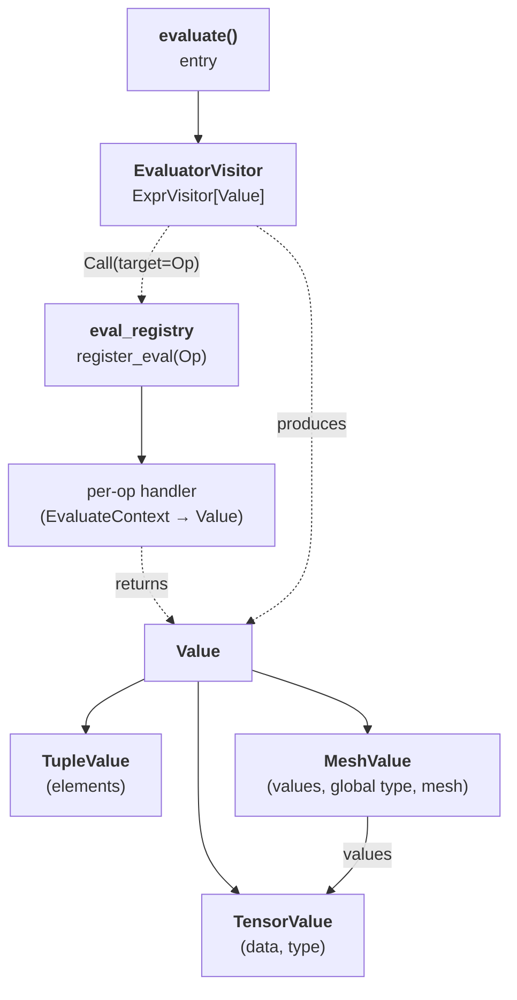

# TileFoundry Spec — evaluator (HIR reference interpreter)

The evaluator executes a HIR `Function`'s SSA-DAG on torch tensors
and returns concrete values. It is a codegen-independent reference
oracle for parser output, type inference, and op value semantics; it
does not lower to TIR or invoke codegen / runtime.



```python
def evaluate(
    target: "Function | LoadedModule",
    *inputs: "torch.Tensor",
) -> "torch.Tensor | tuple[torch.Tensor, ...]":
    ...
```

`evaluate` binds `inputs` to the selected `Function`'s parameters in
order, walks the body, and returns the logical tensor for a single
output or a tuple for a `TupleType` result. When passed a `LoadedModule`,
it binds only activation inputs; declared constants are loaded lazily from
that reading at first use. A loaded module runs its declared `entry`; callers
select another function or child on the `LoadedModule` before calling
`evaluate`.
The evaluator selects nothing on the caller's behalf: no tensor engine, and no
device. It computes where its inputs already are, so what torch supports is what
it supports. A run whose inputs carry no tensor leaves the device to torch's own
default.

## 1. `Value`

An evaluated tensor is a `TensorValue`, or a `MeshValue` when its data varies
across participants. A multi-output node (`Tuple`, a `TupleType` `Call`, or a
multi-carry `LoopRegion`) produces a `TupleValue` containing those values.

```python
class Value:
    """Provide the base of every evaluated value."""
```

- constraints: none — abstract base; concrete values are `TensorValue`, `TupleValue` and `MeshValue`.

### `TensorValue`

```python
class TensorValue(Value):
    """Pair a logical tensor value with its HIR type.

    Attributes:
        data: attribute; Logical tensor value.
        type: attribute; HIR tensor type, including layout.
    """

    data: torch.Tensor
    type: TensorType
```

- constraints:
  - `data` holds the value in its **logical shape** — the shape of
    `type` ([types §2](./types.md#2-tensortype)), not a layout-domain shape.
  - `type.layout`, when a `ShardLayout` or `Layout`, drives the
    layout-domain projection of [§6](#6-layout-domain).
  - A scalar value is a rank-0 `data` with a rank-0 `TensorType`.

### `TupleValue`

```python
class TupleValue(Value):
    """Aggregate evaluated values.

    Attributes:
        elements: attribute; Values in field order.
    """

    elements: tuple[Value, ...]
```

- constraints:
  - `elements` are the per-field `Value`s; `tuple_get_item` projects one
    by static index.

### `MeshValue`

```python
class MeshValue(Value):
    """Pair participant-local tensors with their global HIR type and mesh.

    Attributes:
        values: attribute; Local tensors in logical mesh-coordinate order.
        type: attribute; Global HIR tensor type, including distribution.
        mesh: attribute; Active participant mesh.
    """

    values: tuple[TensorValue, ...]
    type: TensorType
    mesh: Mesh
```

- constraints:
  - `values` MUST contain one `TensorValue` for each logical coordinate, in
    lexicographic order over the flattened mesh shape. Each member carries
    its local tensor shape; `type` retains the global shape and distribution.
  - Ownership and output reconstruction follow [§6](#6-layout-domain).

## 2. Parameters and inputs

`evaluate` binds each entry-`Function` parameter `Var` to the
corresponding positional input:

- An input MUST be convertible to a torch tensor; it is cast to the
  parameter `TensorType`'s dtype.
- Weights and activations are bound identically — a weight is an
  ordinary `Function` parameter, not a distinct constant carrier.
- Each `DimVar` ([types §3](./types.md#3-dtype)) appearing in a parameter's
  `TensorType.shape` is bound from the corresponding axis of the input
  tensor's concrete shape. A later occurrence of the same `DimVar` MUST
  agree with the first binding.

- constraints:
  - A `Function` or `Call` entry takes no resource context and requires one
    input per declared parameter. A `LoadedModule` entry takes activation inputs
    only and supplies each `ConstTensor` lazily by name. A loaded module MUST
    have an `entry`; otherwise the evaluator refuses the call as having no
    default step. Another function or child is selected as a `LoadedModule`
    value before evaluation; orchestration methods are host Python and are not
    evaluator targets.
  - the run happens where the inputs already are. Inputs on more than one device
    MUST be refused, naming which input is where. For a loaded reading, a weight
    somewhere other than the inputs MUST be refused at its first use, naming the
    weight. Evaluation moves neither kind of tensor implicitly, and it never
    picks a device the caller did not express.

## 3. `register_eval` and the eval context

Each op's value semantics are a handler registered against the op
class. The registry is local to the evaluator (it reuses the
`DispatchRegistry` container of
[visitor-registry §3](./visitor-registry.md#3-dispatchregistry) but is not one of
that spec's module-level instances).

```python
eval_registry: DispatchRegistry[type[Op]]

def register_eval(op_cls: type[Op]):
    """Return the evaluator registration decorator for an Op class."""
    ...
```

Instruction-backed HIR scheduling uses a parallel registry:

```python
schedule_eval_registry: DispatchRegistry[type[Op]]

def register_schedule_eval(op_cls: type[Op]): ...
```

`eval_registry` answers how to execute an HIR `Op`. The schedule registry
instead answers which SSA value `tf.schedule` produces when it selects a TIR
instruction class. Those are distinct from the in-place effects of executing
the TIR instruction itself, so TIR schedule-value handlers MUST NOT be
registered in `eval_registry`. The `ScheduleOp` evaluator performs the second
dispatch and refuses an instruction with no schedule-value handler.

A handler receives an `EvaluateContext` and returns a `Value`:

```python
class EvaluateContext:
    """Carry one recursive evaluation and registered evaluator invocation.

    Attributes:
        op: attribute; Operation instance.
        args: attribute; Evaluated operands in Call-argument order.
        result_type: attribute; Call result type.
        loaded_module: attribute; Runtime module reading, when one is active.
        device: attribute; Where the inputs are, or None to leave it to torch.
        dim_bindings: attribute; concrete values for symbolic ShapeDims.
        mesh: attribute; Active static participant mesh, when present.
        coordinates: attribute; One op invocation's logical mesh coordinates.
    """

    op: Any = None
    args: tuple[Any, ...] = ()
    result_type: Any = None
    loaded_module: Any | None = None
    device: str | None = None
    dim_bindings: Mapping[str, int] = field(default_factory=dict)
    mesh: Any = None
    coordinates: tuple[int, ...] | None = None

    def for_op(self, op: Any, args: tuple[Any, ...], result_type: Any) -> EvaluateContext: ...

def handler(ctx: EvaluateContext) -> Value:
    """Evaluate one registered Op invocation."""
    ...
```

A `Call` whose op class has no registered handler raises an error that
names the op class. Dtype promotion follows torch's own
rules; a handler MUST NOT depend on type inference having run.

Every failed `Op` dispatch, including a missing handler and an exception from
the handler, MUST surface as `EvalError` prefixed by `describe_expr(call)`.
When parser provenance is available, that prefix identifies the authored
physical source location, binding, and op. Function-call, `LoopRegion`,
and `Var` failures retain their own contracts.

## 4. Node evaluation

Evaluation is an `ExprVisitor[Value]`
([visitor-mutator §1](./visitor-mutator.md#1-role)) memoized on `id(expr)`, so
a shared sub-DAG ([hir §1.1](./hir.md#11-function)) is evaluated once:

```python
class EvaluatorVisitor(ExprVisitor):
    """Evaluate expressions with identity-based memoization."""

    def visit(self, expr: Expr, ctx: EvaluateContext) -> Value: ...
    def visit_LoopRegion(self, region: LoopRegion, ctx: EvaluateContext) -> Value: ...
```

- A `Var` resolves to its binding in the current environment; a
  `Constant` ([core-ir §2](./core-ir.md#2-expr)) materialises to a torch
  tensor of its `TensorType` (a scalar becomes a rank-0 tensor).
- [`Empty`](./hir.md#empty) materializes deterministic zeros of its declared
  shape and dtype for reference evaluation.
- A `Call` whose `target` is an `Op` evaluates its operands, then
  dispatches through `eval_registry`
  ([§3](#3-register_eval-and-the-eval-context)).
- `EvaluateContext` carries evaluated operands and concrete `dim_bindings` for
  call-invariant `ShapeDim` attributes. Expr-valued runtime data MUST be a Call
  operand; handlers MUST NOT re-enter the evaluator through an attribute.
- `Slice` consumes its evaluated `starts` tuple and resolves `sizes/strides`
  through `dim_bindings`. A window exceeding a runtime axis MUST raise
  `EvalError` rather than return a value whose data disagrees with its full-window type.
- A dim-arithmetic `Call` reached as an operand — a `Slice` start moved off a
  loop's induction variable is one — folds the values its operands evaluated to.
  It performs the arithmetic `resolve_dim` performs in a shape position; only the
  leaves differ, being operands rather than `DimVar` sizes.
- A `Call` whose `target` is a `Function` ([hir §1.1](./hir.md#11-function)) binds the
  evaluated arguments to the callee's parameters in a fresh environment
  and evaluates the callee `body` — the same value semantics a call site
  has under type inference.
  Each evaluated argument's HIR type MUST be compatible with its parameter
  annotation under the Function-boundary rules in HIR; an incompatible value
  raises `EvalError` before the callee body is evaluated.

## 5. `LoopRegion`

A `LoopRegion` ([hir §1.2](./hir.md#12-loopregion)) is a loop over its iteration
domain with an isolated entry block of `params` and `args`.

`EvaluatorVisitor.visit_LoopRegion(region)` implements the loop. All `args`
are evaluated once in the enclosing scope. With `k = len(yield_values)`:

- The first iteration binds `params[:k]` to `args[:k]`; later iterations bind
  them to the previous iteration's `yield_values`.
- Every iteration binds invariant `params[k:]` to the saved `args[k:]` values
  and `induction_var` to the current index (a rank-0 tensor). Its memo contains
  only these entry bindings; body Calls execute in that iteration.
- The result is the final carried value or a `TupleValue` of multiple carries.
- A no-carry loop (`k == 0`) yields the final `body` value; it may capture values.

## 6. Layout domain

Evaluation infers participation from `MeshRegion` and operand `ShardLayout`
values. A static, single-level GPU mesh executes its logical participants on
the caller's existing torch device. Ownership uses the coordinate projection
in [semantic-analysis §3.1](./semantic-analysis.md#31-logical-shape-to-layout-domain).

- constraints:
  - GPU participant execution MUST require positive static mesh extents,
    concrete tensor shapes and evenly divided shards. Symbolic GPU tensor
    shapes MUST be specialized before local projection. `Dynamic` distribution
    and transitions between different participant meshes MUST be refused.
  - CTA/warp/thread reference evaluation MUST retain its global logical view.
    An active GPU participant value MUST NOT cross into a different mesh,
    including a hierarchical GPU-to-CTA mesh. `Local` on a `Split` axis MUST
    require GPU participant execution.
  - Matching topology and physical arrangement identify the same participants;
    mesh-axis names are labels. Ownership selection MUST use logical mesh
    coordinates, including when physical ranks are permuted.
  - Each participant-local operation MUST receive local tensor shapes and data.
    Calls and loop iterations MUST retain the active mesh and fresh memo scopes.
    Invariant values remain canonical until an operation needs their local
    pieces; replicated symbolic inputs need no projection merely to enter a mesh.
  - `MeshCoord` MUST read the invocation's logical coordinate. `Local` MUST
    expose an already-local value without slicing it again. Participant-local
    `Reshape` MUST use the inferred local result shape.
  - Canonical inputs MUST NOT supply unresolved `Partial` contributions.
    Ordinary participant-local operations MUST reject unresolved `Partial`
    operands and require explicit resolution through `Reshard`.
  - Output reconstruction MUST assemble the declared global tensor from its
    `Split` pieces, require agreement of `Broadcast`/plain replicas, and reject
    unresolved `Partial` results. Reconstruction is observation and MUST NOT
    count as communication performed by the HIR program.
  - `Reshard` MUST support unchanged ownership, `Broadcast`-to-`Split`,
    `Split`-to-`Broadcast`, and `Partial(sum)`-to-`Split`/`Broadcast` using actual
    local values. Unchanged mesh coordinates define separate subgroups. Within
    each group, `Split` pieces reconstruct indices, replicated contributions
    agree, and each distinct `Partial` coordinate contributes once to the sum.
    Unsupported transitions, including general `Split`-to-`Split` and creation
    of `Partial` from a replica, MUST raise `EvalError`.
  - A no-op redistribution MUST retain local data; a changed distribution
    MUST materialize destination values. These are logical value semantics;
    collective algorithms and transport timing are not part of evaluation.
  - Loop bounds MUST be uniform, statically resolvable values.
  - When `Reduce` reduces a `Split` axis, evaluation MUST reconstruct the
    logical input and perform the complete reduction, including global mean
    normalization. Reduction over unsplit axes remains participant-local.
    MatMul's split contraction instead leaves `Partial(sum)` for explicit
    resolution, according to [hir §1.3](./hir.md#13-op).
  - An axis-bearing op (`Reduce`, `rms_norm`, ...) MUST address logical tensor
    axes, regardless of the layout domain. A logical `Reshape`
    ([hir §1.3](./hir.md#13-op)) expresses different grouping before the op.
    `Reshard` changes distribution/layout; a local op indexes or reduces the
    logical axes of its participant's piece.
  - `as_layout_view(value: TensorValue) -> torch.Tensor` reshapes logical data
    to the element organization of `type.layout.shape` (the inner layout shape
    for a `ShardLayout`) in default-contiguous order. `from_layout_view(data,
    type)` is its inverse. These helpers serve layout-domain operations; the
    current op handlers operate on logical tensor axes.
