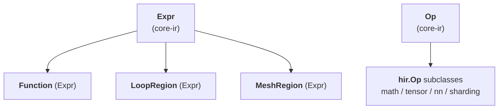

# TileFoundry Spec — hir (`@func` pure SSA dataflow IR)

HIR is the pure SSA-as-DAG dataflow IR. This spec defines the `Function`
container, the structured-SSA exceptions `LoopRegion` and `MeshRegion`, and the
HIR Op subdirectories (math / tensor / nn / sharding). It also defines their
HIR-specific typing rules. The parser authors the mesh scope
([parser](./parser.md)). Shard defines `Mesh` / `Topology`
([shard §5](./shard.md#5-mesh)).



## 1. HIR Expr constructs

HIR values are `Expr` nodes ([core-ir §2](./core-ir.md#2-expr)): a `Function`
container, the loop-phi-shaped `LoopRegion`, the execution-region `MeshRegion`,
and value `Op` calls. HIR is pure **SSA-as-DAG**: there are no `Region` / `Block`
abstractions and no Stmt sequence.

### 1.1 `Function`

```python
class Function(Expr):
    """HIR's function container; its value type is the function signature.

    Attributes:
        name: attribute; the function name; call sites resolve it by `core.resolve`.
        params: attribute; each Var carries a type annotation.
        body: attribute; a single Expr — typically a Call DAG; None for a dispatch prototype.
        return_type: attribute; concrete TensorType for single output, TupleType for multi.
        return_annotation: attribute; authored return declaration, or None.
        specializations: attribute; Dispatch patterns carried by a variant.
        variants: attribute; Shape-specialized implementations carried by a prototype.
        converters: attribute; Weight names paired with offline converter functions.
    """

    name: str
    params: tuple[Var, ...]
    body: Expr | None
    return_type: Type
    return_annotation: Type | None = None
    specializations: tuple[pattern.Pattern, ...] = field(default_factory=tuple)
    variants: tuple["Function", ...] = field(default_factory=tuple)
    converters: tuple[tuple[str, "Function"], ...] = field(default_factory=tuple)
```
- constraints:
  - an `Expr` subclass whose value type is the function signature; always returns
    by value (explicit output params are TIR-only). Typing and shape-dispatch
    rules are stated below.
  - mutable during the compiler's authorised typing, metadata, and specialization updates;
    fields that are not updated retain structural equality and hashing semantics.
  - value-range metadata is refreshed by a non-type-writing whole-function
    inference walk. Parser construction MAY attach an already-proved range to a leaf
    whose value lexical geometry fixes. `MeshCoord` uses its concrete mesh
    axis extent for this purpose.
  - a `Function` MUST NOT declare or override execution context. The `Module`
    that owns it declares the `Target` and the ordered `Topology` hierarchy its
    body runs against ([core-ir §1](./core-ir.md#1-module)).

**Kernel invocation.** Entering an HIR `Function` from Python begins one kernel
invocation. A `Call` from one HIR `Function` to another is a device call inside
the current kernel invocation. It never begins another invocation, whichever
`Module` owns the callee. A `Module` is a static container. An invocation is
a dynamic event. Python entering one root twice is two invocations. A Python
loop entering it N times is N invocations. Module ownership, topology equality,
call-graph depth, source nesting, and call-site repeat count take no part in
this rule. A repeated site, and a site a loop varies, repeat device work inside
the invocation that holds them.

| Caller | Callee | Meaning |
|---|---|---|
| Python | HIR `Function`, directly or through a `Module` entry | Begin one kernel invocation |
| HIR `Function` | HIR `Function` | Same-kernel device call |
| Python | Plain Python `Module` method | Ordinary host orchestration |
| HIR `Function` | Plain Python method | Invalid |

A plain Python `Module` method stays on the host. Each HIR `Function` it enters
therefore begins its own invocation; the method itself is not interpreted,
traced, or dummy-run as HIR.

`Function.body` is a **single Expr** (usually a Call DAG, possibly nested inside
a `LoopRegion`); name reuse lives in the parser's lexical environment, not the
IR. The one exception is a **dispatch prototype**, whose body is `None` (written
`pass` in the DSL; see **Shape dispatch and specializations** below). Crossing
into TIR materialises the HIR return value into a TIR explicit output buffer
parameter ([tir](./tir.md)).

The return type MAY carry a `Partial(reduction)` in a `TensorType`, or in any
tensor field of a nested `TupleType`. Function construction, type inference,
and call elaboration MUST allow that state. A Function boundary MUST preserve
the `ShardLayout` mesh and per mesh axis reduction. It MUST NOT complete the value
merely because it is `Partial`. It MUST NOT reject the value for that reason. A layout-unconstrained parameter can bind to a sharded argument.
Then inference carries each `Partial(reduction)` at its original mesh-axis
index through the body. Inference also carries it into the concrete return
type, including tuple fields. Only an explicit `Reshard` or
allreduce completes that state.

A `with Mesh(("cta",), layout=...) as cta:` inside the body names a topology of
the execution domain the owning `Module` declares. The name MUST resolve to
one of that Module's effective `Topology` entries. The scope creates a
parser-lexical mesh binding. `ShardLayout.mesh` MUST point at an active
binding on the lexical path. A `Mesh` MAY map fewer topologies than the domain
declares. It MUST NOT create a topology. It MUST NOT change the extent of a
topology.

**Return type.** `Function.return_type` is the HIR result `Type`: a
`TensorType` for one result or a `TupleType` for multiple results. It is part of
the function signature and is the result component projected into
`Function.type`. `Function.return_annotation` retains the authored declaration,
including an omitted tensor layout. Binding a standalone declaration constructs
the concrete return type once; calls read that type without filling defaults.

**Value type.** `Function.type` is the IR-level `CallableType`
([types §7](./types.md#7-callabletype)) projected from `params` +
`return_type`. The projection is fixed at construction and stays
consistent across construction sites.

**Call typing — visitor-scoped inference.** Type inference infers the result type of a `Call` to a `FunctionRef`
([core-ir §2.1](./core-ir.md#21-call)). It seeds a new
visitor memo with the actual argument types bound to the callee's formal
parameters. Then it walks the callee body in a child context that retains the
call site's mesh. A callee without a mesh declaration runs in that scope.
A `MeshRegion` in its body composes with it using the usual nested-region rules.
Call typing is type inference only. It does not rebuild a `Function`, mutate the
target, or create a per-call instance. Inference reads the callee body under the
callee's effective Target. It writes none of its nodes. Only a walk that owns
the caller's body stores the result on the caller's `Call`.
A caller-supplied layout (sharding) flowing into a layout-unconstrained
parameter propagates through the body, including through a `Tuple` or
`LoopRegion` return.

Within one inference traversal, repeated calls MUST reuse the
previously inferred result type. Two calls repeat each other when they use the
same `Function` object, equal argument types, and equal call-site mesh scopes.
The cache key uses callee identity, the argument-type tuple, call-site mesh,
and current Module. The key includes the Module's effective target and
topologies. The cached value is only a `Type`. It is never a derived `Function`
or a replacement `Call.target`.

Argument types bind to supplied parameters in order ([core-ir §2.1](./core-ir.md#21-call)). For an omitted
ConstTensor parameter, its declared type seeds the callee visitor memo; its
value comes from the instance's resource
([runtime §1.3](./runtime.md#13-runtimedecoratorpy)).

Caller and callee MUST resolve one effective `Target` and one effective topology
hierarchy. A same-kernel call is one execution context, whichever `Module` owns
each end. Inheritance is the canonical spelling, and a callee declaring the
caller's hierarchy explicitly is accepted only when the resolved tuples are
equal. A mismatch is invalid; it is not a nested launch.

Argument ↔ parameter binding is:

- Arity MUST match — exactly one argument per supplied parameter.
- A declared field that is not `None` MUST equal the corresponding argument
  field. A declared `None` leaves only that field undecided and binds it from
  the argument. This rule applies recursively:
  - `TensorType.shape` and `dtype` always match exactly. `storage` matches
    exactly unless the parameter states `UMAT`, whose residency is undecided.
    `layout=None` leaves layout undecided; a stated layout recurses below.
  - For `Layout`, stated `shape` and `strides` fields match independently. For
    `ShardLayout`, stated `mesh`, `attrs`, and nested `layout` fields match
    independently, and the nested layout follows this same rule.
- Any type not covered by that recursive structure requires exact equality.
- After a successful match, inference binds the parameter to the argument's
  full type. Fields the declaration constrained have already been proved equal;
  fields it left undecided retain the argument's concrete values.
- `DimVar` shapes keep envelope matching. Inference does not
  monomorphize a dynamic shape into a concrete one. **Shape
  dispatch and specializations** below covers that, and call typing does not
  affect it.

When the body cannot express a propagated sharding, typeinfer fails at that
op, not at the boundary. An example is a reshape
whose layout factorization straddles a new axis. Inference does not walk a
dispatch-prototype callee (`variants != ()`, `body is None`). The call's
result is the declared `return_type`. Inference never inspects the `None` body.
**Shape dispatch and specializations** below covers variant selection.

Call typing does not record provenance or bound dimensions because no
call-site function instance is created. Explicit specialization is the
separate operation that produces a derived `Function`. Such a derived
function records its origin and chosen dimensions as the
**Function specialization API** below specifies.

A wholly omitted tensor layout remains `None` in a parameter or return
annotation and imposes no layout constraint. A stated layout or shard attr is
concrete when constructed. It MUST match exactly. Unwritten strides use the
default constructor with the enclosing storage and target.

**SSA shape.** Sharing of intermediate results is expressed by Python object
identity:

- *Single use*: nest the Calls.
  `Call(Binary(kind=MUL), (Call(Binary(kind=ADD), (a, b)), c))` does
  not name the inner `Binary` result.
- *Multiple uses*: the parser binds `c = tf.add(a, b)` in its lexical
  env so subsequent `mul(c, c)` / `sub(c, d)` share the same Call
  node. The IR has no binding nodes; DAG edges express "same value".

The only structured exceptions to the pure Call DAG are `LoopRegion`
([§1.2](#12-loopregion)) and `MeshRegion` ([§1.2.1](#121-meshregion)).

**Function typing rules.** `Function` is not an `Op` and is not registered in
the Op typeinfer registry. `TypeInferVisitor` handles it directly as a
`Call.target`; structural signature rules are enforced by the HIR verifier:

- `Function.body` is a single Expr; Stmts MUST NOT appear.
- `Function.params` entries MUST be `Var`s.
- Within a `Function` signature, every occurrence of a same-name
  `DimVar` across `params` and `return_type` MUST agree on its
  `(lo, hi)` bounds. A disagreement is a verify error. A
  `pattern.Range` specialization MUST anchor to a `DimVar` reachable
  from an input parameter. It MUST lie within that `DimVar`'s envelope
  (see **Shape dispatch and specializations** below).

**Shape dispatch and specializations.**
`Function` is the sole HIR function `Expr`. Shape-dispatch is carried on a
single **base** `Function` through its `variants` field; there is no
separate specialized-function type. The field is the IR-side carrier for
the parser surface ([parser.md](./parser.md)).

The `specializations`, `variants`, and `converters` tuples are canonical
`Function` fields. `converters` records `(weight_name, converter)` pairs in
registration order and is sealed recursively with the base and its variants.

*Structure.* A `Function` is exactly one of three shapes:

- **normal** — `specializations == ()`, `variants == ()`, `body` is an
  `Expr`. An ordinary function.
- **dispatch prototype (base)** — `specializations == ()`,
  `variants != ()`, `body is None`. Declares the signature and dispatch
  envelope only; the implementations live in its variants.
- **variant** — `specializations != ()`, `variants == ()`, `body` is an
  `Expr`. A shape-specialized implementation registered on a base.

Nesting is exactly one level: a variant MUST NOT itself carry variants.
In a sealed (verified) `Module` the invariant is `body is None` ⟺
`variants != ()`. A function with no body and no variants is uncallable
and invalid. A real body combined with variants is invalid. During
authoring the base is transiently `body is None, variants == ()` between
`@func def f: pass` and the first `@f.specialize(...)`. This unsealed
state is allowed only until the base enters a `Module` (see **Authoring
freeze** below).

- `variants` is a canonical IR field — it participates in structural
  equality, hashing, and canonical printing.
- Parser-time Function roles use the following naming and handle contract:

  | role | purpose | lookup handle | `_` allowed | binding uniqueness | parser ledger classification |
  |---|---|---|---|---|---|
  | **kernel / prototype** | Module execution unit | `fn.name` | no | unique within the Module class body | `ModuleBuildContext.bindings[binding] = FunctionRole.ROOT`; `id(fn)` is not in `ModuleBuildContext.owned` |
  | **variant** | Implementation for a dim range | `f"{base}${dim}${lo}_{hi}"` | no | unique within the base | `ModuleBuildContext.bindings[binding] = FunctionRole.VARIANT`; `id(fn)` is in `ModuleBuildContext.owned` |
  | **converter** | Offline weight conversion | `f"{base}.converter[{weight}]"` | yes | reusable | `ModuleBuildContext.bindings[binding] = FunctionRole.CONVERTER`; `id(fn)` is in `ModuleBuildContext.owned` |

  The parser enforces this table during decoration. A parser-authored variant
  MUST carry a non-underscore display label. A `Function` built directly
  in IR MAY omit the non-canonical label. The label MUST NOT participate in
  structural equality, hashing, or the canonical signature. Nothing MAY
  select an implementation by it. A printer emitting an unlabeled IR variant
  MUST choose a valid source binding so the emitted definition remains
  importable.
- Every variant of a base MUST share the base's `name`, `params`, and
  parameter annotations and `return_annotation`. A variant specializes the body,
  not the authored signature. A variant
  runs in the same execution domain as its base because both are owned by the
  same `Module`.
- `.specialize(pattern)` takes no mesh: a variant opens the meshes its body
  needs with `with`, naming the meshes its Module's class body declares. Variant
  and base parameter and return types MUST still match. Authored layout forms and their acceptance rules are owned
  by [shard §6](./shard.md#6-shardattr) and [parser §2](./parser.md#2-syntax-and-rules).
- A variant carries exactly one `pattern.Range` in `specializations`.
  The canonical signature is
  `";".join(f"{p.dim_var}${p.lo}_{p.hi}" for p in specializations)`
  (v0 allows only `pattern.Range`). Two variants of one base MUST have
  distinct canonical signatures.

*Envelope coverage.* A dispatched function's parameter
`TensorType.shape` carries a `DimVar(name, lo, hi)` whose `(lo, hi)` is
the dispatch envelope; `pattern.Range` references that `DimVar` by name.
The variants' closed ranges MUST **partition** the envelope. They MUST be
pairwise **disjoint** and jointly **complete**. Their union is exactly the
DimVar's closed `[lo, hi]` envelope. Adjacent closed ranges are written
`[.., c - 1]` then `[c, ..]`. Every in-envelope shape
therefore selects exactly one variant.

*Prototype body.* A base's `body is None`: the prototype is never
typeinferred, lowered, or evaluated as a body. Only its variants carry
executable bodies.

*Dispatch resolution.* A `Call` whose target is a dispatch prototype
(`variants != ()`) is a dispatch call. Dispatch selects the variant whose `pattern.Range`
matches. That variant is the call's result. Evaluation selects from the
call's concrete argument shapes; specialization selects from the caller's
stated dimension bindings. Both use the same variant table. A shape outside
the envelope matches no variant and is an error. A `Call` whose target has
`variants == ()` is a direct call to that body.

*Authoring freeze.* Variants accumulate during authoring, before the
base `Function` enters a `Module` ([core-ir §1](./core-ir.md#1-module)). A
sealed base rejects further variants. Because `variants` participates in
hashing, a base MUST NOT be hashed while still accumulating variants. A
top-level `Module.functions` entry MUST NOT be a variant: a top-level
`Function` with `specializations != ()` is a verifier error.

### 1.2 `LoopRegion`

```python
class LoopRegion(Expr):
    """Loop-phi-shaped structured SSA folding a tile-style loop into one Expr value.

    Attributes:
        induction_var: attribute; loop induction Var, ranging over range(start, extent, step).
        params: attribute; entry bindings, carry slots followed by invariant captures.
        args: attribute; matching values evaluated in the enclosing scope.
        body: attribute; the loop body Expr.
        yield_values: attribute; loop-phi carry chain (equal lengths).
        extent: attribute; iteration-domain stop (half-open).
        step: attribute; induction-var stride.
        start: attribute; iteration-domain start (default 0).
    """

    induction_var: Var
    params: tuple[Var, ...]
    args: tuple[Expr, ...]
    body: Expr
    yield_values: tuple[Expr, ...]
    extent: ShapeDim
    step: ShapeDim
    start: ShapeDim = 0
```
- constraints:
  - loop-phi-shaped structured SSA that folds a tile-style loop into one `Expr`
    value; `type` is `TensorType` (single carry), `TupleType` (multi-carry), or
    the body's type (no carry).
  - mutable during the compiler's authorised typing and metadata updates.

**Iteration domain.** Both DSL loop surfaces, `for i in tf.tile(...)` and
`for i in range(...)`, lower to this one node. They share the domain
`(start, extent, step)`. They differ only in the loop-variable binding. `tile`
binds a parser-side Python `slice`, and `range` binds a scalar (see
[parser §2.1](./parser.md#21-syntax)). `range` is not unrolled. `induction_var` ranges
over `range(start, extent, step)`: `start` and `extent` are the **half-open**
`[start, extent)` Python-range endpoints (so `extent` is the **stop** value,
not a count). `start` defaults to `0` for `tf.tile(stop, step)` and `range(stop)`;
the `tf.tile(start, stop, step)` and `range(start, stop[, step])` surfaces set it.
Each of `start` / `extent` / `step` is a `ShapeDim`
([types §4](./types.md#4-dim--symbolic-shape-dimensions)).

For `tf.tile(stop, step)` or `tf.tile(start, stop, step)`, the parser-side window at
one iteration is `[induction_var, induction_var + step)`. The induction value
is already a coordinate in `range(start, stop, step)`, not an ordinal to
multiply by `step`.

- When `start` / `extent` / `step` are static `int`, the trip count is
  recoverable from the node alone, without the parser-side window binding
  ([parser §2.1](./parser.md#21-syntax)).
- Every `DimVar` referenced by a `ShapeDim` `start` / `extent` / `step` MUST
  be bound by the enclosing Function's parameter shapes. Resolution
  substitutes each such `DimVar` with the corresponding argument-shape
  size and folds the dim `Expr` to a value `n`. The resolved `start` and
  `extent` MUST be non-negative integers. The resolved `step` MUST be a
  positive integer. Otherwise resolution MUST raise. An unbound
  `DimVar` MUST raise.
- The evaluator resolves a `ShapeDim` `start` / `extent` / `step` at
  call time against concrete argument shapes. The trip count is not
  statically recoverable from the node alone.

**Carry-out semantics.** The parser populates the carry chain when an HIR
grid-loop body contains an `ast.Assign` whose single
`Name` target binds an outer-scope name:

- the carried name becomes a phi `Var` in `params`,
- the pre-loop binding of that name becomes the matching entry in
  `args` (the carry's value on the first iteration),
- inside the loop body the same name resolves to that phi `Var`,
- after the loop, the post-region binding refers to the
  `LoopRegion` itself (single carry) or a `tuple_get_item` of it
  (multi-carry, when `len(yield_values) > 1`).

`args` are value Exprs traversed and rewritten by the visitor / mutator;
`params` and `induction_var` are binding sites. `len(params) == len(args)`
and `k = len(yield_values) <= len(params)`. The first `k` slots carry loop state:
first-iteration values come from `args[:k]`, and later values come from the
matching yield. Remaining slots are invariant captures evaluated once outside
the loop. A no-carry loop has `k == 0` and may still have captured parameters.

A LoopRegion MUST be isolated like a MeshRegion. Its body and yields MUST read
outside values through entry parameters. They MUST NOT embed an `args` value.
The parser captures each external expression binding across every region
boundary; an external Call therefore belongs to its enclosing structural scope.
Each structured region exposes its invariant bindings through `captures()`.
`MeshRegion.captures()` pairs every parameter with its argument;
`LoopRegion.captures()` skips the carry slots and pairs only the remaining
parameters and arguments. Analysis stores those pairs on its iteration-scope
tree, so capture resolution does not need to inspect the region kind.

Type inference derives every argument outside the loop. It binds each
parameter to its argument's type. A region parameter has no type of its own.
A type stored on it by an earlier inference does not constrain the entry
value. Inference seeds the inner visitor with the induction binding and all parameter
bindings, then derives the body and yields. Every yield MUST satisfy
`types_compatible(entry_type, yield_type)` for the parameter it carries into,
and `k > len(params)` is an error. A carried value whose state changes between
Broadcast and Varying is rejected with its mesh axis and an explicit entry-to-Varying
or yield-to-Broadcast Reshard remedy. The carry result is the entry type of the
first `k` parameters. A more specific yield does not narrow it. A loop that
runs no iteration has that type. A no-carry loop (`k == 0`) has the type of its
body. There is no fixed-point iteration.

The loop value is the Expr itself, not a `Call`. Parser-side rules: see
[parser §3](./parser.md#3-implementation-overview).

### 1.2.1 `MeshRegion`

```python
class MeshRegion(Expr):
    """Represent the execution domain of one structured HIR region."""

    mesh: Mesh
    params: tuple[Var, ...]
    args: tuple[Expr, ...]
    body: Expr
```

- constraints:
  - `mesh` is the mesh opened by this region. Visitors compose it with the
    enclosing execution mesh at the body edge; the `args` edge is evaluated
    outside the region.
  - `params` and `args` have equal length. The body may reference each captured
    value only through its corresponding parameter; an argument is never read
    directly from the body. This is the same binding boundary as `Function`.
    Each parameter takes its argument's current type, as for `LoopRegion`
    ([§1.2](#12-loopregion)).
  - The region result is reachable through the values that escape its lexical
    body. A single escaping value is the region's `body`; multiple escaping
    values are carried by a `Tuple` and read through `TupleGetItem` projections.
  - `MeshRegion` is type-transparent: `MeshRegion.type == MeshRegion.body.type`.
    Its execution domain never changes the result's `ShardLayout`.
  - A body with no value is permitted only when a value escapes through a later binding. A body with no value and no escaping value is a parse error.

**Minimal example** — loop-carried accumulator:

```python
# example
acc = tf.zeros((M,), "f32", storage="rmem")
for i in tf.tile(K, BLOCK):
    acc = acc + load_tile(x, i)
# After the loop, `acc` resolves to the LoopRegion value.
```

becomes (sketched):

```python
# example
LoopRegion(
    induction_var = i,
    params        = (acc_phi, x_param),
    args          = (Call(Zeros(...), ()), x),   # pre-loop values
    body          = Call(Binary(kind=ADD), (acc_phi, load_tile(x_param, i))),
    yield_values  = (Call(Binary(kind=ADD), ...),),
    extent        = K,
    step          = BLOCK,
)
```

### 1.3 Op

HIR Ops are organised under `tilefoundry.ir.hir.<namespace>/`; the
subdirectory is file organisation, not a separate IR layer. A **custom Op** records its full contract in its catalog entry below. The contract has fields, typing / verifier rules, and worked examples. A **consensus Op** needs only one sentence or a
grouped external reference, per [SPEC-RULES](../SPEC-RULES.md). The op name is
the pointer — code carries no back-link to this catalog. `ParamDef` plumbing
stays in code; the mechanism is owned by [core-ir §2.3](./core-ir.md#23-op).

**HIR-specific typing hooks.** Each op's constraints are enforced by its
registered `typeinfer.register(<OpClass>)` body via `ctx.error(...)`
([visitor-registry §4](./visitor-registry.md#4-instance-1--typeinfer)):

- `Local(x)`: `x.type.layout` MUST be `ShardLayout`. The result
  shape contracts per the `Split` axes; dtype is preserved; layout
  becomes the corresponding local layout.
- `Reshard(x, layout, storage)`: `layout` and `storage` are attributes
  (compile-time constants); the output preserves `x.type.shape` (logical).
  Architecture invariant: after HIR typeinfer runs, every `ShardLayout`
  reachable from a value's type has concrete `layout.strides` (never `None`). The owning typeinfer MUST materialize the un-materialized (`strides=None`) parser sugar. The per-op `(layout, storage)` resolution table is in the
  `Reshard` op entry below.
- Any HIR Op MUST be value-form ([core-ir §2.3](./core-ir.md#23-op));
  emitting an effect-form Call into HIR is a verify error.
- Each result layout MUST describe that result. A view derives its layout from its source when one is stated. An op producing a distinct value derives a layout over its own result shape. An op MUST NOT copy an input layout across
  a shape change.

Generic, analysis-wide typing behavior is owned by
[semantic-analysis](./semantic-analysis.md): relation-driven type validity
([semantic-analysis §1.1](./semantic-analysis.md#11-relation-derived-type-behavior)), output
storage of multi-input ops, and operand layout / mesh ownership
([semantic-analysis §3.3](./semantic-analysis.md#33-output-storage-and-meshlayout-compatibility)).
HIR ops call these services. Each op's registered typeinfer owns the layout / mesh compatibility and result layout it requires. `Reshard` is the explicit
op that changes a value's layout / mesh.

#### `ir/hir/math/`

Pointwise arithmetic and comparison, torch semantics with TileFoundry
type-promotion. User-callable names (`add` / `cmp_eq` / `logical_and` / …) are
surface aliases ([core-ir §2.3](./core-ir.md#23-op)) over the kinded Ops; there are no
per-name IR classes.
[torch element-wise ops](https://pytorch.org/docs/stable/torch.html#pointwise-ops).

An arithmetic or comparison operand pair SHOULD be written with the Python
operator (`a + b`, `a * b`, `a < b`). A sub-tensor SHOULD be written as a
subscript (`x[:, :, j:j + 1]`, `x[:, :, 3]`). The named forms `tf.add(a, b)` and `slice(x, begin=…, end=…, strides=…)` stay available where a name must be computed. The operator and subscript resolve to them. Both spellings build the
same IR.

##### Binary
```python
class Binary(Op):
    """Kind-tagged pointwise binary operation; produces a Tensor.

    Attributes:
        lhs: input; input tensor.
        rhs: input; input tensor.
        kind: attribute; binary arithmetic, comparison, or boolean tag.
    """

    lhs: Tensor
    rhs: Tensor
    kind: BinaryKind
```
- constraints:
  - Both operands MUST use symmetric right-aligned broadcasting. Missing axes and size-1 axes read the broadcast operand at zero, including rank-0 scalars.
    The result shape MUST be the broadcast of both operand shapes.
  - Values follow torch pointwise semantics; dtypes do not promote. Both operands
    MUST already carry the same `dtype`, and typeinfer MUST reject a mismatch. A
    Python literal is an ordinary operand of the dtype it is written with: `f32` for a float, `i64` for an integer. The authoring surface MUST NOT adapt
    it to its peer. The rejection MUST name `Cast` as the remedy, so the dtype a
    value carries is the one the author wrote.
  - The elementwise `min` / `max` kinds are also surfaced as `minimum` / `maximum`.
  - Equal plain layouts, or one plain layout paired with `layout=None`, pass
    through only when that layout describes the broadcast result. Otherwise two
    non-sharded operands produce `layout=None`; broadcasting differently shaped
    views does not make either operand's layout describe the result. This
    fallback MUST NOT accept an incompatible `ShardLayout` pair.
  - Sharded results merge value states using
    [shard §6.1](./shard.md#61-shard-attr-semantics), including plain inputs.
    All-Broadcast inputs give a Broadcast result, which is plain when its mesh
    covers every unit.
  - If the fallback result is a shaped `rmem` or `smem` value, Binary MUST give it its own C-order `Layout`. A concrete local
    result cannot reach authored analysis with an unresolved layout.
  - A `ShardLayout` operand carrying `Partial(reduction)` propagates to the
    output only when `kind` provably commutes with `reduction`
    (`op(reduction(x)) == reduction(op(x))`). Otherwise typeinfer rejects it. The rejection names the offending operand and the fix (an explicit `Reshard` to
    `Broadcast`).
    States follow [shard §6.1](./shard.md#61-shard-attr-semantics). A Varying
    peer is rejected with an explicit `bitcast(..., <its layout>)` remedy.
    Typeinfer decides each mesh axis independently. `Partial` states on different axes are not interchangeable. `ADD` rejects two Partial inputs
    when their states occupy different mesh axes.
    - `ADD` with both operands `Partial`: commutes (passes) only when both
      carry the same `reduction="sum"` on that mesh axis (`max`/`min` reject
      — `max(x)+max(y)` is not `max(x+y)`).
    - `ADD` with one `Partial` operand and the other `Broadcast` on that mesh axis
      commutes (passes) for `reduction` in `{"max", "min"}`. Adding a replicated
      constant preserves order. It rejects for `"sum"`
      (`sum(x)+b != sum(x+b)`).
    - `MUL` with one `Partial` operand and the other `Broadcast` on that mesh axis commutes (passes) only for `reduction="sum"`. Scaling by a replicated constant distributes over `sum`. It rejects for `"max"`/`"min"`. The constant's sign is not statically provable, and a negative scale flips `max` to `min`.
    - Every other `kind` / operand-shape combination involving a `Partial`
      operand (including `MUL` with both operands `Partial`) rejects: not
      proven to commute with any `reduction`.

##### Unary
```python
class Unary(Op):
    """Kind-tagged pointwise unary operation; produces a Tensor.

    Attributes:
        x: input; input tensor.
        kind: attribute; unary tag including neg, abs, logical_not, rsqrt,
            exp, log, ceil, round, exp2, and log2.
    """

    x: Tensor
    kind: UnaryKind
```
- constraints:
  - Behavior follows torch pointwise semantics with TileFoundry type promotion.
  - `exp` is the natural exponential `e ** x`; `log` is the natural logarithm;
    `exp2` / `log2` are the base-2 counterparts. `ceil` rounds toward
    positive infinity; `round` rounds to the nearest integer with ties to
    even (banker's rounding, matching torch's own `round` semantics).
  - A `ShardLayout` operand carrying `Partial(reduction)` propagates to the
    output only when `kind` provably commutes with `reduction`. Otherwise
    typeinfer rejects it. The rejection names the offending operand and the fix (an explicit
    `Reshard` to `Broadcast`). `exp` / `log` / `relu` / `ceil` / `round` /
    `exp2` / `log2` are monotone non-decreasing, so they commute with `max` /
    `min` but not `sum`. `neg` is linear, so it commutes with `sum` but not
    `max` / `min` (negation reverses order). `abs` / `square` / `rsqrt` /
    `logical_not` are not proven to commute with any `reduction` and reject a
    `Partial` operand unconditionally.

##### Clamp

```python
class Clamp(Op):
    """Clamp every element to a closed interval; produces a Tensor.

    Attributes:
        x: input; Source tensor.
        min_val: attribute; Lower bound.
        max_val: attribute; Upper bound.
    """

    x: Tensor
    min_val: float
    max_val: float
```

- constraints:
  - The result MUST preserve `x`'s shape, dtype, layout, and storage.
  - Clamp is monotone non-decreasing, so it MAY preserve a `Partial(max)` or
    `Partial(min)` state and MUST reject `Partial(sum)`.

##### Softplus

```python
class Softplus(Op):
    """Apply pointwise softplus; produces a Tensor.

    Attributes:
        x: input; Source tensor.
    """

    x: Tensor
```

- constraints:
  - The result MUST preserve `x`'s type.
  - Softplus is monotone non-decreasing, so it MAY preserve a `Partial(max)`
    or `Partial(min)` state and MUST reject `Partial(sum)`.

#### `ir/hir/tensor/`

Tensor structural operations; consensus ops (`Transpose` / `Slice` / `Concat`
/ `Stack` / `ShapeOf` / `Rank`) follow torch / numpy
([torch tensor manipulation ops](https://pytorch.org/docs/stable/torch.html#indexing-slicing-joining-mutating-ops)).

`Transpose`, statically positioned `Slice`, and `Reshape` derive their result
layout during type inference. Their result `TensorType.layout` MUST NOT be
`None`. A `Layout` whose `strides` are `None` states that the layout
is known while its steps are not. A missing input layout is the compact
layout that HIR readers assign to that value. This requirement applies to
these structural ops, not to every tensor-producing HIR op.

Pattern matching and lowering MUST read this result type rather than derive a
second presentation of the result.

- `Transpose` produces a new value, not a storage alias. It MUST permute the
  tensor shape and use a fresh compact C-order result layout. A `ShardLayout`
  MUST remap its split modes through the registered relation with fresh
  strides. Lowering MUST copy the source's permuted-stride view into the new
  result storage.
- `Bitcast(x, layout)` form (ii) keeps the address layout, offset included, and
  the mesh, in any storage; per mesh axis Varying may become Broadcast (or a
  plain result) or Partial: the author states the copies are equal, or sum to the
  value, unchecked. Broadcast (a plain source too) may become Varying. It aliases, costs 0, lowers to a view, keeps every value,
  and its gradient reads the cotangent back with the source's attrs.
- Form (i), any other `Bitcast(x, layout)`, has no autodiff rule. It reinterprets the same bytes with a new shape and layout,
  preserving the input dtype and storage. `layout` is a `LayoutBase`; the result
  shape for a plain layout is the product of the nested sizes in each top-level
  layout mode. For an rmem `ShardLayout`, the result preserves `x.shape` and
  changes only its layout. Its layout modes and `Split` modes MUST be valid
  for that logical shape under the existing layout-mode-to-tensor-axis rules.
  Both layouts MUST be plain `Layout` / `ComposedLayout` without `ShardLayout`
  components, or a source `ShardLayout` with neither `Split` nor `Partial`, in any
  storage, whose stated end states the same attrs and mesh: each unit's copy is
  re-laid out alone as a plain layout. A plain stated end of a Varying source is
  rejected, naming the mesh axis to state Varying. Otherwise both layouts MUST be rmem
  `ShardLayout` on the same mesh.
  That `ShardLayout` MUST contain only `Split` and `Varying` attributes ([shard §6.1](./shard.md#61-shard-attr-semantics)). Bitcast type inference MUST materialize omitted authored strides, using the same default and storage-owner rules as Reshard and TensorView. Every resulting `Layout` component has concrete strides.
  For rmem shards, an address is the owning mesh coordinate paired with the
  offset within that unit. Varying mesh axes do not enter that unit coordinate:
  each unit proves the bijection within its own copy, as for a plain layout.
  Both ends MUST have Varying on the same mesh axes; Varying against Split is
  rejected. The two address sets MUST be equal, so every element stays in its
  original unit and register. `Broadcast` and `Partial` shards
  MUST be rejected. Rmem shards MUST have an underlying `Layout` with stated,
  non-nested strides; composed underlying layouts MUST be rejected. Ownership
  MUST use `local_layout_and_offset` on the layout's factored domain. Both shapes
  MUST be literal and have the same element count. Both address functions MUST be injective. Every result address MUST belong to the source address set. The check MUST use the complete colex address functions, including composed swizzles.
  Type inference MUST reject violations and identify the failing end and rule.
  Broadcast or overlapping layouts MUST NOT be bitcast. The result-to-source
  coordinate relation MUST pair equal addresses, forming a bijection. Bitcast
  MUST alias the source buffer, incur zero traffic, lower to a tensor view,
  and have no instruction candidate. Evaluation MUST reorder values by these
  same address functions. For a row-major `(N, K)` tensor, a bitcast with
  `Layout((K, N), (1, K))` expresses the same bytes as `(K, N)` for `Q @ K^T`.
- `Slice` is normalized as `Slice(x, starts, sizes=..., strides=...)`.
  `starts` is a tuple of rank-0 integer operands; `sizes` and `strides` are
  `ShapeDim` attributes stored in the same IR normal form as every other dim.
  Its result shape is exactly the normalized `sizes` and MUST NOT contain an
  induction `Var`. A start MAY be dim arithmetic over an induction `Var`. Such a start is a window moved off that loop's window by a compile-time offset. That start is an address computed where it is read. It is not a value that an op produces. A walk over compute ops MUST leave it alone.
- A `Slice` of a plain `Layout` or `ShardLayout` MUST return the window layout
  without introducing a `ComposedLayout` offset. Analysis and lowering derive
  the address from the start operands, including through nested slices. If the
  source already has a `ComposedLayout`, the result preserves it and updates its
  offset; a swizzle acts on the address including that offset. The window retains
  the source strides, multiplied by any slice step.
- A whole logical axis MUST keep its authored mode tree. A cut axis MUST use
  `composition` with a tiler built from that axis's own modes, retaining authored
  unit modes. Inner modes MUST divide; the outermost mode takes the remaining
  count, which MUST fit its extent. A Split leaf MUST take either one element or
  its full extent. Retained Splits MUST be remapped to the surviving modes.
- An axis with multiple modes or a Split needs a digit proof. Type inference MUST prove that every source mode digit advances by the window digit times its step. The advance MUST NOT carry across a mode boundary or Split block. This proof uses the Slice
  access relation and the shared enclosing loop domain; physical strides do
  not enter the check. An unprovable window MUST fail with the Slice alignment
  diagnostic. Single-mode axes without Splits need no digit proof and support
  non-unit steps and runtime starts.
- A start outside the affine subset MUST remain a parameter bounded by the
  window's reach inside the source. Such a start is valid on a single-mode axis
  without Splits; a multi-mode or Split axis still requires the digit proof.
  Runtime starts move the address without adding an offset to the result type
  of a plain or sharded source.
- `ComposedLayout(inner=None, outer=ShardLayout(...))` is a sharded view.
  Relation-driven consumers, local projection, execution-domain discovery, and
  Partial checks MUST read distribution from its outer layout. Its offset is
  input addressing and MUST NOT be copied to a consumer's newly produced value. Another view MAY compose and preserve that offset.
- Runtime starts MUST remain ordinary Call operands. They move the view's base
  address, not its strides. A plain input therefore still produces a result `Layout`. That layout does not carry the runtime offset. A safe
  sharded slice follows the preservation rule above. The result type describes
  a full window; whether a loop iteration can contain that window is an
  analysis-domain question, not a type-inference question.

##### Concat

`Concat([inputs...], axis=a)` materializes a rank-preserving tensor by joining
each input segment along `a`. All inputs MUST have one common rank and dtype,
and every non-concatenated dimension MUST match. Negative `axis` values resolve
against that rank. The output's concatenated extent is the sum of the input
extents. Every input access map is defined only on its segment. It subtracts the preceding segments' extent from that axis. The output map is the identity.

The authored `inputs` value MUST be one explicit list, tuple, or supported
static list comprehension. Its Tensor elements flatten into `Call.args` in
source order; direct positional tensors and implicit iterable expansion are not
part of this surface.

Type inference derives fresh output ownership from those access maps. A
`Split` on a non-concatenated axis MAY propagate when shared ownership
propagation proves a zero-offset projection. A `Split` on the concatenated axis
MUST be rejected, including when it appears only on the zero-offset first input. The diagnostic MUST require an explicit `Reshard` before `Concat`.
Incompatible meshes and nonuniform `Partial` states MUST
likewise fail with the `Reshard` remedy. Compatible propagated ownership receives
concrete default strides; the input's physical layout need not be reused.
An output with no real sharding receives a fresh C-order `Layout`.

##### Rank and ShapeOf

- `Rank` produces a rank-0 `i64`; `ShapeOf` produces a rank-1 `i64` vector with
  one entry per input axis. Both are host shape metadata (`storage=umat`), not
  device-resident tensors.
- Evaluation MUST read the concrete runtime tensor rank and extents. A symbolic
  input `TensorType.shape` is the result bound, not the value returned at
  runtime.
- A compile-time integer subscript, `tf.shape_of(x)[k]`, reads one dimension and
  produces the canonical rank-0 `i64` `umat` scalar for that dimension.
- Neither reads an element of its input, and neither moves bytes.

##### Arange

`Arange(type, start=0, step=1)` produces exactly `type.shape[0]` integer values,
starting at `start` and separated by `step`. `type` MUST be a rank-one
`TensorType` with `i32` or `i64` dtype. `start` MUST be a static or symbolic
`ShapeDim`; `step` MUST be a positive static integer. The complete result type,
including layout and storage, is the supplied `type`. Type inference MUST return
it. It MUST NOT construct another type. Coordinates are synthesized without
standalone traffic; their consumers own any materialization. The op has type,
evaluation, access-relation, and cost semantics but no HIR-to-TIR lowering or
codegen contract.

##### Where

`Where(condition, input, other)` applies right-aligned broadcasting across all
three operands and selects elementwise from the two data branches. `condition`
MUST be `bool`; `input` and `other` MUST have the same dtype. The data branches,
not the condition, anchor result storage and distribution. A genuinely sharded
condition MUST be compatible with the distribution derived from the data
branches; every `Partial` operand is rejected. If the resulting shaped value is
in `rmem` or `smem` and no branch layout describes the broadcast result, it
receives a fresh C-order `Layout`. Cost counts one boolean selection per result
element and complete reads of all three inputs plus one result write. The op has
no HIR-to-TIR lowering or codegen contract.

##### ArgMax

```python
class ArgMax(Op):
    """Produce indices of maximum values along an axis.

    Attributes:
        x: input; Source tensor.
        axis: attribute; Reduction axis.
    """

    x: Tensor
    axis: int = -1
```

- constraints:
  - `x` MUST have rank at least one and `axis` MUST resolve within that rank.
  - The result MUST remove `axis`, use dtype `i64`, preserve storage, and derive
    a layout over the reduced result shape. A `Split` on a surviving logical
    axis propagates through the registered relation.
  - The reduction axis MUST NOT be `Split`-sharded. A winning index cannot be
    recovered from independent per-device winners, so typeinfer requires an
    explicit `Reshard` instead of silently completing that split.
  - `x` MUST NOT carry a `Partial` state because a winning index cannot be
    recovered from an unpaired per-device partial reduction.

##### FullLike

```python
class FullLike(Op):
    """Produce a tensor like an input filled with a scalar constant.

    Attributes:
        x: input; Type and shape template.
        value: attribute; Fill value.
    """

    x: Tensor
    value: float
```

- constraints:
  - The result MUST have exactly `x`'s type and every element MUST equal
    `value` converted to that dtype.
  - `x` is read for its Type only: no element of `x` is read, and every element
    of the result is written.

##### Quant

```python
class Quant(Op):
    """Produce per-token-group quantized values and scales.

    Attributes:
        x: input; Source tensor.
        scheme: attribute; Quantization scheme.
        group: attribute; Last-axis group size.
        target_dtype: attribute; Quantized element dtype.
    """

    x: Tensor
    scheme: str = "per_token_group"
    group: int = 128
    target_dtype: DType = DType.fp8e4m3
```

- constraints:
  - `x` MUST have rank at least one and MUST NOT carry a `Partial` state.
  - `scheme` is exactly `"per_token_group"`; packed block formats are a
    different operation boundary. `group` MUST be a positive, non-boolean
    integer, and `target_dtype` is exactly `fp8e4m3`.
  - For a static last extent, `group` MUST divide that extent. For a symbolic
    extent, the scale extent is the symbolic floor division by `group`, and
    evaluation rejects an indivisible runtime extent before reshaping.
  - The result MUST be `(x_q, x_scale)`. `x_q` preserves `x.shape` with
    `fp8e4m3`. `x_scale` has dtype `f32`. It replaces the last extent by
    `x.shape[-1] // group`. Both fields preserve storage and receive freshly
    derived layouts over their own shapes. Outer-axis splits propagate. A
    last-axis split propagates only when its factorization proves that every
    owner holds complete groups and the scale split is representable.
    Otherwise typeinfer requires an explicit `Reshard`. A fully `Broadcast`
    `ShardLayout` pins no mesh and produces unsharded result layouts.
  - Evaluation computes each group's f32 absolute maximum and scale
    `absmax / 448`, divides, clamps to `[-448, 448]`, then casts to `fp8e4m3`.
    An all-zero group uses scale one and produces no NaN.

##### RepeatInterleave

```python
class RepeatInterleave(Op):
    """Repeat elements along one axis; produces a Tensor.

    Attributes:
        x: input; Source tensor.
        repeats: attribute; Repetitions per source element.
        axis: attribute; Axis to expand.
    """

    x: Tensor
    repeats: int
    axis: int
```

- constraints:
  - `axis` MUST resolve within the rank. The result extent at that axis MUST be
    the input extent multiplied by `repeats`. All other extents and storage are
    preserved.
  - Each unit repeats its own elements, so the result keeps the input's attrs
    (`Split`, `Partial`, `Varying` and `Broadcast`) on the new shape
    ([shard §6.1](./shard.md#61-shard-attr-semantics)). A `Partial` input stays
    the same `Partial`: repetition commutes with every reduction.
  - A `Split` on `axis` MUST hold contiguous blocks; local repetition of a
    cyclic or strided distribution is not the global repetition, so such an
    input MUST be refused with a reshard to contiguous blocks as the remedy.

##### Split

```python
class Split(Op):
    """Split a tensor into equal parts; produces a Tuple.

    Attributes:
        x: input; Source tensor.
        axis: attribute; Split axis.
        num_splits: attribute; Number of outputs.
    """

    x: Tensor
    axis: int
    num_splits: int
```

- constraints:
  - `axis` MUST resolve in `[-rank, rank)`, and `num_splits` MUST be positive.
  - A static selected extent MUST be divisible by `num_splits`. Every output
    field has that extent divided by `num_splits`. Every output field otherwise
    preserves the input type.
  - A symbolic selected extent is retained in each output until a tighter
    symbolic quotient is available.
  - Evaluation materializes `num_splits` equal tensors in axis order. Each
    element carries exactly its corresponding inferred `TupleType` field,
    including that field's storage and shard layout; the tuple aggregate has no
    independent layout or storage.

##### Stack

```python
class Stack(Op):
    """Stack equal-shaped tensors along a new axis; produces a Tensor.

    Attributes:
        inputs: input; variadic tensors to stack.
        axis: attribute; inserted result axis.
    """

    inputs: Tuple[Tensor]
    axis: int
```

- constraints:
  - The authored `inputs` value MUST be one explicit list, tuple, or supported
    static list comprehension. Its Tensor elements flatten into `Call.args`.
  - At least one input is required; every input MUST have the same shape and
    dtype. `axis` MUST resolve in `[-rank-1, rank]`.
  - The operation materializes one distinct result. The inserted axis is local
    and unsharded, and the result layout is freshly derived over the result
    shape rather than copied from any input.
  - Stack states a relation. In it, input `i` accesses the result slice whose
    inserted-axis coordinate is `i`. Every old logical axis projects to the
    corresponding result axis on the other side of the insertion. Shared shard
    propagation derives any representable ownership from that relation.
  - Compatible `Split` ownership carries to the shifted old logical axis. A
    fully replicated input contributes no sharding. Incompatible input meshes
    or per-mesh-axis states MUST fail. A non-uniform `Partial` across result slices
    MUST fail. Each failure MUST name the conflicting input and require an
    explicit `Reshard`. Typeinfer MUST NOT select input zero's layout. Typeinfer
    MUST NOT silently discard real ownership. Compatible ownership receives concrete default result strides
    rather than requiring reuse of an input's physical layout.

##### TupleGetItem

```python
class TupleGetItem(Op):
    """Extract one field from a tuple-typed expression by scalar index.

    Attributes:
        tuple_value: input; Tuple-typed expression.
        index: input; Scalar field index.
    """

    tuple_value: Expr
    index: Expr
```

- constraints:
  - `tuple_value.type` MUST be `TupleType`. A constant `index` MUST be in range,
    and the result type is exactly the selected field type.
  - A dynamic `index` requires a non-empty tuple whose field types are all equal;
    the result has that common field type.
  - Access through a constant index reads the selected field's leaf span. Dynamic
    access conservatively reads every leaf because the selected field is known
    only at runtime.

##### Reshape
```python
class Reshape(Op):
    """Reshape ``x`` to ``new_shape``; produces a Tensor.

    Attributes:
        x: input; source tensor.
        new_shape: attribute; target logical shape.
    """

    x: Tensor
    new_shape: tuple
```
- constraints:
  - The result shape is `new_shape`; `size(new_shape)` MUST equal `size(x.shape)`.
  - Evaluation MUST resolve dimensions from the invocation bindings before
    reshaping. At most one unbound dimension may be inferred by element count.
  - A plain C-order input reshapes to a C-order `Layout` over `new_shape`. An
    input with no assigned layout, or a non-contiguous plain input whose regroup
    cannot be expressed, has a `None` result layout.
  - Removing only unit axes from a plain layout MUST preserve the strides of
    the remaining axes. This includes an input that is a strided tensor window.
  - A bare, fully-`Broadcast` `ShardLayout` input (every attr `Broadcast`, no
    genuine sharding) carries that `ShardLayout` through `Reshape`. This holds
    when the input layout modes can express `new_shape` by the view rules below.
    When they cannot (including while either layout shape is symbolic), the result
    layout is `None`. `Reshape` raises no error, because the reshape discards no
    genuine ownership. This rule does not extend to a `ComposedLayout` whose outer
    layout is a `ShardLayout`. That input follows the generic composed-layout
    rule and may produce a `None` layout.
  - A non-genuinely-sharded `UMAT` input reshaped to `()` remains the early
    scalar case and produces a plain `UMAT` scalar.
  - A genuine `ShardLayout` input has at least one non-`Broadcast` attr. It
    carries through `Reshape` when the reshape is a view over its layout modes
    (`layout.layout.shape`, [shard §7.1.1](./shard.md#711-layoutshape)). The view
    takes one of these two forms:
    - every layout mode lies entirely within one new axis. Non-size-1 new axes are
      the product of a contiguous run of whole layout modes, in either merge
      direction. Size-1 axes insert/drop freely and hold no sharding. A `Split`
      mode reference remaps to its new mode. `Partial` / `Broadcast` carry through
      unchanged (mesh-axis states, no mode); OR
    - a `Split`-bound mode divides across a new-axis boundary at a point its bound
      mesh extent evenly divides. The outer (earlier) sub-factor further factors
      into `(mesh_ext, Split-bound, local extent 1)` and `(sub-factor / mesh_ext,
      plain)`. The inner residual becomes a plain (non-`Split`) mode. Every
      `Split`-bound mode keeps local extent 1 ([shard §7.1.1](./shard.md#711-layoutshape)).
  - Arbitrary rank-N regroup is not yet supported and MUST fail closed. One
    case is a `Split`-bound mode whose device-owned block spans a boundary deeper
    than one divide. The other case is two or more `Split`-bound modes that
    interact across the same regroup.
  - A reshape of a genuine `ShardLayout` not expressible by the above MUST fail
    closed. It MUST NOT fabricate or discard a layout.

##### Cast
```python
class Cast(Op):
    """Convert the element dtype; produces a Tensor.

    Attributes:
        x: input; source tensor.
        dtype: attribute; target element dtype.
    """

    x: Tensor
    dtype: DType
```
- constraints:
  - Identity in shape / storage / layout; only the element dtype changes to
    `dtype`. A `ShardLayout` input keeps its layout (the relation is the identity).
  - `Cast` is the conversion boundary for the low-precision dtypes (`fp8e4m3` /
    `f8e8m0` / `f4e2m1`, see [types §3](./types.md#3-dtype)), accepted as either
    the input or the target dtype.
  - The evaluator supports `{f32, f64, f16, bf16, fp8e4m3, f8e8m0, i8, i16, i32,
    i64, u8, u16, u32, bool}`; a `Cast` involving another dtype (e.g. `f4e2m1`)
    raises an unsupported-dtype error.

##### IndexAdd / IndexCopy / IndexSelect
```python
class IndexAdd(Op):
    """Return dst with src slices accumulated at index along dim."""
    dst: Tensor
    index: Tensor
    src: Tensor
    dim: int = 0

class IndexCopy(Op):
    """Return dst with src slices copied to index along dim."""
    dst: Tensor
    index: Tensor
    src: Tensor
    dim: int = 0

class IndexSelect(Op):
    """Select whole slices from x at index along dim."""
    x: Tensor
    index: Tensor
    dim: int = 0
    fill_value: float | None = None
```

These are pure value forms of torch's whole-slice indexing family
([`torch.index_select`](https://pytorch.org/docs/stable/generated/torch.index_select.html),
[`Tensor.index_add_`](https://pytorch.org/docs/stable/generated/torch.Tensor.index_add_.html),
[`Tensor.index_copy_`](https://pytorch.org/docs/stable/generated/torch.Tensor.index_copy_.html)).
They do not mutate an input. `torch.gather` is the separate elementwise-indexing
operation and is not an HIR op.

- constraints:
  - Every `dim` accepts torch-style negative indexing and MUST be in range for
    the data tensor's rank.
  - `IndexSelect.index` MUST be rank 1 with dtype i32 or i64. Its result has
    `x`'s rank, dtype, and storage; `shape[dim]` becomes `index.shape[0]` and all
    other extents are unchanged.
  - A plain `Layout` input to `IndexSelect` MUST produce a row-major layout
    over the result shape, independent of the source strides.
  - When `IndexSelect.fill_value` is not `None`, an index below zero or at least
    `x.shape[dim]` MUST yield a slice of that value. It MUST NOT read
    the source. With `None`, selection retains torch's bounds behavior.
  - `IndexSelect` produces a natural contiguous internal `Layout` for a
    `ShardLayout` input. `Broadcast` and `Partial` states carry through; a
    `Split` on `dim` becomes `Partial(sum)`, and a `Split` on another dim keeps
    its target. Multiple `Split`s including `dim`, or a composed shard layout,
    MUST fail closed.
  - `IndexSelect` is a pure value operation, not a copy. To stage dim-0
    selections into shared memory, schedule its inputs as
    `tf.schedule((x, tf.empty(Tensor[..., "smem"]), index), op=T.copy_async(fill=f))`.
    The indexed instruction has no TMA candidate. Unscheduled `IndexSelect`
    MUST fail lowering with this scheduling form in the diagnostic. The op does
    not support copying its already computed result with `CopyAsync`.
  - `IndexAdd` and `IndexCopy` require rank-1 `index`, equal `dst`/`src` dtype
    and rank, equal non-`dim` extents, and
    `index.shape[0] == src.shape[dim]`. Their result type is exactly `dst`'s.
  - `IndexAdd.index` accepts i32 or i64. Repeated indices accumulate. Its value
    rule uses torch's default `alpha=1`; scaling `src` is explicit HIR.
  - `IndexCopy.index` accepts i64 only. Repeated indices have undefined output
    because torch's last copy is nondeterministic; consumers MUST NOT rely on an
    order.
  - `IndexAdd` and `IndexCopy` reject a `Partial` on `dst`, `index`, or `src`.
    They reject a `Split` of `index`, and a `Split` of `dst` or `src` on `dim`:
    which rows a unit writes would depend on the index values. A `Split` on
    another axis is accepted when `src` is split on the axes `dst` is: each unit
    holds whole rows of that axis and writes them. `Broadcast` layouts remain
    logical HIR types.
  - `IndexAdd` and `IndexCopy` have type inference, cost, and evaluator
    semantics only. No HIR-to-TIR lowering is registered.
  - The gradient of `IndexAdd` is the cotangent for `dst`, and
    `index_select(cotangent, index, dim)` for `src`; `index` has none.
  - `IndexAdd` charges one add and reads `src`, `index`, and the addressed `dst`
    slices before writing those slices. `IndexCopy` charges no arithmetic and
    does not read the overwritten `dst` slices. Neither cost scales with the
    full `dst` extent.

##### Empty

```python
class Empty(Op):
    """Declare storage without initializing its contents."""
    type: TensorType
    buffers: int = 1
```

- `tf.empty(type, buffers=1)` produces exactly the complete `TensorType`
  supplied by the author. Its contents are undefined; it declares the
  write-only operand of a [schedule](./schedule.md#2-operand-and-result-roles).
- `buffers` MUST be a positive integer. Staging ownership and rotation follow
  [schedule §5](./schedule.md#5-buffers-and-cost).
- Its access relation states the same result boundary as `Zeros`, with no
  inputs. Its cost has no traffic and no arithmetic. Lowering declares storage
  without filling it.

##### Zeros
```python
class Zeros(Op):
    """Allocate a zero-initialised tensor of one complete type.

    Attributes:
        type: attribute; complete output TensorType.
    """

    type: TensorType
```
- constraints:
  - Type inference MUST return `type` without reconstructing any part of it.
  - The result is zero-initialised and its logical shape is exactly `type.shape`.
  - Evaluation MUST resolve every symbolic entry of `type.shape` from the function's
    dimension bindings before allocating the concrete tensor.

Ops whose result type is determined entirely by attributes, including `Zeros`
and `Arange`, MUST accept one complete `TensorType`. Shape, dtype, layout, and
storage MUST NOT be split across independent attributes. Transforming ops
include `Reshard`, `Cast`, and `Transpose`. Their result type is partly
inherited from an input. They MUST carry exactly the portions they change. They
MUST inherit the rest from that input.

##### Reduce
```python
class Reduce(Op):
    """Reduce ``x`` over the selected axes; produces a Tensor.

    Attributes:
        x: input; input tensor.
        axes: attribute; reduced logical axes.
        keepdim: attribute; whether reduced axes remain as size-1 axes.
        kind: attribute; mean, sum, abs_max, or max.
    """

    x: Tensor
    axes: tuple
    keepdim: bool = True
    kind: ReduceKind = ReduceKind.MEAN
```
- constraints:
  - The logical result shape follows numpy reduction rules.
  - A reduction over an axis of no elements MUST return the identity of its
    kind. It MUST NOT fail.
  - For `max` the identity is the least value that the result dtype can hold.
    This is not always `-inf`. An integer dtype cannot hold `-inf`. The least
    value of `bool` is `False`. A finite-only float has no infinity.
  - `abs_max` is 0, because its results are magnitudes. `sum` is 0. `mean` has
    no identity, because nothing is there to divide by. It MUST NOT invent
    one.
  - Storage is preserved.
  - Plain input layout passes through unchanged.
  - For `ShardLayout` input, every split mode that belongs to a
    reduced tensor axis collapses to broadcast with size-1 stride-0 output.
  - Sharded input with non-default strides MUST carry explicit producer
    strides. Typeinfer rejects it otherwise.
  - Lowering emits TIR `Reduce`. Runtime dispatch comes from the operands, not
    from an HIR dispatch field.
  - An `x` mesh axis can carry `Partial(reduction)`. This is a pending
    cross-device reduction, orthogonal to the reduced tensor `axes`. It
    propagates only when `kind` commutes with `reduction`.
  - `SUM` and `MEAN` are linear over the reduced axes. They commute with
    `reduction="sum"` only.
  - `MAX` commutes with `reduction="max"` only. The same associative operator
    applies over the combined tensor-axis and mesh-axis index set.
  - `ABS_MAX` is a nonlinear `abs` composed with `max`. It does not commute
    with any `reduction`.
  - Typeinfer rejects a non-commuting combination. It names the offending
    `reduction` and the fix, an explicit `Reshard` to `Broadcast`.

##### InsertSlice
```python
class InsertSlice(Op):
    """Write ``update`` into a window of ``dst``; produces a Tensor.

    Attributes:
        dst: input; target tensor (value form returns a tensor anchored on this
            buffer at lowering time).
        update: input; tensor written into the window.
        offsets: input; per-axis window starts — a rank-0 integer scalar for a
            rank-1 dst, or a tuple of rank-0 integer scalars (literal or
            runtime), one per axis, for rank N.
    """

    dst: Tensor
    update: Tensor
    offsets: Scalar
```
- constraints:
  - `update` has the same rank and dtype as `dst`. The window on each axis is
    `[offset_axis, offset_axis + update.shape[axis])`.
  - A rank-1 `dst` accepts a bare rank-0 scalar offset. A rank-N `dst` requires
    an offset tuple whose length equals the rank.
  - Typeinfer fails a *literal* (compile-time) offset that places a negative or
    out-of-bounds window on an axis, and names the axis. Eval or runtime checks
    a runtime offset.
  - The value form writes `update` into a slice view of the existing buffer of
    `dst`. A loop-carried `dst` reuses one buffer with no replacement
    allocation.
  - A `ShardLayout` of `dst` can carry a `Partial(reduction)` mesh axis. Then
    `update` MUST carry the identical mesh. It MUST also carry the identical
    per-mesh-axis `ShardAttr` state. Otherwise typeinfer rejects the write.
  - The cute layout of `update` MAY differ, because its tensor shape is the
    smaller write window.
  - One output type cannot represent a write of a differently-sharded (or
    unsharded) `update` into a still-partial `dst` position.
  - When `dst` is complete, an `update` carrying a `Partial` MUST be rejected.
    The write result cannot preserve that secondary value state. An explicit
    `Reshard(update, Broadcast)` completes it.
  - `ComputeCostMetadata` charges no traffic for the untouched `dst`. It charges
    one window-sized `update` read, one read of the scalar or structural tuple
    `offsets`, and one window-sized result write.

##### CacheUpdate
```python
class CacheUpdate(Op):
    """Write a window of ``new`` into ``cache``; produces a same-shape cache.

    Attributes:
        cache: input; cache that receives the write.
        cur_pos: input; i32 scalar where the write begins.
        s: input; i32 scalar number of positions to write.
        new: input; source positions, taken as ``new[:, :s]``.
    """

    cache: Tensor
    cur_pos: Tensor
    s: Tensor
    new: Tensor
```
- constraints:
  - `cache` and `new` MUST be rank-4 `[B, len, kv_heads, head_dim]` tensors
    with the same dtype and equal `B`, `kv_heads`, and `head_dim`. Typeinfer
    rejects a mismatch. When both lengths are static, `new.len` MUST NOT exceed
    `cache.len`.
  - `cur_pos` and `s` MUST be i32 scalar tensors. A scalar is rank-0 or has
    only literal size-1 dimensions. Typeinfer rejects another dtype or shape.
  - The write interval is runtime data, never a shape dimension. The result has
    the static shape of `cache`.
  - `cur_pos >= 0`, `1 <= s <= new.len`, and `cur_pos + s <= cache.len` MUST
    be checked at eval/runtime, not typeinfer, because their operands are
    runtime values.
  - This is a pure value-form op. Lowering MAY realize the output in place on
    the buffer of `cache`.
  - A `cache` can carry `Partial(reduction)` on a mesh axis. Then `new` MUST
    carry the identical mesh and per-mesh-axis state. A complete `cache`
    rejects a `new` that carries `Partial`. Typeinfer rejects either mismatch.
  - The registered boundary relation states the write as a window. The result
    and the two scalar controls are exact identities. The cache and `new`
    boundaries name the operands that place the window.
  - How much each moves does not depend on where it lands: `s` rows are
    written, and the rest of the cache is kept.
  - An `s` that is not written down MUST carry the range that the contract of
    this Op gives it. That range is at least one row and at most the fewer of
    `new.len` and `cache.len`. A written-down `s` outside that range MUST be
    refused.

##### TopK
```python
class TopK(Op):
    """Select the top ``k`` elements on ``axis``; produces ``(values, indices)``.

    Attributes:
        x: input; source tensor.
        k: attribute; elements kept on the selected axis.
        axis: attribute; selected axis.
        largest: attribute; greatest vs smallest selection.
        sorted: attribute; ordered selection.
    """

    x: Tensor
    k: ShapeDim
    axis: int = -1
    largest: bool = True
    sorted: bool = True
```
- constraints:
  - The result is a `(values, indices)` tuple. Both shrink the selected axis to
    length `k`. `values` keep the dtype of `x`. `indices` are `i64`.
  - `k` is a `ShapeDim` ([types §4](./types.md#4-dim--symbolic-shape-dimensions)).
    It is a static `int`, or a dynamic value derived from a `DimVar` (e.g.
    `minimum(512, CTX_LEN // 4)`). A dynamic value becomes the symbolic length
    of the selected axis in the output shape. Any other value fails typeinfer.
  - `k` MUST be non-negative. Typeinfer checks this whenever `k` is static.
  - That value MUST NOT exceed the length of the selected axis. Typeinfer checks this
    whenever the axis length is static and `k` is either static or a symbolic
    value with a known, statically-derivable upper bound. That upper bound is
    `DimVar.hi`, composed through
    `DimMin`/`DimMax`/`DimAdd`/`DimMul`/`DimFloorDiv`/`DimMod`.
  - Typeinfer does not check a symbolic `k` against a symbolic axis length. It
    does not check an upper bound that does not statically compose, e.g.
    through `DimSub`, or a `DimFloorDiv`/`DimMod` with a symbolic divisor.
  - Each `DimVar` of a symbolic `k` MUST be resolvable from the shape of
    `x` at evaluation time. `LoopRegion` `ShapeDim` fields resolve against the
    parameter shapes of the whole Function ([§1.2](#12-loopregion)). This rule
    is narrower.
  - The selected axis MUST NOT be `Split`-sharded by a `ShardLayout`. A split
    selected axis fails typeinfer.
  - A `ShardLayout` output preserves the non-selected sharding and any
    replication. Only the layout extent of the selected axis becomes `k`, so the
    layout keeps size parity with the result shape.
  - `sorted` returns the selected elements ordered by `largest`. Otherwise the
    op returns the same selected set in an unspecified order.
  - `x` MUST NOT carry a `Partial(reduction)` mesh axis. A per-device partial
    value cannot recover a winning index. Typeinfer rejects any `Partial` input
    regardless of `reduction` or `k`.

#### `ir/hir/nn/`

Neural-network value Ops following torch semantics
([torch.nn.functional](https://pytorch.org/docs/stable/nn.functional.html)).

##### MatMul / Conv2D / ReLU / Sigmoid / Tanh / SoftMax / LayerNorm
Consensus torch.nn.functional ops.
- constraints:
  - A `ShardLayout` operand carrying `Partial(reduction)` propagates to the
    output only when the op provably commutes with `reduction`. Otherwise
    typeinfer rejects the operand, names it, and names the fix: an explicit
    `Reshard` to `Broadcast`.
  - `ReLU` / `Sigmoid` / `Tanh` are monotone non-decreasing elementwise, so
    they commute with `max` / `min` but not `sum`.
  - `MatMul` is linear in one value input when the other value-carrying input
    is `Broadcast` / replicated. On each mesh axis, one `Partial(sum)` is
    therefore allowed. A double-Partial input or a non-`sum` reduction is
    rejected.
  - `MatMul.a_layout` is `"MK"` (the default) or `"KM"`. `MatMul.b_layout` is
    `"KN"` (the default) or `"NK"`. These literals state the physical order of
    the final two axes of each operand. The access relation maps them to logical
    `(M, K)` and `(K, N)` before it derives the output, contraction ownership,
    and `Partial(sum)` state. The cost of the op is
    `2 * numel(local_output) * local_K`. The op reconstructs `local_K` from that
    same logical-axis mapping.
  - `MatMul` requires one common operand dtype. `MatMul.out_dtype` names the
    result dtype. It defaults to `None`, which means the operand dtype. A dtype
    name is resolved at construction, so an unknown name fails there.
    `out_dtype` states where the result is rounded, not which dtype hardware
    accumulates in. The flops cost stays keyed by the operand dtype. The
    traffic of the result uses the result dtype.
  - When the result dtype equals the operand dtype and the operand dtype is not
    an 8-bit float, evaluation is `torch.matmul` on the operands. Otherwise
    evaluation is `torch.matmul` on the operands widened to `f32`, then cast
    once to the result dtype.
  - Where no Target is in reach (`ctx.resolve_target()` is `None`), a `MatMul`
    with an operand in `smem` or `rmem` has `umat` result storage. The choice of
    instruction, and so where the result lands, waits until a Target is known.
    A shared child is typed under the visitor's current valuation.Context.
  - `Conv2D` requires rank-4 NCHW input and OIHW weight, a rank-1 bias, and one
    common operand dtype. `stride` and `dilation` are positive length-2 tuples.
    `padding` is a non-negative length-2 tuple. `groups` is positive. Input and
    output channels MUST be divisible by `groups`. The input channel extent of
    the weight MUST equal `input_channels / groups`. The bias extent MUST equal
    the output channels.
  - `Conv2D` states its grouped input / weight / bias / output relation over
    output positions and the input-channel and kernel contraction dimensions.
    Shared shard propagation derives a fresh result layout. Input batch and
    compatible weight/bias output-channel splits survive.
  - A contraction split of the input-channel axis MUST be aligned on input and
    weight at the same mesh axis. A single-sided channel split is not a
    representable local convolution.
  - A contraction split produces `Partial(sum)` only when the bias carries the
    same per-mesh-axis `Partial(sum)` state. Then completing the partial result
    adds the bias exactly once.
  - The relation MUST fail on any translated/halo access, incompatible
    contraction, mesh, or per mesh axis state that it cannot represent. The failure
    MUST name the operand and require an explicit `Reshard`. The relation MUST
    NOT copy an input layout or discard real ownership.
  - `Conv2D` costs `2 * numel(output) * weight.shape[1] * kh * kw` flops after
    topology projection. The cost reconstructs the weight extents on logical
    I/KH/KW axes from any factorized local layout. Traffic has exactly four
    slots: complete reads of input, weight, and bias followed by one complete
    result write.
  - `SoftMax` normalizes across an axis, so no `reduction` provably commutes.
    Typeinfer rejects every `Partial` input.
  - `LayerNorm(axis=a)` normalizes over the complete trailing shape
    `x.shape[a:]`, after resolving `a` in `[-rank, rank)`. Weight and bias shapes
    MUST each equal that suffix exactly rather than merely broadcast to it.
    `x` MUST use `f32`, `f16`, or `bf16`. Weight and bias dtypes MUST agree.
    They MUST either match `x`, or be `f32` when `x` is `f16`/`bf16`. The result
    dtype is the dtype of `x`.
  - `LayerNorm` rejects every `Partial` operand and every `Split` on a logical
    normalized-suffix axis of `x`, weight, or bias. A `Split` on an `x` prefix
    axis remains on the same-shape result.

##### Gelu
```python
class Gelu(Op):
    """Gaussian Error Linear Unit.

    Attributes:
        x: input; tensor the activation applies to elementwise.
        approximate: attribute; ``"tanh"`` selects the tanh-based
            approximation (HF ``gelu_pytorch_tanh`` / Gemma-2 MLP activation).
    """

    x: Tensor
    approximate: str = "tanh"
```
- constraints:
  - Elementwise: the output type, shape, and layout are `x`'s.
  - GELU is **not** monotone, so it commutes with no reduction, unlike
    `ReLU` / `Sigmoid` / `Tanh`. Typeinfer rejects any `Partial` operand with a
    `Reshard` remedy.

##### Silu
```python
class Silu(Op):
    """Sigmoid Linear Unit — ``x * sigmoid(x)`` as one op.

    Attributes:
        x: input; tensor the activation applies to elementwise.
    """

    x: Tensor
```
- constraints:
  - Elementwise: the output type, shape, and layout are `x`'s.
  - Fused rather than decomposed into `Sigmoid` + `Binary(MUL)`. The fused form
    does not round the intermediate `sigmoid(x)` to the dtype of `x`. At reduced
    precision the two differ by up to ~1 ULP per element.
  - SiLU is **not** monotone, so it commutes with no reduction. Typeinfer
    rejects any `Partial` operand with a `Reshard` remedy, as `Gelu` does.

##### RMSNorm
```python
class RMSNorm(Op):
    """Normalize ``x`` by the root-mean-square of its last axis, scaled by ``weight``.

    Attributes:
        x: input; tensor normalized over its last axis.
        weight: input; rank-1 scale, same length as ``x``'s last axis.
        eps: attribute; added to the mean square before the root.
    """

    x: Tensor
    weight: Tensor
    eps: float = 1e-6
```
- constraints:
  - `weight` MUST be rank-1 with the same length as the last axis of `x`. Every
    other `x` axis flows through unchanged, including a dynamic
    (`DimVar` / dim-arithmetic) entry.
  - The normalization reduces the whole last axis at once. Every output element
    depends on the full mean of squares of that axis. So the reduced axis MUST
    stay inside a single op instance. It is never an iteration-domain axis of
    its own. It is only an existential range that both the read and the write
    cover in full.
  - Normalization combines every value on the axis non-monotonically, so no
    mesh-axis reduction provably commutes. Typeinfer rejects any `Partial`
    operand.

##### RoPE
```python
class RoPE(Op):
    """Rotate query and key tensors using position-indexed cos/sin caches."""

    q: Tensor
    k: Tensor
    cos_cache: Tensor
    sin_cache: Tensor
    pos_ids: Tensor
```
- constraints:
  - `q` and `k` MUST have the same rank, at least 1, and the same even
    `head_dim` (last axis). Their other extents MAY differ, so grouped-query
    attention gives `q` more heads than `k`.
  - The rotation is the **rotate-half** form. The last axis splits in two
    halves, and the pair `(x[i], x[i + d/2])` rotates together. This is the
    unqualified HF convention (`apply_rotary_pos_emb` / `rotate_half`). The
    interleaved form (`rotate_every_two`, GPT-J / CodeGen) is a different Op,
    not an attribute of this one.
  - The two halves of each `cos_cache` and `sin_cache` row MUST be equal: the
    pair rotates by one angle. The autodiff rule relies on it; the evaluator
    does not check it.
  - The result is `(q_rope, k_rope)`. Each branch preserves the layout of its
    corresponding `q` or `k` input.
  - On each mesh axis, a branch MAY preserve one `Partial(sum)` on its
    corresponding query or key input. The branch MAY do so only when
    `cos_cache`, `sin_cache`, and `pos_ids` are `Broadcast` / replicated on that
    mesh axis.
  - A non-`sum` Partial, multiple value-carrying Partials, or a Partial on a
    secondary cache/index input MUST be rejected. The rejection MUST give a
    `Reshard` remedy.

#### `ir/hir/sharding/`

`ShardLayout` and `Mesh` are type-system constructs, not Expr inputs
([shard §5](./shard.md#5-mesh)).

##### MeshCoord

`dim.MeshCoord` is defined in `ir/dim/mesh_coord.py`. It is registered in
dialect `tf`, category `sharding`. `ir.hir.sharding` does not export it.

```python
class MeshCoord(Op):
    """Return the current unit's coordinates along the given mesh axes."""

    mesh: Mesh
    axes: Expr
```

- constraints:
  - `axes` is an `i64` scalar, an `i64` vector, or a tuple of `i64` scalars.
    The result is one `i64` coordinate per mesh axis, with no shard layout. The result
    is a scalar for a scalar `axes` and a vector of the same length otherwise.
  - Type inference MUST reject a mesh that the current `MeshRegion` does not
    bind. Type inference MUST reject a literal mesh axis outside the mesh's rank.
  - Evaluation holds one value per unit of `mesh`
    ([evaluator §6](./evaluator.md#6-layout-domain)).

##### Reshard
```python
class Reshard(Op):
    """Convert ``x`` to a target layout / storage; produces a Tensor.

    Attributes:
        x: input; input tensor.
        layout: attribute; optional target LayoutBase (Layout / ComposedLayout / ShardLayout).
        storage: attribute; optional target storage kind.
    """

    x: Tensor
    layout: LayoutBase = None
    storage: StorageKind = None
```
- constraints:
  - Omitting `layout` preserves `x.layout`; omitting `storage` preserves
    `x.storage`. The output preserves the input logical `TensorType.shape`.
  - Memory analysis and lowering MUST treat a Reshard as a view iff five
    conditions hold. Storage is unchanged. The shape is literal. No unit is
    added (`ir.utils.unit_change` below). Both structural
    address boxes agree. On every mesh axis with a `Partial` end, both ends are
    equal, or a Varying source becomes Partial ([shard §6.1](./shard.md#61-shard-attr-semantics)). Each thread holds register storage
    privately. So an `rmem` Reshard with a `ShardLayout` is a view only when each
    logical element keeps its threads and its register on each thread. The box
    of an `rmem` `ShardLayout` also holds the mesh's thread numbering. That
    numbering has three parts. The first part is the topologies of the mesh.
    The second part is `plain_layout(flat_layout(mesh))`. The third part is
    the index of the first unit, `mesh.layout(0)`. That box steps by
    `register_strides` instead of the physical strides. So every Split keeps its mesh axis even where its physical
    stride is not 0.
    Such a value whose mesh is not static is a copy. The rule is conservative:
    two notations of one thread numbering may be judged a copy.
    A Split on a mesh axis of extent 1 places nothing: the box neither records
    it nor treats its tensor mode as independent. A box records four fields for
    every other zero-stride Split. The fields are the mesh axis, the logical
    tensor axis, the coordinate scale of the mode within that axis, and the
    extent. The coordinate scale is the product of the later mode extents of the
    same axis. Its physical address layout is the coalesced layout after
    removing these independent modes; swizzle and offset are preserved. Source
    offsets are derived from starts along the registered view chain, independently
    of the offset-free types of plain slices. No element or unit enumeration is required.
    The result MUST reuse the source buffer, lower to a view, and require no
    instruction candidate. Broadcast and nonzero-stride Split ownership do not
    change a shared address, including a device ownership change with the same
    physical box. This alias decision does not estimate redistribution traffic.
    Zero-stride Split changes require a copy.

    | Storage | Broadcast ↔ Split | Repartition | Transpose |
    |---|---|---|---|
    | gmem | view | view | copy |
    | rmem with independent Split modes | copy | copy | copy |

  - Every other Reshard MUST retain its independent buffer and instruction
    selection requirements. Destination storage is concrete.
  - `ir.utils.unit_change` compares the exact unit sets ([shard §5](./shard.md#5-mesh))
    on the topologies that own the destination storage per unit. Typeinfer MUST
    reject sets that differ but are symbolic, and ends that share some but not
    all units when either end carries a `Split` or `Partial`.
  - One op covers zero-copy view, cross-storage copy, cross-CTA redistribute, and
    mixed cases. Typeinfer and the cost evaluator classify the call.

**Stride resolution.** Storage direction follows the physical addressability
hierarchy `rmem < smem < gmem` (per-thread / per-CTA / per-gpu). Typeinfer
dispatches on `(layout, storage)`:

- `layout=None`, storage unchanged → `x.type` (no-op).
- `layout=None`, storage changed → error; a storage change MUST carry an
  explicit `layout=`.
- a layout with unspecified strides, storage unchanged → dest strides match
  the form already on `x.layout`. A Split-axes-zero source ⇒ per-unit form.
  Otherwise ⇒ shared-engine C-order over the canonical global shape. When
  `x.layout` is `None` (plain kernel-param), fall back to shared-engine C-order.
- a layout with unspecified strides, low → high level → dest strides =
  C-order over `layout.shape` (shared-engine form).
- a layout with unspecified strides, high → low level → dest `strides[k]=0`
  for every `Split` axis `k`. Non-`Split` axes follow C-order over
  `shard_layout_local_shape(layout)` with size-1 → 0 (per-unit form).
- `layout=Layout(strides=tuple)` (verbose) → dest strides are taken verbatim;
  typeinfer MUST NOT rewrite them.

**Cost classification.** A Reshard is a zero-copy view with zero traffic
only when no element moves under the alias rule above, including the
`layout=None` no-op. Every other Reshard reports one full source read plus one
full destination write, including a same-storage change of addresses or
storage instances. Cross-unit traffic is recorded alongside storage traffic;
an aliased Reshard has neither storage traffic nor cross-unit traffic.

**Cross-CTA fence.** The reshard lowering owns the grid fence for a cross-CTA
reshard. A separately authored sync does not own it. If a reshard reads a
gmem shard from another CTA ownership, the lowering MUST emit a grid
barrier before it. This is an ownership change across a cta mesh.
The barrier makes the prior shard writes of every CTA visible. The reshard
lowering owns only the fence. Cross-CTA data redistribution (all-to-all /
gather across CTAs) is not part of this op.

##### Local
```python
class Local(Op):
    """Take the current device's local view of a sharded tensor; produces a Tensor.

    Attributes:
        x: input; input tensor with ShardLayout.
    """

    x: Tensor
```
- constraints:
  - The result shape contracts each `Split` axis by the extent of that mesh axis.
  - The result keeps `dtype` and `storage`.
  - The result uses the corresponding local `Layout`. Its domain matches the contracted result shape.
  - The result is `Varying` on each mesh axis where the input is not `Broadcast`,
    on the input's mesh: each unit's view is its own
    ([shard §6.1](./shard.md#61-shard-attr-semantics)). An all-`Broadcast` input
    gives the plain local `Layout`.
  - The `Local` call MUST reject a noncanonical input and report its source location.
  - A static split size divides by the mesh extent. A symbolic size passes through.
  - `Local` only names the existing view of the current unit. It materializes no value. It moves no bytes.

## 2. Function specialization API

The names below are declared in `interfaces/valuation/specialize.py` and exported
as `valuation.<name>`.

```python
class SpecializationError(ValueError):
    """Report that a function cannot be specialized as requested."""


PROVENANCE = "specialized_from"
BOUND_DIMS = "specialized_dims"


def origin_of(function: object) -> Function | None:
    """Return the source function a rebuilt function came from.

    Args:
        function: Candidate derived function.

    Returns:
        Its recorded origin, or None.
    """
    ...


def bound_dims_of(function: object) -> tuple[tuple[str, int], ...] | None:
    """Return the sorted dimensions a rebuild chose, if it chose any.

    Args:
        function: Candidate derived function.

    Returns:
        Recorded bindings, or None.
    """
    ...


def variant_for(fn: Function, dims: Mapping[str, int]) -> Function:
    """Select the unique implementation covering concrete dimensions.

    Args:
        fn: Function or dispatch prototype.
        dims: Concrete extents by dimension name.

    Returns:
        The selected implementation.
    """
    ...


class InstantiateDimensionCloner(ExprCloner):
    """Clone a reachable program with dimension bindings, without type inference."""

    def __init__(self, dims: Mapping[str, int] | None): ...
    def module(self, module: Module) -> Module: ...
    def function(self, function: Function) -> Function: ...


def residual_dims(fn: Function, ctx: valuation.Context | None = None) -> tuple[str, ...]:
    """Return every dimension still stated as a range.

    Args:
        fn: Function to inspect recursively.
        ctx: Current module and effective execution context, required for instance targets.

    Returns:
        Residual dimension names.
    """
    ...


def dim_vars_reached(fn: Function, ctx: valuation.Context | None = None) -> dict[str, object]:
    """Return residual dimension declarations by name.

    Args:
        fn: Function to inspect recursively.
        ctx: Current module and effective execution context, required for instance targets.

    Returns:
        Residual dimension declarations.
    """
    ...


```

- constraints:
  - `variant_for` MUST return an ordinary function unchanged. Otherwise it MUST select exactly one matching variant.
    It MUST raise `SpecializationError` for missing coverage, ambiguous coverage, or an unstated dimension used by a pattern.
  - `InstantiateDimensionCloner` MUST select variants by `variant_for`.
    It MUST substitute dimensions in types, Op attributes, loop bounds, and meshes.
    It MUST clone every function the collector reaches from its context, with one clone per shared definition.
    It MUST preserve every `FunctionRef` target. A name does not change.
    It rebuilds a run-time index operand like any operand.
    It MUST NOT perform type inference while cloning.
  - Each cloned function MUST retain its original name.
    It MUST record the chosen implementation and the sorted bindings.
    `origin_of` and `bound_dims_of` recover these records.
    Provenance and bound-dimension records MUST NOT participate in structural equality or hashing.
    A recorded origin MUST NOT be re-pointed after cloning.
  - Dimension validation and check errors belong to
    [analysis §2](./analysis.md#2-composed-analysis).
  - `residual_dims` and `dim_vars_reached` MUST inspect the whole function graph.
    The graph includes signatures, bodies, Op attributes, loop bounds, variants, called functions, and return types.
    The consumer of a runtime value without a `DimVar` rejects it later.
  - Instance dimension scans MUST receive a `valuation.Context`.
    They MUST recurse through the entries that the Module of the current context resolves ([core-ir §2.1](./core-ir.md#21-call)).
    Function-only graphs retain the context-free query API.
