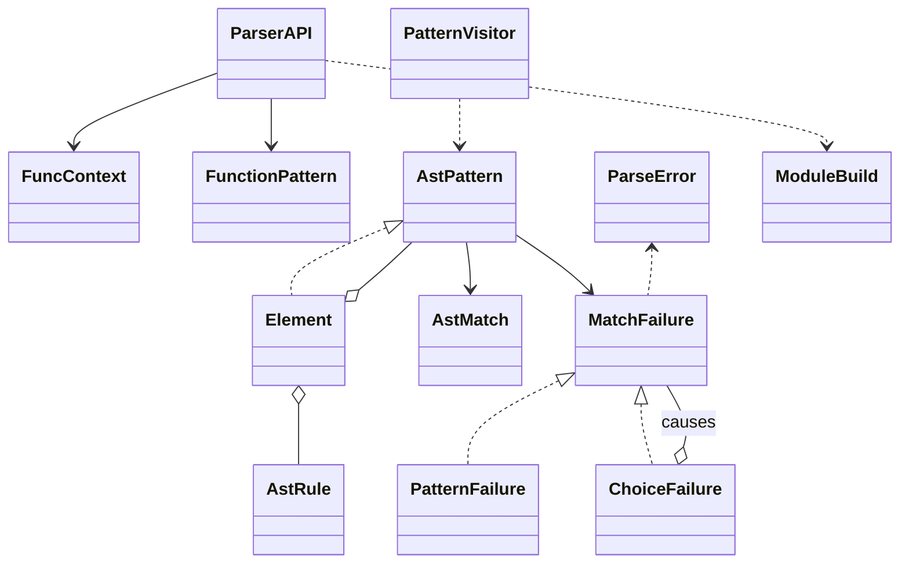
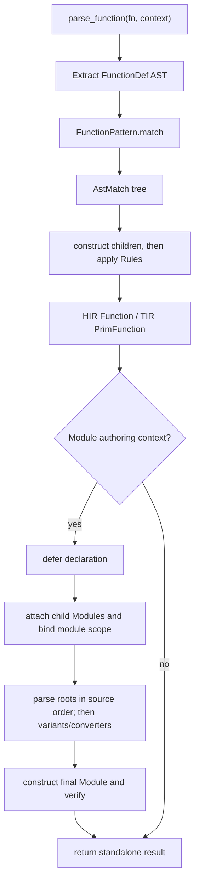
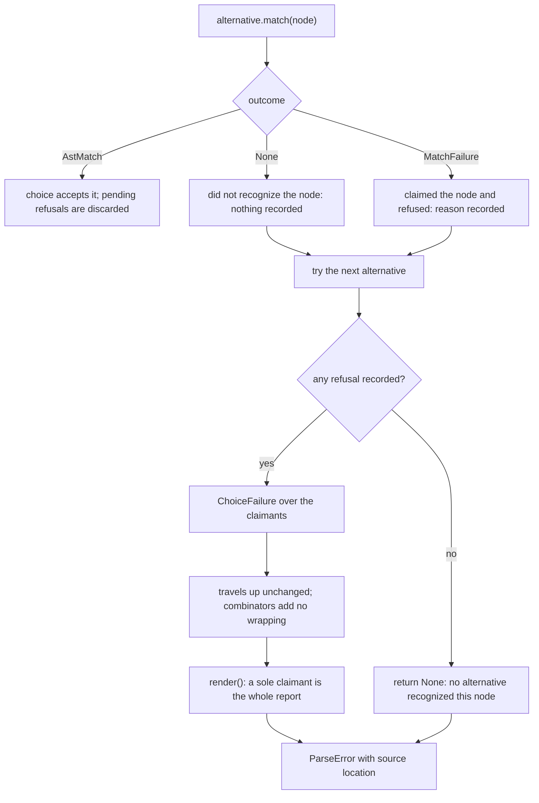

# TileFoundry Spec - Parser

The Parser accepts authored Python functions and produces HIR or TIR through one typed API.

## 1. Public API

Authored DSL source imports its authoring surface with `from tilefoundry.dsl import *`.
`Tensor[...]` is parser annotation syntax. It is not the IR `TensorType` carrier.

`@module` executes its Python class body. It finalizes the collected Function declarations,
child Modules, and ordinary methods. Module authoring has two phases. Class execution records
Function, specialization, and converter declarations. Finalization attaches all child Modules
and puts them in parser scope. Finalization then parses the Functions in source order.
`@func` produces an HIR Function. `@prim_func` produces TIR ([tir §1.3](./tir.md#13-primfunction)).
Explicit PrimFunction targets survive deferred parsing.
`specialize` and `converter` register variants and weight converters on an existing HIR Function.

```python
def parse_function(
    fn: FunctionType, context: FuncContext
) -> Any: ...
```

### 1.1 HIR Return Contracts

An ordinary HIR function and a specialization variant MAY omit `-> return-type`.
An ordinary function that omits it records its inferred `body.type` as `Function.return_type`.
When either declares an annotation, the parser MUST require
`types_compatible(annotation, body.type)`. This is directional compatibility.
It is not a parser-only equality relation. An annotation with `layout=None` leaves
layout unconstrained according to the shared type rule.

A `pass` HIR function is a dispatch prototype and MUST declare `-> return-type`.
That annotation is its `Function.return_type` and callable return type.
Every variant body MUST be compatible with that base return type.
The IR return type of a variant remains the exact base type.
All variants share one dispatch signature.

`Tensor[...]` without a storage slot constructs `storage=GMEM`, including in a
return annotation. It is not an unspecified-storage spelling.
Consequently an SMEM body under `-> Tensor[...]` MUST return a GMEM result explicitly.
When the annotation and the inferred body type are incompatible, the parser reports both,
with the authored function location. A tuple type is annotated `Tuple[...]`,
for a parameter and for an optional return annotation alike. It applies this same compatibility rule
recursively to every field. `Tuple[()]` is the empty `TupleType`; a function that
returns nothing writes `-> None`. The lowercase `tuple[...]` is not a DSL annotation.
`Tuple` is Python's `typing.Tuple`: the parser matches the name in the AST, and a
file without `from __future__ import annotations` imports it with `from typing import Tuple`.
A tuple value is written `()`, `(a,)`, `(a, b)` and an item is read as `a[0]`.

### 1.2 Source Span Metadata

Every parser-authored `Call` reachable from a Function body carries `SourceSpanMetadata` for
the AST expression that constructed it. A parent match fills only Calls without a span. It
cannot replace a more precise child span. Traversal follows `Call` operands and IR `Tuple`
values. It does not assign source identity to shared lexical `Var` values. Source spans use
physical source-file coordinates with a one-based start column.

### 1.3 Tuple Binding Metadata

`a, b = producer(...)` creates detached `TupleGetItem` values with scalar inputs `0` and `1`.
They carry the respective target Name spans (`a` and `b`) and matching `BindingMetadata`.
Later reads do not replace that identity. A multi-carry loop's derived projections carry the `for`
statement span and their carry binding name.

### 1.4 Context and Diagnostics

`FuncContext` carries the dialect, Function role, closure, topology scope, target, and
optional base/key for one parse. Call types inferred while parsing use that target's rules
([visitor-registry §4](./visitor-registry.md#4-instance-1--typeinfer)). In a Module that
declares its Target, a type the parser records is the type the built Module later infers. A
pending Module supplies its declared Target to the parser's current call frame.
`FunctionRole` is `ROOT`, `VARIANT`, or `CONVERTER`.
`ParseError` is the single authored-source diagnostic type. It includes source location and
recursive parse situation.

Instance authoring and call contracts follow
[core-ir §1.3](./core-ir.md#13-modulelist) and [§2.1](./core-ir.md#21-call).
The parser builds every function callee as a `FunctionRef` and resolves it while
parsing ([core-ir §1.4](./core-ir.md#14-function-references)). A failure is a
`ParseError`. An Op callee stays an `Op`.

### 1.5 Mesh declarations and region captures

`Mesh(...)` constructs a compile-time domain value. Layout sugar and a `MeshRegion` use it.
It is not a runtime expression in the HIR value graph. A
`with Mesh(...)` statement delimits an execution domain. It does not describe
the shard layout of its result. An `as name` binding is lexical. It is available inside
the `with` body and expires when the statement ends. Each name that escapes the scope is
rebound to the enclosing `MeshRegion` result. A name escapes when the body changes a name
visible before the `with`, or binds a new name in its live-out. The live-out is the
conservative set of names read after the body. Several escaping names make a tuple region
with `TupleGetItem` projections. Unchanged captures and new names used
only inside the body remain local to the scope. Names read inside either a
MeshRegion or LoopRegion but bound outside it are captured as `args`. The body uses a
fresh `params` binding. LoopRegion places
carry slots first. It excludes its own induction and carry names from captures.
Capture happens one region boundary at a time. Nested regions pass a
value through each region boundary.

In an authored HIR function that opens a mesh, every authored runtime Call
runs inside a mesh scope. This includes operation and function calls, operator
expressions, tensor slices, and explicit tuple subscripts, even for UMAT scalar
results. An unscoped Call raises `ParseError` at its source expression and directs
the author to move it inside `with Mesh(...)`. Function parameters, Python
constants, compile-time mesh declarations, and parser-generated result projections
do not require an execution scope. A function-level `mesh=` covers the whole body.
HIR functions that open no mesh remain logical programs. TIR is unaffected by
this restriction.

A function call inside a mesh supplies that execution scope to its callee.
The callee may omit its own mesh, or declare a region that composes with the call-site scope
([hir §1.1](./hir.md#11-function)). The parser checks call sites lexically. An
unscoped function call is not exempt because its callee contains a mesh.

When a captured name denotes a tile window `slice(iv, iv + step, 1)`, the parser
captures the induction Expr and reconstructs the window with its new parameter.
Tile windows support `window ± c` (translate start/stop), `window * c`, and `c * window`
(scale start, stop, and stride, preserving the element count). Division,
floor division, remainder, and operations between two windows MUST raise
`ParseError`. A Python slice MUST NOT enter the HIR expression graph.
Non-window index arithmetic MUST reject `/` with a diagnostic. The diagnostic directs the
author to integer division `//`. The operation does not return a float.

A loop body holds `with Mesh(...)` statements. The loop carries the names that these
statements bind. A `with` exports changed names visible on entry, including loop carry
parameters, and new names read by following statements. Bindings produced by
nested loops or mesh scopes follow the same rule. The parser reads a TIR loop
bound that is not a literal as the dimension arithmetic that the loop was
lowered from. A bound that names a mesh coordinate reads back as it was printed.

## 2. Syntax and Rules

`T` and `tf` each expose a `Dialect` instance through their module hooks.
Lookup MUST consult one tree keyed by `(dialect, namespace, name)`. A record
at the current path returns its operation builder or exported type. A deeper
path returns the next `Dialect`. Otherwise lookup MUST raise `AttributeError`.
`dir()` and `__all__` MUST list only the current layer's records and immediate
child namespaces.

The `.pyi` stubs reflect the dialect registry, including exported types and
nested namespaces. After changing registrations, regenerate them with
`python -m tilefoundry.dsl regen`. The command produces the `tf/__init__.pyi` and
`T/__init__.pyi` stubs. Git ignores these stubs.

Registration (`register_op`, `register_type`, aliases, collisions) is specified
in [core-ir §2.3](./core-ir.md#23-op). Category organizes documentation, not
lookup. The parser and printers MUST use the same alias records. Printers select the
first applicable alias through `get_registered_name(op)`. A record MUST NOT
occupy a namespace prefix, in either registration order. Missing required
decorator arguments MUST raise `TypeError`.

Negative integer and floating-point literals are single `Constant` values.
Negating a name or a runtime expression constructs a `Unary(NEG)` Call.

Tuple subscripting lowers `stages[index]` to `TupleGetItem(stages, index)`.
Literal negative indices are normalized against the tuple arity before lowering.
A non-literal scalar index is accepted only when type inference can establish one
common field type for every possible result.

### 2.1 Syntax

<!-- parser-grammar:start -->
```ebnf
; root: function
; literal: Python ast.Constant syntax, e.g. 1, "bf16", or None
; name: Python variable name; primary: name/attribute base for calls and subscripts
; expression: Python syntax composed from literals, names, primaries, and operators
; runtime-expression: expression lowered to a TileFoundry IR Expr
mesh-axis             ::= identifier
                          | identifier '[' expression ']'
                          | (identifier | identifier '[' expression ']') '.' identifier
dim-expr              ::= integer-literal
                          | identifier
                          | primary '.' identifier
                          | dim-expr ('+' | '-' | '*' | '//' | '%') dim-expr
                          | (identifier | primary '.' identifier) '(' (dim-expr (',' dim-expr)*)?
                            ')'
layout-dims           ::= '(' ((expression '@' ('(' mesh-axis (',' mesh-axis)* ')' | mesh-axis) |
                          dim-expr) (',' (expression '@' ('(' mesh-axis (',' mesh-axis)* ')' |
                          mesh-axis) | dim-expr))*)? ')'
layout-strides        ::= '(' (dim-expr (',' dim-expr)*)? ')'
placed-layout         ::= '(' layout-dims ',' layout-strides ')'
                          | layout-dims
plain-layout          ::= '(' (dim-expr (',' dim-expr)*)? ')'
literal               ::= None
                          | Ellipsis
                          | boolean-literal
                          | integer-literal
                          | float-literal
                          | complex-literal
                          | string-literal
                          | bytes-literal
primary               ::= identifier
                          | expression '.' identifier
sequence              ::= '(' (expression (',' expression)*)? ')'
                          | '[' (expression (',' expression)*)? ']'
                          | '{' (expression (',' expression)*)? '}'
dict                  ::= '{' (expression ':' expression (',' expression ':' expression)*)? '}'
binary-operation      ::= expression ('+' | '-' | '*' | '/' | '//' | '%' | '**') expression
unary-operation       ::= ('+' | '-' | 'not') expression
call                  ::= expression '(' ((expression | keyword-name '=' expression) (','
                          (expression | keyword-name '=' expression))*)? ')'
slice                 ::= (expression)? ':' (expression)? (':' expression)?
subscript             ::= expression '[' expression ']'
expression            ::= literal
                          | primary
                          | sequence
                          | dict
                          | binary-operation
                          | unary-operation
                          | call
                          | slice
                          | subscript
composed-layout       ::= (placed-layout | plain-layout | expression) '+' dim-expr
                          | ((placed-layout | plain-layout | expression) '+' dim-expr |
                            placed-layout | plain-layout | expression) '|' expression
shard-layout-operand  ::= '(' layout-dims ',' layout-strides ')'
                          | layout-dims
value-states          ::= '{' 'B' '(' ')' '}'
                          | '{' mesh-axis '@' ('P' '(' string-literal ')' | 'V' '(' ')') (','
                            mesh-axis '@' ('P' '(' string-literal ')' | 'V' '(' ')'))* '}'
stated-layout         ::= (composed-layout | shard-layout-operand | expression) '@' (identifier |
                          identifier '[' expression ']' | value-states)
shape                 ::= '(' (dim-expr (',' dim-expr)*)? ')'
                          | identifier
                          | primary '.' identifier
tensor-shape-layout   ::= stated-layout
                          | placed-layout
                          | shape
dtype                 ::= string-literal
                          | primary
layout                ::= None
                          | primary
                          | call
                          | stated-layout
                          | placed-layout
                          | plain-layout
                          | composed-layout
storage               ::= string-literal
                          | primary
tensor-optional-slot  ::= layout
                          | storage
tensor                ::= tensor-head '[' '(' (tensor-shape-layout ',' dtype | shape ',' dtype ','
                          tensor-optional-slot | tensor-shape-layout ',' dtype ','
                          tensor-optional-slot | shape ',' dtype ',' tensor-optional-slot ','
                          tensor-optional-slot) ')' ']'
tuple-type            ::= 'Tuple' '[' '(' (type-annotation (',' type-annotation)*)? ')' ']'
                          | 'Tuple' '[' type-annotation ']'
scalar-type           ::= primary
                          | call
type-annotation       ::= tensor
                          | tuple-type
                          | scalar-type
signature             ::= (name ':' type-annotation (',' name ':' type-annotation)*)?
return-type           ::= type-annotation
if                    ::= if cond-node block (block)?
while                 ::= while cond-node block
loop-iterator         ::= 'tf' '.' 'tile' '(' (expression ',' expression | expression ',' expression
                            ',' expression) ')'
                          | 'range' '(' (expression | expression ',' expression | expression ','
                            expression ',' expression) ')'
loop-carry-statement  ::= expression '=' expression
                          | 'for' name 'in' expression ':' loop-carry
                          | statement
loop-carry            ::= (loop-carry-statement (newline loop-carry-statement)*)?
loop-header           ::= 'for' identifier 'in' loop-iterator ':' loop-carry
loop-body             ::= (statement (newline statement)*)?
for                   ::= 'for' name 'in' expression ':' (block | loop-body)
mesh-context          ::= ('Mesh' | primary '.' 'Mesh') '(' (expression | ('layout' | 'names') '='
                            expression) (',' (expression | ('layout' | 'names') '=' expression))*
                            ')'
                          | expression
with                  ::= 'with' mesh-context ('as' (identifier | None))? ':' block
slice-endpoint-binary ::= index-endpoint dim-op index-endpoint
mesh-coordinate       ::= identifier '.' string-literal
index-endpoint        ::= literal
                          | primary
                          | slice-endpoint-binary
                          | mesh-coordinate
                          | runtime-expression
                          | expression
ceildiv-expression    ::= ceildiv '(' index-endpoint ',' index-endpoint ')'
variadic-inputs       ::= '[' (runtime-expression (',' runtime-expression)*)? ']'
                          | '(' (runtime-expression (',' runtime-expression)*)? ')'
                          | listcomp
                          | generatorexp
                          | expression
op-value              ::= primary '(' ((expression | keyword-name '=' expression) (',' (expression |
                          keyword-name '=' expression))*)? ')'
op-call               ::= (primary | expression '[' expression ']') '(' ((expression | keyword-name
                          '=' expression) (',' (expression | keyword-name '=' expression))*)? ')'
launch                ::= callee '(' ')'
index-slice           ::= (index-endpoint)? ':' (index-endpoint)? (':' index-endpoint)?
subscript-index       ::= '(' ((index-slice | index-endpoint) (',' (index-slice |
                            index-endpoint))*)? ')'
                          | index-slice
                          | index-endpoint
subscript-expression  ::= runtime-expression '[' subscript-index ']'
matmul-expression     ::= runtime-expression '@' runtime-expression
binary-expression     ::= runtime-expression ('+' | '-' | '*' | '/' | '//' | '%') runtime-expression
                          | runtime-expression ('==' | '!=' | '<' | '<=' | '>' | '>=')
                            runtime-expression
                          | runtime-expression ('and' | 'or') runtime-expression
constant              ::= boolean-literal
                          | integer-literal
                          | float-literal
                          | '-' numeric-literal
unary-expression      ::= unary-op runtime-expression
name                  ::= identifier
tuple-expression      ::= '(' (runtime-expression (',' runtime-expression)*)? ')'
runtime-expression    ::= ceildiv-expression
                          | op-call
                          | launch
                          | subscript-expression
                          | matmul-expression
                          | binary-expression
                          | constant
                          | unary-expression
                          | mesh-coordinate
                          | name
                          | tuple-expression
                          | tensor
                          | primary '.' identifier
tuple-assignment      ::= '(' identifier (',' identifier)* ')' '=' runtime-expression
where-annotation      ::= 'where' '(' ')'
statement             ::= if
                          | while
                          | for
                          | with
                          | tuple-assignment
                          | identifier '=' (runtime-expression | expression)
                          | identifier ':' (where-annotation | type-annotation) ('='
                            (runtime-expression | expression))?
                          | 'return' (runtime-expression)?
                          | runtime-expression
                          | 'pass'
block                 ::= (statement (newline statement)*)?
function              ::= 'def' name '(' signature ')' ('->' return-type)? ':' block
```
<!-- parser-grammar:end -->

### 2.2 Rules

<!-- parser-constraints:start -->
| Owner | Situation | Rule | Statement | Source |
| --- | --- | --- | --- | --- |
| binary_expression, matmul_expression, op_call, unary_expression | expression, slice_endpoint, subscript_index, variadic_input | AuthoredCallScopeRule | An authored HIR call must run inside a mesh if its function opens one. | src/tilefoundry/parser/pattern_nodes.py |
| binary_expression, matmul_expression, op_call, unary_expression | expression, slice_endpoint, subscript_index, variadic_input | CallBindingRule | A call must bind its arguments into a Call tuple. | src/tilefoundry/parser/pattern_nodes.py |
| binary_expression, matmul_expression, op_call, unary_expression | expression, slice_endpoint, subscript_index, variadic_input | CallTypeInferenceRule | A call's result type must be inferred from its binding. | src/tilefoundry/parser/pattern_nodes.py |
| call | call_attribute, expression, layout, mesh_layout, slice_endpoint, static_item, static_key, static_layout, static_mesh, static_operand, static_owner, static_slice, subscript_index, type_constructor | InlineMeshCallRule | Inside an open mesh scope, Mesh constructors open a with header unless used as a ShardLayout mesh value. | src/tilefoundry/parser/pattern_nodes.py |
| call | call_attribute, expression, layout, mesh_layout, slice_endpoint, static_item, static_key, static_layout, static_mesh, static_operand, static_owner, static_slice, subscript_index, type_constructor | StaticCallConstructionRule | A static call has a callable target and constructs a valid Python value. | src/tilefoundry/parser/pattern_nodes.py |
| composed_layout | call_attribute, layout, tensor_optional_slot | ComposedLayoutConstructionRule | A checked composition constructs its inner, offset, and outer layout. | src/tilefoundry/parser/pattern_nodes.py |
| composed_layout | call_attribute, layout, tensor_optional_slot | ComposedLayoutInnerRule | A composed layout's inner is a Swizzle or LayoutBase. | src/tilefoundry/parser/pattern_nodes.py |
| composed_layout | call_attribute, layout, tensor_optional_slot | ComposedLayoutOffsetRule | A composed layout has one offset before its inner layout; compound offsets are parenthesized. | src/tilefoundry/parser/pattern_nodes.py |
| composed_layout | call_attribute, layout, tensor_optional_slot | ComposedLayoutOuterRule | A composed layout's outer is a plain Layout without a shard layout. | src/tilefoundry/parser/pattern_nodes.py |
| dim_expr | call_attribute, dim_expr, layout, layout_extent, layout_offset, mesh_layout, tensor_dim_expr, tensor_optional_slot, tensor_shape | ShapeDimRule | A shape dimension must be an integer, DimVar, or expression. | src/tilefoundry/parser/ast_pattern.py |
| dtype | call_attribute, tensor_dtype | CanonicalDTypeRule | A dtype must resolve to a canonical DType. | src/tilefoundry/parser/ast_pattern.py |
| function | function | FunctionDialectRule | A function kind and constructed value must agree with the active dialect. | src/tilefoundry/parser/pattern_nodes.py |
| function | function | FunctionRegistrationRule | A validated function must be registered exactly once in its owning scope. | src/tilefoundry/parser/pattern_nodes.py |
| function | function | FunctionReturnCompatibilityRule | A HIR body with a return annotation must satisfy that annotation; a dispatch prototype must declare one, and each variant body must satisfy the prototype return contract. | src/tilefoundry/parser/pattern_nodes.py |
| function | function | FunctionRoleValidationRule | A root, variant, or converter must satisfy its role before registration. | src/tilefoundry/parser/pattern_nodes.py |
| function | function | FunctionSignatureRule | A function must construct an ordered parameter tuple. | src/tilefoundry/parser/pattern_nodes.py |
| if, while | loop_statement, statement | TirOnlyStatementRule | A TIR-only statement must appear in a prim_func. | src/tilefoundry/parser/pattern_nodes.py |
| index_slice | subscript_index | TileWindowSliceBoundRule | A tile window cannot be used as a slice bound. | src/tilefoundry/parser/pattern_nodes.py |
| layout, plain_layout | call_attribute, mesh_layout, tensor_optional_slot | LayoutPositionRule | A layout must be legal for its parser position. | src/tilefoundry/parser/ast_pattern.py |
| layout, plain_layout | call_attribute, mesh_layout, tensor_optional_slot | LayoutShapeRule | A layout must have a valid non-boolean shape. | src/tilefoundry/parser/ast_pattern.py |
| loop_header | loop_header | TileIteratorQualificationRule | A tiled loop uses tf.tile rather than a bare tile call. | src/tilefoundry/parser/pattern_nodes.py |
| mesh_axis | call_attribute, layout, mesh_layout, tensor_optional_slot, tensor_shape | BareMeshAxisRule | A bare Mesh in a shard layout names a mesh with one mesh axis. | src/tilefoundry/parser/pattern_nodes.py |
| mesh_axis | call_attribute, layout, mesh_layout, tensor_optional_slot, tensor_shape | MeshAxisBindingRule | A mesh axis of a shard layout resolves to a lexical Mesh binding. | src/tilefoundry/parser/pattern_nodes.py |
| mesh_axis | call_attribute, layout, mesh_layout, tensor_optional_slot, tensor_shape | MeshAxisNameRule | A named mesh axis of a shard layout exists in its lexical Mesh. | src/tilefoundry/parser/pattern_nodes.py |
| mesh_context | mesh_context | SelectionBindingRule | A mesh selection names a lexical Mesh binding or its constant slice. | src/tilefoundry/parser/pattern_nodes.py |
| mesh_context | mesh_context | SelectionConstructionRule | A checked selection constructs a Mesh with its topology. The Mesh starts at the first index of the selection, unless the selection holds its whole topology. The Mesh enters its execution scope and defines its lexical binding. | src/tilefoundry/parser/pattern_nodes.py |
| mesh_context | mesh_context | SelectionCoverRule | A mesh selection layout covers each selection-local index exactly once. | src/tilefoundry/parser/pattern_nodes.py |
| mesh_context | mesh_context | SelectionLayoutFormRule | A mesh selection layout is a shape tuple or a shape/stride tuple pair. | src/tilefoundry/parser/pattern_nodes.py |
| mesh_context | mesh_context | SelectionLevelRule | A mesh selection names exactly one topology. | src/tilefoundry/parser/pattern_nodes.py |
| mesh_context | mesh_context | SelectionSizeRule | A mesh selection layout has positive static extents, static strides, matching shape/stride and name ranks, and the same size as its selection. | src/tilefoundry/parser/pattern_nodes.py |
| mesh_context | mesh_context | SelectionStrideRule | Each new mesh axis of a mesh selection maps to one fixed physical stride. | src/tilefoundry/parser/pattern_nodes.py |
| module | module_finalization | ModuleFinalizationRule | A module declaration must contain valid unique members and a resolvable entry. | src/tilefoundry/parser/ast_pattern.py |
| module | module_function | ModuleFunctionRegistrationRule | A validated module function must be recorded in declaration order. | src/tilefoundry/parser/ast_pattern.py |
| module | module_function | ModuleFunctionValidationRule | A module function must satisfy its root, variant, or converter role before mutation. | src/tilefoundry/parser/ast_pattern.py |
| op_call | expression, slice_endpoint, subscript_index, variadic_input | CallVariadicInputFormRule | A variadic call must use one explicit list, tuple, or supported static list comprehension. | src/tilefoundry/parser/pattern_nodes.py |
| op_value | call_attribute | OpValueAttributeRule | Each op-value keyword names an attribute of its resolved op schema. | src/tilefoundry/parser/pattern_nodes.py |
| op_value | call_attribute | OpValueConstructionRule | An op value constructs valid attributes using its resolved schema. | src/tilefoundry/parser/pattern_nodes.py |
| op_value | call_attribute | OpValueKeywordOnlyRule | An op value takes only keyword attributes. | src/tilefoundry/parser/pattern_nodes.py |
| op_value | call_attribute | OpValueUniqueKeywordRule | An op-value keyword is supplied at most once. | src/tilefoundry/parser/pattern_nodes.py |
| placed_layout, stated_layout | call_attribute, mesh_layout, tensor_optional_slot, tensor_shape | LayoutStrideRankRule | A stated stride tuple must have the rank of the layout it addresses. | src/tilefoundry/parser/pattern_nodes.py |
| placed_layout, stated_layout | call_attribute, mesh_layout, tensor_optional_slot, tensor_shape | MeshAxisBoundOnceRule | A shard layout binds each mesh axis at most once. | src/tilefoundry/parser/pattern_nodes.py |
| placed_layout, stated_layout | call_attribute, mesh_layout, tensor_optional_slot, tensor_shape | ShardLayoutAnswerRule | Shard layout sugar states both the shape as written and the layout it implies. | src/tilefoundry/parser/pattern_nodes.py |
| placed_layout, stated_layout | call_attribute, mesh_layout, tensor_optional_slot, tensor_shape | ShardLayoutConstructionRule | Shard layout sugar must construct a valid shard layout. Without splits, partials or stated strides, it uses row-major strides; Broadcast states do not affect this default. A composed operand is retained directly without canonical split decomposition. | src/tilefoundry/parser/pattern_nodes.py |
| placed_layout, stated_layout | call_attribute, mesh_layout, tensor_optional_slot, tensor_shape | ShardLayoutMeshResolutionRule | A shard layout's mesh must be a lexical mesh binding. | src/tilefoundry/parser/pattern_nodes.py |
| placed_layout, stated_layout | call_attribute, mesh_layout, tensor_optional_slot, tensor_shape | ShardLayoutScopeRule | A shard layout requires and covers the current mesh scope, or the function mesh in a signature. Each referenced mesh axis must map uniquely to a mesh axis of that scope. A layout naming a unit set (a slice, or the mesh after '@') takes that mesh instead, inside the current scope. Unstated mesh axes are Broadcast. In a Varying layout without Split or Partial, a topology that holds only Broadcast and does not own the storage is dropped. | src/tilefoundry/parser/pattern_nodes.py |
| placed_layout, stated_layout | call_attribute, mesh_layout, tensor_optional_slot, tensor_shape | ShardLayoutTopologyRule | A shard layout's meshes cannot name the same topology. | src/tilefoundry/parser/pattern_nodes.py |
| placed_layout, stated_layout | call_attribute, mesh_layout, tensor_optional_slot, tensor_shape | UnitSetRule | A layout names one unit set: a mesh slice or the mesh after '@' is the only mesh its axes come from. | src/tilefoundry/parser/pattern_nodes.py |
| reference | annotation, call_attribute, expression, slice_endpoint, subscript_index, tensor_dtype, tensor_optional_slot, type_annotation, variadic_input | LexicalMeshReferenceRule | Inside an open mesh scope, an external Mesh or mesh-bearing ShardLayout cannot stand in for a lexical Mesh binding. | src/tilefoundry/parser/ast_pattern.py |
| shape | tensor_shape | ShapeTupleRule | A shape must construct a tuple of dimensions. | src/tilefoundry/parser/ast_pattern.py |
| stated_layout | call_attribute, tensor_optional_slot, tensor_shape | StatedLayoutOperandRule | States attach to shard layout dimensions, a plain Layout, or a ComposedLayout whose outer is a plain Layout. | src/tilefoundry/parser/pattern_nodes.py |
| storage | call_attribute, tensor_optional_slot | StorageValueRule | Storage must resolve to a StorageKind. | src/tilefoundry/parser/ast_pattern.py |
| tensor | annotation, call_attribute, expression, slice_endpoint, subscript_index, type_annotation, variadic_input | TensorLayoutStorageRule | A tensor type must contain compatible layout and storage values. | src/tilefoundry/parser/ast_pattern.py |
| tensor | annotation, call_attribute, expression, slice_endpoint, subscript_index, type_annotation, variadic_input | TensorPositionRule | A tensor type's storage must be legal for its dialect and position. | src/tilefoundry/parser/ast_pattern.py |
| value_states | call_attribute, tensor_optional_slot, tensor_shape | ValueStatesFormRule | Layout states are one B() alone, or one or more mesh axis @ P(nonempty string) or mesh axis @ V() entries. Empty states are rejected. A mesh axis @ B() entry is rejected. B() mixed with other entries is rejected. | src/tilefoundry/parser/pattern_nodes.py |
| where_annotation | annotation | WhereTopologyStatesRule | Where layout states constrain named topologies with topology @ B() or topology @ P(nonempty string); they do not bind lexical mesh axes. | src/tilefoundry/parser/pattern_nodes.py |
<!-- parser-constraints:end -->

A `mesh-axis` used by shard layout sugar MUST resolve to a mesh binding in the
current lexical scope. A module or closure name that resolves to a `Mesh` does
not become a shard layout binding. Such an external value remains valid as the
context expression of `with ... as ...` outside an open mesh scope, or as the
value supplied to `@func(mesh=...)`. The resulting lexical binding is the name
that shard layout sugar may use.

## 3. Implementation Overview

| Component | Responsibility |
| --- | --- |
| Parser API and Context | Receives authored Functions and carries dialect, role, scope, and recursion inputs. |
| Executable Pattern Graph | Composes concrete AST elements into the Function root pattern. |
| Match and Construction | Matches recursively into `AstMatch`, then constructs owner values on return. |
| Ordered Rules | Validates and normalizes each owner value after construction. |
| Module Build | Lets Python execute the class body, collects declarations, resolves child Modules first, then parses Functions in source order and finalizes the Module. |
| Pattern Visitor | Traverses the same graph to render this section's generated grammar and constraints. |
| Refusal | Carries the reason from the pattern that claimed a node and then refused it. A report names a cause, not the absence of a match. |







A pattern MUST establish that a node is its own before it refuses with a reason. That claim
makes the reason trustworthy. It says that no remaining alternative can accept this node. The
refusal is then the author's mistake, not another pattern's turn. A callee that resolves to an op
schema is such a claim, and a wrong argument count after it is an error. A callee that does not
resolve is not a claim. It may be a bare name or a foreign namespace that another alternative
owns. The pattern then returns `None` and says nothing. The parser never reconstructs reasons
from the AST after the fact. An inspection outside the refusing pattern cannot see which step
failed. It becomes a second, divergent copy of that knowledge.

Being last in one choice is not a claim either. That choice may itself be an
alternative in another. `parse_node` is the single place where no alternative remains. It
is the only place that MAY describe a node from its shape rather than from a pattern's
statement. It describes a node from its shape only when the shape says something worth reading.

`None` and a `MatchFailure` differ only for a choice. Every other combinator returns either one
unchanged. A refusal thus keeps the identity and the wording of the pattern that produced it all
the way to `parse_node`. Nothing is wrapped, filtered, or re-described on the way up. A
`ChoiceFailure` records only the alternatives that claimed the node, which is normally one. It
renders as that sole claimant. Two claimants mean that two patterns claim overlapping shapes. The
report states both and does not choose between them. The ambiguity is in the grammar, not in the report.

Pattern combinators serve both runtime matching and Spec traversal. `AstMatch` separates syntax
matching from object construction. Each Rule reads the recursive context after its owner
value exists. Module class control flow remains Python execution. No Module AST grammar exists.
