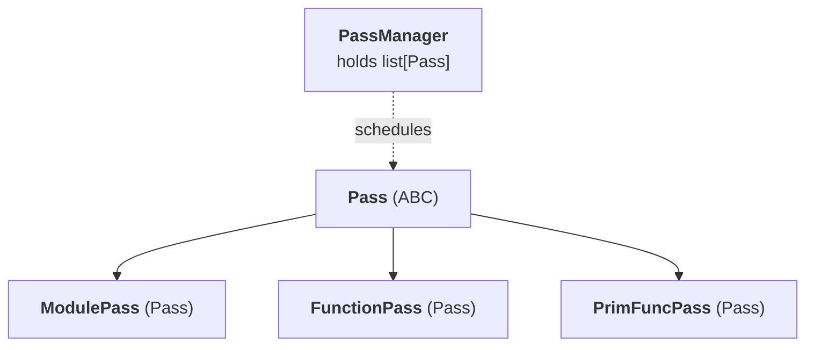

# TileFoundry Spec — passes

The pass framework: `Pass` / `ModulePass` / `FunctionPass` /
`PrimFuncPass` / `PassManager`. A `Pass` is the unit the compiler
schedules over a `Module`; a transform is one stage in this pipeline,
not a free function. After the framework, this spec lists the
implemented passes and their per-pass contracts.



## 1. Role

A `Pass` abstracts every Module-reading or Module-rewriting compile
step; `PassManager` runs registered passes in registration order. The
pass framework is:

- a linear pipeline — passes run sequentially in registration order;
- three pass granularities: `ModulePass` / `FunctionPass` /
  `PrimFuncPass`;
- explicit registration — passes are added via `PassManager.add(...)`.

## 2. `Pass` base class


```python
from abc import ABC, abstractmethod
from tilefoundry.ir.core import Module

class Pass(ABC):
    """A Module → Module pure function.

    Side-effect logging is allowed, but the input Module MUST NOT be
    mutated — Module is a frozen dataclass, so a mutator returns a new
    instance.

    Attributes:
        name: attribute; Stable dump and log name.
        requires: attribute; Ordered dependency assertion.
    """

    name: str = ""
    requires: tuple[str, ...] = ()

    @abstractmethod
    def run(self, module: Module) -> Module: ...
```

- constraints:
  - `run(module)` returns a new `Module`; it does not mutate input.
  - Passes MUST NOT depend on global state. All configuration enters
    through constructor parameters or pass-local attributes.
  - Pass failures raise named exceptions (e.g. `VerifyError`); they
    do not swallow errors.

## 3. Three pass granularities

### 3.1 `ModulePass`

Runs over the whole `Module` and may add / remove / reorder
functions. Examples: module-level inline, dead-function elimination,
synthesizing an entry the module does not yet declare
([§7.3](#73-inserthostentrypass)).

```python
class ModulePass(Pass):
    """Run over a complete Module."""

    @abstractmethod
    def run(self, module: Module) -> Module: ...
```

- constraints:
  - `run` returns a new `Module`; inherits the `Pass` no-mutation / no-global-state
    contract ([§2](#2-pass-base-class)).

### 3.2 `FunctionPass`

Visits each `hir.Function`. The framework supplies a default `run`
that walks `module.functions`, calls `run_function` for HIR
entries, and reassembles the `Module`.

```python
from tilefoundry.ir.hir import Function as HirFunction

class FunctionPass(Pass):
    """Run independently over each HIR Function."""

    @abstractmethod
    def run_function(self, fn: HirFunction, module: Module) -> HirFunction: ...
    def run(self, module: Module) -> Module: ...
```

- constraints:
  - inherits the `Pass` contract ([§2](#2-pass-base-class)); the default `run` reassembles the `Module`
    from `run_function` results.

### 3.3 `PrimFuncPass`

Same shape as `FunctionPass`, but visits `tir.PrimFunction`.

```python
from tilefoundry.ir.tir import PrimFunction

class PrimFuncPass(Pass):
    """Run independently over each TIR PrimFunction."""

    @abstractmethod
    def run_prim_func(self, fn: PrimFunction, module: Module) -> PrimFunction: ...
    def run(self, module: Module) -> Module: ...
```

- constraints:
  - inherits the `Pass` contract ([§2](#2-pass-base-class)); same shape as `FunctionPass` over
    `tir.PrimFunction`.

## 4. Transform pass idiom

Transform passes use the visitor / mutator base classes from
[visitor-mutator](./visitor-mutator.md) rather than hand-written
`isinstance` dispatch.

A transform `PrimFuncPass` wraps a `StmtExprMutator` subclass: `run_prim_func`
runs the mutator over `fn.body`, returns `fn` unchanged when the mutator
preserves identity (the returned body is the same object), and otherwise
returns `replace(fn, body=new_body)`. The inner mutator matches on `Evaluate`
and dispatches on `type(stmt.callable)`.

The visit-and-rewrite contract — including the `visit_Evaluate`
entry form for TIR effect Ops — is owned by
[visitor-mutator §7](./visitor-mutator.md#7-visitor-entry-forms-for-evaluate).

## 5. `PassManager`

A linear scheduler that runs passes in registration order and
optionally drops per-pass IR dumps when wrapped in a
`tilefoundry.dump.DumpScope`.

```python
class PassManager:
    """Ordered pass pipeline.

    Attributes:
        passes: attribute; the registered passes, run in registration order.
    """

    passes: list[Pass] = field(default_factory=list)

    def add(self, p: Pass) -> "PassManager": ...      # register a pass; returns self for chaining
    def run(self, module: Module) -> Module: ...      # run passes in registration order
```

- constraints:
  - `requires` is an ordering assertion checked before the run, not a topological sort.

`PassManager` does not own a dump destination. When the caller
wraps the run in a `DumpScope` and `DumpFlags.PASS_IR` is enabled,
each pass writes `before.txt` / `after.txt` under
`<scope-root>/{NN}_{pass_name}/`. Without an active scope or with
the flag off, `dump(...)` is a no-op. The before/after representations MUST
be passed as no-argument producers, so `repr` is evaluated only when
`PASS_IR` is enabled in an active scope.

## 6. Top-level API

Three public verbs operate on `Module` (no bare `HirFunction` /
`PrimFunction`):

```python
class CompilerOptions:
    """Carry deterministic compiler configuration.

    Attributes:
        target: attribute; Constructed compilation Target.
    """

    target: Target

    def canonical_text(self) -> str: ...


def build(mod: Module, /, *, target: Target | None = None) -> RuntimeModule: ...
def compile(mod: Module, /, *, target: Target | None = None) -> RuntimeModule: ...
```

`build` takes a TIR `Module` whose `Module.entry` is a CPU host entry, then
codegen → toolchain link → loader, and returns a `RuntimeModule`
([runtime](./runtime.md)). It requires the Module to own its Target; an
explicit Target that disagrees with the declared one is an error.

`compile` runs `default_pipeline` over the Module, then `build`. Finalize and
scaffold run the same `default_pipeline`. The `jit` convenience and cache contract are owned by
[runtime §1.6](./runtime.md#16-compilepy).

### Dirty-scope retype / verify

`typeinfer` and `verify` are not standalone pipeline stages. The
parser already runs eager typeinfer ([parser](./parser.md)), so a
`Module` entering the pipeline has `Expr.type` filled. After each
pass runs, `PassManager` re-runs the relevant analysis on that
pass's **dirty scope**:

- HIR-side: changed `Function`s rerun the existing checks and refresh available
  `RangeMetadata` over the complete function without rewriting `.type`.
- TIR-side: changed `PrimFunction`s rerun `verify`, which
  recursively retriggers `typeinfer` on the embedded Expr fields
  and refreshes their `.type`.
- A `ModulePass` whose effect crosses functions (e.g. rewriting an
  `Evaluate(SymbolRef)` callee) MUST report its changed-function set
  or conservatively trigger a whole-module fallback.

Consequence: there is no separate `TypeInferPass`, and `verify` is
not inserted as a public `ModulePass`. Passes own rewrite work; the
unified retype / verify is scheduled by `PassManager`.

## 7. Implemented passes

### 7.1 `ConvertHIRToTIR`

```python
class ConvertHIRToTIR(ModulePass):
    """Replace one selected scheduled HIR entry with verified TIR."""

    visitor: ClassVar[type[Lowering]] = Lowering
    options: CodegenOptions = CodegenOptions()
    name: str = "convert-hir-to-tir"
    requires: tuple[str, ...] = ()

    @classmethod
    def create(cls, target: Target, options: CodegenOptions) -> ConvertHIRToTIR: ...
    def run(self, module: Module) -> Module: ...
```

- constraints:
  - The pass lowers the device root of the Module it receives, in place, and
    its retained calls. That function MUST carry the memory analysis
    (`AllocationSummaryMetadata`); otherwise the pass raises `LoweringError`. It
    never checks or analyzes again, and it takes nothing but configuration at
    construction. Generated names come from the `BindingMetadata` on that IR.
  - A Target MAY bind a subclass with `@bind(TargetClass, ConvertHIRToTIR)`;
    finalization obtains the pass through `Target.resolve(ConvertHIRToTIR)`. The
    entry function and every callee are lowered by the same `visitor` class.
  - What a Call emits, the instruction it issues and the operands that
    instruction reads and writes, and which copies lowering adds for the
    allocation's accepted aliases, come from `analysis/emission.py`.
  - The pass lowers the device root: the callee of the `Launch` in `Module.entry`
    when that entry is a CPU host, otherwise `Module.entry` itself. It returns the
    Module unchanged under `CodegenOptions(emit="skeleton")` or when the Module
    has no HIR function. When lowering HIR from a CPU host root, exactly one
    `Launch` MUST resolve to an HIR function; otherwise `LoweringError` names
    the host and the number of such launches.
  - Address placement comes only from `MemoryMetadata`: integer shared-memory
    addresses are byte offsets, and every analyzed offset becomes one concrete
    buffer view. Multiple offsets bind one view per offset and one tuple of
    those views outside the outermost enclosing HIR loop; each consuming scope
    binds the selected stage `stages[index]` once. The index is the linear
    iteration ordinal
    from outermost to innermost, modulo the number of buffers, when inner loop
    trip counts are constant. Otherwise selection uses a rank-0 integer register
    counter modulo the number of buffers. It is initialized to zero before the
    outermost staged loop and incremented after all uses in each completed
    innermost staged iteration; all uses in one iteration see the same slot.
    Instruction-generated loops do not enter this index.
    An adopted update window is written at its producer. `InsertSlice` skips
    copying only when the update's alias names that HIR destination, resolved
    through region captures.
    A loop-carried entry alias must name its slot's initial value; any other
    entry alias raises `LoweringError`. A accepted semantic alias identifies its
    destination as `BufferAlias.target: SSAValue`. Lowering MUST select the
    flattened target leaf, including nested tuple paths, before binding storage.
    Lowering MUST execute accepted ties at
    every storage level: a tied carry reuses its initial storage; otherwise it
    copies the initial into independent phi storage before the loop. An accepted
    yield-to-phi alias binds the producer output to phi storage, including rmem.
    The backedge needs no copy when the yield has that tie or its tied
    InsertSlice destination resolves through captures to the phi; otherwise
    lowering MUST copy yield to phi. A tied InsertSlice returns destination
    storage; an untied one MUST copy destination to result before writing the
    update window. An update without an adopted WINDOW alias MUST be copied
    into the result window. Allocation's peak-estimation storage links do not imply
    that lowering shares registers; only accepted semantic aliases state that sharing.
  - Schedule type inference and candidate admission MUST share one geometric
    projection implementation with lowering. It infers `repeat`, `order`,
    local issue shapes and `bind`. Type inference and candidates additionally
    call `check_call` to check the declared execution mesh, operand reachability,
    projected atom patterns, `between` relations and registered leaf verifiers.
    Lowering only consumes the projection; it does not repeat admission checks.
    An unscheduled HIR operation MUST have exactly one registered candidate;
    its operand hook supplies any explicit source view (including Transpose).
  - One `LoweringContext` carries read-only `StoragePlan` and `IssuePlan`
    answers, `Names`, and a `TirBuilder`. Only the builder writes TIR.
  - HIR mesh and loop regions become `MeshScope` and `For`; register allocations
    become `AllocTensor`; scheduled and ordinary value operations become
    effect-form TIR calls. Views follow their storage root, so a parameter view
    is addressed through `PtrOf` rather than an analyzed arena offset.
  - Lowering MUST obtain HIR lexical ownership, captures and enclosing execution
    meshes from the shared valuation visitor/context. Planning stores references
    to those contexts rather than constructing a separate region tree. TIR
    statement builders retain their own emitted scopes and destinations.
  - Generated region bindings MUST be reserved in lexical pre-order before
    statement emission, so an outer `scope` index precedes its nested indices.
    The root region reserves `cta`; all other mesh regions, including zero-only
    regions, reserve `scope` names.
    Every HIR `MeshRegion` becomes one `MeshScope`, with its arguments evaluated
    outside it. Non-atom instructions without an operand-declared mesh use
    the current scope, retaining unit axes. An instruction issued on the enclosing
    scope's mesh is emitted directly; another declared mesh opens a nested
    `MeshScope`. Meshes compare after resolving layouts, preserving unit axes.
    IR and type mesh names are retained; lowering MUST NOT rebuild mesh frames.
    Adjacent scopes are not merged. A view is bound in each consuming scope,
    never at its definition; its sharding refers to that scope's mesh.
    Storage declarations follow their HIR definition's scope and position.
    Constant-address `smem` and scratch-backed `gmem` views are materialized in
    each consuming scope. Visit memoizes each HIR node's lowered result in the
    context; forwarded SSA leaves reuse that result. Storage links MUST NOT
    introduce TensorView wrappers. HIR view operations retain their corresponding
    views, including authored identity views. Instruction operands use the same
    Visit path; only a required issue tile introduces a new operand window.
    A window that starts at zero and spans its operand's shape is the operand
    itself. Lowering issues that operand, or its own pointer where the window
    takes another type, and builds no `Slice` for it.
    Lowering MUST obtain storage answers from StoragePlan, the sole reader of analysis
    storage metadata in this pass. The context reads `MemoryMetadata.offsets`,
    accepted links in AllocationSummaryMetadata.values, and the unchanged
    AllocationSummaryMetadata.address_decisions. It chooses direct storage partners,
    output positions and refusals; analysis publishes no derived aliases.
    Each HIR view is formed on its visited operand using the registered op's
    own result-to-operand relation. StoragePlan computes physical view recipes;
    TirBuilder only declares, binds, materializes and emits them. Adopted update windows use InsertSlice's offsets
    at the storage representative; identity forwards need no inverse relation.
    Moving a decision through its structural chain, or placing a written
    producer on an output reached through a view, requires identity coordinates.
    A nonidentity step raises `LoweringError` naming the value and relation;
    lowering MUST NOT silently discard the required inverse relation.
    Copy decisions query accepted kind and partner together: INSERT_SLICE for
    destination copies, WINDOW for update copies, CARRY_INIT for entry copies,
    and CARRY_YIELD for backedge copies. Multiple ties remain distinct.
    Nested view text may differ from a flattened root view, but the physical
    address mapping MUST remain the same. The context derives origin and strides
    from the partner's physical layout; an image bounding box is not a layout.
    A non-affine access retains a partner ComposedLayout's composition; without
    that composition it raises LoweringError naming the relation. Existing
    refusals, including duplicate output storage, retain their text.
    Only `gmem` and `smem` have physical address placements. Optional `rmem`
    IN_PLACE sharing is a live-byte peak estimate: each result retains its own
    typed AllocTensor. Semantic views, forwards, InsertSlice destinations and
    carry ties share register storage. Placed `smem` views MUST state their dtype
    explicitly at the analyzed byte offset; TensorView does not reinterpret a
    typed pointer's dtype. Loop coordinates in those relations MUST bind to their
    own induction values in the visit context.
    Shared register storage is declared at the outermost definition among its
    users, retaining the HIR tensor type and declared mesh.
    Staged storage retains its placement outside the outermost HIR loop.
    Each return-type leaf becomes a new external output parameter with that
    leaf's type; `umat` becomes `gmem`, retaining its layout. A non-tensor leaf
    raises `LoweringError` naming its position and type. Outputs use the analyzed
    storage without a producer-kind whitelist or a structural HIR storage trace.
    Repeated output storage roots and leaves without a proved address raise
    `LoweringError`. Retained-call arguments and destinations MUST be Tensor or
    TensorView objects over the caller's analyzed storage, except that a returned
    call result uses the caller's output parameter. Along a return address chain,
    objects produced by writes and their VIEW/FORWARD results MUST be views of
    that return leaf's output parameter. Input objects and read-only views taken
    directly from them MUST retain the input parameter. A read-only return emits
    no write or copy; overlap between input and output remains the caller's job.
    If a callee writes into a formal but the caller cannot place its result on
    that actual's storage, lowering MUST retain the `cannot be placed on its output`
    refusal.
    Each external output's address is the caller's responsibility; host entry,
    automatic runtime outputs and the codegen signature add no alias contract.
    `Zeros` and `FullLike` share fill lowering; the scalar constant uses the
    destination dtype and requested value. Each fill is emitted in its producer's
    scope; `Empty` emits no fill. Lowering does not add output or retained-call
    copies. Carry entry and backedge copies execute the analyzed storage decisions.
    Slice starts MUST materialize on-demand Call results as TIR scalar operands,
    including Calls nested in dimension expressions. The materialized binding
    MUST be visible where the slice key is emitted.
    A region result must not reference variables bound inside the region,
    including variables in a view's base or start coordinates.
  - Any construct without a complete lowering MUST raise `LoweringError`; the
    pass never emits a partial `PrimFunction` or silently preserves HIR.

Scheduled lowering MUST retain loops and produce one `PrimFunction` per reached
definition, preserving shared child definitions. Tensor parameters retain their
HIR types, and output parameters follow the return-leaf rule above, including
`ShardLayout`. Default and explicit compact row-major layouts denote the same
physical layout. A returned retained call MUST receive the caller's output
parameter directly when it satisfies the same placement rule as `Empty`.
Call boundaries MAY create matching views of
existing buffers, but MUST NOT insert copies, scheduling, or storage transfers.
The original destination remains the call's result after passing its view.

A callee output MAY be in on-chip memory. An smem return MUST copy into the smem
output buffer supplied by its caller. Other callee returns not bound to that
output buffer MUST fail with `LoweringError` naming the callee and call path and
requiring an explicit HIR `tf.schedule` copy. Lowering MUST NOT repair such an
input or schedule logical HIR automatically. Existing root output copying is
unchanged. Codegen does not support these retained TIR calls and MUST refuse them
with `no codegen handler for Op <type>` when emission reaches one.


The target pass registry in `passes/pass_manager.py` exposes these fixed points:

```python
class PassPoint(Enum):
    BEFORE_LOWER = "before_lower"
    AFTER_LOWER = "after_lower"
    BEFORE_CODEGEN = "before_codegen"


def register_pass(
    target: type[Target], point: PassPoint
) -> Callable[[type[ModulePass]], type[ModulePass]]: ...


def target_passes(module: Module, point: PassPoint) -> list[ModulePass]: ...
```

- constraints:
  - `target_passes` MUST collect PrimFunction targets from each function and
    HIR targets from the corresponding `list_call_paths` frame. A frame with
    no Target MUST contribute no target. It MUST order
    targets by registered name and preserve registration order within a target.
  - A pass class MUST be registered at most once per point; a duplicate MUST
    raise `ValueError` naming the Target and pass.
  - Finalize, compile and scaffold MUST run the same pass list: `BEFORE_LOWER`
    target passes, `InsertHostEntryPass`, `ConvertHIRToTIR`, `AFTER_LOWER` target
    passes, `BEFORE_CODEGEN` target passes. Scaffold passes `CodegenOptions(emit="skeleton")`.

### 7.3 `InsertHostEntryPass`

```python
class InsertHostEntryPass(ModulePass):
    name: str = "insert-host-entry"
    requires: tuple[str, ...] = ()

    @classmethod
    def create(cls, target: Target, options: CodegenOptions) -> InsertHostEntryPass: ...
    def run(self, module: Module) -> Module: ...
```

Core defines the pass with `create(target, options)`; its default `run` returns
its Module unchanged. A Target MAY bind a subclass with
`@bind(TargetClass, InsertHostEntryPass)`; `default_pipeline` obtains it through
`Target.resolve(InsertHostEntryPass, options)`. It runs after `BEFORE_LOWER`
target passes and before `ConvertHIRToTIR`. The target owns the supported device
shapes and launch geometry. A TIR Module receives no entry: one without a CPU
entry is rejected by compile.

- constraints:
  - An existing CPU entry MUST pass through unchanged.
  - A synthesized `Launch` MUST state the analyzed shared-memory peak as
    `dynamic_smem`, and 0 when the Module carries no memory analysis.
  - Normalization MUST preserve each authored function's Target.
  - A synthesized `Launch` MUST carry its settled geometry so downstream
    codegen reads it without deriving it again.

## 8. Directory layout

File layout is implementation-owned. Dispatch registry ownership is defined by
[visitor-registry](./visitor-registry.md).
