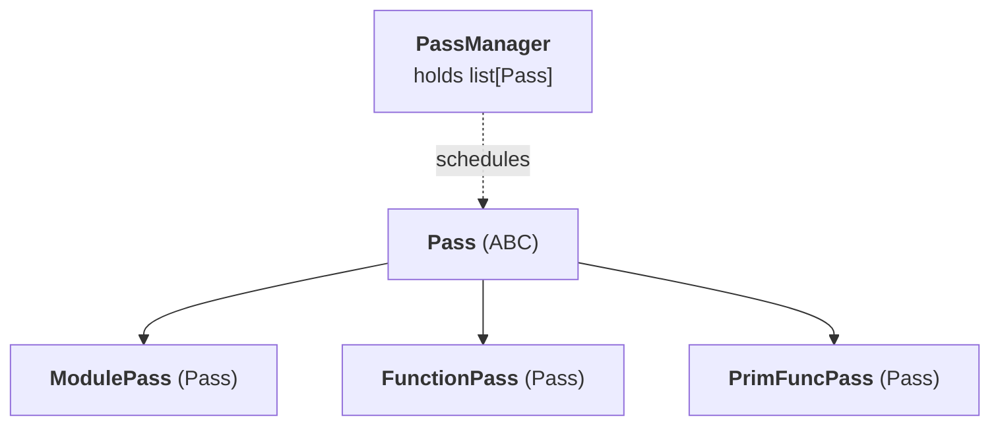

# TileFoundry Spec — passes

The pass framework (`Pass`, `ModulePass`, `FunctionPass`, `PrimFuncPass`,
`PassManager`), then the implemented passes and their contracts. A `Pass` is
the unit the compiler schedules over a `Module`.



## 1. Role

A `Pass` abstracts every Module-reading or Module-rewriting compile step.
`PassManager` runs the passes added with `PassManager.add(...)` sequentially,
in registration order. A pass has one of three granularities: `ModulePass`,
`FunctionPass` or `PrimFuncPass`.

## 2. `Pass` base class

```python
from abc import ABC, abstractmethod
from tilefoundry.ir import core

class Pass(ABC):
    """A Module → Module function.

    Attributes:
        name: attribute; Stable dump and log name.
        requires: attribute; Ordered dependency assertion.
    """

    name: str = ""
    requires: tuple[str, ...] = ()

    @abstractmethod
    def run(self, module: core.Module) -> core.Module: ...
```

- constraints:
  - `run(module)` returns the resulting `Module`. `Module` is mutable. A
    pass MAY rewrite the Module tree in place (`Module.replace_functions`) and
    return the same object. Child Modules are shared by identity. The default
    `FunctionPass.run` / `PrimFuncPass.run` return the input unchanged when no
    function changed, and otherwise a `dataclasses.replace` copy.
  - Passes MUST NOT depend on global state. All configuration enters
    through constructor parameters or pass-local attributes.
  - Pass failures raise named exceptions (e.g. `VerifyError`); they
    do not swallow errors.

## 3. Three pass granularities

### 3.1 `ModulePass`

Runs over the whole `Module` and may add, remove or reorder functions, for
example by synthesizing an entry the module does not declare
([§7.3](#73-inserthostentrypass)).

```python
class ModulePass(Pass):
    """Run over a complete Module."""

    @abstractmethod
    def run(self, module: core.Module) -> core.Module: ...
```

A `ModulePass` inherits the [§2](#2-pass-base-class) contract.

### 3.2 `FunctionPass`

Visits each `core.Function` in `module.functions`. The default `run` calls
`run_function` for HIR entries, passes other entries through, and reassembles
the `Module`.

```python
class FunctionPass(Pass):
    """Run independently over each HIR Function."""

    @abstractmethod
    def run_function(self, fn: core.Function, module: core.Module) -> core.Function: ...
    def run(self, module: core.Module) -> core.Module: ...
```

### 3.3 `PrimFuncPass`

Same shape as `FunctionPass`, but visits `core.PrimFunction` entries and
passes HIR entries through.

```python
class PrimFuncPass(Pass):
    """Run independently over each TIR PrimFunction."""

    @abstractmethod
    def run_prim_func(self, fn: core.PrimFunction, module: core.Module) -> core.PrimFunction: ...
    def run(self, module: core.Module) -> core.Module: ...
```

## 4. Transform pass idiom

Transform passes use the visitor / mutator base classes from
[visitor-mutator](./visitor-mutator.md) rather than hand-written `isinstance`
dispatch. A transform `PrimFuncPass` wraps a `StmtExprMutator` subclass.
`run_prim_func` runs the mutator over `fn.body`. It returns `fn` when the returned
body is the same object. Otherwise it returns `replace(fn, body=new_body)`. The
visit-and-rewrite contract, including the `visit_Evaluate` entry form for TIR
effect Ops, is owned by
[visitor-mutator §7](./visitor-mutator.md#7-visitor-entry-forms-for-evaluate).

## 5. `PassManager`

A linear scheduler that runs passes in registration order.

```python
class PassManager:
    """Ordered pass pipeline.

    Attributes:
        passes: attribute; the registered passes, run in registration order.
    """

    passes: list[Pass] = field(default_factory=list)

    def add(self, p: Pass) -> "PassManager": ...      # register a pass; returns self for chaining
    def run(self, module: core.Module) -> core.Module: ...      # run passes in registration order
```

- constraints:
  - `run` first checks `requires`: each name MUST be the `name` of a pass added
    earlier, otherwise `ValueError`. It is an ordering assertion, not a
    topological sort.

`PassManager` does not own a dump destination. When the caller wraps the run in
a `tilefoundry.dump.Scope` and `Flags.PASS_IR` is enabled, each pass writes
`before.txt` / `after.txt` under `<scope-root>/{NN}_{pass_name}/`. Otherwise
`dump(...)` is a no-op. The before/after representations MUST be passed as
no-argument producers. Then `repr` is evaluated only when `PASS_IR` is enabled in
an active scope.

## 6. Top-level API

Two public verbs operate on `core.Module` only:

```python
class Options:  # compiler.Options; the root re-exports it as CompilerOptions
    """Gather the options of every stage, one part per stage.

    Attributes:
        target: attribute; Constructed compilation Target.
        passes: attribute; ``passes.Options`` handed to ``passes.default_pipeline``.
        codegen: attribute; ``codegen.Options`` handed to ``codegen.link_program``.
        dump: attribute; ``dump.Flags`` that choose what the pipeline dumps.
    """

    target: Target
    passes: passes.Options = passes.Options()
    codegen: codegen.Options = codegen.Options()
    dump: dump.Flags = dump.Flags.ALL


def build(mod: core.Module, /, *, target: Target | None = None, options: Options | None = None) -> runtime.Module: ...
def compile(mod: core.Module, /, *, target: Target | None = None, options: Options | None = None) -> runtime.Module: ...
```

`build` takes a TIR `Module` whose `Module.entry` is a CPU host entry, then
codegen → toolchain link → loader, and returns a `runtime.Module`
([runtime](./runtime.md)). It requires the Module to own its Target; an
explicit Target that disagrees with the declared one is an error.

`compile` runs `passes.default_pipeline(module, options.passes)` over the
Module. Then it runs `build`, which hands `options.codegen` to `codegen.link_program`.
Both steps run inside a `dump.Scope` opened with `options.dump`. That scope only narrows
the scope already active. The pass list is [§7.2](#72-target-pass-points). The
`jit` convenience, which also accepts a bare Function, and its cache contract
are owned by [runtime §1.6](./runtime.md#16-compiler).

### Dirty-scope retype / verify

`typeinfer` and `verify` are not standalone pipeline stages, and there is no
`TypeInferPass`. The parser already runs eager typeinfer
([parser](./parser.md)), so a `Module` entering the pipeline has `Expr.type`
filled. After each pass, `PassManager` rechecks the pass's **dirty scope**. The
dirty scope contains every function on the Module's call paths whose object identity
was not on them before the pass. It also contains every function that reaches one of
those by calls or launches at any depth, variants included. A reference that does not
resolve raises.
Rechecking is per whole function.

- HIR: `verify_function`, then type inference with ranges, which refreshes
  `RangeMetadata` over the complete function.
- TIR: `verify_prim_function`, which retriggers `typeinfer` on the embedded Expr
  fields and refreshes their `.type`.

A rewrite that keeps a function's identity, and changes no function it reaches,
is therefore not rechecked.

## 7. Implemented passes

### 7.1 `ConvertHIRToTIR`

```python
class ConvertHIRToTIR(ModulePass):
    """Replace one selected scheduled HIR entry with verified TIR."""

    visitor: ClassVar[type[Lowering]] = Lowering
    options: passes.Options = passes.Options()
    name: str = "convert-hir-to-tir"
    requires: tuple[str, ...] = ()
    analyses: tuple[str, ...] = ("memory",)

    @classmethod
    def create(cls, target: Target, options: passes.Options) -> ConvertHIRToTIR: ...
    def run(self, module: core.Module) -> core.Module: ...
```

- constraints:
  - The pass lowers the device root of the Module it receives, in place, and
    its retained calls. The device root is the callee of the `Launch` in
    `Module.entry` when that entry is a CPU host, otherwise `Module.entry`
    itself. The root MUST carry the memory analysis
    (`AllocationSummaryMetadata`); otherwise the pass raises `LoweringError`. It
    never checks or analyzes again, and it takes nothing but configuration at
    construction. Generated names come from the `BindingMetadata` on that IR.
  - A Target MAY bind a subclass with `@bind(TargetClass, ConvertHIRToTIR)`;
    finalization obtains the pass through `Target.resolve(ConvertHIRToTIR)`. The
    entry function and every callee are lowered by the same `visitor` class.
  - `analyses` names the analysis families the pass's visitor reads; a
    subclass whose visitor reads more names them too. `tilefoundry schedule
    finalize` runs exactly these on the pass `Target.resolve` gives.
  - The module-level functions of `passes/transforms/convert_hir_to_tir.py`
    give whether a Call is a dimension. They give the instruction a Call issues and
    its operand types. They give the mesh that owns a copy or an instruction. They
    give the accepted aliases that lowering applies. A target analysis that follows
    lowering imports the same functions.
  - The visitor lowers each HIR node in its `visit_<Node>`. `visit_Call` lowers
    a Call that `lowers_to_dim` accepts as a dimension. For any other Call, it
    lowers the values that its storage's dimensions read. Then it lowers its
    operands. Then it dispatches a retained call to `visit_callee`, else to
    `visit_<HIR op>`, else to `visit_T`. That visit dispatches the selected TIR op
    to `visit_T_<Name>`, else to `default_visit_T`. `visit_<HIR op>` and the Expr
    visits share one name space. The visitor MUST NOT define a visit for an HIR op
    with an Expr class name (for example `ShapeOf`).
  - The core visitor lowers mesh regions, retained calls, the views
    `TupleGetItem`, `Slice`, `Reshape` and `Bitcast`. It also lowers a `Reshard`
    whose result has an accepted VIEW alias, and `Empty`. Any other `Reshard` goes to
    `visit_T`. An unscheduled `IndexSelect` raises `LoweringError`. Its
    `default_visit_T` raises `LoweringError` naming the Call, the TIR op and the
    Target. A node without a visit raises `LoweringError` naming the node
    and the Target. A target visitor overrides the visits it changes and
    implements the rest: loops, `InsertSlice`, `Zeros`, `FullLike` and
    instruction issue.
  - On entry to the function body, the core visitor first lowers the children
    that `LivenessMetadata.orders` lists for it, in that order
    ([analysis §1.2.2](./analysis.md#122-memory)). It does the same for any region's
    body in `on_region_start`. Statements then follow the events that the analysis
    planned with. A target visitor
    that lowers loops enters each loop's body through `on_region_start` inside
    the loop's builder region.
  - The pass lowers the device root: the callee of the `Launch` in `Module.entry`
    when that entry is a CPU host, otherwise `Module.entry` itself. It returns the
    Module unchanged under `passes.Options(lower=False)` or when the Module has no
    HIR function. When lowering HIR from a CPU host root, exactly one `Launch` MUST
    resolve to an HIR function. Otherwise `LoweringError` names the host and the
    number of such launches.
  - Address assignment comes only from `MemoryMetadata`: integer shared-memory
    addresses are byte offsets, and every analyzed offset becomes one concrete
    buffer view. Multiple offsets bind one view per offset. They also bind one tuple of
    those views outside the outermost enclosing HIR loop. Each consuming scope
    binds the selected stage `stages[index]` once. The index is the linear
    iteration ordinal
    from outermost to innermost, modulo the number of buffers, when inner loop
    trip counts are constant. Otherwise selection uses a rank-0 integer register
    counter modulo the number of buffers. Lowering initializes the counter to zero
    before the outermost staged loop. It increments the counter after all uses in
    each completed innermost staged iteration. All uses in one iteration see the
    same slot.
    Instruction-generated loops do not enter this index.
    An adopted update window is written at its producer. `InsertSlice` skips
    copying only when the update's alias names that HIR destination, resolved
    through region captures.
    A loop-carried entry alias must name its slot's initial value; any other
    entry alias raises `LoweringError`. A accepted semantic alias identifies its
    destination as `BufferAlias.target: SSAValue`. Lowering MUST select the
    flattened target leaf, including nested tuple paths, before binding storage.
    Lowering MUST apply accepted ties at
    every storage level. A tied carry reuses its initial storage. An untied carry
    copies the initial into independent phi storage before the loop. An accepted
    yield-to-phi alias binds the producer output to phi storage, including rmem.
    The backedge needs no copy when the yield has that tie. It also needs no copy
    when its tied InsertSlice destination resolves through captures to the phi.
    Otherwise lowering MUST copy yield to phi. A tied InsertSlice returns destination
    storage; an untied one MUST copy destination to result before writing the
    update window. An update without an adopted WINDOW alias MUST be copied
    into the result window. Allocation's peak-estimation storage links do not imply
    that lowering shares registers; only accepted semantic aliases state that sharing.
  - Schedule type inference and candidate admission MUST share one geometric
    projection implementation with lowering. It infers `repeat`, `order`,
    local issue shapes and `bind`. Type inference and candidates additionally
    call `check_call` to check the declared execution mesh, operand reachability,
    projected atom patterns, `between` relations and registered leaf verifiers.
    Lowering only consumes the projection; it does not repeat admission checks.
    An unscheduled HIR operation MUST have exactly one registered candidate;
    its operand hook supplies any explicit source view (including Transpose).
  - One `LoweringContext` carries read-only `StoragePlan` and `IssuePlan`
    answers, `Names`, and a `TirBuilder`. Only the builder writes TIR.
  - HIR mesh and loop regions become `MeshScope` and `For`; register allocations
    become `AllocTensor`; scheduled and ordinary value operations become
    effect-form TIR calls. Views follow their storage root, so a parameter view
    is addressed through `PtrOf` rather than an analyzed arena offset.
  - Lowering MUST obtain HIR lexical ownership, captures and enclosing execution
    meshes from the shared valuation visitor/context. Planning stores references
    to those contexts rather than constructing a separate region tree. TIR
    statement builders retain their own emitted scopes and destinations.
  - Lowering MUST reserve generated region bindings in lexical pre-order before
    statement emission. An outer `scope` index then precedes its nested indices.
    The root region reserves `cta`; all other mesh regions, including zero-only
    regions, reserve `scope` names.
    Every HIR `MeshRegion` becomes one `MeshScope`, with its arguments evaluated
    outside it. Non-atom instructions without an operand-declared mesh use
    the current scope, retaining unit axes. An instruction issued on the enclosing
    scope's mesh is emitted directly; another declared mesh opens a nested
    `MeshScope`. Meshes compare after resolving layouts, preserving unit axes.
    IR and type mesh names are retained; lowering MUST NOT rebuild meshes.
    Adjacent scopes are not merged. A view is bound in each consuming scope,
    never at its definition; its sharding refers to that scope's mesh.
    Storage declarations follow their HIR definition's scope and position.
    Constant-address `smem` and scratch-backed `gmem` views are materialized in
    each consuming scope. Visit memoizes each HIR node's lowered result in the
    context; forwarded SSA leaves reuse that result. Storage links MUST NOT
    introduce TensorView wrappers. HIR view operations retain their corresponding
    views, including authored identity views. Instruction operands use the same
    Visit path; only a required issue tile introduces a new operand window.
    A window that starts at zero and spans its operand's shape is the operand
    itself. Lowering issues that operand, or its own pointer where the window
    takes another type, and builds no `Slice` for it.
    Lowering MUST obtain storage answers from StoragePlan, the sole reader of analysis
    storage metadata in this pass. The context reads `MemoryMetadata.offsets`,
    accepted links in AllocationSummaryMetadata.values, and the unchanged
    AllocationSummaryMetadata.address_decisions. It chooses direct storage partners,
    output positions and refusals; analysis publishes no derived aliases.
    Each HIR view is formed on its visited operand using the registered op's
    own result-to-operand relation. StoragePlan computes physical view recipes;
    TirBuilder only declares, binds, materializes and emits them. Adopted update windows use InsertSlice's offsets
    at the storage representative; identity forwards need no inverse relation.
    Moving a decision through its structural chain, or placing a written
    producer on an output reached through a view, requires identity coordinates.
    A nonidentity step raises `LoweringError` naming the value and relation;
    lowering MUST NOT silently discard the required inverse relation.
    Copy decisions query accepted kind and partner together: INSERT_SLICE for
    destination copies, WINDOW for update copies, CARRY_INIT for entry copies,
    and CARRY_YIELD for backedge copies. Multiple ties remain distinct.
    Nested view text may differ from a flattened root view, but the physical
    address mapping MUST remain the same. The context derives origin and strides
    from the partner's physical layout; an image bounding box is not a layout.
    A non-affine access retains a partner ComposedLayout's composition; without
    that composition it raises LoweringError naming the relation. Existing
    refusals, including duplicate output storage, retain their text.
    Only `gmem` and `smem` have physical address assignments. Optional `rmem`
    IN_PLACE sharing is a live-byte peak estimate: each result retains its own
    typed AllocTensor. Semantic views, forwards, InsertSlice destinations and
    carry ties share register storage. Placed `smem` views MUST state their dtype
    explicitly at the analyzed byte offset. TensorView does not reinterpret a
    typed pointer's dtype. Loop coordinates in those relations MUST bind to their
    own induction values in the visit context.
    Shared register storage is declared at the outermost definition among its
    users, retaining the HIR tensor type and declared mesh.
    Staged storage retains its declaration site outside the outermost HIR loop.
    Each return-type leaf becomes a new external output parameter with that
    leaf's type; `umat` becomes `gmem`, retaining its layout. A non-tensor leaf
    raises `LoweringError` naming its position and type. Outputs use the analyzed
    storage without a producer-kind whitelist or a structural HIR storage trace.
    Repeated output storage roots and leaves without a proved address raise
    `LoweringError`. Retained-call arguments and destinations MUST be Tensor or
    TensorView objects over the caller's analyzed storage. The exception is a returned
    call result. It uses the caller's output parameter. Along a return address chain,
    the objects that writes produce MUST be views of that return leaf's output
    parameter. Their VIEW/FORWARD results MUST be views of it too. Input objects and read-only views taken
    directly from them MUST retain the input parameter. A read-only return emits
    no write or copy; overlap between input and output remains the caller's job.
    Consider a callee that writes into a formal. If the caller cannot place its
    result on that actual's storage, lowering MUST retain the `cannot be placed on its output`
    refusal.
    Each external output's address is the caller's responsibility; host entry,
    automatic runtime outputs and the codegen signature add no alias contract.
    `Zeros` and `FullLike` share fill lowering; the scalar constant uses the
    destination dtype and requested value. Each fill is emitted in its producer's
    scope; `Empty` emits no fill. Lowering does not add output or retained-call
    copies. Carry entry and backedge copies execute the analyzed storage decisions.
    Slice starts MUST materialize on-demand Call results as TIR scalar operands,
    including Calls nested in dimension expressions. The materialized binding
    MUST be visible where the slice key is emitted.
    A region result must not reference variables bound inside the region,
    including variables in a view's base or start coordinates.
  - Any construct without a complete lowering MUST raise `LoweringError`; the
    pass never emits a partial `PrimFunction` or silently preserves HIR.

Scheduled lowering MUST retain loops and produce one `PrimFunction` per reached
definition, preserving shared child definitions. Each lowered function's
parameters are its inputs, its scratch, then its outputs. Lowering
decides the scratch list (`scratch_buffers`) from memory analysis before emission.
The list has one `gmem` buffer for each allocation root that the function owns.
The root is neither an input nor an output nor an alias. Then, for each call site, it
has the parameters that the call forwards to its callee's scratch. Two calls of one
definition forward separate buffers.
Emission only reads this list and MUST NOT append scratch. Lowering MUST NOT
rewrite a host function after it lowers the device functions. Tensor parameters retain their
HIR types, and output parameters follow the return-leaf rule above, including
`ShardLayout`. Default and explicit compact row-major layouts denote the same
physical layout. A returned retained call MUST receive the caller's output
parameter directly when it satisfies the same address rule as `Empty`.
Call boundaries MAY create matching views of
existing buffers, but MUST NOT insert copies, scheduling, or storage transfers.
The original destination remains the call's result after passing its view.

A callee output MAY be in on-chip memory. An smem return MUST copy into the smem
output buffer supplied by its caller. Other callee returns not bound to that
output buffer MUST fail with `LoweringError`. The error names the callee and call path.
It requires an explicit HIR `tf.schedule` copy. Lowering MUST NOT repair such an
input or schedule logical HIR automatically. Existing root output copying is
unchanged. Codegen does not support these retained TIR calls and MUST refuse them
with `no codegen handler for Op <type>` when emission reaches one.

### 7.2 Target pass points

The target pass registry in `passes/pass_manager.py` exposes these fixed points:

```python
class PassPoint(Enum):
    BEFORE_LOWER = "before_lower"
    AFTER_LOWER = "after_lower"
    BEFORE_CODEGEN = "before_codegen"


registry: Registry  # keyed by (target class, PassPoint, pass class)


def register_pass(
    target: type[Target], point: PassPoint
) -> Callable[[type[ModulePass]], type[ModulePass]]: ...


def for_target(module: core.Module, point: PassPoint) -> list[ModulePass]: ...
```

- constraints:
  - `passes.for_target` MUST collect PrimFunction targets from each function and
    HIR targets from the corresponding `collect_functions` context. A context
    with no Target MUST contribute no target. It MUST order
    targets by registered name and preserve registration order within a target.
  - A pass class MUST be registered at most once per point. A duplicate MUST
    raise `ValueError` naming the Target and pass.
  - Finalize, compile and scaffold MUST run the same pass list
    (`passes.default_pipeline`). The list is, in order: `BEFORE_LOWER` target passes,
    `InsertHostEntryPass`, `ConvertHIRToTIR`, `AFTER_LOWER` target passes,
    `BEFORE_CODEGEN` target passes. Scaffold passes
    `passes.Options(lower=False)` here and `codegen.Options(emit="skeleton")` to
    `link_program`.

### 7.3 `InsertHostEntryPass`

```python
class InsertHostEntryPass(ModulePass):
    name: str = "insert-host-entry"
    requires: tuple[str, ...] = ()

    @classmethod
    def create(cls, target: Target, options: passes.Options) -> InsertHostEntryPass: ...
    def run(self, module: core.Module) -> core.Module: ...
```

Core defines the pass with `create(target, options)`; its default `run` returns
its Module unchanged. A Target MAY bind a subclass with
`@bind(TargetClass, InsertHostEntryPass)`; `default_pipeline` obtains it through
`Target.resolve(InsertHostEntryPass, options)`. It runs after `BEFORE_LOWER`
target passes and before `ConvertHIRToTIR`. The target owns the supported device
shapes and launch geometry. A TIR Module receives no entry: one without a CPU
entry is rejected by compile.

- constraints:
  - An existing CPU entry MUST pass through unchanged.
  - A synthesized `Launch` MUST state the analyzed shared-memory peak as
    `dynamic_smem`, and 0 when the Module carries no memory analysis.
  - A synthesized entry declares the parameters [§7.1](#71-converthirtotir)
    gives the launched function, with no scratch without memory analysis, and
    its `Launch` forwards all of them. Their names avoid each other.
    `output_count` counts the destinations only.
  - Normalization MUST preserve each authored function's Target.
  - A synthesized `Launch` MUST carry its settled geometry so downstream
    codegen reads it without deriving it again.

### 7.4 `differentiate`

```python
# tilefoundry.passes.transforms.differentiate, exported by tilefoundry.dsl
def differentiate(
    module: core.Module, *, wrt: tuple[str, ...], recompute: tuple[str, ...] = ()
) -> tuple[core.Module, core.Module]: ...

class Saved:
    """One value the forward keeps for the backward; frozen."""

    name: str
    type: types.Type
    origin: str

def saved_values(forward: core.Module) -> tuple[Saved, ...]: ...
def select_value(module: core.Module, selector: str) -> expr.Expr: ...
```

`differentiate` is not a `Pass`: the author calls it with arguments, and it
returns two Modules. It reads the entry of *module*, which MUST have passed type
inference, and builds `<Name>Forward` and `<Name>Backward`. The author calls the
two from a step of their own; `differentiate` builds no step and no optimizer.
It returns two Modules because the author's step computes the loss between
them, and the backward reads values the forward computed: those reach it only
through `saved`.

- The forward entry keeps the name and the parameters of the original entry. It
  returns the original results, flattened, and last a `saved` tuple.
- The backward entry is named `backward`. Its parameters are the gradient of each
  floating point result, in result order, then `saved`. It returns the gradient
  of each `wrt` parameter, in `wrt` order: one value for one name, a tuple for
  more. The gradient of a tuple parameter is a tuple of the same structure.
- `saved` holds only what the backward reads: values the forward computed, and
  parameters by reference. A value named in `recompute` is computed again in the
  backward from what it reads, which `saved` holds instead.
- A function of the same Module that the entry calls is differentiated with
  respect to each of its floating point parameters that is not a `ConstTensor`.
  Each Module keeps one forward and one backward version of it under its own
  name. A child slot's Module is differentiated the same way and takes the same
  slot in both generated Modules. A callee's `saved` is one item of its
  caller's `saved`; in a loop body its items are taken one at a time, as the
  loop rule below says.
- A `MeshRegion` stays a region in both Modules. A value inside a forward
  region that the backward reads leaves the region as an extra result; the
  backward region of the same mesh takes it, and the gradients, as arguments.
- A `LoopRegion` with a static trip count becomes a backward loop that runs its
  iterations in reverse. Its carries are the gradient of each forward carry and,
  for each value the body reads from outside, the sum of that value's
  gradients, resharded to `gradient_layout` at each iteration. A value of an
  iteration that the backward reads is stacked: the forward loop carries one
  stack per tensor, of the value's type with a leading axis of trip-count rows,
  not split (`Split(a)` becomes `Split(a + 1)`), writes the row of each
  iteration with `InsertSlice`, and returns the stacks as extra results; the
  backward reads its row with `Slice`. The induction value is not stacked: the
  backward computes it from its own index. A value the body reads from outside
  is not stacked. A body value that an Op computes from the induction value,
  values the body reads from outside and constants only is computed again in
  the backward body, not stacked. An item of a body callee's `saved` that is a
  parameter of the callee, passed such a value, is that value again; the other
  items are stacked one by one. A loop that runs no iteration passes the
  gradient of each carry to its initial value.
- A value that only parameters outside `wrt`, constants and `ConstTensor`
  parameters reach has no gradient and gets none; a `wrt` parameter that no
  gradient reaches gets zeros.
- Gradient layout: the gradient of a value of layout `L` has layout
  `gradient_layout(L)`, which is `L` with each `Partial` read as `Broadcast`.
  A gradient that reaches an Op's rule with another layout, such as the
  `Partial` gradient a column-split `MatMul` gives its `Broadcast` input, is
  resharded to it first. The backward of a `Reshard` reshards the gradient,
  whatever its layout, back to `gradient_layout` of its input's layout, in one
  `Reshard`, and in none when the two layouts are the same. Each gradient parameter of the
  backward has `gradient_layout` of its result's layout. A `wrt` gradient whose
  layout differs from `gradient_layout` of its parameter's layout gets a final
  `Reshard` to it, so a broadcast weight's partial gradient is all-reduced.
- Each Op that can be differentiated registers one rule
  ([visitor-registry §12](./visitor-registry.md#12-instance-5--autodiff)).
- `recompute` items are `Module[.function]:variable`. The part before `:` is a
  selector as in [cli Commands](./cli.md#commands), resolved by `Module.name`
  among the Modules reachable from *module*; without `.function` it names the
  entry. The variable is the name the author bound.
- `saved_values` lists the items of a generated forward's `saved` with the name
  the author bound (`v<index>` when there is none), the type, and the origin:
  `parameter`, `carry`, the Op and its source line, or the call whose `saved`
  it is; a stack names the trip count first (`stack of 5: ...`).
- constraints:
  - `differentiate` MUST NOT change *module*.
  - Each refusal is a `ValueError` that names what it refuses, and the source
    line when there is one: an empty `wrt`; a `wrt` name that is not a
    parameter, not a floating point tensor or a tuple of them, or a
    `ConstTensor`; an Op with no rule, or a kind or an attribute its rule does
    not take (a strided `Slice`, an `IndexSelect` with `fill_value`, a `TopK`
    off the last axis); a loop that a gradient reaches whose trip count is not
    static, that has no carry, or that carries a tuple; a loop value the
    backward reads that is `Partial`; a call that reaches past one child slot;
    a callee named `backward`; a `recompute` selector without `:`, with a child
    slot path, naming no reachable Module, a Module name two reachable Modules
    share, no function, no value, two values of one name, a parameter, a value
    computed by a call rather than an Op, or a value inside a loop body (the
    first version saves every value of a loop body); and a backward that
    `differentiate` generated, since a second derivative is not supported.

## 8. Directory layout

File layout is implementation-owned. Dispatch registry ownership is defined by
[visitor-registry](./visitor-registry.md).
