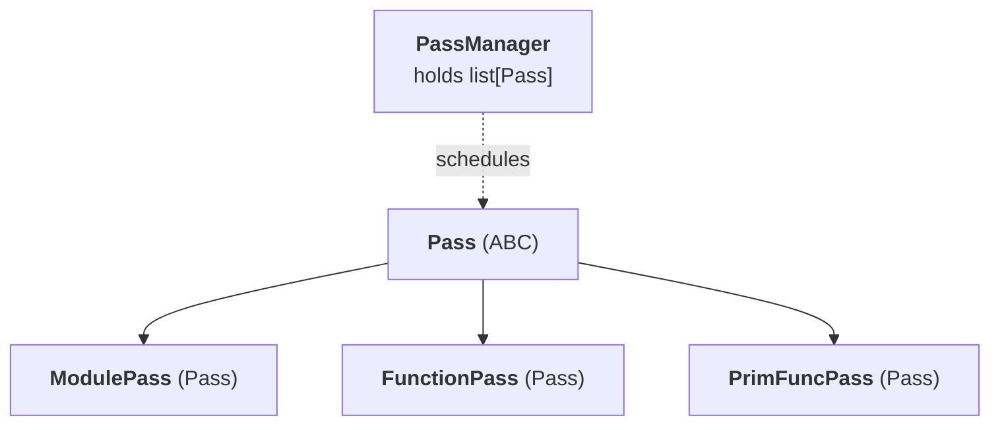

# TileFoundry Spec — passes

The pass framework: `Pass` / `ModulePass` / `FunctionPass` /
`PrimFuncPass` / `PassManager`. A `Pass` is the unit the compiler
schedules over a `Module`; a transform is one stage in this pipeline,
not a free function. After the framework, this spec lists the
implemented passes and their per-pass contracts.



## 1. Role

A `Pass` abstracts every Module-reading or Module-rewriting compile
step; `PassManager` runs registered passes in registration order. The
pass framework is:

- a linear pipeline — passes run sequentially in registration order;
- three pass granularities: `ModulePass` / `FunctionPass` /
  `PrimFuncPass`;
- explicit registration — passes are added via `PassManager.add(...)`.

## 2. `Pass` base class


```python
from abc import ABC, abstractmethod
from tilefoundry.ir.core import Module

class Pass(ABC):
    """A Module → Module pure function.

    Side-effect logging is allowed, but the input Module MUST NOT be
    mutated — Module is a frozen dataclass, so a mutator returns a new
    instance.

    Attributes:
        name: attribute; Stable dump and log name.
        requires: attribute; Ordered dependency assertion.
    """

    name: str = ""
    requires: tuple[str, ...] = ()

    @abstractmethod
    def run(self, module: Module) -> Module: ...
```

- constraints:
  - `run(module)` returns a new `Module`; it does not mutate input.
  - Passes MUST NOT depend on global state. All configuration enters
    through constructor parameters or pass-local attributes.
  - Pass failures raise named exceptions (e.g. `VerifyError`); they
    do not swallow errors.

## 3. Three pass granularities

### 3.1 `ModulePass`

Runs over the whole `Module` and may add / remove / reorder
functions. Examples: module-level inline, dead-function elimination,
synthesizing an entry the module does not yet declare
([§7.3](#73-insert_default_host_entry)).

```python
class ModulePass(Pass):
    """Run over a complete Module."""

    @abstractmethod
    def run(self, module: Module) -> Module: ...
```

- constraints:
  - `run` returns a new `Module`; inherits the `Pass` no-mutation / no-global-state
    contract ([§2](#2-pass-base-class)).

### 3.2 `FunctionPass`

Visits each `hir.Function`. The framework supplies a default `run`
that walks `module.functions`, calls `run_function` for HIR
entries, and reassembles the `Module`.

```python
from tilefoundry.ir.hir import Function as HirFunction

class FunctionPass(Pass):
    """Run independently over each HIR Function."""

    @abstractmethod
    def run_function(self, fn: HirFunction, module: Module) -> HirFunction: ...
    def run(self, module: Module) -> Module: ...
```

- constraints:
  - inherits the `Pass` contract ([§2](#2-pass-base-class)); the default `run` reassembles the `Module`
    from `run_function` results.

### 3.3 `PrimFuncPass`

Same shape as `FunctionPass`, but visits `tir.PrimFunction`.

```python
from tilefoundry.ir.tir import PrimFunction

class PrimFuncPass(Pass):
    """Run independently over each TIR PrimFunction."""

    @abstractmethod
    def run_prim_func(self, fn: PrimFunction, module: Module) -> PrimFunction: ...
    def run(self, module: Module) -> Module: ...
```

- constraints:
  - inherits the `Pass` contract ([§2](#2-pass-base-class)); same shape as `FunctionPass` over
    `tir.PrimFunction`.

## 4. Transform pass idiom

Transform passes use the visitor / mutator base classes from
[visitor-mutator](./visitor-mutator.md) rather than hand-written
`isinstance` dispatch.

A transform `PrimFuncPass` wraps a `StmtExprMutator` subclass: `run_prim_func`
runs the mutator over `fn.body`, returns `fn` unchanged when the mutator
preserves identity (the returned body is the same object), and otherwise
returns `replace(fn, body=new_body)`. The inner mutator matches on `Evaluate`
and dispatches on `type(stmt.callable)`.

The visit-and-rewrite contract — including the `visit_Evaluate`
entry form for TIR effect Ops — is owned by
[visitor-mutator §7](./visitor-mutator.md#7-visitor-entry-forms-for-evaluate).

## 5. `PassManager`

A linear scheduler that runs passes in registration order and
optionally drops per-pass IR dumps when wrapped in a
`tilefoundry.dump.DumpScope`.

```python
class PassManager:
    """Ordered pass pipeline.

    Attributes:
        passes: attribute; the registered passes, run in registration order.
    """

    passes: list[Pass] = field(default_factory=list)

    def add(self, p: Pass) -> "PassManager": ...      # register a pass; returns self for chaining
    def run(self, module: Module) -> Module: ...      # run passes in registration order
```

- constraints:
  - `requires` is an ordering assertion checked before the run, not a topological sort.

`PassManager` does not own a dump destination. When the caller
wraps the run in a `DumpScope` and `DumpFlags.PASS_IR` is enabled,
each pass writes `before.txt` / `after.txt` under
`<scope-root>/{NN}_{pass_name}/`. Without an active scope or with
the flag off, `dump(...)` is a no-op. The before/after representations MUST
be passed as no-argument producers, so `repr` is evaluated only when
`PASS_IR` is enabled in an active scope.

## 6. Top-level API

Three public verbs operate on `Module` (no bare `HirFunction` /
`PrimFunction`):

```python
class CompilerOptions:
    """Carry deterministic compiler configuration.

    Attributes:
        target: attribute; Constructed compilation Target.
    """

    target: Target

    def canonical_text(self) -> str: ...


def build(mod: Module, /, *, target: Target | None = None) -> RuntimeModule: ...
def compile(mod: Module, /, *, target: Target | None = None) -> RuntimeModule: ...
```

`build` takes a TIR `Module`, runs the pipeline over it, then codegen →
toolchain link → loader, and returns a `RuntimeModule`
([runtime](./runtime.md)). It requires the Module to own its Target; an
explicit Target that disagrees with the declared one is an error.

`compile` is `build`. The `jit` convenience and cache contract are owned by
[runtime §1.6](./runtime.md#16-compilepy).

### Dirty-scope retype / verify

`typeinfer` and `verify` are not standalone pipeline stages. The
parser already runs eager typeinfer ([parser](./parser.md)), so a
`Module` entering the pipeline has `Expr.type` filled. After each
pass runs, `PassManager` re-runs the relevant analysis on that
pass's **dirty scope**:

- HIR-side: changed `Function`s rerun the existing checks and refresh available
  `RangeMetadata` over the complete function without rewriting `.type`.
- TIR-side: changed `PrimFunction`s rerun `verify`, which
  recursively retriggers `typeinfer` on the embedded Expr fields
  and refreshes their `.type`.
- A `ModulePass` whose effect crosses functions (e.g. rewriting an
  `Evaluate(SymbolRef)` callee) MUST report its changed-function set
  or conservatively trigger a whole-module fallback.

Consequence: there is no separate `TypeInferPass`, and `verify` is
not inserted as a public `ModulePass`. Passes own rewrite work; the
unified retype / verify is scheduled by `PassManager`.

## 7. Implemented passes

### 7.1 `ConvertHIRToTIR`

```python
class ConvertHIRToTIR(ModulePass):
    """Replace one selected scheduled HIR entry with verified TIR."""

    entry: str | None
    name: str = "convert-hir-to-tir"
    requires: tuple[str, ...] = ()

    def run(self, module: Module) -> Module: ...
```

- constraints:
  - The pass runs `analyze(..., analysis=("memory",))` over the authored entry
    and lowers the checked Module and its retained calls. The authored function is
    retained separately so `BindingMetadata`, keyed by `SourceSpanMetadata`,
    remains the source of user-facing names after analysis has assigned its own
    internal bindings.
  - Address placement comes only from `MemoryMetadata`: integer shared-memory
    addresses are byte offsets, and every analyzed offset becomes one concrete
    buffer view. Multiple offsets form a staged tuple declared outside the
    outermost enclosing HIR loop. Selection uses the linear iteration ordinal
    from outermost to innermost, modulo the number of buffers; inner loop trip
    counts must be constant. Instruction-generated loops do not enter this index.
    An adopted update window is written at its producer. `InsertSlice` skips
    copying only when the update's alias names that HIR destination, resolved
    through region captures.
    A loop-carried entry alias must name its slot's initial value; any other
    entry alias raises `LoweringError`. A published alias identifies its
    destination as `BufferAlias.target: SSAValue`. Lowering MUST select the
    flattened target leaf, including nested tuple paths, before binding storage.
    Lowering MUST execute published ties at
    every storage level: a tied carry reuses its initial storage; otherwise it
    copies the initial into independent phi storage before the loop. A published
    yield-to-phi alias binds the producer output to phi storage, including rmem.
    The backedge needs no copy when the yield has that tie or its tied
    InsertSlice destination resolves through captures to the phi; otherwise
    lowering MUST copy yield to phi. A tied InsertSlice returns destination
    storage; an untied one MUST copy destination to result before writing the
    update window. An update without an adopted WINDOW alias MUST be copied
    into the result window. Allocation's peak-estimation buffers do not imply
    that lowering shares registers; only published aliases state that sharing.
  - Schedule type inference, candidate admission, finalization, and TIR effect
    verification MUST use the same `check_call` implementation. It checks the
    declared execution mesh, operand reachability, projected atom patterns,
    `between` relations, and any registered leaf verifier. Lowering consumes
    its projection rather than maintaining a second instruction geometry rule.
    An unscheduled HIR operation MUST have exactly one registered candidate;
    its operand hook supplies any explicit source view (including Transpose),
    and that candidate is admitted through `check_call`.
  - HIR mesh and loop regions become `MeshScope` and `For`; register allocations
    become `AllocTensor`; scheduled and ordinary value operations become
    effect-form TIR calls. Views follow their storage root, so a parameter view
    is addressed through `PtrOf` rather than an analyzed arena offset.
  - Lowering MUST obtain HIR lexical ownership, captures and enclosing execution
    meshes from the shared valuation visitor/context. Planning stores references
    to those contexts rather than constructing a separate region tree. TIR
    statement builders retain their own emitted scopes and destinations.
  - Generated region bindings MUST be reserved in lexical pre-order before
    statement emission, so an outer `scope` index precedes its nested indices.
    The root region reserves `cta`; all other mesh regions, including zero-only
    regions, reserve `scope` names.
    Every HIR `MeshRegion` becomes one `MeshScope`, with its arguments evaluated
    outside it. Non-atom instructions without an operand-declared mesh use
    the current scope, retaining unit axes. An instruction issued on the enclosing
    scope's physical frame
    is emitted directly; another frame opens a nested `MeshScope`. Frames compare
    after removing trivial composed-layout wrappers, preserving unit axes.
    Adjacent scopes are not merged. A view is bound in each consuming scope,
    never at its definition; its sharding refers to that scope's mesh.
    Storage declarations follow their HIR definition's scope and position.
    Constant-address `smem` and scratch-backed `gmem` views are materialized in
    each consuming scope. Registers shared by tied carries and their initials,
    or region results and their body values, are declared at the outermost
    definition among those values. An RMEM allocation MUST retain
    its HIR tensor type with a physical-frame mesh. Whole-tensor operands reuse
    that allocation; only subwindows require views. Each instruction MUST call
    the shared admission check once, before declaring storage, and use that
    projection for both storage handling and emission. Staged storage retains its
    placement outside the outermost HIR loop.
    Each return-type leaf becomes one output parameter with that leaf's type;
    `umat` becomes `gmem`, retaining its layout. A non-tensor leaf raises
    `LoweringError` naming its position and type.
    Before lowering, return storage is traced through mesh results, tied loop
    carries, tied insert destinations, captures, and static tuple selections. A leaf
    ending at an unclaimed single-buffer `Zeros`, `Empty`, or caller-declared
    retained-call result of the output parameter's exact type places that
    storage at the output parameter,
    regardless of storage kind. Repeated storage roots and leaves without
    such a root raise `LoweringError`. Other `gmem` zeros use scratch.
    Every zero fill is emitted in the zero's current scope; `Empty` emits no
    fill. A lowered leaf that is not its output parameter raises
    `LoweringError`. Lowering does not add output copies. Carry entry and
    backedge copies execute the analyzed storage decisions.
    A region result must not reference variables bound inside the region,
    including variables in a view's base or start coordinates.
  - Any construct without a complete lowering MUST raise `LoweringError`; the
    pass never emits a partial `PrimFunction` or silently preserves HIR.

Scheduled lowering MUST retain loops and produce one `PrimFunction` per reached
definition, preserving shared child definitions. Tensor parameters retain their
HIR types, and output parameters follow the return-leaf rule above, including
`ShardLayout`. Default and explicit compact row-major layouts denote the same
physical layout. A returned retained call MUST receive the caller's output
parameter directly when it satisfies the same placement rule as `Empty`.
Call boundaries MAY create matching views of
existing buffers, but MUST NOT insert copies, scheduling, or storage transfers.
The original destination remains the call's result after passing its view.

A callee output MAY be in on-chip memory. An smem return MUST copy into the smem
output buffer supplied by its caller. Other callee returns not bound to that
output buffer MUST fail with `LoweringError` naming the callee and call path and
requiring an explicit HIR `tf.schedule` copy. Lowering MUST NOT repair such an
input or schedule logical HIR automatically. Existing root output copying is
unchanged. Codegen does not support these retained TIR calls and MUST refuse them
with `no codegen handler for Op <type>` when emission reaches one.


### 7.3 `insert_default_host_entry`

```python
class InsertHostEntryPass(ModulePass):
    """Give a device-only module a host-callable entry.

    Attributes:
        name: attribute; Stable dump and log name.
        requires: attribute; Ordered dependency assertion.
    """

    name: str = "insert_host_entry"
    requires: tuple[str, ...] = ()

    def run(self, module: Module) -> Module: ...


def insert_default_host_entry(module: Module) -> Module:
    """Return a Module whose entry is host-callable.

    Args:
        module: Module to normalize.

    Returns:
        The unchanged or host-entry-normalized Module.
    """
    ...
```

- constraints:
  - The pass is the scheduled form of the transform and states no rule of its
    own. It is the one pass `build` ([§6](#6-top-level-api)) registers.
  - A CPU entry MUST pass through unchanged.
  - With no CPU entry, an all-HIR tree MUST gain one CPU entry per Module
    whose `entry` is set, root and children alike: Python begins a kernel
    invocation only by entering one ([hir §1.1](./hir.md#11-function),
    [core-ir §1](./core-ir.md#1-module)). Any other function gets no entry.
    The tree's resolved Target MUST be CUDA. Each entry launches the Module
    entry by its root-relative call path
    ([core-ir §1](./core-ir.md#1-module)) at the owner's
    effective topology and forwards its own parameters: the declared inputs,
    then one destination per tensor result leaf in tuple leaf order. A
    destination keeps the leaf's shape and dtype, with GMEM storage and no
    layout, and is named `out`, else its first free `_1`, `_2`, ... suffix,
    with the declared names reserved. A unit result adds none; any other
    result type MUST be rejected. The pass checks these when it builds the
    `Launch`, so later stages read them and do not derive them again. The
    authored root entry remains unchanged. The entry's IR name is
    `<fn.name>_host`, with the same suffix rule on collisions; its emitted C++
    and registration names follow the HIR callee's path
    ([codegen §4.4](./codegen.md#44-signatures)).
  - HIR device calls into a direct child's function with implicit ConstTensor
    arguments MUST be rejected, naming caller, callee and omitted weights and
    requesting explicit weight parameters or orchestration calls.
  - Mixed HIR/TIR device trees MUST be rejected.
  - With no CPU entry and exactly one CUDA TIR device function, the transform MUST
    synthesize a CPU entry that mirrors that function's parameters and launches
    it. One rule covers both device shapes: whether the call reads as a launch
    or as a dispatch follows from the callee's own shape, a lone kernel and a
    specialization prototype taking the same route here.
  - It MUST NOT rewrite the Target any function records. Which target a
    function runs on is what its author wrote.
  - The launch geometry MUST be settled here and written into the `Launch`, so
    nothing downstream derives it again. A prototype states no body of its own,
    so its variants state its geometry and they MUST agree.
  - It MUST reject ambiguous device-function sets, a non-entry CPU function, or
    a launch-provided dynamic CTA extent.

## 8. Directory layout

File layout is implementation-owned. Dispatch registry ownership is defined by
[visitor-registry](./visitor-registry.md).
