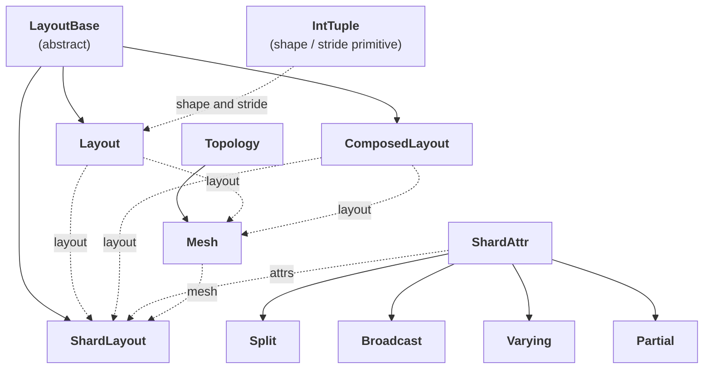

# TileFoundry Spec — Shard / Layout System



`TensorType.layout` ([types §2](./types.md#2-tensortype)) carries any
`LayoutBase`. Invariants live with the construct they constrain; enforcement is
dispatched by [visitor-registry](./visitor-registry.md), with concrete checks in
[tir §1.3](./tir.md#13-primfunction) and [hir §1.3](./hir.md#13-op).

---

## 0. Terms

$$
\underbrace{\mathcal{T}_{\mathrm{thread}}}_{\text{topology}} = \underbrace{(384)}_{\text{topology size}}
\qquad\qquad
\underbrace{0,\ 1,\ 2,\ \dots,\ 383}_{\text{unit ids}}
$$

1. A **topology** is one layer of parallel resource. Its name is the kind of **unit**. Its **topology size** counts its units within one unit of its parent, when present. A **unit id** is the number of one unit in its topology. The **topology scope** is all units of the topology.

$$
\underbrace{\big(\ \underbrace{\mathrm{gpu}:1}_{\text{topology level }0},\quad \underbrace{\mathrm{cta}:132}_{\text{topology level }1},\quad \underbrace{\mathrm{thread}:384}_{\text{topology level }2}\ \big)}_{\text{topologies of the Module}}
$$

2. A Module declares an ordered list of **topologies**. The **topology level** is the position of a topology in this list. Level 0 is the coarsest. The list is the Module's, not the target's: in `(cta, thread)` the cta is at level 0.

$$
\underbrace{\mathcal{M}}_{\text{mesh}} =
\underbrace{\Bigg[\ \underbrace{\begin{matrix}132@\mathrm{sm}\\384\end{matrix}}_{\text{cta group}}\ \Bigg|\ \underbrace{\begin{matrix}3@\mathrm{group} & 128@\mathrm{lane}\\128 & 1\end{matrix}}_{\text{thread group}}\ \Bigg]}_{\text{mesh layout}}
\qquad
\underbrace{\mathcal{M}_{\mathrm{cta}} = \begin{bmatrix}132@\mathrm{sm}\\1\end{bmatrix}}_{\text{sub mesh}}
$$

3. A **mesh** puts the units of adjacent topologies on named **mesh axes**. Each column of the **mesh layout** is `extent@mesh axis` above its stride. Each topology has one group of columns. A **sub mesh** contains one topology. Its strides divide the stored group strides by the product of the lower topology sizes.

$$
\underbrace{(1,\ 1,\ 40)}_{\text{coord}}\ \mapsto\ 384\cdot 1 + 128\cdot 1 + 40 = \underbrace{552}_{\text{index}} = \underbrace{1}_{\text{unit id in cta}}\cdot 384 + \underbrace{168}_{\text{unit id in thread}}
$$

4. The mesh layout maps a **coord** to the **index** of a unit. The index counts the units of all topologies of the mesh. It divides into one unit id for each topology.

$$
\underbrace{\mathcal{M}_{\mathrm{thread}}[1{:}3,\ :]}_{\text{sliced mesh}} = \begin{bmatrix}2@\mathrm{group} & 128@\mathrm{lane}\\128 & 1\end{bmatrix} + \underbrace{128}_{\text{offset}}
$$

5. A **sliced mesh** keeps the topology and the mesh axes. The **offset** is the index of the first unit of the slice.

$$
\underbrace{\big(\ \mathcal{M}_1,\ \underbrace{\mathcal{M}_2}_{\text{innermost mesh}}\ \big)}_{\text{enclosing meshes}}
\qquad
\underbrace{\mathcal{M}_{\mathrm{scope}}}_{\text{mesh scope}} = \Bigg[\ \begin{matrix}132@\mathrm{sm}\\384\end{matrix}\ \Bigg|\ \begin{matrix}2@\mathrm{group} & 128@\mathrm{lane}\\128 & 1\end{matrix}\ \Bigg] + 128
$$

6. Each mesh `with` adds one **enclosing mesh**. The first one is the outermost. The last one is the **innermost mesh**. The **mesh scope** composes the enclosing meshes in order, with the rules of [shard §5](#5-mesh). Its units are in force at that point of the program. Here $\mathcal{M}_1$ is the mesh of all cta, and $\mathcal{M}_2$ is the sliced mesh of item 5.

$$
\underbrace{\mathrm{mma}}_{\text{instruction}}:\quad
\underbrace{\mathcal{M}_{\mathrm{exec}} = \begin{bmatrix}32@\mathrm{lane}\\1\end{bmatrix}}_{\text{execution mesh}}
\qquad
\mathrm{repeat} = (4,\ 2)\ \Rightarrow\ \underbrace{8}_{\text{issues}}
$$

7. An **instruction** is a TIR op that declares an **execution mesh** and can be selected by scheduling. One **issue** is one application of the instruction to one tile. Lowering issues the instruction. The units of the execution mesh execute it.

$$
\underbrace{\mathcal{L}_C}_{\text{shard layout}} = \big(\ \underbrace{(256,\ 64):(64,\ 1)}_{\text{layout of the data}},\ \ \underbrace{(\mathrm{Broadcast},\ \mathrm{Split}(0),\ \mathrm{Split}(0))}_{\text{shard attrs}},\ \ \underbrace{\mathcal{M}_{\mathrm{scope}}}_{\text{mesh}}\ \big)
$$

$$
\underbrace{(256,\ 64)}_{\text{shape of }C}\ \rightarrow\ \underbrace{(1,\ 64)}_{\text{local shape of one unit}}
$$

8. A **shard layout** binds the layout of the data to a mesh. It has one **shard attr** for each mesh axis. **Local** is the part that one unit of the specified topology holds. The example gives the local shape at the thread topology.

$$
\underbrace{\{\ \underbrace{\mathrm{gpu}}_{\text{topology}} : \underbrace{0}_{\text{unit id}}\ \}}_{\text{placement}}
$$

9. A **placement** gives a unit id for each topology that it names. It tells where a process or a piece of data is. It may name only some topologies.

The names `gpu`, `cta`, `thread`, `sm`, `group` and `lane` above are examples of one target and its mesh axes.

**Execution**

| Term | Definition | Source | Words that MUST NOT name it | Python | C++ |
|---|---|---|---|---|---|
| unit (execution unit) | One thing that executes: one gpu, one cta, one thread. | own | `program`, `instance`, `participant`, `position` (for a member) | `per_unit`, `max_physical_units` | — |
| topology | One layer of parallel resource: the kind of unit (its name) and the number of units. | existing | `level` (for this object) | `Topology(name, size)` | enum value only |
| topology size | The number of units of this topology in one unit of the topology above. | CuTe `size` | `program_dim`, `instances`, `extent` of a topology | `Topology.size` | `topology_size<L>()` |
| topology level | The position of a topology in the topologies that the Module declares, an `int`. 0 is the outermost. Python and C++ count the same list. | own | `topology_level: str` (a value that is a name) | `topology: str` for a name; `topology_level(topology, topologies)` gives the position | `cute::find(program_topologies(), cute::C<L>{})` gives the position; `enum class TopologyLevel` labels the topology |
| unit id | The number of a unit in its topology, in `[0, size)`. | CUDA `%tid`, `%ctaid` | `program_id`, `rank` | `Placement.ids`, `unit_ids()` | `unit_id<L>()`, `unit_ids()` |
| mesh | The units of one or more adjacent topologies, arranged by a layout on named mesh axes. | JAX | — | `Mesh(topologies, layout, names)` | `Mesh<TLayout, TopologyLevel...>` |
| sub mesh | The part of a mesh that is one topology. It is a mesh of one topology. | CuTe sublayout, `get<I>` | `separate`, `level` (for this object), `sub-mesh` for the result of a slice | `get(mesh, topology)`, `sub_meshes(mesh)` | `get<L>(mesh)` |
| mesh axis | One axis of a mesh. | JAX `axis_names` | `axis` alone | `mesh_axis`, `Mesh.names` | — |
| mesh layout | The layout of a mesh. It maps a coord to the index over all topologies of the mesh. Mode `i` holds the group of topology `i`. `layouts(mesh)` and `get(mesh, topology)` give the layout of one topology. They divide its strides by the product of the lower topology sizes. The result maps a coord to a unit id. | CuTe | `arrangement` | `Mesh.layout`, `layouts(mesh)` | `Mesh::layout` |
| coord | The location of a unit on the mesh axes. | CuTe | `position` (for a location), "device numbering" | `mesh_coords`, `MeshCoord` | `mesh_coords` |
| index | The linear number that a layout gives to a coord. The index of the layout of one topology is the unit id. | CuTe | "device numbering" | — | — |
| offset | The index of the first unit of a sliced mesh, over all topologies of that mesh. It is one number. `get(mesh, topology)` gives a mesh of one topology with its own offset, a unit id. | CuTe | `starts` | `types.offset(mesh)` | `offset(mesh)` |
| placement | A map from topology names to unit ids. It can name only some topologies. It tells where a process or a piece of data is. | OneFlow | `ProgramMetaData`; `placement` for a shard attr; "memory placement" | `Placement` | `Placement` |
| topology scope | All units of one topology. | own | `scope` alone | — | — |
| mesh scope | The units in force at one point of the program. It is one mesh. It composes the meshes of all enclosing `with`. Its units come from the topology scopes. | own | `scope` alone; `current_mesh`, `active_mesh` | `ctx.mesh_scope`, `MeshScope` | — |
| enclosing meshes | The mesh of each enclosing `with`, outermost first. The last one is the **innermost mesh**. | own | `mesh_stack`, `opened_mesh`, `entered_mesh`, `region_mesh`, `enclosing_mesh` (singular) | `ctx.enclosing_meshes()`, `ctx.innermost_mesh()` | — |
| execution mesh | The units that execute an instruction, as a mesh. Its ISL form is the execution domain. | existing ([tir](./tir.md)) | `participant frame`, `instruction frame`, `execution frame`, `issue mesh` | `execution_mesh`, `find_execution_mesh` | — |
| root mesh | The mesh that a function gets from outside. | existing | — | `root_mesh` | — |
| instruction | A TIR op that declares an execution mesh and can be selected by scheduling. A hardware instruction is a machine instruction. | existing | `instruction` for any TIR op | `match_instruction` | — |
| issue | One application of an instruction to one tile. Lowering writes one call statement for it. Lowering issues; a unit executes. | architecture | `issuers`, "issuing threads" (these are the execution mesh); `issue` for execute | `Issue`, `IssuePlan`, `repeat` | — |
| context | `valuation.Context`: the environment of one function (module, function, target, topologies, mesh scope). | existing | `frame` (a Python stack frame only) | parameter `ctx` | — |
| wave | A set of units that run at the same time. | own | — | `wave_units` | — |
| program | The result of one compilation (one launch). It is not a unit. | existing | `program` for a unit | `check_program` | `program_topologies()` |

**Data**

| Term | Definition | Source | Words that MUST NOT name it | Python |
|---|---|---|---|---|
| shard layout | Binds the modes of a layout to a mesh. | existing | — | `ShardLayout` |
| shard attr | How data is distributed on one mesh axis: `Split`, `Broadcast`, `Varying`, `Partial`. | existing; `Varying` as in JAX | "placement sugar", "placement semantics" | `ShardAttr` |
| local | The part that one unit of the specified topology holds. | CuTe `local_tile`, PyTorch `to_local` | — | `to_local`, `local_type_of`, `Local` |

**Layout** (all as in CuTe)

| Term | Definition | Words that MUST NOT name it |
|---|---|---|
| `Layout`, `shape`, `stride` | As in CuTe. | — |
| mode | One dimension of a layout. | "layout axis" |
| rank | The number of modes. It is not a number of a unit. | `rank` for a unit id |
| extent | One entry of a shape. | — |
| size, cosize | As in CuTe. | — |
| algebra | The layout functions are a port of CuTe: same names, argument order and semantics ([§9](#9-layout-construction-and-algebra)). Row-major is the default order. | — |
| `ComposedLayout.inner`, `ComposedLayout.outer` | CuTe `layout_a` and `layout_b`. | — |

**Polyhedral**

| Term | Definition | Python |
|---|---|---|
| computation domain | The ISL set of iteration points. | `iteration_domain` |
| execution domain | The ISL set of units in polyhedral optimization. The coords of the mesh are its dimensions. | — |
| iteration scope | The loops in force at one point of the program. | `IterationScope` |

**Other words**

| Word | Use |
|---|---|
| `position` | Not a term. In layout and mesh code, write unit, unit id (index), mode or coord. |
| memory level, cache level | Keep the prefix. |
| memory placement, address placement | Write address. |
| unit of measurement (`unit="byte"`) | Write measurement unit. Only `target/hardware/` and the hardware fact files can write `unit` alone. |
| `unit: str` in analysis (a topology name, such as `cta`) | Write `topology: str`. |
| translation unit | Write the full term. |
| unit stride, unit step | Write stride-1, step-1. |

**Rules**

- One concept has one word in Python, C++ and the specs.
- To select a word, use CuTe first, then JAX. Use a word of our own only when neither has one.
- `level`, `scope`, `domain` and `axis` always have a qualifier: topology level, memory level, mesh scope, mesh axis. A class, function or module that handles one case only can omit it.
- Only `targets/nvidia` and the sync classification code use the CUDA names warp, lane, cluster and CTA in implementation code.
- Spec examples can use the names of a specific topology or mesh axis, for example `cta`, `thread` and `lane`.
- Do not keep an alias for an old name.

---

## 1. `IntTuple`

The primitive building block, from pycute's `shape` / `stride` convention;
nested tuples are allowed:

```python
IntTuple = ShapeDim | tuple[IntTuple, ...]    # entry: a static or symbolic extent, or a nested `IntTuple`
```

- constraints:
  - admits a unique flat `int`-tuple view and a unique nested-structure view;
    the `shape` / `strides` of `Layout` and `ShardLayout` are `IntTuple`.

An entry may be a symbolic / dynamic dim (a `DimVar` or dim `Expr` — a
`ShapeDim`); `None` is not a shape extent. The complete `Layout.strides` field
may be `None` in an annotation or before parser default materialization; typed
values carry concrete strides. Consumers that need a concrete integer —
`Mesh.__getitem__` and `T.sync` participation ([tir §1.5](./tir.md#15-sync)) —
require static `int` entries and **fail closed** on a symbolic / dynamic one.

Dimension substitution traverses a tensor's logical shape and layout together.
For a `ShardLayout` it also traverses the bound `Mesh`. The Mesh layout and each
`Topology.size` are geometry of the same program. They MUST receive the same
binding. A consumer that needs fixed geometry MUST reject any residual `DimVar`
or dimension expression. It MUST do so before it asks `size` or `product` for a unit count.

---

## 2. `Layout` hierarchy

`TensorType.layout` accepts only objects in the `Layout` hierarchy:

```python
class LayoutBase:
    """Provide the abstract base for legal tensor layouts."""


class Layout(LayoutBase):
    """Provide a primitive coordinate-to-offset layout."""


class ComposedLayout(LayoutBase):
    """Provide a composition of two layout mappings."""


class ShardLayout(LayoutBase):
    """Bind a layout domain to a device mesh."""
```

Common contract — every legal layout object MUST satisfy:

- a stable domain shape exposed as `shape`,
- a coord-to-physical mapping (`layout(coord) → physical index / offset`),
- a stable domain-axis numbering: the leaves of `shape`, counted as
  `rank(flatten(shape))`,
- **injective mapping** — overlapping / aliasing layouts are not
  permitted; distinct domain coords MUST NOT map to the same physical
  element. Extending to non-injective cases (padding / broadcast
  layouts) requires a separate RFC.

An object that does not satisfy these conditions cannot enter `TensorType.layout`.

---

## 3. `Layout` (pure, primitive)

Mirrors `pycute.layout.Layout`:

```python
class Layout(LayoutBase):
    """Describe a primitive coordinate-to-offset mapping.

    Attributes:
        shape: attribute; Layout-domain shape.
        strides: attribute; Per-domain-axis step rule, or None when unmaterialized.
    """

    shape: IntTuple
    strides: IntTuple | None = None
```

Field meanings:

- `shape` — the layout-domain shape (flat or nested). When a `Layout`
  sits inside `ShardLayout.layout`, this describes the **global,
  unsharded** layout shape — i.e., the shape *before* mesh
  dividing. The per-thread local layout shape is derived from
  `layout.shape` ÷ mesh extents per `Split` (see [§7](#7-shardlayout)).
- `strides` — the step rule from layout domain to physical index. When
  not explicitly given, it defaults to compact row-major strides of `shape`
  ([§9](#9-layout-construction-and-algebra)). When a `Layout` sits inside `ShardLayout.layout`,
  `strides[k]` is the **storage-physical** step on the engine attached
  to that `ShardTensor` (see [§7](#7-shardlayout)).

Semantics:

```python
idx = layout(coord)  # crd2idx(coord, shape, strides), row-major by default
```

The primitive `Layout` has **no** `offset` field; `offset` belongs to
`ComposedLayout` and MUST NOT leak into the primitive.

---

## 4. `ComposedLayout`

Mirrors CuTeDSL `make_composed_layout(inner, offset, outer)`:

```python
class ComposedLayout(LayoutBase):
    """Describe a composition of two layout mappings.

    Attributes:
        inner: attribute; Output-side layout applied last, or identity.
        offset: attribute; Intermediate scalar offset.
        outer: attribute; Domain-side layout applied first, or identity.
    """

    inner: LayoutBase | Swizzle | None
    offset: int
    outer: LayoutBase | None
```

- constraints:
  - `layout(coord) == inner(offset + outer(coord))`. A `None` component is the identity.
  - `shape` comes from `outer` when it is present, otherwise
    from `inner`; a composition with no explicit domain has `shape == ()`.
    A `Swizzle` states no domain, so `inner=Swizzle` with `outer=None` has
    `shape == ()` and is not a complete tensor layout.
  - `outer`, and an `inner` that is a `LayoutBase`, MAY be any `LayoutBase`,
    including a `ShardLayout` that preserves an earlier distribution.
  - `inner` MAY instead be a [`Swizzle`](#41-swizzle), which is the only
    non-affine mapping this IR states. `outer` MUST NOT be one: a `Swizzle`
    has no domain to be the domain-side component of.

Field meanings:

- `outer` — applied **first** (the input / domain-side layout); `None`
  applies the identity mapping
- `offset` — the intermediate scalar offset (a property of the
  composition object, not of the primitive `Layout`)
- `inner` — applied **last** (the output-side layout); `None` applies
  the identity mapping

A `ComposedLayout` inherits its domain shape and axis numbering from `outer`
(from `inner` when `outer=None`). When a `ShardLayout` binds a `ComposedLayout`,
a `Split(k)` attr references that stable `shape`.

### 4.1 `Swizzle`

Mirrors CuTe `Swizzle<B,M,S>`: the XOR offset functor a swizzled
shared-memory layout applies to its index.

```python
class Swizzle:
    """Describe the XOR permutation CuTe `Swizzle<B,M,S>` applies to an index.

    Attributes:
        bits: attribute; CuTe `BBits`, how many bits are XORed.
        base: attribute; CuTe `MBase`, how many low bits are left alone.
        shift: attribute; CuTe `SShift`, the signed source-to-target distance.
    """

    bits: int
    base: int
    shift: int

    bit_msk: int  # property; CuTe `bit_msk`
    yyy_msk: int  # property; CuTe `yyy_msk`
    zzz_msk: int  # property; CuTe `zzz_msk`

    def __call__(self, offset: int) -> int: ...


def make_swizzle(y: int, z: int) -> Swizzle:
    """Build the CuTe swizzle that maps the Y bits onto the Z bits."""


def get_swizzle_portion(layout: Layout | ComposedLayout) -> Swizzle | None:
    """Return the final swizzle of a composed layout, when present."""
```

**Terms.** The *Y bits* are the ones read out of the index
(`yyy_msk = ((1 << bits) - 1) << (base + max(0, shift))`); the *Z bits* are
the ones they are XORed onto
(`zzz_msk = ((1 << bits) - 1) << (base - min(0, shift))`).

- constraints:
  - `bits >= 0`, `base >= 0`, and `abs(shift) >= bits`, which is what keeps
    the Y and Z ranges from overlapping.
  - `swizzle(offset) == offset ^ shiftr(offset & yyy_msk, shift)`, the CuTe
    formula unchanged.
  - A `Swizzle` is an involution (`swizzle(swizzle(offset)) == offset`), so it
    is its own left and right inverse. `bits == 0` is the identity.
  - Swizzle-specialized `composition` and `left_inverse`
    MUST follow the corresponding CuTe `swizzle_layout.hpp` overloads.
    `get_swizzle_portion` returns `None` for a layout with no final swizzle.
    `make_swizzle` MUST reject mask pairs that are not equal-width contiguous
    runs. It MUST NOT invent a representation.
  - A `Swizzle` is a mapping on an index, not a layout. It is not a
    `LayoutBase`. It states no `shape`. It MUST NOT be a
    `TensorType.layout` or a `ShardLayout.layout` on its own. It reaches a
    tensor only as `ComposedLayout.inner`.
  - A `Swizzle` permutes bits inside the codomain `outer` already spans, so
    `cosize(ComposedLayout(Swizzle, offset, outer)) == cosize(outer)` and the
    backing allocation is unchanged by it.
  - A `Swizzle` states where an element lives, never which element a logical
    coordinate names. `outer` gives `shape`, the axis numbering a `Split`
    references, and the access relation of an op. These MUST
    equal those of the unswizzled layout. Hence `Transpose`, `Reshape` and `Slice`,
    which only relabel the domain, carry the same `Swizzle` through (a window's
    start is a constant shift stated by `offset`).
  - A swizzled `ComposedLayout` MUST NOT serve as a `Mesh` execution scope:
    [§9](#9-layout-construction-and-algebra) admits an identity
    `inner` only.

---

## 5. `Mesh`

```python
class Topology:
    """Describe one parallel-resource level.

    Attributes:
        name: attribute; Stable topology-level name.
        size: attribute; Explicit static or symbolic extent.
    """

    name: str
    size: ShapeDim

class Mesh:
    """Record a parallel device domain and its units.

    Attributes:
        topologies: attribute; Ordered topology sequence.
        layout: attribute; One nested layout, mode i being topology i, over all topologies.
        names: attribute; Human-readable layout-axis names.
    """

    topologies: tuple[Topology, ...]
    layout: Layout | ComposedLayout
    names: tuple[str, ...] = ()

    def __getitem__(self, key) -> Mesh: ...


def layouts(mesh: Mesh) -> tuple[Layout, ...]:
    """Return each topology's layout in its own unit ids."""
    ...


def offset(mesh: Mesh) -> int:
    """Return the index of the first unit the mesh covers; 0 when it is not sliced."""
    ...


def get(value, key):
    """Return one mode of a layout, or the mesh of one topology of a mesh."""
    ...


def sub_meshes(mesh: Mesh) -> tuple[Mesh, ...]:
    """Return get(mesh, topology) for each topology in order."""
    ...


def within_mesh_scope(mesh: Mesh, current: Mesh) -> bool:
    """Return whether each continuous unit set is contained in current."""
    ...


def equals_mesh_scope(mesh: Mesh, current: Mesh) -> bool:
    """Return whether each topology of mesh selects the units current selects."""
    ...
```

- constraints:
  - `offset(mesh)` MUST return the integer `ComposedLayout.offset` of a sliced
    mesh and 0 for an unsliced mesh. It MUST refuse an offset that is not an
    integer. It does not decode the offset per topology.
  - `get(mesh, topology)` MUST return the single-topology mesh of that topology,
    or `None` when the mesh does not name it. `get(layout, i)` is the CuTe mode
    getter. Only `get` divides the total offset into one topology's unit id.
  - `get` divides the offset from the innermost topology outward, down to the
    selected one. A size that divides a nonzero remainder MUST be static and
    positive. A remainder of 0 needs no further size. The outermost topology
    keeps the quotient, so its size MAY be symbolic. `get` MUST refuse an offset
    that it cannot divide. It MUST refuse a mesh of several
    topologies whose slice has an inner transform.
  - Scope comparison reads `selected_units(get(mesh, topology))`. It reduces
    that sub mesh's layout with `layout_algebra.filter(layout, major="row")`
    and keeps its offset. Filtering
    removes shape-one and stride-zero modes and coalesces adjacent modes after
    affine dimension normalization. For continuous selections,
    `equals_mesh_scope` MUST compare offsets and normalized sizes, independent
    of mode order. Otherwise it MUST conservatively compare the filtered
    layouts and offsets for equality. It compares only the topologies that
    `mesh` names. The other topologies of `current` do not enter it.
  - `within_mesh_scope` MUST require both filtered selections to be continuous and
    prove containment of their half-open intervals `[start, start + size)`.
    Static continuity is `size == cosize`; symbolic continuity requires either
    coalescing direction to leave one mode with stride one. Symbolic interval bounds MUST use the
    conservative dimension range of their difference. For an unproved bound,
    it MUST return False.
  - A Mesh is a compile-time constant. A Mesh does not enter the IR graph.
    It describes the device domain, not a tensor layout. A slice never becomes an IR/SSA value.

Field meanings:

- `topologies` — the ordered device-domain descriptions (`name` + `size`)
- `layout` — a nested `Layout` whose mode `i` holds topology `i`'s axes. It maps
  a coord to the unit's index over all topologies of the mesh. A constant slice
  (`m[...]`) replaces it with a `ComposedLayout` recording the sub-box
  ([tir §1.5](./tir.md#15-sync)).
- `names` — optional human-readable names (`cta.x`, `cta.y`, …)

In a kernel, `with Mesh(selection, layout=shape, names=names)` rearranges a lexical,
single-level selection.
`layout=(shape, strides)` states selection-local numbering, row-major by default.
It MUST cover every selected unit once. It MUST give each axis one fixed physical stride.
Composition preserves topology and offset. A slice of the resulting composed mesh is rejected.

Every mesh MUST state one nested `Layout` whose mode `i` holds the axes of
topology `i`, a one-level mesh included. Its strides are in the index over all
topologies of the mesh. A stride of topology `i` is its own stride times `u_i`.
`u_i` is the product of the declared sizes of the topologies after `i` in this
mesh. A size that enters `u_i` MUST be a positive static int. The outermost
size enters no product, so it MAY be symbolic. `Mesh` normalizes what was
written into that form at construction. `Mesh` cuts one layout over all
topologies' axes at the topology boundaries. Each topology takes axes left to
right until their extents multiply to its own size. An axis of extent one adds
no units and joins the topology being filled. An axis that straddles a
boundary MUST be refused rather than divided. Every axis MUST belong to one
topology. A stride that `u_i` does not divide exactly MUST be refused. This holds for
a layout written grouped, ungrouped or under a `ComposedLayout`. A
one-level mesh takes every axis into its single mode, with `u_0 = 1`.

Because the layout is a nested `Layout`, the layout operations read it.
`get(mesh.layout, i)` is the group of topology `i`, in the index over all
topologies. `get(mesh, topology)` and `layouts(mesh)` divide that group's
strides by `u_i`, so they are in that topology's own numbering.
`flatten(mesh.layout)` is every topology's axes end to end.
`int_tuple.repeat_like` against `mesh.layout.shape` states per axis whatever is
stated per topology. `utils.flat_layout(mesh)` is those axes as one layout,
offset included. It is the form a mesh is written and printed in. A sliced mesh
keeps its `ComposedLayout`, its inner transform and a zero offset included. A
slice's `ComposedLayout.offset` is where the whole mesh starts in that index.
For a slice with no inner transform, the unit's index is
`offset(mesh) + mesh.layout.outer(coord)`. `mesh.layout(coord)` already
includes that offset. A slice with an inner transform applies its parts
in the order of [§4](#4-composedlayout).

Mesh composition uses the following rules:

- `Mesh.from_meshes(*meshes)` MUST append a mesh whose level names are disjoint from
  those in force. It MUST replace them entirely when the inner mesh names every
  one. It MUST replace the trailing levels when the inner mesh names a suffix
  of them. In that case it MUST keep the levels above and their names unchanged. Level names
  overlapping in any other way MUST be rejected rather than decomposed.
- Append concatenates the per-level layouts. Each topology's own strides are
  multiplied by its `u_i` in the result once. When an appended mesh is sliced,
  the result's `ComposedLayout.offset` is the sum of each topology's start times
  its `u_i`.
- Replacing a suffix with a sliced mesh MUST preserve each retained upper level's
  start. It MUST take each replaced level's start and layout from the inner mesh.
  The combined `ComposedLayout.offset` MUST then be re-encoded in
  index from those per-level starts. Replacing an unsliced suffix
  and replacing the whole mesh retain their existing behavior. Every replaced
  level MUST select a continuous unit set contained in the enclosing level's
  continuous unit set. Continuity and containment MUST hold throughout the
  declared dimension envelopes. A replacement or enclosing selection with holes
  MUST be rejected rather than approximated as an interval.
- `Mesh.from_meshes(*meshes)` invokes `check_topology` on its result. For each named
  level with a concrete declared extent, its unit count MUST NOT exceed
  that extent. The check defers a symbolic extent until dimensions are bound. A
  level stating a run is already bounded by `Mesh.__getitem__` and is not
  checked again.
- `sub_meshes(mesh)` is the inverse construction: it returns `get(mesh, topology)`
  for each topology in order. Each result has that topology's layout, its own
  offset, and its share of the axis names. It is exported as `types.sub_meshes`.

HIR `MeshRegion` applies this composition only at its body boundary. Its `args`
are evaluated in the enclosing scope and are not recomposed merely because the
value is consumed by a region.

- constraints:
  - `Topology` construction rejects a `None` size. `Mesh` construction rejects
    a `None` entry in its layout shape and normalizes the layout into one mode
    per level. It performs no other unit-consistency check. Its
    `topologies` field is a `tuple[Topology | str, ...]`. A single-level mesh
    may name its topology by string until the parser resolves it
    from the enclosing module declaration. A multi-level mesh MUST carry
    `Topology` values. Topology names in one mesh MUST be unique.
  - The author surface is `with Mesh(("cta",), layout=(128,)) as cta:`. The
    parser resolves the non-empty tuple of declared topology names to the
    `Topology` tuple before it constructs the record. A bare string and the
    `topology=` keyword are not Mesh author forms.
  - A Mesh naming several levels may be sliced. The key addresses all level axes
    in order. The sliced layout keeps the strides in the index over all
    topologies. The slice offset is the sum of each selected start times that
    axis's stride.
  - Nested single-level Mesh scopes compose to exactly that shape. The axes join
    outermost first. Each outer stride is scaled by the units below it.
    A value distributed at two levels at once may therefore be written either
    way. Both forms state one shard layout.
  - A reader that asks for a unit count by topology name reads
    `size(mesh.layout)`. It accepts a Mesh with one topology only. It
    rejects a multi-topology Mesh, and does not project its layout onto a
    guessed level.
  - For an exact unit set at a topology level, a reader
    MUST take that level's projected layout as above. It MUST refuse a Mesh
    that names no such level. For both a plain `Layout` and a sliced
    `ComposedLayout`, the set is
    `{layout(c) | 0 <= c < size(layout)}`. Composition applies its
    retained offset and inner mapping.
  - That unit set MUST be static, positive, inverse-projectable,
    duplicate-free,
    and contained in `[0, selected_topology.size)`. A plain Mesh MUST cover the
    complete selected domain. A strict subdomain MUST use a sliced Mesh so its
    offset is retained rather than collapsed to an extent.
  - `Mesh` exposes neither a primary `topology` nor `topology_domain()`, and
    it has no attribute-style axis API. In layout sugar, `m.axis` is parser
    syntax resolved to the pair `(mesh, layout_axis_index)`, not a Mesh
    attribute.

The placed-layout constructor has one more guard. A single layout may
split a named level only once. Take two distinct meshes that one placed layout
uses. If they name the same topology level, parsing MUST reject the layout at
its source node. This is a layout-construction rule. It is independent of
`Mesh.from_meshes()`'s scope-composition rules.

### 5.1 `Placement`

A `Mesh` states which units exist. It does not state which unit the
process that reads a checkpoint occupies. That is a property of the run,
not of the model. `Placement` states exactly that and nothing else.

```python
class Placement:
    ids: Mapping[str, int]

    def unit_ids(self, topologies: tuple[Topology | str, ...]) -> tuple[int | None, ...]: ...

    def coords(self, mesh: Mesh) -> tuple[int | None, ...]: ...

    @classmethod
    def from_mesh(cls, mesh: Mesh) -> tuple["Placement", ...]: ...
```

- constraints:
  - A `Placement` MUST be data, not a callable. Load time settles which unit
    a loaded module speaks for. A per-call answer would let a module change
    identity while it holds weights narrowed for the old one.
  - `ids` is keyed by level name. `unit_ids(topologies)` answers one id per
    ordered `Topology` by lookup. A level the mapping does not name is unfixed.
  - `Placement.from_mesh(mesh)` lists every placement of a mesh. Each id is a
    unit id within its topology: the value of that topology's layout plus the
    offset of `get(mesh, topology)`. Its coordinates are `mesh_coords` of those
    ids ([§7.6](#76-local_layout)).
  - `coords(mesh)` is `mesh_coords(mesh, unit_ids(mesh.topologies))`.
  - The placement of a launched process comes from `runtime.placement_from_env`
    ([runtime](./runtime.md)). The IR layer does not read the environment.
  - An unfixed level MUST be left undivided, not read as `0`. The device
    chooses its own `cta` and `thread`.
  - A `Placement` is host-side execution context. It MUST NOT appear in a
    `TensorType`, a checkpoint, a `CallableSignature`, a kernel parameter, or
    a `forward` argument.
  - One loaded module speaks for one unit. A host that serves several units
    MUST build one module per unit. The host MUST tell each module which unit
    it is. A module MUST NOT read the current device (thread-local) to decide
    which unit it is.

---

## 6. `ShardAttr`

```python
class ShardAttr:
    """Provide the base for per-mesh-axis sharding attributes."""


class Split(ShardAttr):
    """Bind a mesh axis to a layout-domain axis.

    Attributes:
        axis: attribute; Layout-domain axis index.
    """

    axis: int

class Broadcast(ShardAttr):
    """Mark the value replicated across this mesh axis."""

class Varying(ShardAttr):
    """Every copy holds the whole axis; values may differ between units."""

class Partial(ShardAttr):
    """Mark an unreduced partial value.

    Attributes:
        reduction: attribute; Reduction required to obtain the full value.
    """

    reduction: str = "sum"


def S(axis: int) -> Split:
    """Build a split attribute.

    Args:
        axis: Layout-domain axis index.

    Returns:
        The split attribute.
    """
    ...


def P(reduction: str = "sum") -> Partial:
    """Build a partial attribute.

    Args:
        reduction: Required reduction.

    Returns:
        The partial attribute.
    """
    ...


def V() -> Varying:
    """Build a varying attribute."""
    ...


def B() -> Broadcast:
    """Build a broadcast attribute.

    Returns:
        The broadcast attribute.
    """
    ...
```

Each entry of `ShardLayout.attrs` describes one **mesh axis**, by its
position in the tuple. The attr says what that mesh axis does. `Split`
binds a mesh axis to a layout mode. `Broadcast`, `Varying`, and `Partial`
are **value states** on a mesh axis and carry no mode.

Field meanings:

- `Split(axis)` — the current mesh axis is bound to the underlying
  layout's `axis`-th layout domain axis (i.e., `layout.shape[axis]`).
  `axis` MUST satisfy `0 <= axis < rank(flatten(domain(layout)))`.
  Multiple mesh axes MAY bind the same mode. Each static mesh extent
  must divide the remaining extent in mesh-axis order. The local extent is
  `layout.shape[axis] // product(mesh extents bound to axis)`. The canonical
  constructor normally factorizes such bindings into distinct
  modes. `shard_layout_local_shape` also accepts and composes the
  unfactorized form.
- `Broadcast` — the current mesh axis does not participate in
  splitting; the value is replicated across this mesh axis.
- `Varying` — the current mesh axis does not split the value. Every copy holds
  all coordinates. Values may differ between units. A plain layout is
  Varying on every axis ([shard §6.1](./shard.md#61-shard-attr-semantics)).
- `Partial(reduction)` — the current mesh axis carries an **un-reduced
  partial value**. The full result over this mesh axis is the
  `reduction` (`sum` / `max` / `min`) of the per-shard values. A
  subsequent allreduce over this mesh axis is required to obtain it.
  A `Partial` carries no mode. It is a value state on the mesh
  axis given by its position in `attrs`. How a `Partial` propagates,
  resolves, and must not be silently lost is part of relation-driven
  propagation
([semantic-analysis §3.2](./semantic-analysis.md#32-relation-driven-shard-propagation)).

Comparing or combining shard layouts and consuming their mesh use one projection
that keeps mesh axes aligned with their attributes without rewriting stored types.
It omits all-Broadcast levels except an instruction's required topology levels;
levels containing Split or Partial remain part of the distribution.

### 6.1 Shard attr semantics

| attr | axis separates copies | axis inside one copy |
| --- | --- | --- |
| `Split` | Copies hold different coordinates | One copy; units divide the work |
| `Broadcast` | Every copy holds all coordinates; values are the same | One shared copy |
| `Partial` | Every copy holds one contribution (always separates copies) | — |
| `Varying` | Every copy holds all coordinates; values may differ | One shared copy |

An axis separates copies when its level is the storage owner's level or coarser.
Partial axes always separate contributions, including axes finer than the storage
owner. A Partial on such an axis holds one copy per unit of that axis. Each copy is at
its own base address. Completing the reduction leaves one copy.
A plain layout is Varying on every axis. An unstated axis of a
`ShardLayout`, and a level its mesh omits, is Broadcast.

The topologies a ShardLayout keeps include its Varying levels. An explicit
execution mesh may omit outside levels that contain neither Split nor Partial.
Checks inside that execution mesh still distinguish Broadcast from Varying. Physical projection first omits levels
containing Varying but no Split or Partial. It then reads remaining Varying as
Broadcast. It does not change the stored value type. When physical projection
omits every level, the value uses the plain layout. Levels containing only
Broadcast stay in the shard mesh.

Type compatibility compares shard attrs as written and reads no storage owner:
plain, Broadcast, and Varying are distinct; an omitted level reads as Broadcast.

`attrs_by_axis(type_, mesh=None, owners=None)` reads states keyed by topology
level and axis ordinal. Without owners it reads shard attrs as written. Plain is
Varying. Omitted shard axes and levels are Broadcast. With target owners,
Broadcast and Varying on axes finer than their storage owner both read as
Broadcast. An empty owner mapping is not the same as omitting owners: it states
no separate storage copies.

`ShardAttr.combine(kind, a, b)` merges two read states **before** access relations
map Split attrs. Elementwise operations pass their `BinaryKind`;
multilinear operations (matmul, conv2d, rope) pass `BinaryKind.MUL`; other
operations pass `None`. Here B, V, S, and P denote Broadcast, Varying, Split,
and Partial. S cells retain the Split operand. When both are S, they retain `a`. Access
relations subsequently check shard attr consistency and map reduction dimensions.
Unary operations check their own Partial commutativity separately.

| a \ b | B | V | S | P(r) |
| --- | --- | --- | --- | --- |
| B | B | V | S | MUL and r = sum: P(r); ADD and r in {max, min}: P(r); otherwise error |
| V | V | V | S | Error |
| S | S | S | a | Error |
| P(r) | Symmetric with B row | Error | Error | ADD and both reductions = sum: P(sum); otherwise error |

`combine` rejects `None` with `ValueError`. Callers must first read plain layouts
through `attrs_by_axis`. Error cells raise `ValueError`. The error names the kind and both attrs.
It gives an explicit `reshard(..., @ {B()})` remedy where equal values are required.
Only B → V is implicit. V → B is an explicit view. The author promises equal
values, with no communication or runtime check. V → P is also an explicit view.

A Reshard reads both ends' value states and checks each mesh axis. A Partial
end must come from the same Partial or from Varying. A Partial source may become
any state, completing its reduction. Lowering chooses which collective moves data,
for the whole Reshard.

### Surface syntax sugar

| Written form | Meaning |
| --- | --- |
| `(8, 16)` | Plain row-major `Layout` |
| `((8, 16), (1, 8))` | Plain `Layout` with explicit strides |
| `(8 @ t.w, 16)` | `ShardLayout` splitting a tensor dimension over `t.w` |
| `(8, 16) @ {B()}` | All-Broadcast `ShardLayout` |
| `((8, 16) + 4 \| Swizzle(2, 4, 3)) @ {B()}` | All-Broadcast `ShardLayout` based on a `ComposedLayout` |
| `(8 @ t.w, 16) @ {t.l @ V()}` | Split shard attr with Varying values on `t.l` |
| `(8 @ t.w, 16) @ {t.l @ P("sum")}` | Split shard attr with Partial values on `t.l` |
| `((8 @ t.w, 16), (16, 1)) @ {t.l @ P("sum")}` | Shard layout with explicit strides and Partial values |
| `where(layout=(_, _, dim) @ {cta @ B()})` | Broadcast constraint on the named topology `cta` |

A shard layout covers the current composed mesh scope, or the function mesh in a
signature. Unstated axes are Broadcast. An annotation with `layout=None`
imposes no layout constraint. On an axis that separates copies, plain `Layout` and an all-Broadcast `ShardLayout` state different facts:
Varying and Broadcast ([shard §6.1](./shard.md#61-shard-attr-semantics)). Written shape and stride
constraints remain.
Shared-memory distribution belongs to CTA or coarser levels. Author-written tiles
in thread scope use plain layouts. A `where` clause constrains named topologies.
Acceptance rules are generated in [parser §2](./parser.md#2-syntax-and-rules).

---

## 7. `ShardLayout`

`ShardLayout` is the distributed binding layer. It binds the domain
axes of an underlying layout to mesh axes. It introduces no new
layout-algebra primitive.

```python
class ShardLayout(LayoutBase):
    """Bind a layout domain to a device mesh.

    Attributes:
        layout: attribute; Underlying layout-family member.
        attrs: attribute; Shard attributes in mesh-axis order.
        mesh: attribute; Device-domain mesh.
    """

    layout: LayoutBase
    attrs: tuple[ShardAttr, ...]
    mesh: Mesh
```

Sub-field contracts are in [§7.1](#71-layout)–[§7.5](#75-example).

The transformation that changes the distribution (redistribute / sharding) is
an IR op: `hir.sharding.Reshard`, see [hir §1.3](./hir.md#13-op).

### 7.1 `layout`

The underlying `LayoutBase`. `Layout` / `ComposedLayout` ([§3](#3-layout-pure-primitive), [§4](#4-composedlayout)) own
the layout algebra. `ShardLayout` binds their stable `shape` and its leaf
numbering to a mesh. It does not redefine that algebra. The `LayoutBase`
hierarchy represents nested stage layouts.

When a `Layout` sits inside `ShardLayout.layout`, its `shape` and
`stride` carry **additional, narrower semantics**. These go beyond the plain
[§3](#3-layout-pure-primitive) meaning. They describe the *distributed* form of the tensor, not a
free-standing primitive layout. [§7.1.1](#711-layoutshape) and [§7.1.2](#712-layoutstrides) define
these narrower meanings. They refine (not replace) the [§3](#3-layout-pure-primitive) contract.

#### 7.1.1 `layout.shape`

Let `sl: ShardLayout`, `T: TensorType`, and `G = sl.layout.shape`.

- `G` is the canonical / unsharded layout-domain shape; it MUST NOT
  encode per-unit extents.
- `rank(G)` MAY differ from `rank(T.shape)`.
- `size(G) == size(T.shape)` MUST hold.
- For any `Split(k)` in `sl.attrs`, `0 <= k < rank(G)` MUST hold.
  `Partial` / `Broadcast` carry no mode.
- `Split(k)` indexes into `G`; it MUST NOT refer to `T.shape` axes or
  mesh axes.
- For every mesh axis `a` with `sl.attrs[a] = Split(k)`,
  `G[k] == sl.mesh.layout.shape[a]` MUST hold. Equivalently, `shard_layout_local_shape(sl)[k] == 1`
  on every `Split`-bound layout dim. The parser canonicalizes surface sugar `N @ m.a` with
  `N > mesh_extent(a)` at parse time into a
  factorised form, `(mesh_extent(a) @ m.a, N // mesh_extent(a))`. The
  factorised residual axis enters the IR as a non-`Split` layout dim. See
  [parser §2.1](./parser.md#21-syntax). A symbolic logical axis split across
  multiple mesh axes MUST be factored in mesh-axis order by exact successive
  quotients. Equal extents yield one. A `DimMul` containing the mesh extent
  as either factor yields its other factor. Integer quotients MUST be exact.
  Undecidable divisions MUST be rejected. Thus `NC * 128` split over `(NC, 64)`
  becomes `(NC, 64, 2)`, with the residual `2` unbound. Symbolic factored shapes
  use symbolic products in their concrete default strides until specialization.
- `shard_layout_local_shape(sl)[k] = G[k] / sl.mesh.layout.shape[a] = 1` iff some mesh axis
  `a` has `sl.attrs[a] = Split(k)`.
- `shard_layout_local_shape(sl)[k] = G[k]` otherwise.
- The canonical regroup rule ([§8](#8-layout-propagation)) defines how `T.shape` aligns with
  `G`.

#### 7.1.2 `layout.strides`

Let `sl: ShardLayout` and `S = sl.layout.strides`. Let `engine(i)`
denote the `ShardTensor.engine` that unit index `i` sees along the
relevant mesh axis.

- A typed value MUST have a concrete `S`. An annotation MAY omit its layout entirely.
  Authored layouts always construct concrete strides.
  Shard layout sugar without strides takes owner strides from
  `ShardLayout.from_modes` ([§9](#9-layout-construction-and-algebra)). Source
  storage and source stride spelling do not choose the default.
- `S == ()` is a concrete rank-0 layout (`shape == ()`).
- When `S` is a concrete tuple, `S[k]` is the element step along
  layout dim `k`. The step is on the physical storage that
  `ShardTensor.engine` holds. The step MUST NOT be an abstract global stride.
- For every mesh axis `a` with `sl.attrs[a] = Split(k)`,
  `S[k] ∈ {0} ∪ ℤ_{>0}` MUST hold.
- `S[k] == 0` ⇒ mesh axis `a` contributes `0` to intra-engine offset
  on dim `k`. Typical: allocator gives each unit a distinct
  `engine(i)`.
- `S[k] > 0` ⇒ mesh axis `a` contributes `i · S[k]` elements to
  intra-engine offset on dim `k`. Typical: `engine(i)` shares one
  base ptr across units.
- For layout dims `k` with no `Split` binding, `S[k]` follows [§3](#3-layout-pure-primitive)
  semantics, evaluated on the engine's physical storage.
- `ShardLayout` construction MUST reject layouts that require more than one
  stride per `Split` axis (cyclic / interleaved).

### 7.2 `attrs`

Per-mesh-axis attributes (`Split | Broadcast | Varying | Partial`),
ordered by mesh axis. `len(attrs)` MUST equal `rank(mesh)`.

A `Split(k)` substitutes the current `mesh_coord` into layout dim `k` of
`layout`. It produces the local projection on the current device. See
[§6](#6-shardattr) for individual `ShardAttr` semantics.

### 7.3 `mesh`

The device-domain `Mesh` ([§5](#5-mesh)).

### 7.4 Reshard preserves logical shape

`Reshard` is the IR op that swaps a tensor's `layout` / `storage`.
It **preserves `TensorType.shape`**. A `(1, 1536)` logical tensor MAY
reshard to a `ShardLayout` with `layout.shape=(1, 8, 192)`. The output
`TensorType.shape` is still `(1, 1536)`. Logical-shape rewrites
(transpose / flatten / true reshape) go through `hir.tensor.Reshape`,
not `Reshard`.

### 7.5 Example

Logical tensor `(2, 1536)` reshards via surface sugar
`(2 @ m.x, 12 @ m.y, 128 @ m.t)` with `mesh=(x=2, y=4, t=32)`. Parser
canonicalization ([§7.1.1](#711-layoutshape), [parser §2.1](./parser.md#21-syntax)) expands `12 @ m.y` into
`(4 @ m.y, 3)`. It expands `128 @ m.t` into `(32 @ m.t, 4)`. It emits
`Layout(shape=(2, 4, 3, 32, 4), strides=...)`. The parser fills the strides
using the destination storage owner ([§7.1.2](#712-layoutstrides)). Symbolic
shapes use symbolic products rather than an omitted tuple.

For `storage='rmem'` on a target whose rmem owner is thread, all three
thread-level Splits are per-unit, regardless of source storage:

```
# example
layout = Layout(shape=(2, 4, 3, 32, 4), strides=(0, 0, 4, 0, 1))
attrs  = (Split(0), Split(1), Split(3))
mesh   = Mesh((Topology("thread", 256),), Layout(shape=(2, 4, 32), ...))
```

`shard_layout_local_shape(sl)` yields `(1, 1, 3, 1, 4)`. Each `Split`
axis has `local_shape = 1` by construction.
So the local offset sum
reduces to `0`. Every unit receives its own engine.
The engine holds `3 × 4 = 12` elements in C-order.

For `storage='gmem'` with target-owned memory, all Splits are shared.
The same sugar materializes to C-order strides over the canonical global shape: `strides = (1536, 384, 128, 4, 1)`.
So the units write to disjoint offsets of a single underlying gmem
buffer.

Explicit non-default strides, such as an instruction fragment, retain their
address map. Parser normalization sets statically unit leaves to stride zero.
It does not replace the other written strides with defaults.

### 7.6 `local_layout`

One answer states which part of a sharded tensor one unit holds.
Both sides of a launch read this answer.

```python
def local_layout(shard, tensor_shape, coords) -> tuple[Layout, int]: ...
def mesh_coords(mesh, ids) -> tuple[int | None, ...]: ...
def local_layout_and_offset(shard, tensor_shape, coord) -> tuple[Layout, int]: ...
```

- constraints:
  - `local_layout` MUST require canonical modes for every logical
    tensor axis. Split modes come first in mesh-axis order. At most
    one residual mode follows them. Zero-stride Split modes are outside the compactness
    chain. All remaining non-unit modes MUST have compact adjacent strides
    (`stride[i] == stride[i+1] * extent[i+1]`). A noncanonical axis MUST
    raise `ValueError` stating `not canonical (split outer, residual inner); not
    supported`. It MUST NOT return an incorrect local view.
  - a tensor axis is divided by every mesh axis that cuts it. Their extents
    multiply. Two axes of one topology level cut it into a grid. Two topology levels
    also cut it into a grid. One level takes a block of what the other level left.
  - the axes that cut one tensor axis run outermost first. One step
    of one of them MUST clear everything that the axes inside it hold. This MUST
    hold whether or not the level that owns them has an id.
  - a unit holds an axis whole when no mesh axis cuts it. A unit also holds an
    axis whole when only a level with an unfixed id cuts it.
  - a static extent that its mesh axis does not divide MUST be refused by name.
    A shard would then not be one slice. A non-static axis extent MUST pass through
    `local_layout` unchanged. A symbolic remainder cannot prove nondivisibility.
  - `local_layout_and_offset` MUST reject unbound tensor sizes with `ValueError`
    before projecting. Its offset must be concrete. It MUST reuse the
    `local_layout` projection and its canonical check.
  - `local_layout` MUST keep the strides of the whole tensor. What one unit
    holds is the same rows, the same distance apart. They begin further in.
  - The mesh of a `ShardLayout` that `local_layout` returns keeps the unfixed
    axes. When it keeps every topology, the kept strides and the offset stay as
    they were. When it drops a whole topology, each kept topology's axes go back
    to its own numbering through `get`. The result is then composed again over
    the kept topologies. Its offset counts from their starts. The second return value
    is the tensor address offset. This step does not change it.
  - `local_layout_and_offset` counts its offset in exactly those strides. It
    takes a mesh coord, as the CUDA runtime's `local_layout_and_offset(sl, coord)`
    does. A host that holds logical data passes the shard. The host replaces the
    layout of the shard with the row-major layout of the same modes
    ([runtime §1.10](runtime.md#110-shardtensor)).
  - `mesh_coords` turns per-level unit ids into mesh coordinates, as the
    CUDA runtime's `mesh_coords(mesh, unit_ids())` does. It subtracts the offset
    of each topology's `get` before it divides the id, as the runtime
    `level_id` does. A level whose id is `None` leaves its axes `None`.
  - the host states `tensor_shape` and `ids`. The device reads them off its
    own layout and its hardware. [§7.1.1](#711-layoutshape) factors a split
    axis. So the rank of the layout is not the rank of the tensor. A `Placement` may leave
    `cta` / `thread` for the device to divide.
  - host and device MUST answer under the same two names (`local_layout`,
    `local_layout_and_offset`). Both compute `coord x local_extent x inner`.
    So "which part is mine" is one rule. It is not two implementations that can disagree.

---

## 8. Layout propagation

`ShardLayout` here is the data model that the analysis services read and
produce. Logical-shape-to-layout-domain interpretation and relation-driven
shard propagation are owned by [semantic-analysis §3](./semantic-analysis.md#3-shard-propagation).
Logical shape → layout domain is in
[semantic-analysis §3.1](./semantic-analysis.md#31-logical-shape-to-layout-domain).
Relation-driven propagation is in
[semantic-analysis §3.2](./semantic-analysis.md#32-relation-driven-shard-propagation).

The form
`ComposedLayout(inner=None, outer=ShardLayout(...))` represents a static-offset tensor view. `shard_layout_of(layout)`
MUST return the direct `ShardLayout` or that outer carrier. It MUST return
`None` for other compositions. Services that inspect distribution rather than
addressing use this projection. The `ComposedLayout.offset` remains a property
of the input view. Propagation derives a fresh result `ShardLayout`. It does not
copy that displacement to a materialized consumer.

---

## 9. Layout construction and algebra

`Layout(shape)` is the tensor default constructor. It keeps the authored mode
profile. It uses compact row-major strides, CuTe `LayoutRight`, including
symbolic products. A statically known extent 1 gets stride 0. Rank zero gives
`Layout(())`. A shape and its strides MAY be one integer: that layout has one mode.
`normalize_layout` applies only the extent-1 rule to an existing tensor layout.
It preserves every other stride, mode, offset, swizzle and mesh. The parser uses
this rule for explicit tensor layouts. Mesh layouts and algebra intermediates
keep their own coordinate conventions.

The layout functions are a port of CuTe. Each function has the CuTe name,
argument order and semantics. Its docstring names the CuTe header. One Python
function holds every overload of one CuTe function.

| Module | CuTe header | Functions |
|---|---|---|
| `ir/types/int_tuple.py` | `int_tuple.hpp`, `algorithm/tuple_algorithms.hpp`, `numeric/math.hpp` | `rank`, `depth`, `get`, `take`, `select`, `wrap`, `unwrap`, `flatten`, `flatten_to_tuple`, `unflatten`, `repeat_like`, `group`, `append`, `prepend`, `product`, `product_each`, `product_like`, `size`, `sum`, `inner_product`, `ceil_div`, `round_up`, `shape_div`, `safe_div`, `elem_scale`, `congruent`, `weakly_congruent`, `compatible`, `evenly_divides`, `filter_zeros`, `lex_less`, `colex_less`, `elem_less` and their `leq`/`gtr`/`geq` forms, `transform_leaf`, `zip2_by` |
| `ir/types/stride.py` | `stride.hpp` | `crd2idx`, `idx2crd`, `crd2crd`, `compact_major`, `compact_col_major`, `compact_row_major`, `compact_order`, `LayoutLeft`, `LayoutRight` |
| `ir/types/layout.py` | `layout.hpp`, `layout_composed.hpp`, `swizzle.hpp` | `Layout`, `ComposedLayout`, `Swizzle`, `get`, `take`, `select`, `flatten`, `unflatten`, `rank`, `depth`, `size`, `coshape`, `cosize`, `domain_offset` |
| `ir/types/layout_algebra.py` | `layout.hpp`, `layout_composed.hpp`, `swizzle_layout.hpp`, `underscore.hpp` | `make_layout`, `make_composed_layout`, `make_ordered_layout`, `make_layout_like`, `make_fragment_like`, `transform_layout`, `coalesce`, `filter`, `filter_zeros`, `append`, `prepend`, `replace`, `group`, `composition`, `complement`, `right_inverse`, `left_inverse`, `zip`, `tile_unzip`, `logical_divide`, `zipped_divide`, `tiled_divide`, `flat_divide`, `ceil_div`, `logical_product`, `zipped_product`, `tiled_product`, `flat_product`, `blocked_product`, `raked_product`, `tile_to_shape`, `with_shape`, `upcast`, `downcast`, `recast_layout`, `max_alignment`, `max_common_layout`, `max_common_vector`, `domain_distribute`, `nullspace`, `slice`, `dice`, `slice_and_offset` |
| `ir/types/swizzle_layout.py` | `swizzle.hpp`, `swizzle_layout.hpp` | `make_swizzle`, `get_swizzle_portion`, `get_nonswizzle_portion`, `composition` of a `Swizzle` |

```python
class Layout:
    def __init__(self, shape: IntTuple, strides: IntTuple | None = None): ...

    def __call__(self, coord, *, major: str = "row") -> int:
        """Return crd2idx(coord, shape, strides, major=major)."""
        ...


def normalize_layout(layout: LayoutBase) -> LayoutBase: ...


def reverse_modes(t):
    """Reverse the modes of t at every level; a Layout reverses shape and strides."""
    ...
```

```python
class NotProjectableError(ValueError):
    """Report that a layout cannot serve as a mesh execution scope."""


class StorageOwners:
    order: tuple[str, ...]  # Target topologies, coarse to fine.
    owner: Mapping[StorageKind, str]

    def private(self, storage, topology) -> bool: ...


class ShardLayout:
    @classmethod
    def from_logical(cls, shape, mesh, attrs, *, storage, owners) -> ShardLayout:
        """Factor logical axes by their mesh splits, then call from_modes."""
        ...

    @classmethod
    def from_modes(cls, shape, mesh, attrs, *, storage, owners) -> ShardLayout:
        """Keep authored modes and positional attrs; construct owner strides."""
        ...


def shard_layout_local_shape(
    sl: ShardLayout, *, require_static: bool = True
) -> tuple:
    """Project a global sharding layout to its local shape.

    Args:
        sl: Sharding layout to project.
        require_static: Whether unresolved local extents are rejected.

    Returns:
        The per-shard shape. In strict mode every extent is static.
    """
    ...
```

- constraints:
  - A function whose result depends on mode order takes `major`. `"col"` is CuTe: mode 0 is fastest.
  - `"row"` is the default. It reverses the modes of the inputs at every level.
    Then it applies `"col"` and reverses the modes of the result.
  - A row-major divide or product keeps the CuTe structural groups in CuTe order.
    These groups are the `(tile, rest)` of `zipped_divide` and each `(tile_i, rest_i)` of `logical_divide`.
  - A tuple tiler or profile applies position by position in both orders. Only a terminal reverses.
  - An integer coordinate of a tuple shape divides from the first mode in CuTe order.
    The last mode is not reduced. `None` in a coordinate is CuTe `_` and reads as 0.
  - `int_tuple`, `layout_algebra` and `swizzle_layout` are reached as namespaces.
    `types` exports the `layout.py` and `stride.py` functions and the `make_*` constructors.
    `types.get` also reads a `Mesh`. `types.domain_offset` is the `ShardLayout` form.
  - Default strides come from `Layout(shape)` (above). A Split whose topology is
    private under `target.storage_owners` gets stride zero. Compacting the
    remaining modes drops only its mesh factor. It keeps its local residual
    (extent one for a fully factored Split). So one unit has no holes. The
    target supplies the storage owner and the coarse-to-fine topology order. The
    owner topology and every coarser one are private. The owner `target` is
    shared. Absent memory facts mean an empty owner table.
  - `ShardLayout.from_logical` MUST factor each logical axis split by one or more
    mesh axes in mesh-axis order. It MUST remap each `Split` to its factor. It MUST append
    a non-unit residual factor. Symbolic multi-axis splits MUST use successive
    exact integer or structural product quotients, as
    [shard §7.1.1](./shard.md#711-layoutshape) specifies.
    It MUST reject indivisible or undecidable dynamic multi-axis splits.
    `ShardLayout.from_modes` MUST keep its input mode tree and positional attrs.
    The owner stride algorithm exists only in this constructor. Authored mode trees,
    raw IR producers and printer default comparison use it. Logical shard layout
    sugar uses `from_logical`. For an explicit `ShardLayout(Layout(shape), attrs, mesh)`
    (also with an explicit `None` stride), the parser recognizes the omitted
    inner strides before construction. Then it calls `from_modes` with the enclosing
    tensor or operation storage. `Target.storage_owners`
    projects and validates the owner table once. `umat` uses the rmem owner.
  - `shard_layout_local_shape` MUST multiply the divisors of multiple `Split`
    attributes that name the same mode. Equal symbolic split and mesh
    extents produce local extent one. A `DimMul` with the mesh extent as either
    factor MUST yield its other factor as the local extent. Other symbolic split
    relations MUST be rejected as undecidable. An unconsumed symbolic extent MAY pass through
    only when `require_static=False`. Strict mode MUST reject it.
  - `coalesce` and `bw_coalesce` merge static modes as CuTe does. Symbolic modes merge when the
    normal forms of `shape * stride` and the next stride are equal.
  - A tuple profile of `coalesce` or `filter` MUST NOT have more modes than the layout.
    Modes past the profile stay unchanged.
  - `filter` MUST remove static stride-0 and extent-1 modes before coalescing. An empty result is `1:0`.
  - `is_contiguous(layout, major)` takes a filtered layout. For static extents it tests `size == cosize`.
    For symbolic extents it looks for one stride-1 mode after coalescing in either order.
  - `complement` MUST raise `NotProjectableError` for a non-injective layout.
  - Inverting a composed mesh layout MUST accept only an identity inner mapping
    and an inverse-projectable primitive outer layout. Other layouts MUST raise
    `NotProjectableError`, not return a guessed inverse.
  - `composition` of static shapes MUST raise `ValueError` when the CuTe divisibility condition fails.
  - `shape_div` of two symbolic extents is a project extension. Equal extents give 1. Other pairs MUST raise `ValueError`.
  - `cosize` of a `ComposedLayout` is the `cosize` of its outer layout. A symbolic stride counts as non-negative.
  - `slice_and_offset` of a swizzled `ComposedLayout` follows `swizzle_layout.hpp` when the coordinates and offset are static.
    Otherwise it moves the index into the composed offset.
  - Instruction projection MUST leave a whole operand axis unchanged. It MUST retain
    symbolic extents without division or a static-extent requirement. A cut axis
    MUST use `zipped_divide` with a tiler built from its own mode structure.
    The result MUST preserve per-element addresses under row-major reading. The repeat MUST be
    leftmost within each axis. Otherwise projection MUST refuse and name the
    mode. Projection MUST retain `Split` and remap it to the kept mode. Repeat modes
    with a `Split` are bind modes. The others are serial modes.
