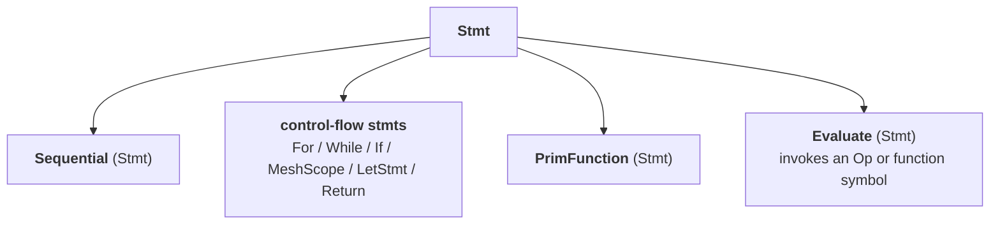

# TileFoundry Spec — tir (`@prim_func` imperative IR)

TIR is the imperative target IR. A `@tilefoundry.prim_func` body parses
into TIR. TIR has no value return; effect-form Ops carry
the work, structural Stmts carry control flow.

- **Container**: `tir.PrimFunction(name, params, body, output_count, target)`.
  `body` is a `Sequential`; the function returns no value.
- **Stmt tree**: function bodies are nested Stmts only. Exprs appear
  inside Stmt fields (e.g. `LetStmt.value`, `For.start`).
- **Effect Ops** (`Copy`, `Fill`, `Cast`, `ReLU`, `Reduce`)
  are value-class Ops registered with `@register_op`; in Stmt
  position they are invoked as `Evaluate(op, args)`
  ([§1.4](#14-evaluate)).
- **Value Ops** (`AllocTensor`, `MemorySpan`, `PtrOf`, `TensorView`)
  are anchored by `LetStmt` so their result `Var` has stable
  identity.
- **No HIR Ops** reach TIR. A program is TIR before the pass pipeline
  ([passes](./passes.md)) reads it.

## 1. TIR Stmt hierarchy

### 1.1 `Stmt`

```python
class Stmt:
    """Provide the abstract base for every TIR statement.

    Attributes:
        loc: attribute; Optional non-semantic debug location.
    """

    loc: str | None = None
```

- constraints:
  - the abstract base of every TIR Stmt subclass; HIR has no `Stmt`.



### 1.2 Structural Stmts (`tir.stmts`)

```python
class Sequential(Stmt):
    """Contain a statement sequence.

    Attributes:
        body: attribute; Statements in execution order.
    """

    body: tuple[Stmt, ...]

class LetStmt(Stmt):
    """Bind a variable for the following statements of its enclosing Sequential.

    Attributes:
        var: attribute; Bound variable.
        value: attribute; Bound expression.
    """

    var: Var
    value: Expr

class For(Stmt):
    """Represent a counted loop.

    Attributes:
        induction_var: attribute; Loop variable.
        start: attribute; Initial value.
        stop: attribute; Exclusive bound.
        step: attribute; Increment.
        body: attribute; Loop body.
    """

    induction_var: Var
    start: Expr
    stop: Expr
    step: Expr
    body: Sequential

class While(Stmt):
    """Represent a conditional loop.

    Attributes:
        cond: attribute; Loop condition.
        body: attribute; Loop body.
    """

    cond: Expr
    body: Sequential

class If(Stmt):
    """Represent conditional control flow.

    Attributes:
        cond: attribute; Branch condition.
        then_body: attribute; Taken body.
        else_body: attribute; Untaken body.
    """

    cond: Expr
    then_body: Sequential
    else_body: Sequential

class MeshScope(Stmt):
    """Scope a mesh binding over a body.

    Attributes:
        mesh: attribute; Compile-time mesh.
        binding: attribute; Lexical mesh binding.
        body: attribute; Scoped statements.
    """

    mesh: Mesh
    binding: Var
    body: Sequential

class Return(Stmt):
    """Terminate a value-less primitive function."""
```

- constraints:
  - the structural (control-flow / binding) Stmt family; bodies are `Sequential`.

- `MeshScope.mesh` carries the `Mesh` object; the `binding` `Var`
  scopes the mesh inside `body`.

### 1.3 `PrimFunction`

```python
class PrimFunction(Stmt):
    """Contain one effect-only TIR function.

    Attributes:
        name: attribute; Function name.
        params: attribute; Parameters, with trailing outputs.
        body: attribute; Function body.
        output_count: attribute; Number of trailing output parameters.
        target: attribute; Compilation target for this function.
        metadata: attribute; Non-semantic function-level analysis records.
    """

    name: str
    params: tuple[Var, ...]
    body: Sequential
    output_count: int = 1
    target: Target = field(default_factory=default_target)
```

The DSL spelling `prim_func(output_count=N)` records the trailing output
parameters; omitting it means one output.

- constraints:
  - itself a `Stmt`, not a separate top-level node; returns no value.
    `verify_prim_function` enforces the rules below.

`visitor_registry.verify.verify_prim_function(fn, *, module_fns=())` enforces:

- **Param homogeneity**. All parameters' layouts MUST be uniformly
  `ShardLayout` or uniformly non-`ShardLayout`; mixing is rejected.
- **Fresh `Var` identity**. The same `Var` object MUST NOT be bound
  by more than one `LetStmt` / `For` / `MeshScope` across the
  function. Parameters seed the bound set.
- **Lexical uses**. A `Var` MUST be visible in the scope that binds it. Let
  values and loop bounds are checked before their binders enter scope. A
  `LetStmt` variable is visible from the next statement to the end of its
  enclosing `Sequential`; branch, loop, and mesh bindings do not escape.
  Every variant uses its own parameters.
  Expression fields, including intrinsic statements and Return, MUST contain
  IR nodes; lowering recipes are rejected. Op, PrimFunction, and SymbolRef
  callables are permitted.
- **`LetStmt` typing**. `LetStmt.var.type` MUST equal the typeinfer
  of `LetStmt.value`.
- **`AllocTensor` placement**. `Call(AllocTensor, ...)` MAY only
  appear directly as `LetStmt.value`. Nesting it inside any other
  Expr is rejected.
- **`MeshScope` mesh in scope**. Any embedded `ShardLayout` MUST
  reference a mesh on the active TIR `MeshScope` traversal cache, the
  composition of that stack, or a parameter's `ShardLayout.mesh`.
- **`For` bound coordinates**. A `MeshCoord` read by `For.start` / `.stop` /
  `.step` MUST name a literal in-range axis of a mesh bound by an enclosing
  `MeshScope`.
- **Retained function calls** follow [core-ir §2.1](./core-ir.md#21-call).
  Verification requires strictly equal argument types/counts and rejects recursion.
- **`Evaluate.callable`**. When `callable` is a `SymbolRef`
  ([§2.1](#21-symbolref)), module-level resolution MUST find exactly one
  `PrimFunction` of that name in the enclosing `Module`, `args` length
  MUST match the resolved callee's `params`, and the `SymbolRef.type`
  MUST equal the resolved callee's `CallableType`. When `callable` is
  an `Op`, it MUST pass the same `check_call` used by ScheduleOp type inference,
  candidate admission, and lowering. Its declared execution mesh MUST match
  the enclosing mesh and its operands MUST be reachable from that scope.
  For atom calls, operand patterns apply to the shared projected issue tiles.
  Every input operand MUST match its `ParamDef.pattern` and every
  declared `between` relation MUST hold. A per-Op verifier registered via
  `@register_verify_stmt(Op)` MAY impose additional rules that the declaration
  does not express. An effect Op with neither an input pattern nor a `between`
  relation MUST register such a verifier; an Op stating no contract is rejected.

### 1.4 `Evaluate`

```python
class Evaluate(Stmt):
    callable: Op | SymbolRef | PrimFunction | ModuleList | Call
    args: tuple[Expr, ...]      # the callable's operands in ParamDef / parameter order
```

- constraints:
  - TIR's single Stmt-position wrapper for a no-result invocation; verify and
    lowering dispatch on `type(callable)`.

The `callable` is one of:

- an effect-form `Op` (e.g. `tir.memory.Copy`,
  `tir.tensor.Reduce`, `tir.Launch` [§2.3](#23-tir-ops)). `args` are
  the Op's operands in `ParamDef` order. Device-instruction verification uses the shared
  `check_call`: match the execution mesh, project instruction tiles, check
  operand patterns and declared `between` relations, then invoke the optional
  leaf verifier. A context-dependent operand pattern MAY resolve itself against
  the callable before matching. Host `Launch` instead checks its target,
  arguments, and launch extents as a function invocation.
- a `SymbolRef` ([§2.1](#21-symbolref)) — a reference to a callee
  `PrimFunction` in the enclosing `Module`. `args` follow the callee's
  parameter order, the final `output_count` positions binding output
  buffers; the callee is resolved uniquely at module level
  ([§1.3](#13-primfunction)).

- a retained `PrimFunction`, single-slot `ModuleList`, or computed
  `Call(TupleGetItem, (ModuleList, index))` target, following the same instance
  resolution as HIR ([core-ir §2.1](./core-ir.md#21-call)). These device calls
  remain in one Module tree; they MUST NOT become `SymbolRef` or launches.
  Printers MUST emit `helper(...)`, `child(...)`, and `layers[i](...)` respectively.

Scheduled lowering follows [passes §7.1](./passes.md#71-converthirtotir).

Per-Op verify and codegen handlers, when present, are keyed by `Op` type and
receive the Op together with `args`; an `Op` callable carries no result, so its
`Call` form is unit-typed.

The value-producing counterpart is the `Call(Op, args)` Expr
([core-ir.md §2.1](./core-ir.md#21-call)): it has a non-`Unit` result
type and is anchored by `LetStmt`. `Evaluate` is the unit-typed,
Stmt-position form and the only Stmt-position invocation wrapper.

**Effect Op vs. control Stmt.** A callable that is a single
unconditional invocation — an effect `Op` or a function `SymbolRef` —
is expressed as `Evaluate(callable, args)`. A construct that carries
its own control flow stays a first-class `Stmt`, not an `Evaluate`
callable. `Abort` ([§1.7](#17-abort)) is a terminator.

### 1.5 `Sync`

`Sync` is a mesh-scoped barrier. It is an **effect-form op** (`tir.sync.Sync`),
authored `T.sync(m)`, and appears in Stmt position wrapped by `Evaluate`
([§1.4](#14-evaluate)) like any other effect op. The surface is **only**
`T.sync(m)` / `T.sync(m[slice])` — there is no `m.sync()` receiver form.

```python
class Sync(Op):
    """Effect form; mesh-scoped barrier op ``tir.sync.Sync``, authored ``T.sync(m)``.

    Attributes:
        mesh: attribute; the (possibly sliced) mesh the barrier synchronizes.
    """

    mesh: Mesh
```

- constraints:
  - a mesh-scoped barrier; in Stmt position it is wrapped by `Evaluate`. The
    participant set, barrier mapping, and named-barrier id rules are below.

#### `mesh` — the participating threads

- `mesh` is the (possibly sliced) mesh `Sync` synchronizes. `T.sync(m)`
  synchronizes the whole mesh; `T.sync(m[1:3, :])` synchronizes the constant
  sub-mesh selected by the slice.
- A **mesh slice is a compile-time descriptor.** `m[...]` is evaluated at parse
  time via `Mesh.__getitem__` into a sub-`Mesh` whose `layout` is a
  **`ComposedLayout`** recording the participating sub-box (the affine "mesh
  scope" case `image(c) = offset + outer(c)`): the selected per-axis extents
  over the parent strides in `outer`, the slice origin (linear thread index of
  the first participant) in `offset`, identity `inner`. An un-sliced mesh's
  `layout` is a plain `Layout`. A sliced mesh is still a `Mesh`; the slice never
  becomes an IR/SSA value.
- The **participant set** is derived through the existing layout algebra
  (`shard.md`): the participating linear thread indices are `offset +
  outer(coord)` over `outer`'s domain (the plain `layout` at `offset 0` for an
  un-sliced mesh); `base` is the minimum, `count = size(outer)`, and the block
  domain is the product of the topology extents. `classify` / `participation`
  are the single source of truth shared by verify and codegen.
- **Legal-slice verification.** A sliced mesh is accepted only if its
  `ComposedLayout` `layout` reconstructs as a constant slice of an enclosing
  full mesh `e`: same strides, per-axis sub-extents bounded by `e`'s shape, an
  offset that decomposes into in-range per-axis starts, and the **full topology
  tuple** + names equal — the proof rebuilds `e[key]` and compares, so a forged
  slice cannot pass. A full mesh (plain-`Layout` `layout`) is accepted only by
  equality with an enclosing mesh.

The target's verifier determines which participant sets have a supported
barrier. Lowering MUST synchronize exactly those participants; unsupported
sets MUST be rejected rather than broadened or split. Hardware barrier choice,
identifier allocation, and cross-device occupancy requirements belong to the
target implementation.

#### Design rationale

A barrier's scope is a compile-time constant — *which* threads take part — so
the mesh, and any slice of it, is a compile-time descriptor rather than an SSA
value, and the barrier kind is derived from that set by one shared routine so
verify and codegen cannot disagree.

### 1.7 `Abort`

```python
class Abort(Op):
    message: str = ""
```

- constraints:
  - a terminating effect Op on believed-unreachable paths, anchored in Stmt
    position by `Evaluate`.

- Target lowering MUST emit a terminating failure for a runtime hit.

### 1.8 `@intrinsic` — user-defined effect Stmts

```python
# example
@intrinsic
def <name>(<param>: Expr, ...) -> None: ...    # decorated function's signature defines the synthesized Stmt subclass; its body becomes the verifier
```

- constraints:
  - synthesises a Stmt subclass, registers the body as its verifier, and wires
    parser dispatch under the snake-case name; parameters are annotated `Expr` and
    the return annotation is `None`.

## 2. TIR Expr and callable constructs

### 2.1 `SymbolRef`

```python
class SymbolRef(Expr):
    """Name a primitive-function callee.

    Attributes:
        name: attribute; Canonical callee name.
        nested: attribute; Child module slot path from the current Module.
    """

    name: str
    nested: tuple[str, ...] = ()
```

- constraints:
  - a leaf `Expr` naming a callee as an `Evaluate` / `Launch` target; resolution
    is module-level and unique. Per-field rules below.

`SymbolRef` is a leaf `Expr` naming a callee `PrimFunction` as a call
target: the `callable` of an `Evaluate(SymbolRef, args)`
([§1.4](#14-evaluate)) function invocation and `args[0]` of a `Launch`
([§2.3](#23-tir-ops)).

#### `name`
- MUST be the canonical name of a `PrimFunction` in the enclosing
  `Module` ([core-ir.md §1](./core-ir.md#1-module)), exactly as stored
  in `PrimFunction.name`. It MAY be a generated / mangled
  specialization name.

#### `nested`
- MUST name child module slots relative to the caller's current `Module`.
  An empty path selects the current module's own functions. Resolution MUST
  traverse those slots and find one function named `name` in the reached
  module; it MUST NOT search descendants by an unqualified name. Missing slots
  or functions MUST report the full requested path. Verify and codegen MUST
  use the same slot-path resolver.

#### `type`
- MUST be the resolved callee's IR-level `CallableType`
  ([types §7](./types.md#7-callabletype)): `parameters` are the callee
  `params` types in order; `return_type` is `UnitType`
  ([types §6](./types.md#6-unittype)) — a TIR `PrimFunction` returns
  no value, its outputs are trailing params ([§1.4](#14-evaluate)).
- MUST be set at construction from the callee in hand; a `SymbolRef`
  with a deferred or unresolved type MUST NOT enter constructed IR.
  `Expr` is frozen and verify MUST NOT mutate IR, so verify only
  checks `type` against the resolved callee ([§1.3](#13-primfunction)) —
  it never back-fills.

Resolution starts in the caller's `Module` and traverses `nested` child slots.
A unique lookup in the reached `Module`
([core-ir.md §1](./core-ir.md#1-module)) MUST map `name` to exactly
one `PrimFunction`; zero or more than one match is an error. Functions with
that name in other modules do not participate in this lookup.
Specialization variants each carry a distinct canonical
`PrimFunction.name`, so a `SymbolRef` to a variant resolves
unambiguously; the unmangled dispatcher is represented by its prototype and
`variants`, not by a `SymbolRef`. Local typeinfer does not resolve a `SymbolRef`; it
carries its `type` directly.

### 2.2 `ShapeOf`

```python
class ShapeOf(Expr):
    """Produce one runtime tensor extent.

    Attributes:
        param: attribute; Enclosing primitive-function tensor parameter.
        axis: attribute; Tensor axis.
    """

    param: Var
    axis: int

def shape_of(param: Var, *, axis: int) -> ShapeOf: ...  # exported by tilefoundry.dsl
```

`shape_of(x, axis=0)` is the authored and printed spelling of this TIR
expression. The parser MUST accept it, and printing followed by re-import
MUST preserve it. It is distinct from HIR `tf.shape_of`.

- constraints:
  - `type` is a rank-0 `i32` `TensorType` (scalar): one runtime tensor extent.
  - `param` MUST resolve to a parameter `Var` of the enclosing
    `PrimFunction`; `axis` MUST be a valid axis index of `param.type`.
  - the type is the only record that an axis is open. A `PrimFunction` MUST
    NOT carry a second parameter standing for an extent its own types already
    state as a `DimVar`; the convention expands the tensor parameter into a
    pointer plus one extent per open axis
    ([codegen §4.4](./codegen.md#44-signatures)), so no parameter name is
    reserved and a user parameter named `<something>_shape_<n>` is an ordinary
    parameter.

### 2.3 TIR Ops

Value Ops MUST be anchored by `LetStmt.value` — their result `Var` is the only
handle. Effect Ops appear in Stmt position as `Evaluate(op, args)`
([§1.4](#14-evaluate)). Each Op's full contract lives here, in its catalog entry
below; code carries only a one-line purpose docstring
([SPEC-RULES](../SPEC-RULES.md)).

The canonical inspection surface covers every Op in this catalog. Printing and
re-importing a TIR program MUST reach a fixed point: value Ops remain assignment
forms, effect Ops remain statement forms, and enum-valued attributes use their
named enum members with the owning enum imported by the printed program.

- `TensorType.storage` is a `StorageKind` ([types §2](./types.md#2-tensortype)).
  A memory-resident TIR tensor MUST carry a concrete level; the unmaterialized
  `umat` ([types §2](./types.md#2-tensortype)) is an HIR-only value and MUST
  already be materialized to a concrete level in TIR — it never appears there.
- `Reshard` ([hir §1.3](./hir.md#13-op)) does not appear in TIR. A layout change
  is a `TensorView` here and allocates and copies nothing; a storage change is a
  `LetStmt(AllocTensor)` plus `Evaluate(Copy, ...)`.

#### Memory Ops (`tir.memory.*`)

##### AllocTensor
```python
class AllocTensor(Op):
    """Value form; allocate a tensor, anchored by ``LetStmt.value``.

    Attributes:
        tensor_type: attribute; the allocated tensor's result type.
    """

    tensor_type: TensorType
```
- constraints:
  - allocate a tensor; a value Op anchored by `LetStmt.value`.

##### MemorySpan
```python
class MemorySpan(Op):
    """Value form; re-interpret a memory region as a typed tensor.

    Attributes:
        x: input; the memory region being re-interpreted.
    """

    x: Tensor
```
- constraints: []

##### PtrOf
```python
class PtrOf(Op):
    """Value form; take the device address of a tensor.

    Attributes:
        tensor: input; the tensor whose device address is taken.
    """

    tensor: Tensor
```
- constraints:
  - returns `PointerType(tensor.dtype, tensor.storage)`; it does not preserve
    the tensor's shape or layout in the pointer type.

##### TensorView
```python
class TensorView(Op):
    """Value form; construct a logical tensor over a typed pointer.

    Attributes:
        pointer: input; a ``PointerType`` value or an smem byte offset.
        dtype: optional attribute; element type stated for a numeric address.
        storage: optional attribute; storage stated for a numeric address.
        layout: attribute; the view descriptor.
        shape: attribute; logical shape, optionally inherited from ``PtrOf``.
    """

    pointer: object
    dtype: str | None = None
    storage: StorageKind | None = None
    layout: object
    shape: tuple | None = None
```
- constraints:
  - An explicit `shape` is authoritative. If omitted, it is inherited only
    when the input syntax is exactly `T.ptr_of(tensor)`, from that tensor's
    `TensorType.shape`. No other pointer provenance and no layout is inspected
    to guess a shape.
  - An integer input is a byte offset from the kernel's dynamic shared-memory
    base. It MUST state `dtype`, `storage="smem"`, and `shape`; booleans and
    non-integer numeric addresses are invalid.
  - A `PointerType` input MAY restate `dtype` or `storage`, but any stated value
    MUST equal the pointer descriptor.
  - Trailing coordinate inputs are not supported on pointer views.
  - `T.ptr_of` MAY point at an allocated `ShardTensor`; the view rebuilds over
    the engine pointer rather than reusing the existing shard layout.

Copy and Fill use a shared mesh wildcard, specialized from the Target's
`MemoryExecutionFacts`. They require a contiguous run and sharded register
operands on that same level. The module's Target Facts validate topology names
and extents; memory declarations do not enumerate backend topology names.

##### Copy
```python
class Copy(Op):
    """Effect form; byte-equivalent copy between two tensors.

    Attributes:
        src: input; Copy source.
        dst: input; Copy destination.
    """

    src: Tensor
    dst: Tensor
    execution_mesh: MeshPattern
```
- constraints:
  - `src` declares `READ`; `dst` declares `WRITE`.
  - both operands are whole-byte tensors in gmem, smem, or rmem, with equal
    dtype. Their storages MAY be equal; same-storage copy is still a byte move.
  - `src` and `dst` MUST have equal logical shapes for every storage direction.
    Copy's access relation pairs the same logical coordinate on both ends.
    A caller changing shape MUST state that shape in its source or destination
    view; Copy does not infer a reshape from the runtime's enumeration order.
  - `execution_mesh` is the mesh declaration shared by every rmem operand's
    `ShardLayoutPattern.mesh`.

##### Fill
```python
class Fill(Op):
    """Effect form; broadcast a scalar value into a tensor.

    Attributes:
        tensor: input; destination tensor.
        value: input; rank-0 scalar broadcast into ``tensor``.
    """

    tensor: Tensor
    value: Tensor
    execution_mesh: MeshPattern
```
- constraints:
  - `tensor` declares `WRITE`; `value` declares `READ` and MUST be scalar.
  - a nonconstant value's dtype MUST equal the destination dtype. Constant zero
    is convertible and MAY use the parser's default scalar dtype.
  - `execution_mesh` is the same mesh referenced by `tensor` when it is rmem;
    the scalar carries no shard mesh.

##### Cast
```python
class Cast(Op):
    """Effect form; convert a register tile to ``dtype``."""

    src: Tensor
    dst: Tensor
    dtype: DType
    execution_mesh: MeshPattern
```
- constraints:
  - `src` declares `READ`; `dst` declares `WRITE`; both are rmem tensors.
  - the operands have equal shapes and distinct dtypes.
  - `dtype` is required and equals the destination dtype.
  - both operand shard layouts reference the same `execution_mesh` declaration.

#### NN Ops (`tir.nn.*`)

##### ReLU
```python
class ReLU(Op):
    """Effect form; pointwise ``max(src, 0)`` written into ``dst``.

    Attributes:
        src: input; input tensor.
        dst: input; destination tensor.
    """

    src: Tensor
    dst: Tensor
```
- constraints:
  - `src` declares `READ`; `dst` declares `WRITE`; both are rmem tensors. A tile held elsewhere
    is moved in and out by `Copy`, which schedule inserts from this declaration.

#### Tensor Ops (`tir.tensor.*`)

##### Reduce

```python
class Reduce(Op):
    """Effect form; generic axis reduction dispatched by the ``kind`` tag.

    Attributes:
        src: input; reduction source.
        dst: input; reduction destination.
        workspace: input; optional staging buffer sized by lowering.
        axes: attribute; reduced-axis tuple.
        keepdim: attribute; whether reduced axes remain with extent one.
        kind: attribute; ``ReduceKind`` tag.
    """

    src: Tensor
    dst: Tensor
    workspace: Tensor | None = None
    axes: tuple
    keepdim: bool
    kind: ReduceKind
```
- constraints:
  - `src` declares `READ`, `dst` `WRITE`, and `workspace` `READ | WRITE`. `src` and `dst` may
    live in any storage; `workspace` is an optional smem staging buffer.
  - both dtypes are f32, f16, or bf16.
  - `axes` and `keepdim` determine the destination shape. Kept axes have extent one;
    otherwise they are removed.
  - `src` and `dst` carry a `ShardLayout` over one thread mesh; `src`'s layout carries no swizzle
    and no offset.
  - `Reduce` carries no dispatch parameter; runtime selects the strategy.
  - The target determines whether staging is needed and sizes the workspace
    from the source execution mesh. This declaration exposes no runtime tier.

##### Dot

`dst = sum(lhs * rhs)` in one statement, and not an `elementwise` followed by a
`Reduce`: materialising the product first would cost a register per element of
the row.

```python
class Dot(Op):
    """Effect form; fused multiply-contract over the axes the meshes contract.

    Attributes:
        lhs: input; left operand.
        rhs: input; right operand.
        dst: input; the destination cell.
        workspace: input; optional shared staging buffer.
    """

    lhs: Tensor
    rhs: Tensor
    dst: Tensor
    workspace: Tensor | None = None
```
- constraints:
  - `lhs` and `rhs` declare `READ`; `dst` declares `WRITE`; `workspace` declares `READ | WRITE`.
    `lhs`, `rhs`, and `dst` may live in any storage; `workspace` is smem.
  - **No axes attribute.** The operands' meshes already state the contraction
    axes; restating them would introduce a second source for one fact.
  - `lhs` and `rhs` contract over the same number of *local* elements: the fold
    walks one operand's length and indexes the other with it. Their global
    shapes may differ, and in the canonical matrix-vector call they do — a row
    of the matrix is split over the mesh while the vector is broadcast.
  - `dst` is one cell. A contraction leaves a total and every participant leaves
    holding it, so a wider destination is not a wider result but cells the op
    never writes.
  - An optional smem workspace stages partial results when the target's
    lowering requires it. Such staging requires a `ShardLayout` on `lhs`,
    whose execution mesh determines the workspace and synchronization.
  - The operands need not agree in dtype: accumulation is f32 whatever is
    loaded.

#### Generic kind-tagged effect Ops (`tir.arith`)

`Binary` / `Unary` are effect-form Ops that dispatch on a kind enum rather than
per-op classes; they appear as `Evaluate(op, args)`. `BinaryKind` /
`UnaryKind` / `ReduceKind` are compiler-wide tag enums shared across HIR and
TIR; lowering preserves the kind value without re-mapping. Their owning
definitions are [core-ir §4](./core-ir.md#4-shared-operation-kinds).

`Binary`, `Unary`, `Where`, `Clamp`, `Cast`, `ReLU`, and `Reduce` are target-neutral
instruction declarations (`OpCapability(None)`) with registered access
relations, so schedule discovery and an explicit `tf.schedule` consume the same
contracts as TIR verification. The five elementwise declarations use the
thread mesh named by their rmem operands. `Reduce` instead walks the source
coordinates and collapses its declared axes into the destination; its optional
workspace is an operand only when the call supplies it.

##### Clamp

```python
class Clamp(Op):
    """Effect form; clamp a source tensor into a destination.

    Attributes:
        min_val: attribute; Lower bound.
        max_val: attribute; Upper bound.
        src: input; Source tensor.
        dst: input; Destination tensor.
    """

    min_val: float
    max_val: float
    src: Tensor
    dst: Tensor
```

- constraints:
  - `src` declares `READ`; `dst` declares `WRITE`; both are rmem tensors. A tile held elsewhere
    is moved in and out by `Copy`, which schedule inserts from this declaration.
  - `src` and `dst` MUST carry the same dtype; the effect writes
    `min(max(src, min_val), max_val)` elementwise into `dst`.

##### Binary
```python
class Binary(Op):
    """Effect form; pointwise binary operation ``dst = lhs <kind> rhs``.

    Attributes:
        lhs: input; left-hand operand.
        rhs: input; right-hand operand.
        dst: input; destination operand.
        kind: attribute; ``BinaryKind`` tag.
    """

    lhs: Tensor
    rhs: Tensor
    dst: Tensor
    kind: BinaryKind
```
- constraints:
  - `lhs` and `rhs` declare `READ`; `dst` declares `WRITE`; all three are rmem tensors. A tile held
    elsewhere is moved in and out by `Copy`, which schedule inserts from this declaration.
  - Both `lhs` and `rhs` MUST support right-aligned broadcasting, including
    missing axes, size-1 axes, and rank-0 scalars. `dst.shape` MUST equal the
    broadcast of their shapes. Operand order MUST be preserved for every kind.
  - Lowers to the binary runtime family without per-kind TIR classes.

##### Where

`Where(cond, lhs, rhs, dst)` writes `lhs` where `cond` is true and `rhs`
otherwise. Its capability is target-neutral and its operands are registers
on the executing thread mesh. `cond` MUST have bool dtype; the data branches
and destination MUST have the same dtype. All three inputs use right-aligned
broadcasting, and `dst` MUST have their broadcast shape. HIR Where lowers to
this effect-form instruction.

##### Arange

`T.arange(dst, start=0, step=1)` writes `start + i * step` into coordinate
`i` of a one-dimensional `i32` or `i64` register destination. It is a
WRITE-effect instruction available on every target. `start` and `step` are
static integers; a symbolic HIR start MUST be refused during candidate
admission with a reason naming `start`. Its schedule evaluator returns the
same typed sequence. It uses the ordinary registered-op parser and printer.

##### Unary
```python
class Unary(Op):
    """Effect form; pointwise unary operation ``dst = <kind>(src)``.

    Attributes:
        src: input; input operand.
        dst: input; destination operand.
        kind: attribute; ``UnaryKind`` tag, including rsqrt.
    """

    src: Tensor
    dst: Tensor
    kind: UnaryKind
```
- constraints:
  - `src` declares `READ`; `dst` declares `WRITE`; both are rmem tensors. A tile held elsewhere
    is moved in and out by `Copy`, which schedule inserts from this declaration.
  - Lowers to the unary runtime family without per-kind TIR classes.

#### `Launch`

Effect Op for a host-side launch of a device kernel (CPU entry only, no value);
the callee `SymbolRef` and grid/block extents flow through the `Evaluate` args,
the non-grid/block launch config through the Op attributes.

The shared `LaunchAttrs` descriptor carries target-owned selector values:

```python
class LaunchAttrs:
    """Carry authored launch attribute selector/value pairs.

    Attributes:
        entries: attribute; Selector/value pairs interpreted by target lowering.
    """

    entries: tuple[tuple[Enum, object], ...] = ()
```

The target interprets each selector and rejects unsupported values. These
are authored-IR selectors, not a target registration API. Launch geometry is
derived in codegen and emitted into the host entry, rather than carried as
runtime metadata.

```python
class Launch(Op):
    """Effect form; host launch of a device kernel, producing no value.

    Attributes:
        cluster: attribute; optional cluster extents.
        dynamic_smem: attribute; dynamic shared-memory byte count.
        stream: attribute; optional stream handle.
        attrs: attribute; remaining ``LaunchAttrs`` launch configuration.
    """

    cluster: tuple | None = None
    dynamic_smem: int = 0
    stream: object | None = None
    attrs: LaunchAttrs = LaunchAttrs()

# Evaluate(Launch(...), (SymbolRef(callee), grid_x, grid_y, grid_z, block_x, block_y, block_z, *forwarded_args))
```

- constraints:
  - appears only in a CPU (host) entry body; grid/block extents are launch config,
    not kernel parameters. Per-arg / per-attribute rules below.

`Launch` appears only in a CPU (host) entry body, as `Evaluate(Launch(...),
args)` with `args = (SymbolRef(callee), grid_x, grid_y, grid_z, block_x,
block_y, block_z, *forwarded_args)`:

- **callee**: `args[0]` MUST be a `SymbolRef` ([§2.1](#21-symbolref)) resolving to
  a device `PrimFunction` whose target is not CPU, or a HIR `Function` by its
  root-relative selector ([core-ir §1](./core-ir.md#1-module)).
  The host-entry pass writes and checks a HIR callee's forwarded args
  ([passes §7.3](./passes.md#73-inserthostentrypass)); verification
  resolves the selector and does not check them again.
- **grid / block**: `args[1:7]` are the grid then block extents in the fixed
  order `grid_x, grid_y, grid_z, block_x, block_y, block_z`. Each is an `Expr`
  — a `Constant` for a static extent, a `ShapeOf` ([§2.2](#22-shapeof)) for a
  launch-provided (dynamic) one, or a dim-arithmetic `Call` over those. They are
  launch configuration, not kernel parameters: the device observes geometry
  through the codegen `program_dim` / `program_shape` accessors, never as
  arguments.
- **forwarded args**: the remaining `args` bind the callee's parameters, one
  each, in declaration order. An extent the callee's types leave open is not
  among them: it travels with the pointer the convention expands that
  parameter into ([codegen §4.4](./codegen.md#44-signatures)), read off the
  tensor the host holds.
- **attributes**: `cluster`, `dynamic_smem`, `stream`, and `attrs` carry the
  non-grid/block launch configuration. A `cluster` / `stream` / `attrs` value
  the active target does not support MUST be rejected in target lowering.

#### Execution meshes

Target admission metadata uses `OpCapability`. Its optional `declaration` and
`attribute` fields bind a named variant declaration back to its registered Op;
consumers enumerate those records directly from the Op registry. Capability
metadata does not control presentation: instruction reports group by the Op
schema's `category` and sort by its `name` within each category.

An instruction Op reserves the class-body name `execution_mesh` for the mesh
that executes one issue. A fixed instruction declaration MAY state a concrete
`Mesh`; an Op with a caller-selectable frame MAY state a `ParamDef` whose
pattern is a `MeshPattern`; and an element-wise Op MAY point directly at the
same `MeshPattern` used by its operand shard declarations. A declaration
MAY use an `OrPattern` of mesh patterns when it supports distinct execution
topologies. The target's verifier enforces any topology-specific restrictions.
These are the supported forms. An instruction whose `execution_mesh` has another form MUST be
rejected by name rather than treated as running on arbitrary threads.

An operand that carries a `ShardLayout` and executes element-wise MUST use that
same execution-mesh pattern in `ShardLayoutPattern.mesh`. Unsharded gmem and
smem operands carry no holder mesh; the execution declaration does not invent
one for them.

#### Async copy Ops (`tir.async.*`)

Non-blocking gmem→smem staging: a producer issues copies and commits groups;
a consumer waits on the group queue.

##### CopyAsync

```python
ASYNC_WIDTHS = (4, 8, 16)


class CopyAsync(Op):
    """Effect form; async gmem→smem copy, non-blocking.

    Attributes:
        src: input; gmem staging source.
        dst: input; smem staging destination.
        index: optional third positional input; rank-1 i32/i64 row indices.
        fill: attribute; optional out-of-range row value.
    """

    src: Tensor
    dst: Tensor
    index: Tensor | None = None
    fill: float | None = None
    execution_mesh: MeshPattern
```
- constraints:
  - `src` is gmem and `dst` is smem, with the same dtype. Each layout MUST
    admit the same width from `ASYNC_WIDTHS` and MUST walk the same tile
    mode at step 1. For a `ShardLayout`, vector width is read from the whole
    tile arrangement; its other strides ensure every participant's start is
    aligned. Two split layouts compare their tile modes only when their mesh
    and shard attrs are identical.
  - With `index`, only dim 0 is gathered: `dst[r] = src[index[r]]`.
    It is the third positional input: `T.copy_async(src, dst, index, fill=0)`.
    Each of `src`, `dst`, and `index` MUST have a plain layout or a pure
    Broadcast ShardLayout, with no Split or Partial attributes. Verification
    MUST reject other distributions and identify the operand. This restriction
    does not apply to transfers without an index.
    The index MUST be rank-1 i32 or i64, and `dst` MUST have shape
    `(index.shape[0], *src.shape[1:])`. Without `index`, `fill` MUST be `None`.
    With a stated `fill`, an index below zero or at least `src.shape[0]`
    MUST fill the whole destination row without reading the source.
  - Indexed transfers MUST partition destination vectors among executing
    threads. Vectors MUST stay inside a row; their width is chosen statically
    from inner contiguous runs and row-stride alignment, using `ASYNC_WIDTHS`.
    An invalid row MUST use the stated fill value without reading the source.
  - Indexed schedules produce one `CopyAsync` instruction, whether the
    index names all selected rows or the author schedules one index slice
    per loop iteration. Lowering MUST NOT split rows or introduce predicate
    operands. Schedule evaluation MUST agree with dim-0 IndexSelect,
    including its out-of-range fill behavior.
  - A later read of `dst` is ordered by `CpAsyncCommit` followed by
    `CpAsyncWait`.
  - `execution_mesh` states the issuing threads. The gmem and smem operands are
    unsharded and therefore declare no separate holder mesh.

##### CpAsyncCommit

```python
class CpAsyncCommit(Op):
    """Effect form; close the current in-flight async-copy group."""
```
- constraints:
  - Later `CpAsyncWait` counts committed groups.

##### CpAsyncWait

```python
class CpAsyncWait(Op):
    """Effect form; wait until at most ``n`` committed groups remain in flight.

    Attributes:
        n: attribute; most-recent committed groups allowed to remain in flight.
    """

    n: int = 0
```
- constraints:
  - `n` is a non-negative compile-time count.
  - `n = 0` drains every outstanding committed group.
