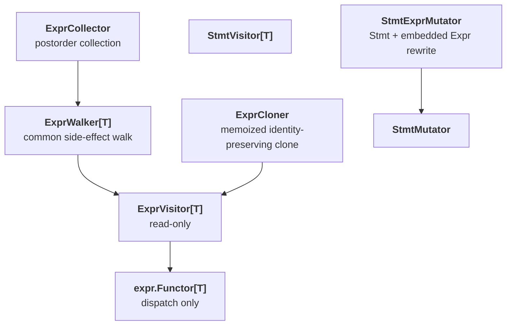

# TileFoundry Spec — IR Visitor / Mutator

The IR traversal / rewrite framework: `expr.Functor[T]` /
`expr.Visitor[T]` (in `ir/expr/visitor.py`) and `core.ExprVisitor[T]` /
`core.ExprWalker[T]` / `core.ExprCloner` / `core.BindingSubstitutionCloner` /
`core.StmtVisitor[T]` / `core.StmtMutator` / `core.StmtExprMutator`
(in `ir/core/visitor.py`).
A shared compiler facility, owned by neither analysis nor any
specific pass.



## 1. Role

Visitors and mutators are the standard base classes for **recursive
IR traversal and rewrite**; manual `isinstance` dispatch is not the convention.

- **Visitor** — read-only traversal returning a user-defined `T`
  (aggregation, collection, verification).
- **Cloner / Mutator** — rewrite returning the same node kind
  (`Expr → Expr`, `Stmt → Stmt`): lowering, simplification, structural rewrite.

The base classes define traversal scaffolding only. Logic is injected by
overriding `visit_<ClassName>(node, ctx)` in Expr-family subclasses. The
context is passed through `visit`; it is not visitor construction state.

## 2. Dispatch convention

`visit_<ClassName>` static dispatch (no `singledispatch`), for example
`visit_Call(self, call, ctx)`, `visit_Var(self, var, ctx)`,
`visit_For(self, stmt)`, `visit_Evaluate(self, stmt)`.

Expr-family `visit(node, ctx)` looks up `visit_<type(node).__name__>` on the
subclass and calls it with the same context. On `expr.Visitor` subclasses the
lookup order is `visit_leaf_<ClassName>(node, operands, ctx)` (operands are
visited first), then `visit_<ClassName>(node, ctx)`, then `default_visit_leaf`
when overridden (`ExprWalker`), otherwise `default_visit(node, ctx)`.
Statement visitors keep a context-free `visit(stmt)` entry.

- **Runtime class name wins.** With both `visit_Call` and `visit_Expr`
  defined, `visit_Call` handles a `Call`; base-class overrides are not consulted.
- **Fallback to `default_visit(node, ctx)`.** `expr.Functor.default_visit` raises
  `NotImplementedError`; a visitor or mutator must explicitly implement a
  node's behavior or call its child traversal/rebuild helper.
- **No Op-level dispatch here.** A `Call(target=Add)` reaches `visit_Call`;
  per-Op dispatch belongs to the registries under `tilefoundry.interfaces`
  ([visitor-registry](./visitor-registry.md)).
- **Types.** `core.TypeFunctor[T]` is the same `visit_<ClassName>` dispatch over
  type and layout values (no memo; `default_visit` raises `NotImplementedError`).

## 3. `ExprVisitor[T]`

Read-only Expr-tree traversal. `T` is user-chosen (`None` for
side-effect collection, `set[Var]` for free-var analysis, etc.).

```python
class Functor[T]:                                  # expr.Functor: dispatch only; no memo
    def visit(self, expr: Expr, ctx: Any = None) -> T: ...
    def dispatch_visit(self, expr: Expr, ctx: Any) -> T: ...
    def default_visit(self, expr: Expr, ctx: Any) -> T: ... # raises NotImplementedError

class ExprVisitor[T](expr.Visitor[T]):             # core.ExprVisitor; T is user-chosen
    def __init__(self, *, memo=None, visit_other_functions=False, root_function=None): ...
    def visit_operands(self, expr: Expr, ctx: Any) -> tuple[T, ...]: ...
    def clear(self) -> None: ...                   # clears memo and root
```

- constraints:
  - `ExprVisitor` memoizes by `id(expr)` at `dispatch_visit`; each value keeps
    the original `Expr` alive together with the result to prevent id reuse.
  - `visit_operands` uses the fixed class-match table `expr_children` in
    `ir/core/visitor.py`, not the dataclass-field walker `child_exprs` in
    `ir/expr/expr.py`. It visits value children only and excludes binding-site
    Vars, including `LoopRegion.params` and Function parameters.
  - `visit_operands` is the only operand hook. A node needing non-generic
    traversal overrides its complete `visit_<Kind>(node, ctx)` method; there
    are no per-kind `visit_operands_<Kind>` hooks.
  - `expr_children` raises `AssertionError` for an unknown `Expr` subclass;
    it does not silently return an empty tuple.
  - `visit_function_body(fn, ctx)` sets `root_function` to `fn` when unset,
    then enters `fn.body` only if `can_visit_function_body(fn)`: `fn` is the
    root, or `visit_other_functions=True`; otherwise it returns `None`. The
    gate does not apply to `visit_operands`: a `core.Function` found in
    `expr_children` has its body visited unconditionally.

`expr_children(expr)` enumerates child Exprs by fixed field order. It is the
single table that grows whenever a new Expr subclass appears:

| Node | Child Exprs |
|---|---|
| `Var` | `()` |
| `Constant` | `()` |
| `SymbolRef` | `()` |
| `ShapeOf` | `()` |
| `Tuple` | `elements` |
| `ModuleList` | `()` |
| `Call` | `(target, *args)` when target is a Call, otherwise `args` |
| `MeshRegion` | `args`, `body` |
| `LoopRegion` | `args`, `body`, `yield_values` (binding-site Vars are excluded) |
| `core.Function` | `body` (parameter binding-site Vars are excluded) |

Passes that collect dimension variables from carried bindings must enumerate
`LoopRegion.params` explicitly. `child_exprs` is the broader dataclass-field
helper for module ownership, not the visitor traversal contract.

Example — collect every `Var`:

```python
# example
class VarCollector(ExprVisitor[None]):
    def __init__(self) -> None:
        self.vars: set[Var] = set()
    def visit_Var(self, var: Var, ctx) -> None:
        self.vars.add(var)
```

`ExprWalker[T]` is the shared side-effect traversal layer. It defines only
`default_visit_leaf(expr, operands, ctx)`, returning no value; every
unoverridden node reaches it after its operands.

`ExprCollector` is the standard postorder collector. `collect_exprs(root)`
passes one list as context and returns the collected tuple; a shared value in
the SSA DAG appears once. Function reachability relies on this
operand-before-consumer order.

## 4. `ExprCloner`

Recursive Expr rewrite returning the same node kind. Core invariant:
**when no child changed, return the original node** (identity
preservation).

```python
class ExprCloner(ExprVisitor[Expr]):                   # memoized identity-preserving Expr rewrite
    def default_visit(self, expr: Expr, ctx: Any) -> Expr: ...
```

- constraints:
  - When no child changed, `default_visit` returns the original node.
  - The memo comes from `ExprVisitor`: a shared input node is cloned at most
    once and every consumer receives the same result.

`BindingSubstitutionCloner` is the binding-aware specialization. It replaces
`Var` values from an identity-keyed environment and extends that environment
for `LoopRegion` induction and carried bindings. It inherits
`ExprCloner`'s identity memo: sharing within one clone is preserved, while a
caller that needs independent copies MUST use a fresh instance for each copy.
`expr_operands(expr)` exposes value/dataflow operands without entering a
`Function` body; `function_values(function)` includes the Function, its
parameters, and the canonical `collect_exprs(function.body)` order.

`rebuild_expr(expr, new_children)` constructs a new Expr of the
same subclass while preserving non-child fields (`type`, `source`).

Identity preservation gives structural sharing of untouched subtrees, change
detection via `new_expr is old_expr`, and valid identity-keyed caches
(`typeinfer`, cost) for unchanged nodes.

An Expr visitor `visit_Call` override that needs recursive children MUST call
`visit_operands(call, ctx)`. An Expr cloner override that needs the generic
identity-preserving rebuild MUST call `default_visit(call, ctx)`; it may return
the original node directly only after it has explicitly handled the children.

## 5. `StmtVisitor[T]` / `StmtMutator`

Same shape as the Expr family, but for the Stmt tree.

```python
class StmtVisitor(Generic[T]):                     # read-only Stmt-tree traversal
    def visit(self, stmt: Stmt) -> T: ...          # dispatch to visit_<Type> else generic_visit
    def generic_visit(self, stmt: Stmt) -> T: ...  # recurse child Stmts

class StmtMutator:                                    # identity-preserving Stmt rewrite
    def visit(self, stmt: Stmt) -> Stmt: ...          # dispatch to visit_<Type> else generic_visit
    def generic_visit(self, stmt: Stmt) -> Stmt: ...  # recurse child Stmts; invariant identical to ExprCloner
```

- constraints:
  - `StmtMutator`'s identity-preservation invariant is identical to `ExprCloner`.
  - `StmtVisitor` / `StmtMutator` do not descend into Expr fields embedded in
    Stmts; those are visited only through `StmtExprMutator` ([§6](#6-stmtexprmutator)).

`stmt_children(stmt)` enumerates child Stmts only (Expr fields
come back via `StmtExprMutator`):

| Stmt | Child Stmts |
|---|---|
| `Sequential` | `body` |
| `PrimFunction` | `(body,)` |
| `For` / `While` | `(body,)` |
| `If` | `(then_body, else_body)` |
| `MeshScope` | `(body,)` |
| `LetStmt` | `()` |
| `Return` | `()` |
| `Evaluate` | `()` (leaf in the Stmt tree) |

## 6. `StmtExprMutator`

Rewrites the Stmt tree **and** the Expr fields embedded in Stmts — the common
choice for lowering, simplification and structural rewrite.

```python
class StmtExprMutator(StmtMutator):                   # rewrite Stmts, and the Exprs embedded in their Expr-typed fields
    def visit_stmt(self, stmt: Stmt) -> Stmt: ...     # rewrite the Stmt tree via StmtMutator
    def visit_expr(self, expr: Expr, ctx: Any = None) -> Expr: ... # rewrite embedded value Exprs; shares ExprCloner's rewrite helper
    def generic_visit(self, stmt: Stmt) -> Stmt: ...  # StmtMutator recurse, then rewrite each Stmt's Expr fields
```

- constraints:
  - The rewrite scope is **embedded value Exprs**, not binding `Var`s.

`rewrite_stmt_exprs(stmt, fn)` enumerates the Expr fields of each
Stmt subclass, applies `fn` with identity preservation, and rebuilds
when needed:

| Stmt | Expr fields |
|---|---|
| `LetStmt` | `value` (`var` is a `Var` and is not rewritten) |
| `For` | `start`, `stop`, `step` (`induction_var` is a `Var` and is not rewritten) |
| `While` | `cond` |
| `If` | `cond` |
| `Return` | (none — `@prim_func` has no value return) |
| `Evaluate` | `args` (and `callable` when it is a `SymbolRef`, `Call` or `ModuleList`) |
| `MeshScope` / `Sequential` | (none) |

`α-renaming` and similar `Var`-rewriting passes use `StmtMutator` directly.

## 7. Visitor entry forms for `Evaluate`

TIR effect-form Ops (`Copy`, `Fill`, `TiledMma`, `ReLU`, `Reduce`, ...) are `Op`
subclasses, not `Stmt` subclasses; in Stmt position they appear as
`Evaluate(callable=op, args)`. Passes and visitors MUST match on `Evaluate`
and dispatch on `type(callable)`: a `visit_Evaluate(self, stmt)` override
branches on `type(stmt.callable)` (e.g. `Copy`).

`stmt_children(Evaluate)` is empty. `StmtExprMutator` exposes `Evaluate.args`
(and `callable` when it is a `SymbolRef`, `Call` or `ModuleList`) as Expr
fields. A value-form `Call` to a TIR effect-form Op in Stmt
position, instead of `Evaluate(op, args)`, is malformed IR
([tir §1.4](./tir.md#14-evaluate)).

## 8. Implementation location

- Public exports of `ir.core`: `TypeFunctor`, `ExprVisitor`, `ExprWalker`,
  `ExprCollector`, `collect_exprs`, `ExprCloner`, `BindingSubstitutionCloner`,
  `expr_children`, `function_values`, `StmtVisitor`, `StmtMutator`,
  `StmtExprMutator`, `walk_prim_function`, `rewrite_prim_function`.
- They live in `ir/core/visitor.py`; `expr.Functor` / `expr.Visitor` live in
  `ir/expr/visitor.py`. The child-enumeration / rebuild tables (`expr_children`,
  `rebuild_expr`, `stmt_children`, `rebuild_stmt_children`, `stmt_expr_fields`,
  `rewrite_stmt_exprs`) are in `ir/core/visitor.py`; only `expr_children` is
  exported. A new Expr or Stmt subclass extends those tables in this one file.

## 9. PrimFunction helpers

```python
def walk_prim_function(visitor: StmtVisitor, pf: PrimFunction) -> None: ...
def rewrite_prim_function(
    mutator: StmtMutator,
    pf: PrimFunction,
) -> PrimFunction: ...
```

- constraints:
  - `walk_prim_function` visits `pf.body`; it does not visit the
    `PrimFunction` wrapper itself.
  - `rewrite_prim_function` rewrites `pf.body` and returns the original
    `PrimFunction` when the body is identity-unchanged. Otherwise it returns a
    copy with the rewritten `Sequential` body.
