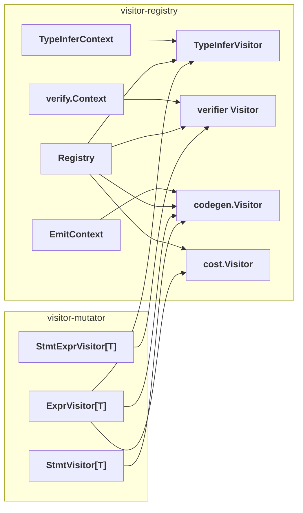

# TileFoundry Spec — Visitor Registry

The derived-visitor pattern: every `analysis` / `verify` / `codegen` walker is
one template, **base visitor + custom Context + per-class registry**. This spec
defines the template and the generic `Registry`. Every instance is built on the
generic one. The instances are `typeinfer` / `verify` / `codegen` / `cost`, with
the access-relation and evaluator registries beside them. One interface
package under `tilefoundry.interfaces` owns each registry. The package
`tilefoundry.codegen` owns the code-generation registry. A key with no entry
raises `MissingHandlerError` where it is looked up
([§3.1](#31-registry-instances)).

The split:

- **`typeinfer`** dispatches on any Expr-producing `Op`'s `Call` —
  HIR value Ops plus TIR-owned Expr Ops (`tir.memory.{AllocTensor,PtrOf,Span,
  TensorView}`) and the TIR effect Ops with a void result. It
  fills / refreshes `Expr.type`.
- **`verify`** dispatches on TIR `Stmt` (control-flow / binding /
  `Evaluate`) plus cross-function invariants (`Evaluate(FunctionRef)`
  callee resolution, mesh scope, layout homogeneity). A Stmt verify
  rule MAY recursively retrigger `typeinfer` on embedded Expr fields.

Concrete per-node rules belong with the node owner ([tir](./tir.md) /
[hir](./hir.md) / [parser](./parser.md) / [target](./target.md)). This spec
defines **how** rules plug into the dispatch chain, not **what** they say.



## 1. Role

[visitor-mutator](./visitor-mutator.md) defines the **traversal** scaffold (how
to recurse the IR). This spec defines the **dispatch** scaffold (at a node, how
to find the per-class handler and call it). A walk follows one template:

1. inherit a `Visitor` / `Mutator` base,
2. carry a custom `Context` (mutable state + caches + helpers),
3. inside `visit_<ClassName>` consult a `Registry` and invoke `fn(node, ctx)`.

### 1.1 Registry is not a property of `StmtVisitor` / `ExprVisitor`

`StmtVisitor` / `ExprVisitor` are pure traversal scaffolds
([visitor-mutator §5](./visitor-mutator.md#5-stmtvisitort--stmtexprvisitort--stmtmutator)) and
know nothing about any registry. "A `Stmt` subclass consults `verify.registry`"
is wired into the verifier's program visitor ([§5](#5-instance-2--verify))
explicitly.

`verify.register(Fill)` writes an optional leaf handler into
`verify.registry`. For effect Ops, the verifier's `visit_Evaluate` delegates
device instructions to the `verify_call` service, whose implementation
(`check_call` in `interfaces/schedule`) reads `verify.registry` after checking
the operation's declaration. A Stmt subclass without a dedicated method of that
visitor is checked by its `verify.registry` entry; this does not replace
effect-call admission.

### 1.2 Two ways to write a visitor

- **Fixed-logic visitor.** Inherit `ExprVisitor` / `StmtVisitor` and hand-write
  `visit_Call` / `visit_For` / … overrides. No registry. Use it for rules pinned
  to one place (e.g. a one-shot rewrite).
- **Extensible visitor.** Define a `Context` + `Registry` + `register` function,
  and have the visitor consult its own registry inside `generic_visit`. Use it
  when third-party code should plug in handlers per node class (`typeinfer` /
  `verify` / `codegen` are this shape).

The recipe for a new extensible analysis is in
[§10](#10-defining-a-new-extensible-analysis).

## 2. Core contract

Two node shapes can be registry-dispatched:

- **Op (value-producing).** Used via `Call(target=Op, args)`. The Op
  subclass is the registry key; handler signature is
  `(call: Call, ctx) -> T`.
- **Stmt (effect-producing).** A direct `Stmt` subclass — control
  flow, binding, `Evaluate`, user `@intrinsic`. The Stmt subclass is
  the registry key; handler signature is `(stmt: Stmt, ctx) -> T`.

A registry that asks about a node alone keys exactly one of the two.
Code generation asks about more than the node, so its key carries the
class alongside the other two things the answer depends on
([§6](#6-instance-3--codegen)). The instances split as follows:

| Instance | Op-branch handler | Stmt-branch handler | Notes |
|---|---|---|---|
| **typeinfer** | `(Call, TypeInferContext) -> Type` | — | Call result typing, including `TupleType.Void` for effect Ops |
| **verify** | — | `(Stmt, verify.Context) -> None` | Effect-side constraints; for `Evaluate(op, args)`, dispatch keys on the Op class — see [§5](#5-instance-2--verify) |
| **codegen** | `(Call, EmitContext) -> str` | `(Stmt, EmitContext) -> None` | Both sides are emitted; the key also carries the target and the position — see [§6](#6-instance-3--codegen) |
| **cost** | `(Call, cost.Context) -> Cost` | `(Stmt, cost.Context) -> Cost` (optional) | Recursive-local logical work |

The visitor base's `generic_visit` recurses the generic control-flow / binding
Stmts (`For` / `If` / `While` / `LetStmt` / `Sequential` / `MeshScope` /
`Return`). The verifier's program visitor has a dedicated method for each of
them and `Evaluate`. It requires a registry entry for any other Stmt
([§5](#5-instance-2--verify)). Their semantic rules are owned by
[tir](./tir.md) / [hir](./hir.md).

## 3. `Registry`

Every instance shares one registry implementation, in `tilefoundry.dispatch`: a
key → value map with a duplicate-registration guard and two ways to ask. The key
depends on the question the instance answers.

```python
class MissingHandlerError(LookupError):
    """A registry has no entry for a key that a caller requires."""


class Registry[Key, Value]:
    """Key-to-handler map. A second registration of one key raises."""

    def __init__(self, name: str) -> None: ...
    def register(self, key: Key, value: Value) -> None: ...
    def decorator(self) -> Callable[[Key], Callable[[Value], Value]]: ...
    def require(self, key: Key) -> Value: ...
    def get(self, key: Key, default: Value | None) -> Value | None: ...
    def has(self, key: Key) -> bool: ...

```

- constraints:
  - `register` MUST raise `RuntimeError` on a second registration of the same
    key. Subclasses do not inherit a parent's handler. Each concrete
    `Op` / `Stmt` subclass MUST register itself.
  - `decorator` returns the `register(key)` decorator form for a registry keyed
    by a class alone. An instance with a wider key states its own registration
    function ([§6](#6-instance-3--codegen)).
  - `require` returns the entry. It raises `MissingHandlerError` naming the
    registry and the whole key. A caller for which a miss is an error MUST use
    this method.
  - `get` takes its default as a required argument, so a legal miss states
    its answer where it is asked. There is no implicit `None`.
    The verifier's visitor and `cost.Visitor` take `get`. A typeinfer or evaluator
    miss reaches `ctx.error` or `EvalError` naming the Op.

### 3.1 Registry instances

Each registry is a module-level `Registry` owned by one package, which also
exports its registration function. Declare a registry where its question is
answered. Register a handler where its key is owned
([develop Functions](../develop.md#functions)). No
registry lives in a package that depends on the Ops it dispatches.

| Registry | Key | Handler | Owner |
|---|---|---|---|
| `typeinfer.registry` | `type[Op]`, or `(type[Target], type[Op])` | `(Call, TypeInferContext) -> Type \| TypeInferResults` | `interfaces/typeinfer` |
| `evaluator.registry` | `type[Op]` | `(EvaluateContext) -> Value` | `interfaces/evaluator` |
| `cost.registry` | `type[Op]` | `(Call, cost.Context) -> Cost` | `interfaces/cost` |
| `access.relation_registry` | `type[Op]` | `(Call, ctx) -> tuple[access.Relation, ...]` | `interfaces/access` |
| `verify.registry` | `type` (Stmt or Op) | `(node, verify.Context) -> None` | `interfaces/verify` |
| `access.alias_registry` | `type[Op]` | `(Call) -> int \| None` | `interfaces/access` |
| `codegen.registry` | `(type[Target], Role, type)` | by role ([§6](#6-instance-3--codegen)) | `codegen` |
| `passes.registry` | a pass class | its registered entry | `passes` |
| `inspection.tir_printer.registry` | `type` | the TIR printer's entry for that class | `inspection` |
| `target.bindings` | `(type[Target], type)` | the bound implementation class (`target.bind`) | `target` |
| `schedule.pairings` | `type[Op]` (an HIR Op) | `schedule.Pairing` | `interfaces/schedule` |
| `services.registry` | a service function | its implementation ([§3.2](#32-services)) | `services` |

The registration functions are `typeinfer.register(cls, *, target=None)`,
`evaluator.register(cls)`, `cost.register(cls)`, `access.register_relation(cls)`,
`verify.register(cls)`, `access.register_alias(cls)` and
`codegen.register(target, role, cls)`; the candidate pairings are registered
through `schedule.register_candidates` ([§11](#11-instruction-candidate-mappings)).
The interface packages are imported as
`from tilefoundry.interfaces import typeinfer`, so a registration is spelled
`@typeinfer.register(Op)` in the Op's own file.

```python
# example
# an Op file registers each rule it owns against its own class:
@typeinfer.register(Binary)
def _(call: Call, ctx: TypeInferContext) -> TensorType: ...
@cost.register(Binary)
def _(call: Call, ctx: cost.Context) -> Cost: ...
```

- constraints:
  - `tilefoundry/bootstrap.py`, imported by `tilefoundry/__init__.py`, imports
    the packages that register implementations and calls `target.load()`. A key
    with no entry raises `MissingHandlerError` where it is looked up. The tests
    cover the typeinfer rule of every `tf` and `T` Op. They also cover the
    evaluator, cost and access rules of every `tf` Op. A verify rule is optional
    by design ([§5](#5-instance-2--verify)). A codegen key exists only for the
    targets that emit the node ([§6](#6-instance-3--codegen)). Most Ops alias no
    operand.
  - The `evaluator` registry holds the reference semantics of HIR Ops and of the
    TIR Ops a `tf.schedule` selects
    ([evaluator §3](./evaluator.md#3-the-evaluator-registry-and-the-eval-context)).
    The two kinds are distinct classes, so they never share a key.

### 3.2 Services

A lower layer that needs an implementation living above it calls a service
function. The function is declared in `tilefoundry.services`. That package sits
at the bottom of the layer order and imports no IR. The implementing package
registers its implementation at import, keyed by the function itself.

```python
def evaluate(target: object, *args: object, context: object | None = None) -> object: ...
def prepare(module: object, raw: object, out_dir: str, *, device: str = "cpu") -> None: ...
def render(expr: object) -> str: ...
def report_json(result: object) -> str: ...
def verify_call(op: object, args: tuple, mesh: object, *, ctx: object) -> None: ...
def describe_refusal(instruction: str, path: tuple, reason: object) -> str: ...
def refusal_reason(refusal: object, parameter: str | None) -> object: ...
def builtin_analyzer(selector: str) -> object: ...
def simplify_dim(kind: str, args: tuple) -> object: ...
def normalize_dim(value: object) -> object: ...
def dim_range(value: object) -> tuple[int, int] | None: ...
def specialize(base: object, declared: object, mesh: object) -> object: ...
def converter(base: object, weight_name: str) -> object: ...
```

- constraints:
  - A service function MUST resolve its implementation through
    `services.registry.require(<the function>)`. A call to a function that
    nothing implements raises `MissingHandlerError`.
  - The implementations are:
    - `evaluate` in `interfaces/evaluator`
      ([evaluator §2](./evaluator.md#2-parameters-and-inputs)).
    - `prepare` in `runtime/prepare.py`.
    - `render` in the TIR printer of `inspection`.
    - `report_json` in the analysis report of `inspection`. It returns the report
      data of one `analysis.Result` as JSON text. So `analyze` can write
      `analysis.json` without importing `inspection`.
    - `describe_refusal` and `refusal_reason` in the pattern printer of
      `inspection`.
    - `verify_call` in `interfaces/schedule`. It turns a
      `schedule.RefusalError` into a `VerifyError`.
    - `builtin_analyzer` in `analysis/registry.py`.
    - `simplify_dim` in `ir/dim/simplify.py`.
    - `normalize_dim` and `dim_range` in `ir/dim/isl_interop.py`.
  - `Function.__call__`, `Module.__call__` and `core.LoadedModule.__call__` call
    `services.evaluate`, and `Module.prepare` calls `services.prepare`, so
    `ir/core` evaluates and prepares without importing the layers above it.
  - `Function.specialize`, `PrimFunction.specialize` and `Function.converter`
    call `services.specialize` and `services.converter`. `parser` implements
    them as the decorators that parse a variant or a weight converter. So `ir/core`
    declares the authoring methods without importing `parser`.

## 4. Instance 1 — `typeinfer`

Context. `valuation.Context` and `valuation.Visitor` live in
`tilefoundry.interfaces.valuation`; `TypeInferContext` and `TypeInferResults` in
`tilefoundry.interfaces.typeinfer`:

```python
# tilefoundry.interfaces.valuation
@dataclass
class Context:
    """Shared definition environment, lexical transitions and call resolution."""

    module: Module | None = None
    function: Function | PrimFunction | None = None
    target: Target | None = None
    topologies: tuple[Topology, ...] | None = None
    caller_context: valuation.Context | None = None
    mesh_scope: Mesh | None = None
    loops: tuple[tuple[Expr, object, object, object], ...] = ()
    loop_aliases: dict[int, Expr] = field(default_factory=dict)
    call_site: Call | None = None
    owner: Expr | Stmt | None = None
    parent: valuation.Context | None = None

    def with_captures(self, captures) -> valuation.Context: ...
    def enter_region(self, region) -> valuation.Context: ...
    def enter_call(self, call: Call) -> valuation.Context: ...
    @property
    def callee(self) -> Function | PrimFunction | None: ...
    def callee_context(self, call: Call | None = None) -> valuation.Context | None: ...
    def capture_root(self, expr: Expr) -> Expr: ...
    def ancestors(self) -> Iterator[valuation.Context]: ...
    def enclosing_meshes(self) -> tuple[Mesh, ...]: ...
    def innermost_mesh(self) -> Mesh | None: ...
    def resolve_target(self) -> Target | None: ...


@dataclass
class TypeInferContext(valuation.Context):
    """Type inference bindings over the shared valuation environment."""

    memo: dict[int, tuple[Expr, Type]] = field(default_factory=dict, repr=False, compare=False)
    instantiated_memo: dict[tuple, Type] = field(
        default_factory=dict, repr=False, compare=False
    )

    def type_of(self, expr: Expr) -> Type: ...
    def local_type_of(self, expr: Expr) -> Type: ...
    def error(self, node: Expr | Stmt, msg: str) -> NoReturn: ...
```

`TypeInferContext` extends `valuation.Context`; `cost.Context` and
`verify.Context` extend `TypeInferContext`. There is no capability-provider or
request protocol.

`valuation.Visitor(ExprVisitor)` supplies four overridable callbacks:
`on_call_start`, `on_call_end`, `on_region_start`, and `on_region_end`.
Start callbacks derive the context through its corresponding `enter_*` method;
end callbacks return the result unchanged by default. Memoized visits do not
repeat callbacks. Shared region-child traversal is implemented in
`visit_operands`, so a `visit_leaf_LoopRegion` override retains the transitions.
Arguments and loop bounds use the outer context; parameters, body, and yields
use the inner context. The region's own leaf uses the outer context.
A Call remains in its caller environment; visiting its operands does not enter
the callee body. Type inference seeds fresh type bindings when it analyzes a
called definition.
Lexical parent links and caller links MUST remain distinct.

- constraints:
  - `enter_region` returns a context whose `owner` is the region and whose
    `parent` is the outer context. An HIR `LoopRegion` or `MeshRegion` records
    its captures; a `LoopRegion` appends to `loops`. A `MeshRegion` or TIR
    `MeshScope` composes its mesh into `mesh_scope`. A TIR `For` only enters
    the lexical region chain: `loops`, `loop_aliases`, and `mesh_scope` stay
    unchanged.
  - `ancestors()` yields contexts from the innermost to the definition root.
    `enclosing_meshes()` returns the mesh of each `MeshRegion` or `MeshScope`
    owner in that chain, outermost first. When the chain has none, it returns
    `(mesh_scope,)`, the definition's external mesh. It returns `()` when that
    is `None`. An authored mesh is not prefixed with the external one.
    `innermost_mesh()` is the last element of `enclosing_meshes()`, or `None`.

`valuation.Context` carries the current Module, function, effective target, and
whole topology hierarchy directly. A shared definition carries no parent or
inherited execution context ([core-ir §1](./core-ir.md#1-module)).

- constraints:
  - `callee` identifies the called function and `callee_context()` its environment;
    `call_site` identifies the Call.
    Shared call resolution MUST implement [core-ir §2.1](./core-ir.md#21-call).
    An Op call has no called environment; a `FunctionRef` call requires the
    context's Module ([core-ir §1.4](./core-ir.md#14-function-references)).
    `valuation.definitions(context, postorder=False)` visits reached HIR
    definitions once through the shared dispatch; postorder visits dependencies
    before callers. Ordinary Call visits do not enter the called body.
  - Crossing a Function boundary uses `dataclasses.replace` so a context
    subclass retains its analysis-specific state. It also retains `mesh_scope`:
    a callee inherits the call site's mesh, and a region in its body composes
    with it using the usual nested-region rules.
  - `resolve_target` MUST return the context's effective Target, or
    `None` when none is supplied. The parser MAY fall back to the target under which
    a not-yet-finalized Module is being built
    ([parser §1.4](./parser.md#14-context-and-diagnostics)).
  - `memo` is the current scope's identity-pinned type table. Crossing a
    Function boundary creates a fresh context table; a region keeps its scope
    and seeds a nested visitor table from the enclosing one.
  - `instantiated_memo` is the traversal-wide Function-call result table,
    keyed by callee identity, argument types, current mesh, and effective
    Module execution context. Crossing a Function
    boundary MUST preserve the same table object. It stores Types only and never introduces
    a derived Function into the IR.
  - `TypeInferContext.type_of` only looks up `memo`. A type stored on the node
    by an earlier walk is never an input. A value this inference has not
    visited or bound is an error through `ctx.error`. It never starts a
    traversal or infers a type on demand. Only a caller that runs a typeinfer
    rule itself binds that rule's inputs in `memo`.
  - A shared access relation asks the context it is given. Inference passes its
    own context. Code that reads typed IR passes its stage's context (analysis
    its `AnalyzeContext`).
  - `verify.Context.type_of` and `cost.Context.type_of` read IR that is already
    typed, so they return `expr.type`; `cost.Context` reads a selected type
    first.
  - `local_type_of` is the same read in a context without a topology window;
    contexts with a window override it to project the read type.

Registry + registration function, both exported by `tilefoundry.interfaces.typeinfer`:

```python
typeinfer.registry: Registry[type[Op] | tuple[type[Target], type[Op]], Callable]
def register(cls: type, *, target: type[Target] | None = None) -> Callable[[Callable], Callable]: ...
```

- constraints:
  - handler signature is `(call: Call, ctx: TypeInferContext) -> Type | TypeInferResults`.
  - Without `target` a handler is keyed by its Op class and answers everywhere.
    With `target` it is keyed `(target, op_cls)`. It answers only where
    `ctx.resolve_target()` is of that Target type.
    A bare `Type` states no value range; `register` normalizes it to
    `TypeInferResults(type)` without changing the other registries.
  - every `tf` and `T` Op has an entry ([§3.1](#31-registry-instances)).

Visitor:

`TypeInferVisitor` and `inference_type` live in
`tilefoundry.interfaces.typeinfer`, beside shard propagation. Each other
visitor lives beside its registry: `cost.Visitor` in
`tilefoundry.interfaces.cost`, and `codegen.Visitor` in
`tilefoundry.codegen.visitor`. The verifier's program visitor and the HIR/TIR
whole-program verification entry points are not an interface: they live in
`tilefoundry.verifier` ([§5](#5-instance-2--verify)).

```python
class TypeInferVisitor(valuation.Visitor[Type]):
    def __init__(self, *, memo=None, owns_body=True, ranges=False): ...
    def visit(self, expr: Expr, ctx: TypeInferContext) -> Type: ...
    def visit_leaf_Var(self, var: Var, operands, ctx): ...
    def visit_leaf_Constant(self, c: Constant, operands, ctx): ...
    def visit_leaf_Call(self, call: Call, arg_types, ctx): ...
    def visit_leaf_Tuple(self, tup: Tuple, field_types, ctx): ...
    def visit_LoopRegion(self, region, ctx): ...
    def visit_MeshRegion(self, region, ctx): ...
    def visit_leaf_ShapeOf(self, shape_of: ShapeOf, operands, ctx) -> Type: ...

def inference_type(expr: Expr, ctx: TypeInferContext | None = None, *, ranges=False) -> Type: ...
```

- constraints:
  - one `visit_leaf_<Kind>` rule per `Expr` subclass reachable from a `core.Function`
    body or a tir `Expr` field — there is no `isinstance` fallback. An `Expr`
    subclass with no rule raises via `ctx.error` in `default_visit_leaf` rather
    than trusting a possibly-stale `Expr.type` field.
  - `visit_leaf_Call` branches on its target. An `Op` looks up
    `(type(ctx.resolve_target()), type(target))` first, then
    `typeinfer.registry` by `type(target)`; an Op with neither entry routes
    through `ctx.error`. Handlers read operand types through `ctx.type_of`, which sees
    the current scope's memo bindings. A `Function` binds parameters into a new visitor memo.
    It walks its body in a replaced child context ([hir §1.1](./hir.md#11-function)).
    Repeated calls to the same callee with equal argument types and call-site
    mesh scopes reuse the result in `instantiated_memo`.
  - `visit_leaf_Tuple` derives a structural `TupleType` directly from its
    already-derived operands, never the Tuple node's stamped `.type`.
  - `visit_LoopRegion` and `visit_MeshRegion` derive all `args` outside the
    region, verify isolation, and bind each parameter to its argument's type. A
    type stored on a parameter is never read as a constraint. An owning visitor
    stores that type on every parameter, including captures the body does not
    read; a non-owning one stores nothing.
  - `visit_LoopRegion` rejects more yields than parameters. It seeds a new visitor
    with induction and all entry bindings. It visits body and yields once. It
    checks each yield with `types_compatible(entry_type, yield_type)`. The
    result is the carried entry types ([hir §1.2](./hir.md#12-loopregion)). It
    overrides the complete node visit; the base has no per-kind operand hook.
  - `visit_MeshRegion` composes the region mesh with the enclosing HIR
    `mesh_scope` and checks the resulting topology. It visits the body with a
    new visitor seeded from the region's entry bindings, in a replaced child
    context. So a rule reading `ctx.type_of` inside the body sees the types
    derived in it. The region result type is the body's type.
  - `visit_leaf_ShapeOf` returns the node's declared rank-0 i32 type.
  - `inference_type` creates a fresh non-owning visitor and returns the inferred
    type without writing it to `expr.type` by default. With `ranges=True`, it
    replaces or removes each `RangeMetadata` over the complete tree without
    rewriting stored types. Partial parser inference never writes ranges.

Lifecycle: parser builds a `TypeInferContext` and infers each newly built call
at parse time (see [parser](./parser.md)). Once a complete HIR Function is
formed, and after a pass replaces one, whole-function inference refreshes its
available ranges. Analysis does the same after cloning its complete view. This
range-only refresh deliberately leaves the existing type lifecycle unchanged.
The visitor and its context share the current scope's memo;
`type_of` is a constant-time lookup used to expose bindings to handlers.

### 4.1 Access relation service — `access_relation`

One registry over the Op classes says where each Op reads and writes. Every
reader asks it. Typeinfer asks it to derive the result's Type. The loop
footprint asks it for the bytes one authored loop touches. The movement family
asks it how much crossed each boundary. There is no second registry and no
fallback. A boundary nobody can price is a boundary nobody can measure.

```python
# tilefoundry.interfaces.access
class Relation:
    """One boundary's relation, together with what its parameters are.

    Attributes:
        relation: attribute; The relation from the Op's iteration space to the coordinates of its own value it reaches.
        values: attribute; Each isl parameter name mapped to the operand element or dimension it is.
        may_access: attribute; Whether each coordinate accesses one data-dependent element of its image.
        affine: attribute; The Op-written affine before intersection with its iteration domain, or None if no single affine exists.
    """

    relation: "isl.map"
    values: IslParamValues = {}
    may_access: bool = False
    affine: isl.multi_aff | None = None

def relations_of(call, ctx) -> tuple[access.Relation, ...]: ...
def local_relations_of(call, ctx) -> tuple[access.Relation, ...]: ...
def projected(relations, call, ctx, *, device=None) -> tuple[access.Relation, ...]: ...
def iterating(extents, relations: tuple[access.Relation, ...]) -> tuple[access.Relation, ...]: ...
def shape_from_relation(access: access.Relation, extents) -> tuple: ...
```

Registry + registration function, both exported by `tilefoundry.interfaces.access`:

```python
access.relation_registry: Registry             # keyed by type[Op]
def register_relation(op_cls: type) -> Callable[[Callable], Callable]: ...
```

- constraints:
  - A handler has the shape `(call, ctx) -> tuple[access.Relation, ...]`. It MUST NOT read
    the Call's own Type. Typeinfer asks the handler to derive that Type, so a
    handler that asked back would ask for its own answer. It MAY read its
    operands' Types, its Op's attributes, and the values its parameters bind.
  - `access.Relation` is the only carrier. An Op's relations are one flat
    tuple of them, with no record around it. A boundary MUST NOT be a bare
    `isl.map` or `isl.multi_aff`. Those say where a boundary reaches and nothing
    about what its parameters stand for, so whoever restricts one guesses.
    `relations_of` MUST refuse a handler answer that is not a tuple of
    `access.Relation`. Every helper that builds a boundary hands one over
    already stated. A function handed to `access.Relation` is kept as the
    relation it is.
  - When `access.Relation.may_access` is True, each coordinate accesses one
    element of its image, chosen by data. The position of a boundary in the
    tuple determines whether it reads or writes. `reached_elements` MUST count
    at most one element per coordinate. It takes the minimum of the image size
    and the coordinate count.
  - Every `access.Relation.relation` is a relation from the Op's **whole
    iteration space** to the coordinates that boundary reaches. It is stated in
    the axes the value was written in. Every boundary of one Op shares that
    space. A boundary MAY be partial in that space. A partial boundary is one
    relation empty somewhere, not a second space. There is no separate domain
    field. What an Op walks is the union of its boundary domains.
  - A coordinate an Op only learns at run time is a **parameter** of the
    relation. `values` maps it to the operand element or dimension it is.
    Whoever restricts the relation binds the parameter and does not guess. A
    parameter nobody binds is a hole and MUST be refused. One name MUST be one
    value across the whole Op. Collecting an Op's `values` MUST refuse a
    name bound to two values. A handler MAY name each boundary's parameters on
    its own. `iterating` MUST first rename them by object identity. The rename
    gives one value one name and two values two names. It equates and merges two
    names that one boundary gives to one value. No rename captures another name.
    A value that cannot keep its name gets a fresh `p<number>` that no parameter
    and no coordinate of the Op uses. Renaming MUST return new relations. It
    MUST leave the stated ones, and their `values`, as they were. One relation
    can be reused by another Op. A relation composed or restricted from others
    MUST carry exactly the parameters it names, taken from those `values`. The
    caller that composes it picks them. Construction refuses a parameter left
    without one.
  - The tuple has one relation per argument, in argument order, and then one
    per result. A single value has one relation. A `TupleType` result has one
    per field, in field order. Position is the only record of where the
    arguments end. A reader that holds the Call takes the first
    `len(call.args)` as the arguments' and the rest as the result's. The caller
    hands that count to a reader without a Call. Before any Type is derived,
    construction holds parameter closure. `iterating` holds the shared
    iteration arity. `relations_of` holds the tuple form and at least one
    relation after the arguments. Projection adds what needs the derived Type.
    It adds one relation per result field. It puts each image at the rank its
    value was written in. Each projected relation reaches a countable number of
    elements.
  - How much a boundary moves MUST NOT be a second field. It is what the
    relation reaches over the coordinates its Op iterates, counted from the
    relation's own image. Reaching the same element from many coordinates is one
    element moved. An inner iteration axis costs nothing. A projection or a
    count that cannot be derived MUST fail closed. It MUST NOT fall back on a
    stated number.
  - `relations_of` answers in logical axes only. `projected` carries every
    boundary from logical axes onto the coords the reader addresses. `projected`
    composes with the layout the value ended up with. `projected` also holds every
    boundary to the iterations this unit performs. `local_relations_of` is
    `projected` over `relations_of`. A value nobody divided is addressed whole
    by every unit. So leaving one boundary unheld would charge one unit what
    all of them read.
  - A boundary never read or written MUST be
    stated as an empty relation at its value's own rank. `access.unread`
    builds one. An Op whose result follows from its operands' Types alone MUST
    register `readnone_relations(result_shape)`. Examples are a rank, a shape,
    and a view of the same value. `result_shape` derives the result's shape
    from the operand Types. Every boundary of it is then empty at the rank of
    the value it describes. On the output side, that rank is the result's own
    rank.

A second registry in the same package states which operand a view re-addresses:

```python
access.alias_registry: Registry                # keyed by type[Op]
def register_alias(op_cls: type) -> Callable[[Callable], Callable]: ...
def aliased_operand(call: Call) -> int | None: ...
```

- constraints:
  - A handler has the shape `(call: Call) -> int | None`. It returns the
    position of the input whose bytes the Call's result re-addresses, or `None`
    for a new value. `aliased_operand` answers `None` for an Op with no handler.
    The registry is partial, and an unregistered Op is a value of its own.

## 5. Instance 2 — `verify`

Context, in `tilefoundry.interfaces.verify` (extends `TypeInferContext`; adds no
field):

```python
# tilefoundry.interfaces.verify
@dataclass
class Context(TypeInferContext):   # inherits mesh_scope and the region chain
    """The context a per-stmt verify handler is annotated against."""
```

- constraints:
  - The shared region chain ([§4](#4-instance-1--typeinfer)) says where a
    statement stands. The verifier enters each TIR `MeshScope`
    and `For` with `enter_region`. A handler reads the composed
    `mesh_scope`, each enclosing mesh through `enclosing_meshes()`, or the
    innermost through `innermost_mesh()`. A context built without a region
    chain answers `(mesh_scope,)`.

Registry + registration function, both exported by `tilefoundry.interfaces.verify`:

```python
verify.registry: Registry[type, Callable]   # keyed by Stmt/Op class
verify.register: Callable[[type], Callable[[Callable], Callable]]   # the registry's decorator
```

- constraints:
  - A handler has the signature `(node, ctx: verify.Context) -> None`. A failure
    goes through `ctx.error(node, msg)`, which raises `VerifyError`.

**`Evaluate(op, args)` dispatch.** TIR effect-form Ops
(`Copy` / `Fill` / `ReLU` / `Reduce` and target instructions such as the CUDA
`TiledMma`) appear in
Stmt position as `Evaluate(callable=op, args)`. The verify path keys
on the Op class, not on `Evaluate` itself. `verify.register`
takes the **Op class**. The verifier's `visit_Evaluate` passes
device-instruction Ops to the `verify_call` service ([§3.2](#32-services)).
That service runs the same `check_call` that ScheduleOp inference, candidate
admission, and lowering use.
That check owns declaration matching and invokes any registered leaf verifier.
A missing leaf handler MUST NOT bypass the declared constraints. The verifier
reports refusals from the common check as `VerifyError`.
The registry key is the Op class. The registry implementation owns the handler
input shape. The stable IR shape is `Evaluate(op, args)`.
The stable IR does not wrap a value-form `Call` inside `Evaluate`. See
[visitor-mutator §7](./visitor-mutator.md#7-visitor-entry-forms-for-evaluate)
for the matching visitor entry-form contract and
[tir §1.4](./tir.md#14-evaluate) for the wrapper definition.

```python
# example
# a verify handler keys on the Op class and returns None:
@verify.register(Fill)
def _(call: Call, ctx: verify.Context) -> None: ...
```

Per-stmt rules (shape / dtype / layout constraints) belong in
[tir](./tir.md).

Visitor:

`verify_function`, `verify_prim_function`, `verify_module`,
`verify_shape_of`, `verify_value_layouts` and `input_params` are the public whole-program entry
points of `tilefoundry.verifier`. The package sits above `ir.hir` and `ir.tir`
and reads both, so neither IR layer owns the driver. `verify_prim_function`
runs one program visitor over a `PrimFunction` body. The visitor lives beside
the rules and entry points in `verifier/verify.py`. The package does not export
it.

```python
# tilefoundry.verifier.verify
class Visitor(StmtExprVisitor[None]):
    def __init__(self, function: PrimFunction): ...   # visible / ever-bound Vars of this function
    def visit_Sequential(self, stmt, ctx): ...        # also LetStmt, For, While, If, MeshScope, Return, Evaluate
    def generic_visit(self, stmt, ctx): ...           # any other Stmt: its verify.registry entry, then its Expr fields
    def visit_Var(self, var, ctx): ...                # every use must be visible
    def visit_Call(self, call, ctx): ...              # AllocTensor call position and embedded ShardLayout meshes
```

- constraints:
  - One visit covers a statement's own rules and every use in its Expr fields
    ([visitor-mutator §5](./visitor-mutator.md#5-stmtvisitort--stmtexprvisitort--stmtmutator)).
    Another Stmt, such as an intrinsic, is a leaf. After its registered rule,
    each field `stmt_expr_fields` names goes through the same use rules. The
    verifier refuses a non-IR value by name.
    The visitor visits `For` and `MeshScope` bodies in `ctx.enter_region(stmt)`.
    Effect Ops go through `check_call` with `ctx.mesh_scope`.

**Unregistered semantics.** The built-in control-flow / binding Stmts and
`Evaluate` have dedicated methods. [tir](./tir.md) owns their constraints.
Examples are `For.step != 0`, `If.cond` of type `bool`, and `LetStmt`
binding rules. Any other Stmt subclass without a `verify.register` entry is
rejected with `no verify_stmt registered for <Stmt>`.

## 6. Instance 3 — `codegen`

The concrete `EmitContext` interface is owned by
[codegen §2.3](./codegen.md#23-emitcontext). This section owns only the
registry-dispatch contract that consumes that context.

One registry, shared by every target, in the module `tilefoundry.codegen.registry`.
A generated line depends on three things. The first is the language it is
written in. The second is the position of a call it is written at. The third is
the class being asked about. All three are the key:
```python
class Role(Enum):
    """Which position of a call a code-generation handler answers for.

    Attributes:
        EMIT: attribute; the node is written where it stands.
        CALLEE: attribute; the parameters a function declares.
        CALLER: attribute; the arguments a scope supplies for them.
        LAUNCH: attribute; how a host entry launches a function of this target.
    """

    EMIT = "emit"
    CALLEE = "callee"
    CALLER = "caller"
    LAUNCH = "launch"


registry: Registry[tuple[type[Target], Role, type], Callable]


def register(
    target: type[Target], role: Role, cls: type
) -> Callable[[Callable], Callable]: ...
```

- constraints:
  - There is one code-generation registry. A target is a dimension of its key,
    never a registry of its own. A translation unit that writes a call to
    another target's function MUST reach that target's answer. It MUST NOT
    import that target's code generator.
  - The target a key names is the one whose language the answer is written in.
    For a call, that target is the **callee's**. The callee's own convention
    spells a call to it. The calling scope fills in only the names it already
    holds.
  - `LAUNCH` keys on `tir.launch.Launch`. The CPU host target's `EMIT` handler
    for `Launch` forwards to the `LAUNCH` handler of the callee's target. That
    handler states how its function is launched ([codegen](./codegen.md)).
  - `EMIT` keys on a node class: `type[Op]` for an Op reached through its
    `Call`, or `type[Stmt]`. `CALLEE` and `CALLER` key on a signature class
    ([codegen §4.4](./codegen.md#44-signatures)). They read one signature from
    opposite ends. So they are one key apart, not two registries apart.
  - A miss is an error naming the whole key. Codegen has no fallback
    emission. A node or signature nothing answers for MUST NOT be written. The
    registry is partial by design. An Op has an entry only for the targets that
    emit it ([§3.1](#31-registry-instances)).

Handler signatures:

- `EMIT`: `(node, ctx: EmitContext) -> None`. It writes its lines through
  `ctx.emit`. It reaches its operands through the context and does not return a
  fragment. `node` is the `Call` for an Op and the Stmt itself
  otherwise. `Launch` is the exception. Its `EMIT` handler and the `LAUNCH`
  handler it forwards to take `(entry, stmt, ctx)`. These arguments are the host
  entry and the `Evaluate` statement. Both handlers return the launch's text and
  do not write it.
- `CALLEE`: `(signature: Signature, ctx: EmitContext) -> tuple[str, ...]` —
  the C++ parameters this one logical parameter declares. Any derived name it
  invents there is its own and is never parsed back.
- `CALLER`: `(signature: Signature, ctx: EmitContext) -> tuple[str, ...]` —
  the arguments the writing scope passes for it, in the order and count the
  callee declared.

```python
# example
# one handler per (target, position, class):
@codegen.register(Target, Role.EMIT, ReLU)
def _(call: Call, ctx: EmitContext) -> None: ...
@codegen.register(Target, Role.EMIT, For)
def _(node: For, ctx: EmitContext) -> None: ...
@codegen.register(Target, Role.CALLEE, TensorSignature)
def _(sig: TensorSignature, ctx: EmitContext) -> tuple[str, ...]: ...
```

`codegen.Visitor`, in `tilefoundry.codegen.visitor`:

```python
class Visitor:  # codegen.Visitor
    """Dispatch a node to the handler that writes it, for a caller holding a registry."""

    def __init__(self, ctx, registry: Registry, *, target: type): ...
    def emit_stmt(self, stmt: Stmt) -> None: ...   # Stmt-side entry
    def emit_expr(self, expr: Expr) -> None: ...   # Op-side entry, through the Call
```

- constraints:
  - A Stmt is reached by its own class. An Op is reached through the `Call`
    carrying it. So the visitor has two entries. `target` is the key's first
    dimension, not diagnostic text. A leaf `Expr` has no emission of its own and raises.

User extension path — adding a new Stmt `MyIntrinsic`:

1. `ir/tir/<cat>/my_intrinsic.py`: define `MyIntrinsic(Stmt)` and
   `@verify.register(MyIntrinsic)`.
2. In a target package, add `codegen/tir/<cat>/my_intrinsic.py` and register
   `@codegen.register(MyTarget, Role.EMIT, MyIntrinsic)`.
3. For another target, register the same class against its concrete Target
   subclass in that target package.

The visitor / pass pipeline / parser do not change.

## 7. Instance 4 — `cost`

Cost evaluation is a recursive-local analysis. A handler receives selected
candidate Types through `cost.Context`. It does not select hardware resources.
`cost.Context`, `TrafficBytes` and `Cost` live in `tilefoundry.interfaces.cost`,
with the registry, the registration function `cost.register` and
`cost.Visitor`.

```python
@dataclass(frozen=True)
class TrafficBytes:
    """Per-operand traffic.

    Attributes:
        read: attribute; bytes read from the operand.
        write: attribute; bytes written to the operand.
        total_bytes: attribute; derived read-only traffic in both directions.
    """

    read: int = 0
    write: int = 0

    @property
    def total_bytes(self) -> int: ...

@dataclass(frozen=True)
class Cost:
    """Leaf-local work for one selected candidate.

    Attributes:
        flops: attribute; logical floating-point work grouped by compute dtype.
        traffic: attribute; per-operand traffic in argument order, with the
            result last.
        service: attribute; results asked for that are not floating point,
            grouped by the kind of service the machine provides.
        sent: attribute; bytes that left the unit they were on, by the
            boundary they crossed.
        bytes: attribute; derived read-only traffic over every operand.
    """

    flops: Mapping[DType, int]
    traffic: tuple[TrafficBytes, ...]
    service: Mapping[str, int] = {}
    sent: tuple[tuple[str, TrafficBytes], ...] = ()

    @property
    def bytes(self) -> int: ...

# tilefoundry.interfaces.cost
class Context(TypeInferContext):
    """Selected candidate types used for recursive-local costing.

    Attributes:
        selected_types: attribute; selected ``id(expr)`` to ``Type`` mapping.
        selected_output_type: attribute; selected output type, when supplied.
        topology: attribute; topology window to project through, or None for types as written.
    """

    selected_types: Mapping[int, Type] = field(default_factory=dict)
    selected_output_type: Type | None = None
    topology: str | None = None

    def local_type_of(self, expr: Expr) -> Type: ...  # read expr.type, then project
    def local_output_type(self, call: Call) -> Type: ...

cost.registry: Registry[type[Op], Callable]
cost.register: Callable[[type[Op]], Callable[[Callable], Callable]]

# tilefoundry.interfaces.cost
class Visitor(valuation.Visitor[Cost]):
    def __init__(self, registry: Registry = cost.registry): ...
    def visit_Call(self, call: Call, ctx: cost.Context) -> Cost: ...
```

- constraints:
  - Every `tf` Op MUST have one registered evaluator
    ([§3.1](#31-registry-instances)). An Op with
    none MUST fail `cost.Visitor.visit_Call` with the Op name and source
    location.
  - An evaluator is registered with `cost.register(Op)` when the file of its Op
    is imported. Shared construction helpers
    (`elementwise`, `cost.operation`, `traffic` and the like) live in
    `interfaces/cost`. The work an Op asks for follows from its own semantics
    and its operand types, so it is the same on every backend. A target package
    does not register evaluators, because that would make one backend's presence
    decide whether any consumer can cost a program.
  - `flops` MUST group leaf-local floating-point work by compute `DType`. Work
    that is not floating point MUST NOT appear there under the dtype of its
    result. A comparison producing `bool` is not `bool` FLOPs. Pricing it as
    such puts work on a pipe it never went down.
  - `service` MUST group that work by the kind of service the machine provides.
    Name each kind for the operation, not for a machine: `integer`, `predicate`,
    `select`, `special`. A comparison MUST record
    `predicate`. A selection MUST record `select`. An operation over whole
    numbers MUST record `integer`. An operation the machine answers on its
    special-function unit MUST record `special`, not one FLOP each. Examples
    are `rsqrt`, `exp`, `log`, `exp2`, `log2`. That unit publishes its own
    rate, a fraction of the float pipe's. Counting them as arithmetic prices
    them too fast.
    Counts MUST be non-negative integers and MUST NOT be booleans. An operation
    MUST record its work once, under `flops` or under `service` but not both.
    An evaluator MUST NOT invent a kind no target states a rate for. A
    consumer that cannot price a kind refuses and does not substitute zero.
  - `TrafficBytes.total_bytes` and `Cost.bytes` MUST be read-only derived
    properties and MUST NOT be accepted as constructor fields.
  - `traffic` MUST carry exactly one `TrafficBytes` per operand of the call, in
    argument order with the result last. Only which direction is nonzero
    is read. A nonzero `read` says that boundary is read. A nonzero `write`
    says it is written. `bytes` is derived. It is every operand's traffic in
    either direction.
  - An evaluator MUST NOT name a memory level. Which level an operand's bytes
    move at follows from that operand's Type. The consumer reads that level.
    A report of a length that disagrees with the call's operand count MUST fail
    naming the call and both counts.
  - An evaluator says which way each boundary moves and whether the operation
    materialises anything. It does not say **how much** crosses. A consumer
    takes every amount from the Op's access relations
    ([§4.1](#41-access-relation-service--access_relation)) in the window it is
    asking about. An Op with no registered relation MUST fail closed. The
    consumer MUST NOT read the evaluator's number as the amount.
  - An operation that only re-describes or re-indexes existing elements
    reports no direction on those boundaries and moves nothing. The numbers
    that place a window are read like any other operand. A `Reshape`
    moves nothing. A `Slice` moves nothing of its tensor source or result and
    reads the numbers placing it. A `Transpose` reads and writes because its
    evaluator materialises the permutation.
  - With no `topology`, `cost.Context.local_type_of` MUST return the selected
    Type as written. With one, it MUST apply `local_type_of` using the context's
    topology hierarchy. It MUST reject unresolved or non-concrete local extents
    at the point where the evaluator requires them.

## 8. Shared helpers

### 8.1 `ctx.error`

```python
def error(self, node: Expr | Stmt, msg: str) -> NoReturn: ...   # node: the offending Expr/Stmt (class name used in the message); msg: the constraint-failure message
```

- constraints:
  - `TypeInferContext` and every Context that inherits it provide this helper.
    It raises `VerifyError` with a stable format.

### 8.2 Other helpers

Local helper implementation is not part of this contract.

## 9. Registration timing — import-time side effects

Registrations (`typeinfer.register`, `cost.register`, `codegen.register`, and
the other registration functions of [§3.1](#31-registry-instances))
are import-time side effects. `ir/hir/__init__.py`, `ir/tir/__init__.py`, and
each target package's `__init__.py` import every Op category, subpackage and
module. So every registration runs.

`import tilefoundry` imports `bootstrap`. This module imports the implementing packages
and loads the targets. Every registry is fully populated before the import
returns. A re-import is idempotent. Python caches the module.
`Registry.register` does not re-run the import-time body.

## 10. Defining a new extensible analysis

To add a per-node-class extensible analysis (e.g. liveness on top of typeinfer),
follow the four steps.

### Step 1 — define a Context

```python
# example
@dataclass
class LivenessContext(TypeInferContext):
    live_sets: dict[Var, set[Var]] = field(default_factory=dict)
```

### Step 2 — declare a registry + registration function

```python
# example
registry: Registry[type[Op], Callable]           # the new analysis's registry
register = registry.decorator()                  # register a handler for one Op class
```

The registry lives in the interface package of the analysis
([§3.1](#31-registry-instances)).

Use `type[Op]` for an analysis that walks `Call`s. Use `type[Stmt]` for
an analysis that walks effect Stmts. Declare both registries if the analysis
needs both.

### Step 3 — derive a Visitor that holds the registry explicitly

```python
# example
class AliasVisitor(ExprVisitor[None]):
    def __init__(self, registry: Registry = registry): ...
    def visit_Call(self, call: Call, ctx: LivenessContext) -> None: ...
```

### Step 4 — register handlers in the Op files

```python
# example
# a liveness handler keys on the Op class and returns None:
@liveness.register(Reshape)
def _(call: Call, ctx: LivenessContext) -> None: ...
```

The instances in this spec follow these steps. A new analysis is a peer
of them. No existing visitor, registry or dispatch code changes. Callers own
their `Registry`, `Visitor` subclass (built on
[visitor-mutator](./visitor-mutator.md)), and `Context` dataclass. Nothing
auto-binds them.


## 11. Instruction candidate mappings

`register_candidates(hir_op, tir_ops)`, exported by
`tilefoundry.interfaces.schedule`, appends instructions in registration
order. The target-neutral pairings are registered in `schedule/pairings.py`.
Used as a decorator, it registers one callback per HIR operation:
`callback(call, instruction_type) -> (attributes, operand_types)`. A second
callback is an error. A registration without a decorated callback retains the
existing callback. An operation without a callback uses the default mapping.

The default maps READ operands in input order and WRITE operands to `call.type`,
and copies same-named attributes. A non-default HIR attribute with no
instruction parameter counterpart raises a `ValueError` naming the HIR field
and instruction. `instruction_from_hir` applies the same check to automatic
lowering through `sole_candidate`. Reshard supplies source/result types.
IndexSelect supplies source/result/index and maps `fill_value` to `fill`.
MatMul supplies the result as acc and describes lhs/rhs bytes as M,K and K,N.
MatMul permutes shape and strides for KM/NK. MatMul does not invent an accumulator layout.

Target capability records supply an open atom class to the instruction
matcher. The matcher's frozen result records contain the constructed instruction and
full ordered matcher path. [schedule](./schedule.md) owns acceptance and
[inspection](./inspection.md) owns path and refusal rendering.
