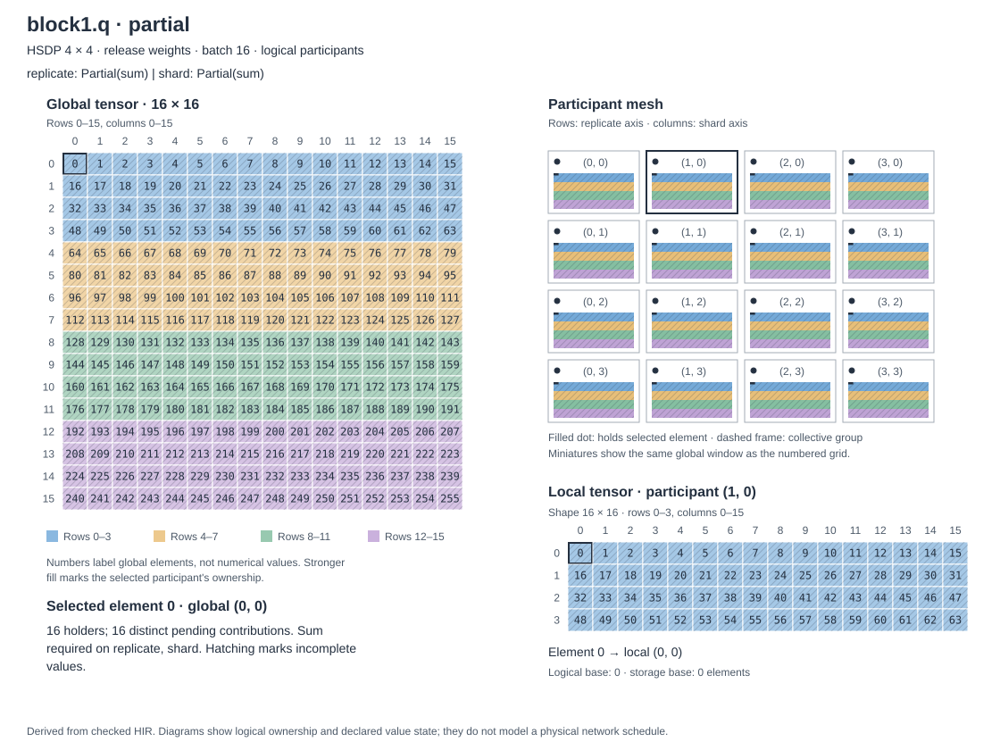
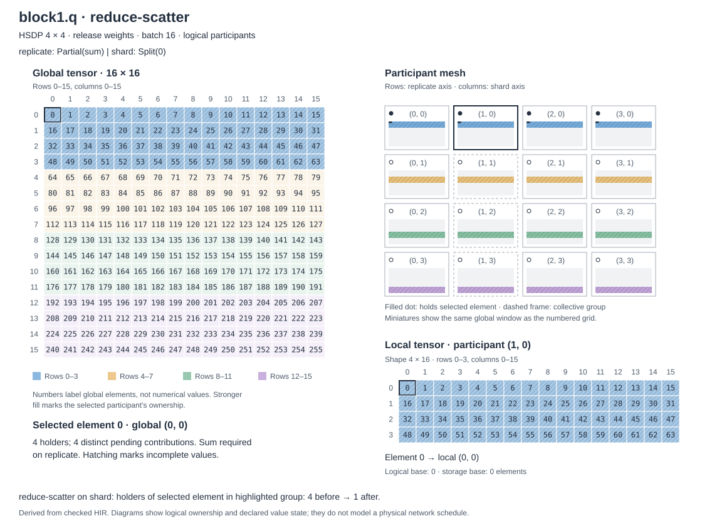
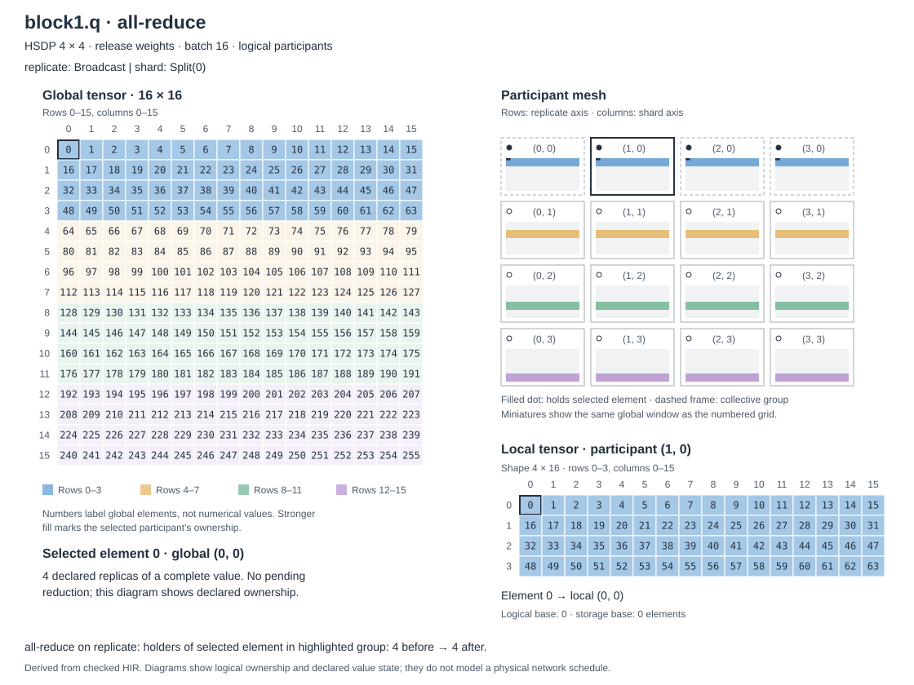

# Two-block FSDP and HSDP training in HIR

This study asks how releasing gathered parameters after forward changes storage and logical communication while preserving the training update. The HIR evaluator simulates participants on CPU. Forward, backward, and momentum SGD are authored explicitly. PyTorch autograd supplies an independent numerical reference.

## Run the comparison

Use an editable TileFoundry installation with the NVIDIA target, following [the development guide](../../docs/develop.md). From the repository root:

```bash
python -m examples.fsdp_training.run --participants 1 2 4
python -m examples.fsdp_training.run --participants 4 --replicas 2
python -m examples.fsdp_training.run --participants 16 --replicas 4
```

Each configuration performs two training steps on changing batches, checks logits, global mean loss, every parameter gradient, updated parameters, and momentum buffers, then analyzes memory. The first command prints six FSDP records; the second and third each print two HSDP records, on 2 × 2 and 4 × 4 logical meshes respectively. Analysis can take several minutes per configuration. It needs neither a checkpoint nor a dataset download.

| File | Responsibility |
|---|---|
| `model.py` | Explicit forward/backward HIR and parameter residency policies |
| `reference.py` | Dense embedding, PyTorch SDPA/autograd, and optimizer oracle |
| `run.py` | Correctness checks and reports derived from existing HIR facts |
| `visualize.py` / `ownership_svg.py` | HIR ownership trace and reusable SVG renderer |

## Explore tensor ownership

The diagrams use numbered cells and colored row tiles, inspired by [CuTe's layout algebra illustrations](https://docs.nvidia.com/cutlass/latest/media/docs/cpp/cute/02_layout_algebra.html). Each number is a global element index, not a tensor value. The participant miniatures show the same logical window; the local tensor keeps those global labels so the mapping can be followed directly.

The checked-in SVGs below are generated from the first block's Q-weight gradient on a **4 × 4 HSDP mesh**. They follow element 64 and participant `(0, 1)` through three existing HIR values. Filled dots identify every holder of that element, a solid frame identifies the selected participant, and dashed frames identify its collective group. Hatching means the held values still need reduction.

**Local backward contributions — sixteen distinct contributions cover the same indices.**



**Reduce-scatter — each row resolves the shard axis. Four replica-axis contributions remain for element 64.**



**All-reduce — each column resolves the replica axis. The four holders now declare replicas of the completed sum.**



The following scalar operation divides the sum by 16 to produce the global-mean gradient. The diagrams show logical grouping; mesh rows are not assignments to physical nodes.

Reproduce these resolution-independent SVGs from the repository root:

```bash
python -m examples.fsdp_training.visualize --output-dir examples/fsdp_training/figures
python -m examples.fsdp_training.visualize --tensor head --stages parameter gather gradient updated --output-dir /tmp/head-ownership
python -m examples.fsdp_training.visualize --participants 2 --replicas 1 --retain --output-dir /tmp/fsdp-ownership
```

Use `--tensor` for any of the fourteen parameters, `--element` and `--participant` to choose the highlighted mapping, or `--list-values` followed by `--value ID` to render activations and other intermediates. The available named stages are `parameter`, `gather`, `partial`, `reduce-scatter`, `all-reduce`, `gradient`, `momentum` and `updated`; the collective stages depend on the mesh. Large tensors use explicitly labeled windows with every displayed cell preserved, and the local view shows up to four rows. Colors identify logical row tiles and remain stable across stages. `Partial` and `Broadcast` may cover identical indices while representing different value states.

The exporter checks HIR types without executing numerical training or device communication. `trace_function()` follows reached calls, mesh regions and tuple leaves by SSA identity; scalar literals are omitted. `describe_tensor()` reuses logical projection to obtain coverage and the coordinate map, then applies the projection to the authored address map for storage offsets. `ownership_svg.render_svg()` draws any tensor value from that trace using the standard library and existing layout helpers. `training_trace()` supplies the model's input/output signature and parameter labels; the command-line interface also uses those labels for selection. No HTML template, browser runtime or plotting dependency is needed to generate the SVGs.

Logical and storage offsets are shown separately. Their equality in an authored dense map does not make them the same concept: changing to compact private storage can change the storage offset while preserving logical ownership. Loops and unsupported region kinds are rejected, and plain layouts receive no invented holder mesh.

## Model and training contract

The workload borrows selected components from modded-nanogpt: [RMSNorm](https://github.com/KellerJordan/modded-nanogpt/blob/4ea6b937337a4889b8cfe3f38a93d120048d8f71/track_1_short/model/layers.py), [QK normalization and rotary position encoding](https://github.com/KellerJordan/modded-nanogpt/blob/4ea6b937337a4889b8cfe3f38a93d120048d8f71/track_1_short/model/attention.py), and a [ReLU-squared MLP](https://github.com/KellerJordan/modded-nanogpt/blob/4ea6b937337a4889b8cfe3f38a93d120048d8f71/track_1_short/model/gpt.py). GQA is an adaptation: this is not a reproduction of that repository's speedrun model or optimizer.

```text
tokens -> embedding -> block 1 -> block 2 -> RMSNorm -> vocabulary head -> cross-entropy
block  -> RMSNorm -> causal GQA -> residual -> RMSNorm -> ReLU² MLP -> residual
```

The baseline FP32 configuration has batch 8 (16 for the 4 × 4 HSDP case), sequence length 8, width 16, four query heads, two KV heads, head width 4, MLP width 64, and vocabulary 32. RMSNorm is affine-free, projections have no bias, embedding and head are untied, and there is no dropout. Random nonzero initialization makes every parameter's gradient nonzero on the first step. This avoids a zero output projection concealing an incorrect backward path.

HIR represents the tiny embedding lookup as one-hot matrix multiplication; the reference uses `torch.nn.functional.embedding`. Fixed rotation matrices express RoPE in HIR, while the reference rotates adjacent coordinate pairs. HIR broadcasts K/V over a separate query-group dimension; the reference repeats KV heads before SDPA. These are equivalent small-workload representations, not production embedding or attention kernels.

Every participant receives different complete sequences. With multiple participants, parameters and momentum are split along tensor dimension 0 within each shard group; the single-participant case keeps them whole. Linear backward contracts the split token dimension to produce actual `Partial(sum)` contributions. FSDP resolves those with reduce-scatter; HSDP uses reduce-scatter and then all-reduce as described below. Exactly one division by the total participant count produces gradients of the global mean loss. HIR `Reduce` has complete reduction semantics, used for the scalar loss. The optimizer uses learning rate 0.01, momentum 0.9 and zero initial velocity, with no dampening, weight decay or Nesterov update. The second step consumes the first step's returned state; inputs are not mutated.

Checks use `rtol=5e-4`, `atol=2e-5` for FP32 reduction-order differences. The runner prints the observed maximum absolute errors separately for logits, loss, gradients, parameters and momentum.

## Residency experiment

Both variants use the same arithmetic and saved activations. The release variant gathers inside each forward stage, releases its full weights at the stage boundary, and re-gathers weights needed by backward. The retain variant returns full weights from forward and passes them to backward. Saved values are ordinary HIR tuples; there is no autodiff annotation, lifetime operation, or separate allocator.

Embedding backward does not read the embedding weights, so neither variant gathers them again. Each transformer block owns six parameter tensors. The head owns one. A stage boundary groups their lifetimes; it does not declare collective packing or an NCCL launch group.

For one-dimensional FSDP with multiple participants the per-step logical transfers are:

| Quantity | Release | Retain |
|---|---:|---:|
| Tensor all-gather occurrences | 27 | 14 |
| Tensor gradient reduce-scatter occurrences | 14 | 14 |
| Peak live gathered-weight storage per participant | 11,264 bytes (11 KiB) | 24,576 bytes (24 KiB) |
| All-gather result bytes per participant | 51,200 | 26,624 |
| Reduce-scatter input bytes per participant | 26,624 | 26,624 |
| Persistent parameters plus momentum per participant | 53,248 / P | 53,248 / P |

### How the table is generated

The first command above generates the six FSDP records. For just the two-participant comparison, run `python -m examples.fsdp_training.run --participants 2`. Each record checks two numerical updates but reports the transfers and storage of one training-step graph, not the sum of two steps. `P` is the participant count and 1 KiB is 1,024 bytes.

In `run.py`, `study()` builds and checks each program, runs the independent training comparison, and calls `analyze(..., analysis="memory")`. `summarize_training()` then obtains the table from that analyzed HIR:

1. Walk reached function calls and inspect each mesh axis of `Reshard`: `Split -> Broadcast` is an all-gather, `Partial(sum) -> Split` is a reduce-scatter, and `Partial(sum) -> Broadcast` is an all-reduce. Each call occurrence is counted, so invoking a shared block definition twice counts both blocks. These graphs stage one changed axis per collective. Payload uses the participant-local shape from the shared logical projection, times dtype size: the all-gather result or the reduction input. Unchanged Split axes still reduce this local payload. The report records the changed axis, group size, and number of disjoint groups in `collective_groups`; occurrence counts are per participant, not multiplied by the number of groups.
2. Follow call and tuple results back to gathered values, then select their accepted allocation roots from `AllocationSummaryMetadata`. Use the lifetime windows in `RegionMemoryMetadata` to sum simultaneously live bytes, deduplicating aliases by root, and take the maximum over lifetime boundaries. Tensor shape alone does not identify a gathered weight.
3. Sum the allocation entries for the parameter and momentum inputs to obtain persistent state per participant. Fixed inputs, activations and returned update buffers are outside this selected quantity.

The escaping-view regression also checks that a 128-byte view keeps its full 256-byte gathered backing allocation reserved while another stage executes.

The following arithmetic independently explains the generated numbers. Every parameter is FP32, so each element occupies four bytes. Each block has six parameter tensors:

| Parameter | Shape | Full tensor bytes |
|---|---|---:|
| Embedding | `[32, 16]` | 2,048 |
| Q projection, per block | `[16, 16]` | 1,024 |
| K projection, per block | `[8, 16]` | 512 |
| V projection, per block | `[8, 16]` | 512 |
| Output projection, per block | `[16, 16]` | 1,024 |
| MLP up projection, per block | `[64, 16]` | 4,096 |
| MLP down projection, per block | `[16, 64]` | 4,096 |
| Vocabulary head | `[32, 16]` | 2,048 |

One block therefore holds 11,264 bytes (11 KiB). The fourteen tensors together hold `2 + 11 + 11 + 2 = 26 KiB` (26,624 bytes).

- **All-gathers:** forward gathers `1 + 6 + 6 + 1 = 14` tensors. Release re-gathers the two blocks and head during backward, adding `6 + 6 + 1 = 13`, for 27 total. Retain reuses those weights and stays at 14. Embedding backward needs the saved tokens and incoming gradient, not the embedding weights, so there is no embedding re-gather.
- **Reduce-scatters:** each of the fourteen parameter gradients has one `Partial(sum) -> Split` transition under either policy, giving 14.
- **Peak gathered-weight storage:** release keeps full weights within each stage, whose largest set is one 11 KiB block. Retain reaches a point where both blocks and the head are live: `11 + 11 + 2 = 24 KiB`. The embedding's gathered weights are already dead. These sums explain the peaks found by the allocation/lifetime analysis.
- **Collective payloads:** retain gathers 26 KiB of result tensors per participant. Release adds the 24 KiB needed by backward, giving 50 KiB (51,200 bytes). The fourteen reduce-scatter inputs total 26 KiB per participant under both policies. These quantities describe the full tensors entering or leaving logical collectives; they do not subtract a participant's existing shard or estimate network bytes.
- **Persistent state:** parameters occupy 26 KiB and momentum occupies another 26 KiB. Even sharding gives `52 KiB / P`: 52, 26 and 13 KiB per participant at `P = 1, 2, 4` respectively.

The multi-participant counts, full-tensor payloads and gathered-weight peaks stay the same at `P = 2` and `P = 4`; persistent shards get smaller. Single-participant execution reports zero interparticipant transfers and `null` for a separate gathered-weight peak, since full weights can alias their original storage.

At two participants, both policies matched the dense reference over two updates with maximum absolute errors of `5.1e-7` for logits, `1.2e-7` for gradients/momentum, and `3.0e-8` for updated parameters; scalar loss agreed at the reported FP32 precision. A separate local check against PyTorch FSDP2 on two sm90 GPUs also passed both policies, with maximum gradient error `3.9e-7`. That check used real sharded parameters, reduced gradients and sharded momentum, and does not establish distributed execution of the HIR or equality of physical communication schedules.

These are selected storage components, not total training memory: saved activations, gradients, functional update outputs, fixed inputs and other temporaries also occupy storage. Caller-owned inputs remain persistent. Logical collective payloads are not link traffic, achieved bandwidth, or elapsed time. The H200 target supplies storage ownership for this analysis; no H200 execution or speedup is claimed.

The result is a storage/communication trade-off. Retention removes re-gathers, while release permits smaller gathered-weight residency. Choosing between them needs a memory constraint or a future scheduled/runtime experiment.

## HSDP: two shard groups with replicated parameter shards

Run `python -m examples.fsdp_training.run --participants 4 --replicas 2`. The logical mesh axes are `(replicate=2, shard=2)`, with coordinates `(0,0), (0,1), (1,0), (1,1)`. Each row is a shard group; each column contains corresponding parameter shards across replicas. This follows the two-dimensional placement convention of [PyTorch FSDP2](https://docs.pytorch.org/docs/main/distributed.fsdp.fully_shard.html).

The distribution states are expressed using existing HIR attributes:

| Value or transition | Replicate axis | Shard axis |
|---|---|---|
| Tokens and activations | Split batch | Split batch |
| Parameters and momentum | Broadcast | Split parameter dimension 0 |
| Gathered parameters | Broadcast | Broadcast |
| Local parameter-gradient contributions | Partial(sum) | Partial(sum) |
| After reduce-scatter within each row | Partial(sum) | Split parameter dimension 0 |
| After all-reduce within each column | Broadcast | Split parameter dimension 0 |

The reduce-scatter must leave the replicate-axis contribution unresolved. Each column then all-reduces only its parameter shard. The program divides by four after both reductions, once. A small evaluator regression inspects the intermediate values from four distinct contributions and refuses to observe that still-Partial intermediate as a completed tensor. The transformer checks all gradients and both momentum updates against dense training.

The same reporter generates these differences from four-way FSDP:

| Per-step, per-participant quantity | FSDP, 4 shards | HSDP, 2 replicas × 2 shards |
|---|---:|---:|
| All-gathers, release / retain | 27 / 14 | 27 / 14 |
| Reduce-scatters | 14 | 14 |
| Gradient all-reduces | 0 | 14 |
| Reduce-scatter input | 26 KiB | 26 KiB |
| All-reduce input | 0 | 13 KiB |
| Persistent parameters plus momentum | 13 KiB | 26 KiB |
| Peak gathered weights, release / retain | 11 / 24 KiB | 11 / 24 KiB |

HSDP's all-gathers and reduce-scatters use two disjoint groups of size two on the `shard` axis. Its all-reduces use two groups of size two on the `replicate` axis. The fourteen full gradients total 26 KiB, so the all-reduce inputs after two-way reduce-scatter total `26 / 2 = 13 KiB` per participant. Parameters plus momentum occupy `52 / 2 = 26 KiB`; replication does not further divide that storage. Gather counts, result payloads and lifetime peaks follow the same stage arithmetic as FSDP above. No-op reshards do not count as transfers.

The mesh describes logical participant groups. A deployment could bind each row to one node and use intra-node gathers/reduce-scatters with inter-node all-reduces. The example does not assign nodes, links or routes, and it does not estimate their bandwidth. Logical projection and propagation determine indices and per-axis value state; physical realization chooses storage strides and owner-local allocation separately. A later communication lowering can consume these groups without changing the training equations.

A separate local check with real PyTorch HSDP on four sm90 GPUs passed two updates for both policies. It used a `(2, 2)` DeviceMesh and verified `Replicate(), Shard(0)` parameter and momentum placements, local shard contents, gradients, logits, and loss. The largest differences were `7.5e-7` for logits, `4.2e-7` for gradients/momentum, and `1.5e-8` for parameters. All four devices were on one host: this validates subgroup numerical behavior, not inter-node transport or HIR-generated distributed execution. The extra hardware comparison remains local; the repository keeps the semantic tests and runnable reference study.

## 4 × 4 HSDP

The larger logical mesh uses four replica groups and four shards per group. Its batch is 16, giving every participant one complete sequence of length 8; all parameter shapes stay the same. The original 1/2/4-participant studies retain batch 8 and their table values. Run `python -m examples.fsdp_training.run --participants 16 --replicas 4` for numerical checks and analysis of both residency policies.

Both 4 × 4 policies passed two updates against the independent dense reference on CPU, including every parameter gradient and momentum update. Maximum absolute differences were `5.1e-7` for logits, `4.8e-7` for loss, `7.5e-8` for gradients/momentum and `1.5e-8` for parameters. These are sixteen simulated HIR participants; no sixteen-GPU execution or inter-node transport is claimed.

There are four disjoint groups of size four for each collective. Four-way reduce-scatter leaves `26 / 4 = 6.5 KiB` of all-reduce input per participant; parameters plus momentum occupy `52 / 4 = 13 KiB`. Gather counts, gather-result and reduce-scatter-input payloads, and gathered-weight peaks match the table above. The final gradient normalization divides by sixteen participants once.

## Regression checks

Target-independent ownership and reduction unit tests live under `tests/core`. NVIDIA-backed training, tuple-call and lifetime regressions live under `tests/nvidia/cuda`; they execute the reference tensors on CPU. The training fixtures contain top-level `@module` programs and use the CLI source loader for both policy entry points. CI also exercises the example's FSDP and HSDP transformer builder for each policy. The runner supplies the broader residency study.

```bash
python -m pytest tests/nvidia/cuda/evaluator/test_fsdp_training.py \
  tests/nvidia/cuda/evaluator/test_mesh_calls.py \
  tests/nvidia/cuda/analysis/test_fsdp_training.py -q
```

## Supported reference semantics

The example simulates a single GPU topology level with concrete shapes and even shards. GQA supplies the workload; FSDP and HSDP distribute the data, parameters, gradients and optimizer state. Execution stays on the input tensors' device. Physical multi-node execution, communication scheduling, mixed precision and uneven shards are outside this study.

The evaluator's [layout-domain contract](../../docs/spec/evaluator.md#6-layout-domain) defines participant execution, supported redistribution and output reconstruction. Reconstruction assembles the logical output for comparison; it is not an additional collective in the reported graph. Plain or `Broadcast` replicas must agree, and a pending `Partial` must be resolved before it is observed as a completed tensor.

## Logical composition and physical realization

The ownership exporter first uses `project_domain` to select the tensor coordinates held by a participant. Applying that projection to a canonical index map gives the global element labels in the diagrams. `DomainProjection.apply` also composes it with the authored address map to obtain storage offsets. The same ownership can therefore be realized with different physical strides.

The owning contracts are [logical coordinate projection](../../docs/spec/semantic-analysis.md#31-logical-shape-to-layout-domain), [relation-driven propagation](../../docs/spec/semantic-analysis.md#32-relation-driven-shard-propagation), and [physical local layout](../../docs/spec/shard.md#76-local_layout). Propagation derives logical-axis `Split` and mesh-axis `Partial` before storage realization. For plain or all-`Broadcast` inputs, `derive_output_distribution` returns `None`; that result does not retain an explicit replication constraint or prove replica equality. The example uses stated placements rather than a placement solver.

## Related design work

- [Discussion #181](https://github.com/tile-ai/TileFoundry/discussions/181): participant reference evaluation, Partial values and logical redistribution.
- [Discussion #183](https://github.com/tile-ai/TileFoundry/discussions/183): HIR-first distributed modeling and cross-device ownership.
- [#255](https://github.com/tile-ai/TileFoundry/issues/255), originally [#138](https://github.com/tile-ai/TileFoundry/issues/138): the evaluator work item; this example covers a training subset.
- [#278](https://github.com/tile-ai/TileFoundry/issues/278): broader Broadcast canonicalization remains separate.
- [#260](https://github.com/tile-ai/TileFoundry/pull/260), [#162](https://github.com/tile-ai/TileFoundry/pull/162), [#165](https://github.com/tile-ai/TileFoundry/pull/165), and [#170](https://github.com/tile-ai/TileFoundry/pull/170): Partial alias handling, mesh/layout slicing, checkpoint projection, and structured lifetimes used here.
