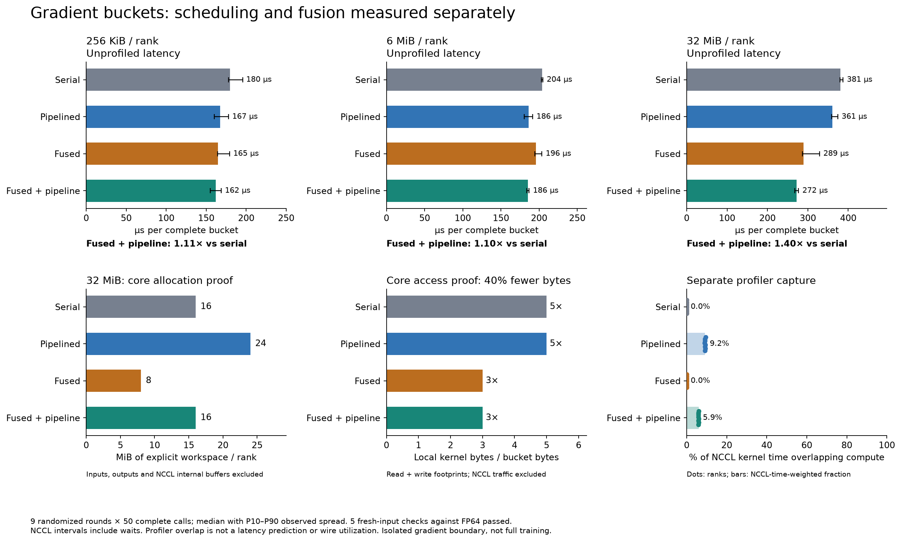
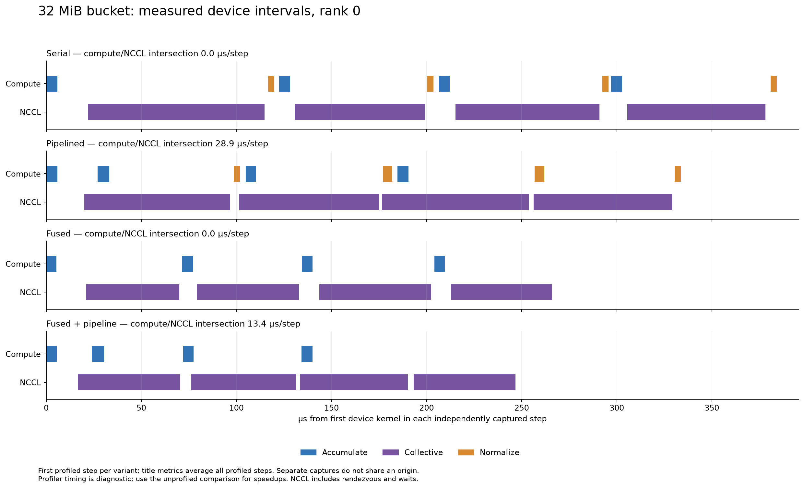

# Gradient accumulation and communication fusion

For a 32 MiB FP32 gradient bucket, combining fusion with pipelining measured
**272.3 µs versus 380.8 µs serial: 1.40× faster**. Compared with unfused
pipelining, it reduced the planned workspace from **24 to 16 MiB** and removed
**40% of the local pointwise kernels' read/write bytes**. All four candidates
passed five fresh-input checks against an independent FP64 CPU reference.



The two larger payloads match Qwen3-30B-A3B matrix sizes: one expert projection
(`2048 × 768`, 6 MiB in FP32) and the attention query projection
(`2048 × 4096`, 32 MiB). The 256 KiB case exercises a smaller bucket. Inputs are
synthetic microbatch gradients. This experiment covers a gradient synchronization
boundary; it does not run the whole model or DMuon update.

## The transformation

Every candidate computes `g = sum_r(a_r + b_r) / P` for the same inputs and four
chunks. The serial program accumulates a chunk, all-reduces its sum, then
normalizes it. The pipelined program permits two chunks in flight. Fusion
replaces `all_reduce(sum) → normalize(1/P)` with `all_reduce(avg) → output`.
NCCL defines average as the sum across ranks divided by their count
([NCCL reduction types](https://docs.nvidia.com/deeplearning/nccl/user-guide/docs/api/types.html#ncclredop-t)).
The accumulation kernel remains explicit.

`region_boundary` checks the dependency/value boundary of each sum/normalization
pair. The independent numerical oracle checks the replacement's arithmetic.
The query conservatively exposes scratch values too; the example explicitly
declares the receive buffer disposable. The query is not a rewrite-equivalence
proof.
`plan_workspace` places scratch using the same effects and completion relation
that check the emitted program. No example-side allocator or dependency solver
is involved. The normalizer disappears from the captured fused execution; this
is an executed reduction fusion, not a simulated cost saving.

| Variant | 256 KiB latency (µs) | 6 MiB latency (µs) | 32 MiB latency (µs) | Workspace for 32 MiB |
|---|---:|---:|---:|---:|
| Serial | 179.8 | 203.9 | 380.8 | 16 MiB |
| Pipelined | 167.3 | 186.0 | 360.6 | 24 MiB |
| Fused | 164.6 | 195.8 | 288.9 | 8 MiB |
| Fused + pipeline | 161.8 | 185.5 | 272.3 | 16 MiB |

The table reports median complete-call latency, including native host issue and
completion. The figure shows the observed P10–P90 spread across nine randomized
rounds. Each round times 50 calls after 30 warmup calls per variant. Each sample
uses the slowest rank's elapsed time. Setup, compilation, input generation and
reference checks are excluded. All latency measurements finish before any
profiler capture starts. Inputs remain fixed during timing.

The combined median speedups are 1.11×, 1.10× and 1.40× respectively. At 6 MiB,
fused pipelining and ordinary pipelining differ by less than the observed spread;
this run does not establish an incremental latency benefit from fusion there.
The workspace and local-access reductions still apply. These measurements do not
partition the latency improvement into memory, launch and synchronization costs.

## Reading the timeline



This is the first captured step on rank 0, with each variant's first device
kernel placed at time zero. The optional interactive export exposes every rank
and payload. Interval intersections use exact CUDA timestamps; unrelated host
enqueue ranges do not count as device overlap. Profiling is a separate diagnostic
capture with one additional warmup per variant and three recorded steps.

For the 32 MiB bucket, the NCCL-time-weighted fraction across ranks overlapping
compute was **9.2% for pipelining and 5.9% for fused pipelining**. The faster
candidate has less overlapping compute because it removes four normalization
launches. Overlap percentage alone would rank these candidates incorrectly.
NCCL intervals include rendezvous and waits; they are not wire-activity measures.

Memory bars are feasible core-planned caller workspace, excluding the fixed
inputs/outputs and NCCL's internal allocations. The local-access bars count
pointwise-kernel footprints: three bucket-sized accesses for accumulation, plus
two for unfused normalization. They are not measured HBM transactions and do not
include NCCL memory or network traffic.

## Reproduce and inspect

Run from the repository root with the usual CUDA/NCCL build dependencies described
in the [example README](../README.md). `NCCL_HOME` must point to the installation
used for native linking; Matplotlib and optionally Plotly render the results.

```bash
python -m torch.distributed.run --standalone --nproc-per-node=8 \
  examples/qwen3_dmuon/benchmark_overlap.py --output .tmp/qwen-gradient
python examples/qwen3_dmuon/overlap_plot.py .tmp/qwen-gradient/evidence.json \
  --output .tmp/qwen-gradient/figures --interactive
```

The default payloads and sampling settings reproduce this experiment. Use a new
output directory. The run preserves authored TIR, generated sources, raw CUDA
traces and numerical/timing data there. The figure command also accepts the
checked-in [gradient_overlap.json](gradient_overlap.json); no CUDA is needed to
render it. PNG, SVG and optional standalone HTML outputs come from the same data.

The saved JSON includes per-rank samples, trace summaries, source fingerprints
and software versions. Maximum absolute error over all cases was `3.52e-7`,
within the declared `atol=2e-6, rtol=3e-6` checks. The logical program and selected
physical bindings are checked again during native emission.

[The pilot timings](pilot_timing.json) are retained for audit. That protocol
interleaved profiling between payload cases and showed more than 10× timing
drift in the middle payload. The final protocol separates all timing from
profiling and lengthens warmup/batches. The pilot does not isolate the cause of
the drift, and its samples are not used for the speedups above. All final timing
samples, including outliers, are retained.
