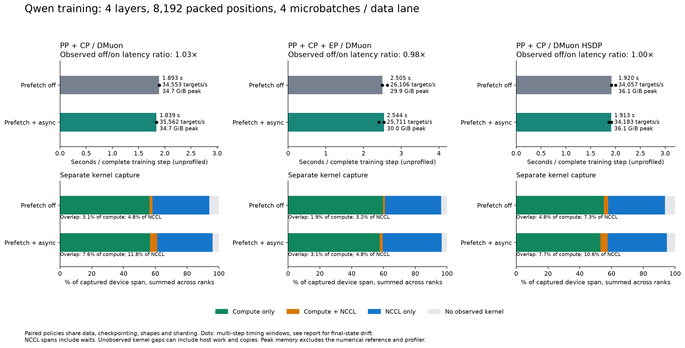
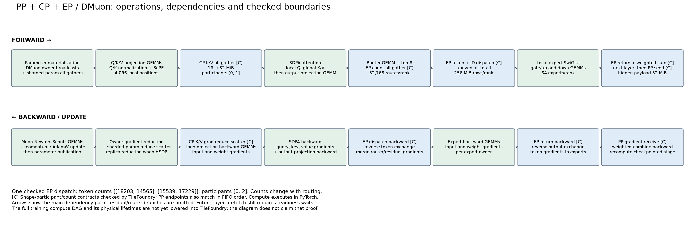
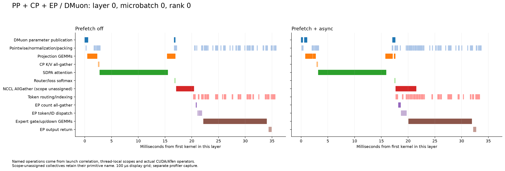
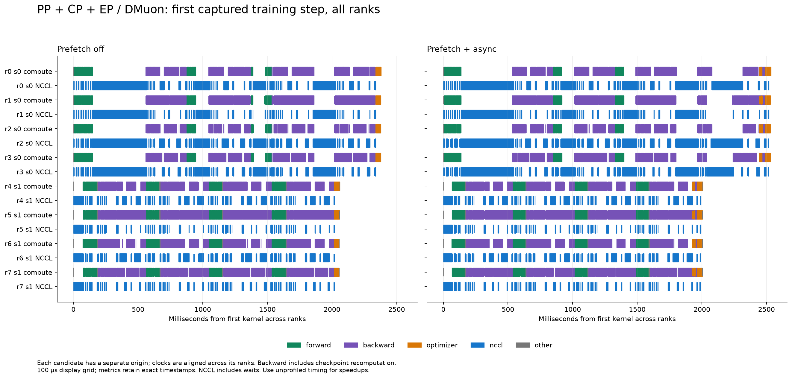

# Complete Qwen training under composed parallelism

This experiment measures forward, backward, checkpoint recomputation, DMuon
updates and their communication together. It uses the real Qwen3-30B-A3B layer
widths, 128 experts and vocabulary, with **four layers and 8,192-position packed
sequences**. Two pipeline stages run four microbatches per data lane, with two
independent data lanes: 65,536 packed positions per update, before padding and
document boundaries. Inputs and initial weights are synthetic; the operations
and updates execute. The reference workload uses FP32 and retains DMuon's
internal optimizer arithmetic. It is a reduced-depth correctness workload,
not a production mixed-precision throughput estimate.

| Case | PP | CP | EP | DMuon storage/reduction groups |
| --- | ---: | ---: | ---: | --- |
| CP | 2 | 2 | 1 | Four shard ranks per stage |
| CP + EP | 2 | 2 | 2 | Four dense shard ranks; two ranks per expert domain |
| CP + HSDP | 2 | 2 | 1 | Two shards × two replicas per stage |

These are DMuon configurations, including its HSDP path; this is not a comparison
against a separately implemented FSDP optimizer. EP with HSDP replicas is still
rejected by the example. Each pair uses identical model dimensions, batches,
checkpointing, ownership and optimizer math. The change enables supported
DMuon layer prefetch and asynchronous replica/publication work. The baseline
already allows normal pipeline and backward communication overlap.

## Measured comparison



| Configuration | Prefetch off (s/step) | Prefetch + async (s/step) | Observed off/on ratio | Peak allocation (GiB) |
| --- | ---: | ---: | ---: | ---: |
| cp | 1.893 | 1.839 | 1.029× | 34.75 → 34.75 |
| cp_ep | 2.505 | 2.544 | 0.985× | 29.89 → 29.95 |
| cp_hsdp | 1.920 | 1.913 | 1.003× | 36.06 → 36.06 |

CP's median decreases by 2.8% in this run. Its unchanged-policy repeat remains
at 1.893 s/step. The CP+EP median moves in the slower direction, and its observed
timing windows overlap substantially with the other policy. The HSDP difference
is also within the window spread. These data do not establish a universal
prefetch benefit or a training convergence result.

For CP, mean compute time per rank/update is 1.12 s and NCCL kernel time is
0.72 s. Their intersection grows from 34 to 85 ms: 3.1% → 7.6% of compute,
or 4.8% → 11.8% of NCCL. These are separate profiled windows, not a decomposition
of the unprofiled speedup. The complete-training workload has substantial GEMM,
attention and checkpoint-recomputation work available to overlap.

## Operations and checked boundaries



This guide follows the executing code and uses the recorded model dimensions,
participant groups and an actual checked EP count matrix. Marked communication
boundaries have shape/count/participant contracts; PP sends and receives are
also checked for matching endpoints and FIFO order. The picture is an authored
map of the main dependency path, not an automatically proven full training DAG.
Full training compute lowering and physical-lifetime analysis remain unfinished.



The layer view names projection GEMMs, SDPA, CP K/V all-gather, EP count exchange,
token/ID dispatch, local expert gate/up/down GEMMs, return traffic and parameter
publication. Names come from actual kernel/ATen operators and thread-local
launch scopes. A collective with no reliable semantic scope stays explicitly
labelled with its NCCL primitive name; the exporter does not guess its owner.



The interactive **training_operations.html** additionally separates checkpoint
recomputation, backward GEMMs, CP gradient reduce-scatter, EP gradient exchanges,
owner-gradient reduction, and optimizer GEMMs/pointwise updates. It switches
between every configuration, policy and rank. Detailed timelines accompany the
phase overview, so a long NCCL span can be inspected as a specific operation.

These traces identify concrete follow-up regions: expert token packing before
dispatch, expert return followed by weighted combination, and parameter
materialization before its consumer. They are candidates for kernel/scheduling
work; no arbitrary fused training kernel is claimed here. Grouped P2P spans
also expose pipeline readiness as a separate issue from collective bandwidth.

## Measurement and checks

Each candidate performs two independent full-model reference checks, two warmup
updates, three four-update timing windows, then a separate two-update CUDA
capture. This is **18 actual optimizer updates per candidate**. Timing includes
batch preparation and the complete training step. Explicit device synchronization
occurs at window boundaries; there is no added synchronization between the four
steps within a timing window. Each timing sample uses the slowest rank's window
time, divided by four. The report retains every window and uses their median.
These are within-run samples, not independent experiment replications.

Each reference check compares loss and all owner gradients (`rtol=1e-4`,
`atol=1e-6` for gradients). The explicit near-tie routing mode verifies routing
probabilities and cutoff margins before replaying the reference indices in
validation. Warmup, timing and profiling use online routing. Final weights must
be finite, and publication must agree exactly within each replica group.
All six candidates and the unchanged-policy control passed these checks; the
maximum owner-gradient error was below `6.73e-9`. Each run matched 1,152 PP
transfers. The first two updates have full reference checks; later updates do
not have a full independent numerical oracle.

An initial pilot required identical final hashes across the two independent
execution policies. That check failed after 18 updates despite passing the
initial loss/gradient checks. The final protocol preserves all-tensor hashes
and compares a fixed sample of up to 256 elements per parameter to quantify
end-state drift. Samples diagnose differences; they do not prove full-weight
equivalence or convergence. The strict `pipeline.py --compare-final` replay
check remains available and unchanged.

All 47 parameter tensors have differing final hashes across policies. The
sampled relative L2 differences are 1.55% (CP), 1.58% (CP+EP), and 1.51%
(CP+HSDP). Repeating CP with the **same policy and source** produces 1.57%
sampled relative L2 drift and a maximum recorded loss difference of 0.0193.
Thus the hash mismatch also occurs without changing prefetch policy. This
control does not prove full-weight equivalence or isolate the numerical cause.

The installed Qwen expert implementation uses CUDA `index_add_`, for which
[PyTorch documents possible nondeterminism](https://docs.pytorch.org/docs/2.14/generated/torch.Tensor.index_add_.html).
This is a possible contributor to drift, not an isolated explanation of the
failed hash check. No determinism settings or numerical tolerances were changed
to make an execution policy pass.

## Read the figures

The latency figure uses unprofiled timing. Peak memory is the maximum allocated
by any training rank, after releasing the GPU reference and before the profiler
starts. It excludes allocations outside the PyTorch allocator. Throughput counts
valid next-token targets exactly once across CP copies; padding and document
boundaries are excluded.

The device figure partitions rank-time into compute only, NCCL only, their
intersection and spans with no observed kernel. The latter can contain host
work or copies; it is not a direct measurement of GPU idleness. NCCL kernels
include rendezvous and protocol waits, so their duration is not wire time.
Both overlap denominators are shown: fraction of compute, and fraction of NCCL.

The timeline shows one complete captured step across all ranks on a shared host
clock. Backward includes activation-checkpoint recomputation. First-step
intervals use a 100-microsecond display grid; metrics use exact timestamps.
Kernel attribution follows host launch ranges; asynchronous completion may extend
past a host step. The interactive export switches between all cases and execution
policies.

## Reproduce

```bash
python examples/qwen3_dmuon/benchmark_training.py --output .tmp/qwen-training --repeat-baseline
python examples/qwen3_dmuon/training_plot.py .tmp/qwen-training/training.json \
  --output .tmp/qwen-training/figures --interactive
```

The launcher reuses `pipeline.py`. It changes no core scheduling or communication
semantics. Raw per-rank traces, commands, versions, source fingerprints and
numerical reports stay in the run directory. The checked-in [compressed JSON](training.json.gz) and figures
are a compact review artifact. The renderer accepts that file directly without
CUDA; it includes every timing window, exact operation metrics, representative
contracts and the unchanged-policy control. The local gradient-fusion microbenchmark remains
in [its own report](README.md); its speedup does not apply to these training runs.

To render the recorded results without rerunning training:

```bash
python examples/qwen3_dmuon/training_plot.py \
  examples/qwen3_dmuon/evidence/training.json.gz \
  --output .tmp/qwen-training-figures --interactive
```
