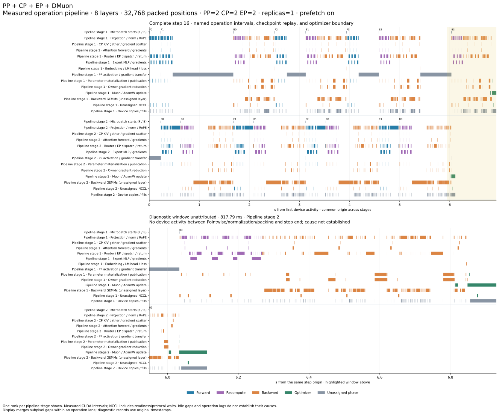

# Composable Qwen training and optimization analysis

This example connects complete Qwen3-30B-A3B training steps to TileFoundry's
communication contracts, async completion checks and optimization analysis.

| Concern | Example implementation | Core boundary |
| --- | --- | --- |
| Model, matrix roles and packed data | `model.py`, `data.py`, `attention.py` | Tensor shape and ownership; model roles are independent of the optimizer |
| PP/CP/EP and sharding | `parallel.py`, `sharding.py` | `Collective`/`Exchange` participant, shape and routing contracts; DMuon consumes model-declared domains |
| Async execution and fusion | `fusion/program.py` | `check_communication`, `overlap_candidates`, `region_boundary`, `plan_workspace` |
| Communication backend | `fusion/benchmark.py` | Generic host IR; NCCL selected through `codegen.Options.communication` |
| End-to-end diagnosis | `trace.py`, `report.py`, `experiments/simulate.py` | Named activities, idle/lag detection, modeled dependency/resource blockers and critical paths |

NCCL is the implemented native provider. Emission and linking are separate from
ownership and completion analysis; adding another provider does not require
model-specific communication in core. NVSHMEM progress semantics are not implemented.
The cases compose PP, CP and EP with DMuon and its HSDP mode.
Standalone FSDP/HSDP and TP composition are not demonstrated.

## Training and operation pipelines

Run from the repository root in the prepared example environment.

```bash
python -m examples.qwen3_training.train compare \
  --layers 8 --tokens 32768 --cases cp cp_ep cp_hsdp ep_hsdp \
  --output .tmp/qwen-training
python -m examples.qwen3_training.report \
  --runs .tmp/qwen-training/cp-on .tmp/qwen-training/cp_ep-on \
    .tmp/qwen-training/cp_hsdp-on .tmp/qwen-training/ep_hsdp-on \
  --output .tmp/qwen-training/report
```

Each case uses two PP stages, four microbatches, packed documents and stage
checkpointing. Paired policies hold the workload fixed and change DMuon prefetch/
async execution. Two initial updates compare loss and owner gradients with an
unpartitioned reference; subsequent updates check finite values and exact peer
publication. Timing uses separate unprofiled windows. This does not establish
convergence or full-run equivalence.

| Configuration | PP | CP | EP | HSDP replicas | Packed positions/update |
| --- | ---: | ---: | ---: | ---: | ---: |
| [PP + CP + DMuon](figures/pp-cp-dmuon-prefetch-on.svg) | 2 | 2 | 1 | 1 | 262,144 |
| [PP + CP + EP + DMuon](figures/pp-cp-ep-dmuon-prefetch-on.svg) | 2 | 2 | 2 | 1 | 262,144 |
| [PP + CP + DMuon HSDP](figures/pp-cp-dmuon-hsdp-prefetch-on.svg) | 2 | 2 | 1 | 2 | 262,144 |
| [PP + EP + DMuon HSDP](figures/pp-ep-dmuon-hsdp-prefetch-on.svg) | 2 | 1 | 2 | 2 | 524,288 |

Dense and expert parameters have separate HSDP meshes. The expert mesh contains
only ranks holding the same expert partition; neither mesh crosses a pipeline
stage. In the EP + HSDP case, dense parameters use two shards × two replicas;
each expert domain uses one shard × two replicas. Global batch sizes differ as
shown; timing comparisons are between execution policies within each row.

The diagrams use the configuration names above. Pipeline stages are numbered
from 1; F/B markers identify forward/backward microbatch starts. Operation lanes
show projection/norm, CP K/V exchange, attention, EP dispatch/return, expert MLP,
PP transfers and parameter updates, with checkpoint replay identified separately.



Generated run directories retain traces, source fingerprints, numerical checks
and machine-readable diagnostics. Idle intervals mean no captured device activity;
unusually slow instances are compared within the same rank, operation, phase and
layer. Their causes remain **unattributed** in measured traces. NCCL residency
includes readiness/protocol waits and is not a bandwidth measurement.

## Larger grids and blocking dependencies

```bash
python -m torch.distributed.run --standalone --nproc-per-node=8 \
  --module examples.qwen3_training.experiments.calibrate --output .tmp/native.json
python -m torch.distributed.run --standalone --nproc-per-node=8 \
  --module examples.qwen3_training.experiments.calibrate \
  --transport socket --output .tmp/socket.json
python -m examples.qwen3_training.experiments.simulate \
  --validated-run .tmp/qwen-training/cp_ep-on \
  --native .tmp/native.json --remote .tmp/socket.json \
  --grid 4,2,2,1 --grid 4,4,4,1 --grid 8,8,8,1 --grid 8,16,8,1 \
  --layers 48 --tokens-per-cp 8192 --microbatches 16 --steps 16 \
  --output .tmp/qwen-grids
```

Grid entries are PP, CP, EP and outer data parallelism: up to 1,024 modeled ranks
and 131,072 packed positions. The [Modeled PP + CP + EP + DMuon (1,024 ranks)](figures/modeled-pp-cp-ep-dmuon-1024-ranks.svg) names blockers
and resource waits in its diagnostic window. Generated event records retain
operation keys, dependencies, resource owners and critical-path membership.
These let an agent distinguish a producer dependency from fabric contention.

Timing is inferred from measured phase compute and communication microbenchmarks.
Compute is split by analytic work, respecting packed document boundaries and the
busiest CP slice; one third of backward is assigned to checkpoint replay.
Communication extrapolates rounds; socket samples are a transport proxy,
not a measured remote fabric. Stage cohorts run in lockstep with shared node
resources and skewed routing. `--remote-scale` and `--contention` expose assumptions.
This stresses specialized HIR contracts and an authored schedule, without larger-
grid numerical execution, full training HIR/lifetime proof or capacity validation.

## From diagnosis to checked optimization

CP/EP dependencies suggest inspecting finer producer/consumer boundaries; PP waits
suggest examining stage balance and checkpoint replay; resource waits suggest
placement or scheduling changes. These are hypotheses. Author the affected
boundary in core IR, check its effects, completions and workspace, then measure it.

The [Gradient fusion](figures/gradient-fusion.svg) demonstrates that process on
`mean_rank(microbatch_a + microbatch_b)`: serial, pipelined, normalization fused
into NCCL average, and fused with pipelining. Core analysis exposes independent
occurrence pairs and fusion inputs/outputs, and proves explicit scratch reuse.
Fresh inputs are checked against an independent FP64 oracle. This boundary's
results do not imply a fused end-to-end training implementation.

```bash
python -m torch.distributed.run --standalone --nproc-per-node=8 \
  --module examples.qwen3_training.fusion.benchmark --output .tmp/gradient-fusion
python -m examples.qwen3_training.fusion.report .tmp/gradient-fusion/evidence.json \
  --output .tmp/gradient-fusion/report
python -m pytest tests/core/analysis/test_communication.py tests/nvidia/cuda/codegen/test_gradient_fusion.py
```
