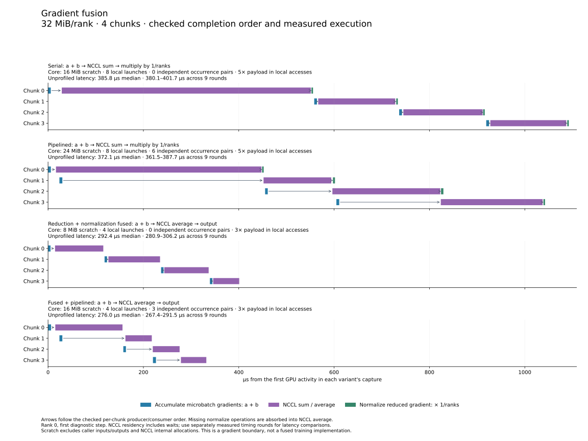

# Composable Qwen training and optimization analysis

This example connects Qwen3-30B-A3B training steps to TileFoundry's communication contracts, asynchronous completion checks, and optimization analysis. Full training executes through PyTorch and DMuon; TileFoundry checks selected communication contracts rather than lowering the complete model. The isolated gradient example additionally demonstrates authored HIR, native NCCL generation, and workspace planning.

[DMuon](https://arxiv.org/abs/2606.27153) is a drop-in distributed implementation of Muon that reduces the cost of matrix-orthogonalization updates across data-parallel training, and this example exercises its dense and expert ownership domains and FSDP/HSDP communication paths.

| Concern | Example implementation | Core boundary |
| --- | --- | --- |
| Model, matrix roles, and packed data | `model.py`, `data.py`, `attention.py` | Tensor shape and ownership; model roles stay independent of the optimizer |
| PP/CP/EP and sharding | `parallel.py`, `sharding.py` | `Collective`/`Exchange` participant, shape, and routing contracts; DMuon consumes model-declared domains |
| Async execution and fusion | `fusion/program.py` | `check_communication`, `overlap_candidates`, `region_boundary`, `plan_workspace` |
| Communication backend | `fusion/benchmark.py` | Generic host IR; NCCL selected through `codegen.Options.communication` |
| End-to-end diagnosis | `trace.py`, `report.py`, `experiments/simulate.py` | Named activities, measured idle/lag detection, and modeled dependency/resource blockers |

NCCL is the implemented native provider. Emission and linking are separate from ownership and completion analysis, so another provider does not require model-specific communication in core. NVSHMEM progress semantics are not implemented.

## Setup

Run from the repository root with Python 3.12 or newer, CMake, Ninja, a host compiler, and CUDA. See [the developer guide](../../docs/develop.md) for CUTLASS and NCCL discovery through the standard CMake configuration.

```bash
python -m pip install -e '.[test]' -e targets/nvidia
python -m pip install flash-attn-4==4.0.0b39 nvidia-cutlass-dsl==4.8.1
python -m pip install 'dmuon @ git+https://github.com/X-Square-Robot/dmuon.git@083ea977c045c5c15881845b3a3c465b6d2c4bb2'
```

The checked environment uses PyTorch 2.15.0, Transformers 5.14.1, DMuon 0.2.0, and FA4 4.0.0b39. Parameters and communication use FP32; packed attention uses BF16.

## Training and operation pipelines

The comparison launcher uses eight GPUs, two pipeline stages, four microbatches, packed documents, and stage checkpointing. Each pair changes only DMuon prefetch/asynchronous execution while holding the workload fixed. `cp` selects CP with DMuon's FSDP path, `cp_hsdp` selects CP with its HSDP path, and `ep` selects EP with DMuon FSDP without CP.

```bash
python -m examples.qwen3_training.train compare --layers 8 --tokens 32768 --cases cp cp_ep ep cp_hsdp ep_hsdp --output runs/qwen-training
python -m examples.qwen3_training.report --runs runs/qwen-training/cp-on runs/qwen-training/cp_ep-on runs/qwen-training/ep-on runs/qwen-training/cp_hsdp-on runs/qwen-training/ep_hsdp-on --output runs/qwen-training/report
```

| Configuration | PP | CP | EP | Optimizer partition | Packed sequence length | Packed positions per update |
| --- | ---: | ---: | ---: | --- | ---: | ---: |
| [CP + DMuon FSDP](figures/pp-cp-dmuon-prefetch-on.svg) | 2 | 2 | 1 | FSDP | 32,768 | 262,144 |
| [CP + EP + DMuon FSDP](figures/pp-cp-ep-dmuon-prefetch-on.svg) | 2 | 2 | 2 | FSDP | 32,768 | 262,144 |
| [EP + DMuon FSDP](figures/pp-ep-dmuon-prefetch-on.svg) | 2 | 1 | 2 | FSDP | 32,768 | 524,288 |
| [CP + DMuon HSDP](figures/pp-cp-dmuon-hsdp-prefetch-on.svg) | 2 | 2 | 1 | 2 shards × 2 replicas | 32,768 | 262,144 |
| [EP + DMuon HSDP](figures/pp-ep-dmuon-hsdp-prefetch-on.svg) | 2 | 1 | 2 | 2 shards × 2 replicas | 32,768 | 524,288 |

Packed sequence length is the number of positions in one packed document sequence per microbatch, written `[1, sequence_length]` before CP slicing; a local CP shard has `[1, sequence_length / CP]`. Positions per update multiply the sequence length by four microbatches and the number of distinct data lanes, without treating CP duplicates as new data. Thus a larger positions-per-update value does not itself imply checkpointing. Activation checkpointing is independently enabled by wrapping each local stage, and raw profiles label the resulting backward replay as `Recompute:` operations. Global batch sizes differ across rows, and timing comparisons belong within one row rather than across configurations.

Dense and expert parameters have separate HSDP meshes. An expert mesh contains only ranks holding the same expert partition, and neither mesh crosses a pipeline stage. In EP+HSDP, dense parameters use two shards by two replicas, while each expert domain uses one shard by two replicas. Standalone FSDP/HSDP implementations outside DMuon and TP composition are not demonstrated.

Two initial updates compare loss and owner gradients with an unpartitioned reference. Subsequent updates check finite values and exact peer publication. Routing replay is restricted to observed near ties; BF16 comparisons use max-scaled error bounds rather than rejecting harmless small-probability differences. These checks do not establish convergence or full-run equivalence.


The diagrams number pipeline stages from one and mark forward/backward microbatch starts. Lanes cover projection/norm, CP K/V exchange, attention, EP dispatch/return, expert MLP, PP transfers, and parameter updates, with checkpoint replay identified separately. Generated run directories retain traces, source fingerprints, numerical checks, and machine-readable diagnostics. Measured idle intervals and slow operations remain unattributed, and NCCL residency includes readiness/protocol waits rather than just transfer service time.

## Larger grids and blocking dependencies

Measure communication calibration on the single node, then extrapolate to 1,024 ranks on 64 nodes with 16 GPUs per node and 1,048,576 packed positions per sequence:

```bash
python -m torch.distributed.run --standalone --nproc-per-node=8 --module examples.qwen3_training.experiments.calibrate --output runs/native.json
python -m torch.distributed.run --standalone --nproc-per-node=8 --module examples.qwen3_training.experiments.calibrate --transport socket --output runs/socket.json
python -m examples.qwen3_training.experiments.simulate --validated-run runs/qwen-training/cp_ep-on --native runs/native.json --remote runs/socket.json --grid 8,16,8,1 --layers 48 --tokens-per-cp 65536 --microbatches 16 --steps 16 --gpus-per-node 16 --output runs/qwen-grids/balanced
python -m examples.qwen3_training.experiments.simulate --validated-run runs/qwen-training/cp_ep-on --native runs/native.json --remote runs/socket.json --grid 8,32,4,1 --layers 48 --tokens-per-cp 32768 --microbatches 16 --steps 16 --gpus-per-node 16 --output runs/qwen-grids/more-cp
python -m examples.qwen3_training.experiments.simulate --validated-run runs/qwen-training/cp_ep-on --native runs/native.json --remote runs/socket.json --grid 16,16,4,1 --layers 48 --tokens-per-cp 65536 --microbatches 16 --steps 16 --gpus-per-node 16 --output runs/qwen-grids/more-pp
python -m examples.qwen3_training.experiments.simulate --validated-run runs/qwen-training/cp_ep-on --native runs/native.json --remote runs/socket.json --grid 8,16,4,2 --layers 48 --tokens-per-cp 65536 --microbatches 16 --steps 16 --gpus-per-node 16 --output runs/qwen-grids/more-data
```

Grid entries are PP, CP, EP, and outer data parallelism. Every row uses 1,024 ranks on 64 nodes with 16 GPUs per node, 48 layers, 16 microbatches, and 1,048,576 packed positions per sequence. Independent grid simulations are CPU-only and can run concurrently to compare layouts efficiently.

| PP | CP | EP | Outer data | Ranks | Purpose | Packed positions per update |
| ---: | ---: | ---: | ---: | ---: | --- | ---: |
| 8 | 16 | 8 | 1 | 1,024 | Balanced CP/EP layout | 134,217,728 |
| 8 | 32 | 4 | 1 | 1,024 | More sequence parallelism, fewer expert groups | 67,108,864 |
| 16 | 16 | 4 | 1 | 1,024 | More pipeline stages and less work per stage | 67,108,864 |
| 8 | 16 | 4 | 2 | 1,024 | Two independent outer data lanes | 134,217,728 |

The [modeled 1,024-rank pipeline](figures/modeled-pp-cp-ep-dmuon-1024-ranks.svg) uses the first layout and names blockers and resource waits. Each grid also produces a complete event trace with operation keys, dependencies, resource owners, and critical-path membership.

Timing is inferred from measured phase compute and communication microbenchmarks, not a physical 1,024-rank training result. Compute is split by analytic work using packed document boundaries and the busiest CP slice; one third of backward is assigned to checkpoint replay. Communication extrapolates rounds, and socket samples are a transport proxy rather than a measured multi-host RDMA fabric. Stage cohorts run in lockstep with shared node resources and skewed routing. `--remote-scale` and `--contention` expose assumptions. The model does not provide larger-grid numerical execution, a full training HIR/lifetime proof, or capacity validation.

## From diagnosis to checked optimization

CP/EP dependencies suggest inspecting finer producer/consumer boundaries; PP waits suggest examining stage balance and checkpoint replay; resource waits suggest placement or scheduling changes. These are hypotheses, so author the affected boundary in core IR, check effects, completions, and workspace, then measure it.

For each gradient chunk `i` with local microbatch gradients `a_i` and `b_i` across `N` ranks, the following pipeline computes the same result in four ways: `y_i = AllReduce_sum(a_i + b_i) / N = AllReduce_avg(a_i + b_i)`. The optimization replaces the separate sum-and-normalize path with NCCL average; it does not fuse the model or claim that all communication disappears.



| Variant | Collective | Separate local normalization | Chunk overlap |
| --- | --- | --- | --- |
| Serial | Sum | Yes | No |
| Pipelined | Sum | Yes | Yes |
| Fused | Average | No | No |
| Fused + pipelined | Average | No | Yes |

Without fusion, the collective writes a sum into receive scratch and a second kernel normalizes it into the output. Fusion writes the average directly to the output, removing that scratch buffer and normalization pass. Pipelining is orthogonal: it overlaps one chunk's collective with another chunk's local accumulation. Core analysis identifies the legal completion dependencies, region boundary, and reusable workspace; native measurement then checks whether the implementation helps. Every variant uses identical inputs and is checked against an independent FP64 oracle, so this remains an isolated gradient-boundary experiment rather than a claim about full-training speedup.

```bash
python -m torch.distributed.run --standalone --nproc-per-node=8 --module examples.qwen3_training.fusion.benchmark --output runs/gradient-fusion
python -m examples.qwen3_training.fusion.report runs/gradient-fusion/evidence.json --output runs/gradient-fusion/report
python -m pytest tests/core/analysis/test_communication.py tests/nvidia/cuda/codegen/test_gradient_fusion.py
```
