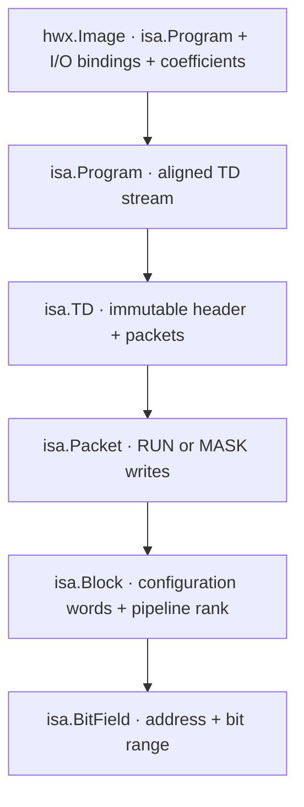
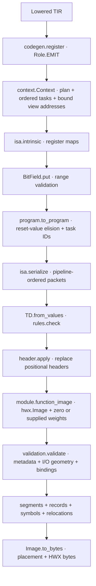

# ANE Codegen Spec

Scope: lowered ANE TIR → configuration registers → immutable task descriptors →
HWX container. The calling convention and TVM FFI entry registrations live in `codegen/module.py`.

## 1. Representation

`isa.TensorDesc` stores dtype, NCHW shape and element strides. Byte strides, storage
size and canonical geometry are derived in `isa/tensor_desc.py`.
`context.tensor_desc_of` is the single conversion from a static fp16 GMEM or SMEM tensor
type. An HWX `TensorBinding` binds a name, role and virtual address to a `TensorDesc`; its
page reservation is derived from the descriptor's storage size. The C launcher
uses the same `TensorDesc` fields in the same order, followed by the Python-derived
`storage_bytes` reservation, without a name.
`module.tensor_row` is the sole renderer of its C initializer.
`Image` retains the `Program` directly and serializes it once during container
assembly. The byte layer provides encoding; it has no descriptor decoding API.

## 2. Build flow and validation

Validation follows the representation: `BitField.put` checks individual fields,
`TD.validate` checks cross-field relations, and the HWX assembler checks metadata,
I/O geometry, complete DMA ranges and segment bounds. `validation.validate` MUST invoke
every TD's validation, including directly constructed descriptors. Each invalid input raises before serialization
can produce a container. The field formulas and their confidence are described in
[isa §8](./isa.md#8-field-formulas-and-staging).

### 2.1 Emitter preconditions

Each Op emitter MUST validate the schedule attributes it consumes and reject any
nondefault attribute it does not consume. Refusals for undecoded hardware behavior
MUST contain `is not decoded yet`; contradictory values MUST name the violated relation.

Unary MUST reject `scale != 1` combined with `square`, and `abs` combined with
`square` and `clamp`, as not decoded yet. The order is
`(src * pre_scale + bias) * scale` or the square of the biased value, then abs,
then clamp, with fp16 rounding after each arithmetic step.

| Op | Consumed schedule attributes | Attributes requiring defaults |
|---|---|---|
| Unary | `patch` | `width_code`, `ocg_size`, `omit_ocg` |
| Binary | `patch` | `width_code`, `ocg_size`, `omit_ocg` |
| Pool | `patch` | `width_code`, `ocg_size`, `omit_ocg` |
| Reduce | `patch` | `width_code`, `ocg_size`, `omit_ocg` |
| Bypass | `width_code`, `ocg_size`, `unicast_channels`, `omit_ocg` | `patch` |
| Conv | `ocg_size` | `patch`, `width_code`, `omit_ocg` |

A patch MUST have exactly two integer values in 0–15 and match the derived raster
patch: `(ceil(log2(max(width, 16))), 4)`, or for Pool `(4, ceil_log2(result rows))`.
A Pool result wider than 16 is not decoded yet. Other patch combinations are not
decoded yet.

Pool admits kernels of 1–3 and strides of 1–2 per axis. Padding is 0, or 1 on an
axis whose kernel is 3; other padding is not decoded yet. MAX selects pool mode 2
and pads with negative infinity (`0x0500[3:2] = 1`). AVG selects pool mode 1, which
divides by the window size, except that padding left out by
`count_include_pad=False` selects pool mode 0, which divides by the cells inside the
map; both pad with zero. Reduce programs a SUM `scale` other than 1 as the fp32
final scale `0x090C`, so a mean is a sum scaled by the reciprocal of its count; a
scale with MAX or MIN, `square` and `post` are not decoded yet.
OCG MUST equal `rules.channel_groups` for the relevant channels, except that an
identity Bypass programs OCG zero; an identity Bypass over more than 32 channels
is not decoded yet. Conv MUST reject
an explicit OCG above 64 output channels because that field is omitted in that mode.
Bypass unicast MUST be 1 for identity and `rules.unicast_channels` of the source
channels for C/W transpose: the 16-channel groups rounded up to a power of two, at
most 8. A transpose fills the lower nodes first exactly when that count exceeds 1.
Zero is an error.
Bypass MAY omit OCG only when the inferred value equals its reset value of zero
and no explicit OCG is given. Other omission combinations are not decoded yet.

Every L2 source and result base MUST be the framework offset of its SMEM tensor.
Effective range and overlap checks still apply at descriptor validation.

Every emitted operand MUST be a `[1, C, H, W]` feature map; the matrix forms of Conv
and Bypass are not emitted. A row-major `[M, K]` matrix with 64-byte rows holds the
bytes of the canonical `[1, M / H, H, K]` map, so a matrix product is scheduled over
such maps as `load`, a C/W transposing Bypass, a 1x1 Conv whose `[N, K, 1, 1]` weight
is the right operand transposed, a second transposing Bypass and `store`.

Conv with a bias operand selects the bias mode `0x0D04[4] = 1` and reads the bias
from its coefficient lanes; the bias MUST be a direct constant parameter. Bypass MUST emit only
identity or `perm=(2, 1, 0)` and MUST check the resulting shape. Other valid
permutations are not decoded yet. Bypass with a lookup-table nonlinear is not
decoded yet and MUST be rejected. A Conv whose source and result heights differ is
not decoded yet. The source load owns its access-type field; convolution does not
overwrite that field when using the load.

### 2.2 L2 buffer placement

The framework's memory analysis places every SMEM tensor. `Context.bind` MUST use
the constant byte offset of its lowered `T.tensor_view(..., storage="smem")` as the
tensor's L2 base, and MUST refuse an offset that is negative or not a multiple of 16
and a tensor whose `storage_bytes` differs from its `TensorDesc.l2_extent`.
Codegen MUST NOT move an SMEM tensor. An SMEM operand without such an offset MUST be
rejected. Schedules MUST declare SMEM with `tf.empty`; they supply no L2 addresses.

Every call emits one task, except `T.ane.store`, which emits none. Before emission
`Context.plan` records, for each SMEM tensor, the call that produces it and the
`store` that writes it out, and for each task the GMEM tensor its DMA moves:

| Call | Task | L2 source | L2 result | DMA |
|---|---|---|---|---|
| `load(src, dst)` | identity PE unary | `dst`, where the DMA lands | `dst`, in place | reads `src` |
| engine task | the Op | its SMEM sources | its `dst` | writes the `store` destination of `dst`, if any |
| `store(src, dst)` | none | — | — | — |

- constraints:
  - Each emitter MUST take an L2 source's base and producing engine from `Context.source`,
    and its L2 result base and stored GMEM tensor from `Context.result`. A load is a planar producer.
  - A task whose result is stored MUST program a DMA result (`l2_result_type` DMA_READ, buffer mode 1)
    with the stored tensor's geometry and strides, and keeps the result's own block as its L2 result
    address. Any other task MUST keep its result in L2 and program its channel and row pitches.
  - `plan` MUST reject a `store` whose source a `load` produced (`its source must be the result of a
    computation`), a stored tensor that a task reads (`its source is read again after being written out`)
    and a tensor stored twice (`an L2 tensor is written out once`). The entry MUST reject an output that
    no `store` writes (`the output must be written by T.ane.store`) and a `load` of a non-input.
  - A store destination MAY be a window of the output and a load source a window of an input; the DMA
    base is the window's byte offset that `tir/prim_function.view_binding` resolves.
    The ANE lowering inserts such a window through `tf.insert_slice` only when memory analysis placed
    the update in the result's window and the result on its destination; any copy is refused.

Codegen does not check SMEM lifetimes: the transfer validation of
[isa §9](./isa.md#9-verified-transfer-validation) keeps every interval within
`isa.dma.L2_CAPACITY` (2 MiB) and disjoint within a task, except the in-place load,
and requires each L2 source to match an unmodified earlier result. Capacity overflow
MUST fail before emission.

Producer result and consumer source MUST use the same framework base, shape and
pitches. SMEM logical layouts MAY use 16-byte aligned rows; the physical L2 pitches
MUST come from `TensorDesc.l2_channel` and `l2_row`. An SMEM read MUST have a
preceding producer. A convolution reads its L2 source through `load_chained`, with
neither small-source mode nor output transpose; so does a Bypass, whose output MAY be
transposed. Bypass and Conv are neural producers. A Binary reads both sources from
L2: its second source programs `0x051C` and its pitches with the second stream off
and source routing 1, and both sources MUST come from tasks of one engine. A task that reads an L2 buffer
MUST set the source alias bit of the engine that produced it:
`l2_src_alias_conv_rslt` after a neural producer and `l2_src_alias_planar_rslt`
after a planar one. A Pool or Reduce reads L2 when a store writes its result out; a
A `T.ane.load` pass MUST set all eight alias bits, whatever its position in the stream:
its DMA read reuses a block that earlier passes may still hold.
Pool keeps the task words of its DMA-source form, confirmed on the device. A Pool or
Reduce result kept in L2 is not decoded yet, and
[isa §9](./isa.md#9-verified-transfer-validation) rejects its task.

## 3. Module responsibilities

All paths below are relative to `ane/codegen/`.

| Module | Responsibility |
|---|---|
| `context.py` | Task order, SMEM bases, producers and stores, DMA tensors, operand addresses and raster patch |
| `tir/prim_function.py` | Lowered function walker and descriptor-program construction |
| `tir/memory/{load,store}.py` | Registered transfer emitters; `store` emits no task |
| `tir/ne/{conv,bypass}.py` | Registered neural-engine emitters |
| `tir/pe/{binary,pool,reduce,unary}.py` | Registered planar-engine emitters |
| `program.py` | Reset-image word elision and task IDs assigned at construction |
| `header.py` | Stream-position header policy; returns replacement descriptors |
| `hwx/macho.py` | `Field`/`Record` fixed layouts, Mach-O records, segments, symbol table, first page |
| `hwx/bindings.py` | Named I/O bindings and their loader-bound segments |
| `hwx/records.py` | ANE load commands, element catalog, shape stabs and symbol entries |
| `hwx/coefficients.py` | Coefficient lane layouts, LUTs and coefficient section packing |
| `hwx/relocations.py` | Base-address payload offsets, relocation packet integrity, relocation table |
| `hwx/validation.py` | Every check an image passes before it is laid out |
| `hwx/image.py` | Role assignment, virtual and file placement, byte assembly |
| `module.py` | Validated skeleton images, FFI entries and shared linker contributions |

## 4. HWX layout

H14 uses a Mach-O variant with magic `0xBEEFFACE`, CPU `0x80`, subtype 5 and file
type 2. Its ordered segment commands are:

| Segment | Sections | Reservation and protection |
|---|---|---|
| `__PAGEZERO` | None | 16 KiB guard, protection 0/0 |
| `__FVMLIB` per I/O | Output `__data` or input `__const` | Loader-bound, output 2/2, input 1/1 |
| `__TEXT` | `__text`, `__const` | 32 KiB, protection 5/5 |
| Optional `__KERN_0` | `__kern_0` | At least two 16 KiB pages, protection 1/1 |

Virtual allocation begins at `0x30000000`. Nonzero `scratch_bytes` MUST be
rejected because its mapping is not decoded yet.
Output surfaces precede inputs; each reserves its storage size rounded to 16 KiB.
The text const section starts after the stream on a 64-byte boundary and occupies
16 KiB. The kernel section follows the complete text reservation.

The load commands continue with buffer references (`0x40`), a segment record
(`0x04`), input then output binding records (`0x04`), compiler metadata (`0x08`),
source-model information and runtime version (both `0x31`), then `LC_SYMTAB`.
The segment record stores text/const addresses, resource addresses, stream word
and task counts, the trait mask at `+0x844` and bookkeeping at `+0x860`.
`record_count` and `format_code` are explicit image metadata; absent a format
code, the largest TD cycle estimate supplies it. Binding records carry shape,
element code, byte strides, total extent and procedure/symbol strings.

Every fixed-layout structure, Mach-O or ANE, is one `macho.Record` declaration
whose fields state their offset, format and default once. A constant whose meaning
is not decoded is the default of an unnamed field and appears nowhere else. A field
name declared at two offsets stores one value twice. A load command's `size` covers
its fields and variable tail, rounded up to eight bytes. A section with relocations
carries `S_ATTR_LOC_RELOC`, and its segment drops `SG_NORELOC`.

Commands, symbols, strings and text relocations precede the first file segment.
The preferred file offset is `0x4000` for at most two surfaces and `0x8000`
otherwise; placement may advance through `0x10000` and `0x20000` to clear metadata.
A mapped segment's file offset is its virtual address plus one slide, the text file
offset minus the text address.
The allocation retains the trailing kernel reservation even for an image without
coefficients, preserving the container's file extent.

Canonical I/O rows are `align64(width × element_bytes)`, planes are `height × row`,
and batches are `channels × plane`. The `canonical` policy requires these strides;
`declared` uses the caller's geometry. Singleton axes do not participate in canonical
validation; derived byte strides and storage retain complete padded inner blocks.

## 5. Coefficients, relocations and symbols

A coefficient tensor has at most 16 lanes, evenly divided by output channels.
Each lane walks input channels, kernel height, kernel width, then its output
channels, and starts on a 64-byte boundary. Blocks follow their first consumption
order in one section, with byte bases computed from the preceding blocks' sizes. Repeated consumption of a direct
constant reuses its block. Each convolution uses its own pass index, block base
and lane stride. Weight parameters must be contiguous OIHW fp16 tensors.
A convolution with a bias leads every lane's weights with one fp16 bias word per
lane output, in output order; the bias is a contiguous fp16 vector consumed with
one weight only. A lookup table together with a bias is not decoded yet.

`CoefficientLayout` owns the shape, section base and actual LUT bytes. Its
`weight_axes` records each loop extent and source/destination byte stride in
lane, input channel, kernel row, kernel column and lane-output order, and `bias_axes`
in lane and lane-output order; Python packing and the generated C++ weight and bias
writer loops consume these rules directly. Lane count, stride and weight offset are
derived by the same layout used by emitters, symbols and relocation checks.
`Coefficient` binds values to that layout; `Image.coefficients` is the sole image
coefficient representation. The loop axes, source/destination strides and weight offset have one definition.

A convolution with a lookup-table nonlinear leads every lane with the complete
128-byte table of [tir Nonlinear](./tir.md#nonlinear); its weights start at the
weight offset 128 and the lane stride is `align_up(128 + lane bytes, 64)`. The
descriptor selects the listed nonlinear mode and reads the table through the
coefficient stream; it enables no separate lookup-table DMA. A lane over 128 weight
bytes with a table is not decoded yet and is rejected before packing. One constant
consumed under different tables is not decoded yet.

Coefficient slot addresses and relocation widths come from
`isa.fields.COEFFICIENT_RELOCATIONS`. Packet flags select only the forms emitted
as extended packets; the width table also covers ordinary single-word and paired
forms. Section-relative coefficient relocations preserve their addends. I/O bases
remain flagged packet operands for the loader to bind.

Binding offsets include alignment sentinels and inter-descriptor gaps. Both
DMA and coefficient validation share the encoded packet walk. Each enabled DMA
MUST carry an adjacent low/high base pair with relocation flags and exactly one
binding. Orphan high words, duplicate bases and missing bindings are
errors. Enable/access/routing fields determine which transfers require bases.

I/O roles MUST come from entry parameter order and `output_count`, with trailing
outputs; they MUST NOT be inferred from destination relocations. Direct `Image`
construction defaults to one trailing output. A DMA base's relocation flags name
the I/O segment of its buffer: `isa.io_relocation(k)` = `0x110 + 4k` for the k-th
segment in output-then-input order. `function_image` flags each DMA base with the
segment of the GMEM tensor that `Context.plan` records for its task.
Validation MUST require those flags to name the bound symbol, dst to bind an output
and src/src2 to bind inputs; other symbol mappings are rejected as not decoded yet.
A flagged coefficient base MUST name the kernel segment, `isa.io_relocation(n)` for
n I/O segments. A GMEM intermediate
written by a pass but outside the signature's outputs MUST be rejected because
its mapping is not decoded yet; it MUST NOT be promoted to an external output.

For every enabled transfer, the effective byte strides MUST match its bound
`TensorDesc` and each extent MUST fit within it: a transfer moves the buffer or a
window of it. Only fp16 N=1 canonical layouts and the verified
C/W transpose to a canonical destination are accepted. Other declared layouts,
formats and mapping combinations are rejected as not decoded yet. The exclusive
end is `addend + (C-1)*channel_stride + (H-1)*row_stride + W*2`; the addend MUST be
nonnegative and the end MUST not exceed the bound descriptor's `storage_bytes`.
The decoded geometry, singleton handling and L2 relationships are specified in
[isa §9](./isa.md#9-verified-transfer-validation).

Procedure names including NUL MUST fit the five-byte fixed region before the
binding symbol. Distinct I/O names MUST remain distinct after eight-byte buffer
reference truncation. `validation.validate` checks both constraints before assembly.

Every coefficient slot has an explicit `CoefficientReloc` naming its block.
`require_relocated` rejects missing blocks or slots, duplicate bindings,
nonconsecutive blocks, wrong first-use order, mismatched bases and lane reads
crossing the assigned block. The listed nonlinear mode MUST agree with whether the
read block's lanes lead with a table, and the bias mode with whether they hold bias words. Enabled coefficient readers must carry a bound
base. LUT reads require actual table bytes and a nonempty in-range read extent;
register forms without an established read range are rejected. All executable
containers pass through the original `Image.to_bytes()` and its validation.

Symbols contain external surface entries, per-lane coefficient entries, the shared
element-type catalog and shape stabs. Shape type IDs follow the catalog, using five
IDs per surface for four axis strides and the shape. Compiler metadata records the
H14 profile, allocator/cache options, kernel/surface sizes and task count;
source-model metadata names the generating tool, version and procedure.

## 6. Program templates

`module.function_template(fn)` emits a `template.ProgramTemplate` without constant
bytes. Its deterministic UTF-8 JSON schema stores the entry name, TD IDs, flags,
headers and dependencies, ordered Packet kinds/writes/flags, `output_count`, named I/O tensor
descriptors, DMA bindings and convolution weight uses. A DMA binding identifies a
TD index, register, I/O symbol and byte addend. A weight use identifies its constant
name, consuming TD, OIHW packing shape and coefficient section offset.

`to_bytes` writes schema version 2; `from_bytes` rejects other versions and restores
the existing `isa.Program`, `TD` and `Packet` classes. Restoration validates their
field rules and encoding, fp16 N=1 I/O geometry, DMA symbols, slot coverage and addends.
Image assembly from directly constructed templates applies the same feature-map precondition.
Template bytes are structural records, not an HWX container. Loading these records
requires the matching Python template schema and the existing Python HWX encoder.

`ProgramTemplate.image(constants)` accepts little-endian fp16 OIHW weight bytes by
constant name and constructs the original `hwx.Image`. Encoded relocation offsets
are recomputed from the restored Program, including sentinels and descriptor gaps.
Packing and final container serialization remain in the existing HWX implementation;
`Image.to_bytes()` retains mandatory `require_relocated` validation. The entry
retains multiple convolutions and coefficient blocks structurally, at most two
nonconstant parameters and one trailing result. Templates preserve coefficient
layout even when a GMEM intermediate prevents complete image generation. DMA slots
are identified per descriptor. Existing structural JSON records remain a thin
adapter to the shared coefficient layout and image assembler.

`module.function_image(fn, constants)` delegates to the template. The generated FFI
entry embeds its complete HWX skeleton and invokes the internal `ane_launch` ABI.

## 6. Compiled entry and load-time weights

`emit_function` MUST serialize a complete skeleton through `Image.to_bytes()` with
zero-valued weight tensors. It retains an internal `AneEntry` containing the skeleton bytes,
coefficient segment file offset, I/O descriptors and `{name, writer}` table.
The coefficient offset is read from the validated container's segment command.
Lookup tables remain in the skeleton. Each consuming Op owns generation of its
weight writer; convolution generates a contiguous CPU fp16 OIHW writer using
`CoefficientLayout.weight_axes` and `weight_offset` from `hwx/coefficients.py`.

`function_image(fn, constants)` remains the offline reference assembler. Omitting
`constants` constructs the skeleton; supplying a mapping requires every weight.
Native writers MUST reproduce that assembler's complete image byte for byte for
the same logical weights. The compiled artifact contains no user weight values.
Runtime image ownership, loading and provisioning are specified in
[runtime §1](./runtime.md#1-load-forward-close).

- constraints:
  - `called_as` MUST omit const weights and describe ordinary host tensors with the same shapes and dtypes.
    Device padding MUST remain in the internal I/O descriptors.
  - The generated entry MUST accept an integer token before flattened tensor parameters.
    Load MUST bind the token; the public tensor signature MUST omit it.
  - Each entry MUST register through `ane_register` in a `TVM_FFI_STATIC_INIT_BLOCK`.
    Registration names MUST be the dotted entry names; C++ identifiers MUST retain the core mangled symbols.
  - The link contribution MUST add the launcher source, packaged headers, required Apple frameworks
    and the installed TVM FFI library, and MUST name the library with the `.so` suffix.
