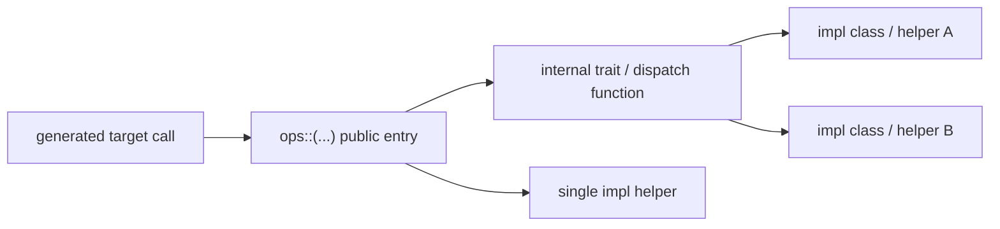

# TileFoundry CUDA Spec — Runtime

This spec owns the CUDA runtime headers and their layout-driven dispatch.
Headers live under
`targets/cuda/tilefoundry_cuda/codegen/include/tilefoundry/runtime/cuda/`
and are package data located through `importlib.resources`. The runtime builds
on the vendored CUTLASS / CuTe headers. The
[core runtime](../../../../../docs/spec/runtime.md) owns the Python API.

Declaration blocks are generated by `scripts/runtime_spec_surface.py` from
headers; hand-written constraints state semantics and design reasons.

## 2. C++ Runtime Surface

### 2.2 `cuda/`

#### 2.2.1 `cuda/runtime.cuh`

<!-- generated: cuda-runtime -->
```cpp
// targets/cuda/tilefoundry_cuda/codegen/include/tilefoundry/runtime/cuda/runtime.cuh
inline constexpr int kWarpSize;

template <class...> inline constexpr bool dependent_false_v;

enum class TopologyScope {
    gpu,
    cta,
    thread,
    scope_count,
};

template <TopologyScope T>
CUTE_HOST_DEVICE constexpr auto program_dim() noexcept;

template <TopologyScope T>
CUTE_HOST_DEVICE constexpr auto program_shape() noexcept;

CUTE_HOST_DEVICE constexpr TopologyScope program_topology() noexcept;

CUTE_HOST_DEVICE constexpr auto program_topologies() noexcept;

struct ProgramMetaData {
    int program_id[int(TopologyScope::scope_count)];
};

CUTE_HOST_DEVICE ProgramMetaData &program_meta();

CUTE_HOST_DEVICE void program_meta(ProgramMetaData const &meta);

template <TopologyScope T> CUTE_HOST_DEVICE size_t program_id() noexcept;

CUTE_HOST_DEVICE auto program_ids() noexcept;
```
<!-- /generated -->

**Terms.** A *level* is one parallel-resource level of the launch: `gpu`, `cta` or `thread`. An *instance* is one id of a level. A *coordinate* is one id per level, which is what `program_ids()` hands back.

- constraints:
  - `gpu` is the level the host places. A card carries no register naming
    which of the mesh's cards it is, so `program_id<TopologyScope::gpu>()`
    reads what the launch was told instead, and that value MUST equal the id
    the host's `Placement` gave the `gpu` level for the same invocation
    ([runtime §1.10](../../../../../docs/spec/runtime.md#110-runtimetensorpy)).
  - the value reaches the device as a by-value `ProgramMetaData` kernel
    parameter, and the generated kernel MUST hand it to `program_meta` before
    any divergence. One thread writes and the barrier orders that write
    against every read.
  - `program_meta`'s slot is `__shared__`, so one name is one copy per block
    rather than one per device: two kernels running at once on one card each
    read what their own launch was told.
  - `scope_count` states how many levels there are, and everything indexed by
    a level MUST derive its length from it: `ProgramMetaData.program_id`, the
    tuple `program_ids()` returns, and the coord a mesh is asked about. A
    coord shorter than that is missing a level rather than naming a smaller
    mesh, and MUST be refused where it is used rather than left to read the
    neighbouring level's id.
  - `program_topology()` is the coarsest level this program names and
    `program_topologies()` is the whole run from there to `scope_count`,
    coarsest first. Both derived answers are CuTe's own questions about that
    tuple -- how many levels is `cute::rank` of it, where level `S` sits is
    `cute::find(program_topologies(), cute::C<S>{})` -- so neither has a name
    of its own, and a level this program does not name is refused the way CuTe
    refuses it: `cute::find` hands back the rank and the `get` that follows
    reports `"Index out of range"`.
  - that parameter MUST NOT appear in the wrapper's user-visible signature. A
    `Placement` itself never reaches a kernel ([runtime §1.10](../../../../../docs/spec/runtime.md#110-runtimetensorpy)); the
    id derived from it is an internal parameter the caller supplies.

- constraints:
  - The enumeration is fixed to the `gpu`, `cta` and `thread` program levels plus the `scope_count` sentinel. A warp-sized grouping is an axis of a `thread` mesh's layout, not a level of its own.
  - **Positions are row-major**: the last axis is the fastest. Extents `(8, 32)` give `(id / 32, id % 32)`, so a thread mesh names its warps first and its lanes last. Every layout in this surface is read that way, and CuTe's own algebra is not ([§2.3.1](#231-layoutcute_extcuh)).
  - One `.cu` is one launch. `program_dim<T>()` is what a translation unit states; `program_shape<T>()` is derived from it as level `T` and every level under it, which is the shape a mesh naming several levels is indexed against. The same mesh compiled into another translation unit belongs to another launch.

### 2.3 `cuda/layout/`

#### 2.3.1 `layout/cute_ext.cuh`

<!-- generated: layout-cute-ext -->
```cpp
// targets/cuda/tilefoundry_cuda/codegen/include/tilefoundry/runtime/cuda/layout/cute_ext.cuh
template <class Shape, class Stride>
CUTE_HOST_DEVICE constexpr auto reverse(cute::Layout<Shape, Stride> const &l);

template <class A, class O, class B>
CUTE_HOST_DEVICE constexpr auto
reverse(cute::ComposedLayout<A, O, B> const &l);
```
<!-- /generated -->

**Terms.** *CuTe order* is CuTe's own reading of a layout, mode zero fastest. A mesh is written row-major, last axis fastest, so the two are reverses of each other and CuTe's algebra reads a mesh backwards until it is turned.

- constraints:
  - CuTe reads mode zero as the fastest and a mesh is written the other way round, so every CuTe function meaning "next to" reads a mesh backwards: `coalesce` leaves `(2,32):(32,1)`, 64 consecutive threads, unfolded, and `logical_divide` cuts a domain that runs the other way. The runtime reverses a mesh's axes once and uses plain CuTe after that.

#### 2.3.2 `layout/mesh.cuh`

<!-- generated: layout-mesh -->
```cpp
// targets/cuda/tilefoundry_cuda/codegen/include/tilefoundry/runtime/cuda/layout/mesh.cuh
template <class TLayout, TopologyScope... Topos> struct Mesh {
    using layout_type = TLayout;
    static constexpr int level_count;
    static constexpr TopologyScope scope;
    TLayout layout;
    /// The scope flat axis ``I`` runs at. A mesh naming one level
    /// answers its own scope for every axis. A mesh naming several
    /// groups its layout one nest per level, and the nest holding
    /// flat axis ``I`` states its level.
    template <int I>
    CUTE_HOST_DEVICE static constexpr TopologyScope axis_scope();
};

template <TopologyScope S, class L, TopologyScope... Topos>
CUTE_HOST_DEVICE constexpr auto get(Mesh<L, Topos...> const &mesh);

template <class L, TopologyScope... Topos>
CUTE_HOST_DEVICE constexpr int offset(Mesh<L, Topos...> const &mesh);

template <class L, TopologyScope... Topos, class Coord>
CUTE_HOST_DEVICE constexpr bool contains(Mesh<L, Topos...> const &mesh,
                                         Coord const &coord);

template <class L, TopologyScope... Topos, class Coord>
CUTE_HOST_DEVICE constexpr auto mesh_coords(Mesh<L, Topos...> const &mesh,
                                            Coord const &coord);

template <class L, TopologyScope... Topos>
CUTE_HOST_DEVICE constexpr bool is_warped(Mesh<L, Topos...> const &mesh);

template <class L, TopologyScope... Topos>
CUTE_HOST_DEVICE constexpr auto as_warped(Mesh<L, Topos...> const &mesh);

template <TopologyScope Scope, class Extents>
CUTE_HOST_DEVICE constexpr auto make_mesh(Extents const &extents);
```
<!-- /generated -->

**Terms.** A *mesh* names one or more levels and carries a layout whose values are those levels' ids. A *slice* is a mesh whose layout has a constant term: it covers part of a level, starting at that term. *Warped* describes a thread mesh whose ids run a whole number of warps; its *lane* axis is one warp and its *warp* axis steps between them.

- constraints:
  - A mesh is the levels it names and the layout whose values are their ids -- the same two facts the IR `Mesh` carries beside its axis names ([shard §5](../../../../../docs/spec/shard.md#5-mesh)). Its instance count and shape are `cute::size` and `cute::shape` of that layout, which read through a slice on their own.
  - A mesh naming several levels states its axes grouped one nest per level, each already in that level's own numbering, and `get<level>` picks the nest. A mesh that names several without that grouping is refused: no rule says which axes are whose. It cannot also be sliced -- the slice and the level boundary would both be deciding which positions these are.
  - `mesh_coords` answers where this program sits in the mesh's own coordinates: one `idx2crd` per level, of that level's id against that level's nest, grouped the way the mesh is. The answer is congruent with `cute::shape` of the mesh's layout whether it names one level or several, so a layout over that shape indexes with it as it stands. The ids it reads are `program_ids()`, one per level this program names, so a coord of another length is refused by name.
  - `contains` and `mesh_coords` are not the same question, and on a mesh narrower than its level not the same answer. `idx2crd` is `(id / stride) % extent`, so thread 64 of a 128-thread block is not in a 32-instance mesh and does act as its instance 0: the upper warps repeat what the lowest warp does. A slice does not repeat, so a coordinate from outside one reaching `mesh_coords` is a codegen fault. `contains` asks every level the mesh names, because a mesh grouped one nest per level is one instance per level together.
  - A thread mesh has warps only when its ids run a whole number of them. `(32,..)` stepping by one is one warp and the axis beyond it carries the warps; `(128,..)` holds four that `as_warped` splits out. Lanes shorter than a warp, repeated across warps, MUST be refused by name -- they reach neither `bar.sync`, which counts whole warps, nor one `__syncwarp`.
  - `as_warped` is idempotent: a mesh whose fastest axis is already one warp comes back unchanged.
  - Only one shape of `cute::ComposedLayout` is a mesh: `cute::identity` over a static offset. A swizzle in the first slot, or a dynamic offset, is a mesh whose first instance is not a compile-time number, and every reader wants it as one.
  - The offset MUST NOT be dropped. A mesh layout maps a coordinate to an instance *within* the mesh; only the offset turns that into an instance of the launch, and reading a coordinate off a raw id instead hands every instance of a slice the box its neighbour owns. A plain `cute::Layout` is the whole level at offset zero.

#### 2.3.3 `layout/shard_layout.cuh`

<!-- generated: layout-shard-layout -->
```cpp
// targets/cuda/tilefoundry_cuda/codegen/include/tilefoundry/runtime/cuda/layout/shard_layout.cuh
template <class TLayout, class TAttrs, class TMesh> struct ShardLayout {
    using layout = TLayout;
    using attrs = TAttrs;
    using mesh = TMesh;
    TLayout layout_value;
    TMesh mesh_value;
};

template <int Axis> struct S {
    static constexpr int axis;
};

struct B {};

template <class Reduction> struct P {
    using reduction = Reduction;
};

struct Dynamic {};

template <size_t Ax, class L, class A, class M>
CUTE_HOST_DEVICE constexpr auto stride(ShardLayout<L, A, M> const &sl);

template <class SL> CUTE_HOST_DEVICE constexpr void check_shard_layout();

template <class Shape, class TMesh, class Attrs,
          __CUTE_REQUIRES(!cute::is_layout<Shape>::value)>
CUTE_HOST_DEVICE constexpr auto
make_shard_layout(Shape const &shape, TMesh const &mesh, Attrs const &);

template <class TLayout, class TMesh, class Attrs,
          __CUTE_REQUIRES(cute::is_layout<TLayout>::value)>
CUTE_HOST_DEVICE constexpr auto
make_shard_layout(TLayout const &layout, TMesh const &mesh, Attrs const &);
```
<!-- /generated -->

**Terms.** A *shard layout* is a tensor layout, one *attr* per mesh axis, and the mesh those attrs are indexed against. An attr says what its mesh axis does with the tensor: `S<k>` splits tensor axis `k` across it, `B` broadcasts, and `P<R>` leaves an unreduced partial.

- constraints:
  - `TAttrs` is a `cute::tuple` of empty tags, so the aggregate holds no attribute value: the attributes are in the type and the layout is what carries data.
  - One attr per mesh axis. A shard layout that says nothing about an axis leaves the reader to guess whether that axis splits the tensor.

### 2.4 `cuda/tensor_view/`

#### 2.4.1 `tensor_view/shard_tensor.cuh`

<!-- generated: tensor-view-shard-tensor -->
```cpp
// targets/cuda/tilefoundry_cuda/codegen/include/tilefoundry/runtime/cuda/tensor_view/shard_tensor.cuh
template <class TEngine, class TGlobalLayout, class TShardLayout>
struct ShardTensor {
    using engine_type = TEngine;
    using global_layout_type = TGlobalLayout;
    using shard_layout_type = TShardLayout;
    TEngine engine;
    TShardLayout shard_layout;
    /// As ``cute::Tensor`` has it: the engine's own pointer, before any
    /// instance's slice is projected out of it.
    CUTE_HOST_DEVICE auto data();
    CUTE_HOST_DEVICE auto data() const;
};

template <class T, class GL, class SL>
CUTE_HOST_DEVICE auto make_shard_tensor(T const &tensor, GL, SL shard_layout);

template <class T>
concept ShardTensorLike =
    detail::is_shard_tensor<cute::remove_cvref_t<T>>::value;

template <class SL>
inline constexpr bool shard_layout_is_composed_v;

template <class T> CUTE_HOST_DEVICE decltype(auto) local_tensor(T &&t);

template <class T>
using local_view_t =
    cute::remove_cvref_t<decltype(local_tensor(std::declval<T const &>()))>;

template <class T> CUTE_HOST_DEVICE constexpr int shard_mesh_instances();
```
<!-- /generated -->

**Terms.** A *shard tensor* is an engine, the global layout it came from, and a shard layout. *Projecting* it is resolving it to the slice this instance owns: `local_tensor`, whose type-level half is `local_view_t`, while `ShardTensorLike` is the one test for "is this operand sharded". All three are `tilefoundry::` names, not `detail` ones.

- constraints:
  - `engine` is a CuTe tensor or view, never a raw pointer: residency lives on the engine type, and `data()` drops it. Its layout MUST be the declared concrete local shard layout, using the shared register numbering for rmem; codegen MUST NOT choose a separate default engine order. Storage spans the layout codomain, including any pitch. A rank-0 address is encoded in CuTe as one singleton mode with stride zero.
  - A shard layout whose layout is a `cute::ComposedLayout` -- which is how a [`Swizzle`](../../../../../docs/spec/shard.md#41-swizzle) reaches the device -- is projected with its function kept: `shard_layout_is_composed_v` picks that path, and `local_tensor` returns a tensor over the engine's own pointer whose layout is the same composition, this instance's origin folded into its offset. Advancing the pointer instead would run the function on a slice-relative index and hand two instances one address, so the offset MUST NOT move to the engine.
  - A composed layout takes that path even when no mesh axis splits it. The composed path reconstructs the declared function and the participant offset over the engine pointer, including when every mesh attribute broadcasts.
  - `local_tensor`, `local_view_t` and `ShardTensorLike` are public: a step every op must take, and the word an op writes its own constraints in, are not implementation details. `is_shard_tensor` -- how `ShardTensorLike` is decided, which nothing outside needs -- stays in `detail`.
  - A tensor whose layout is a `ShardLayout` has distributed semantics -- it is the whole tensor, and each instance owns the slice its shard layout gives it.
  - One attr per mesh axis, against the mesh's axes flattened: a mesh naming several levels states them grouped one nest per level, and its rank is then how many levels it names rather than how many axes the attrs answer for.
  - Several mesh axes MAY cut one tensor axis -- two axes of one level as a grid, or two levels one taking a block of what the other left. Each cut divides what the previous one left, so the axis's local extent is the whole divided by all of them, and one step of a mesh axis clears everything the axes inside it hold.
  - Where an instance's slice begins is that mesh's own shape carrying, on each axis, how far along the tensor one step of it moves the origin: the attrs say which tensor axis and how much of it a step clears, the tensor layout says what that costs in elements. It is congruent with the mesh's shape, grouping and all, so `mesh_coords` indexes it as it stands and reading it is `crd2idx`. It is not `offset(mesh)`, which is the first id a sliced mesh covers.

### 2.5 `cuda/primitive/`

#### 2.5.1 `primitive/unary.h`

<!-- generated: primitive-unary -->
```cpp
// targets/cuda/tilefoundry_cuda/codegen/include/tilefoundry/runtime/cuda/primitive/unary.h
struct rsqrt_op {
    template <class T> __device__ T operator()(T x) const;
};

struct neg_op {
    template <class T> __device__ T operator()(T x) const;
};

struct relu_op {
    template <class T> __device__ T operator()(T x) const;
};

struct square_op {
    template <class T> __device__ T operator()(T x) const;
};

struct sigmoid_op {
    template <class T> __device__ T operator()(T x) const;
};

struct silu_op {
    template <class T> __device__ T operator()(T x) const;
};

struct softplus_op {
    template <class T> __device__ T operator()(T x) const;
};

struct exp_op {
    template <class T> __device__ T operator()(T x) const;
};

struct log_op {
    template <class T> __device__ T operator()(T x) const;
};

struct identity_op {
    template <class T> __device__ T operator()(T x) const;
};

struct clamp_op {
    float min_val, max_val;
    template <class T> __device__ T operator()(T x) const;
};
```
<!-- /generated -->

**Terms.** A *primitive* is a callable tag an op instantiates. It takes scalars, not tensors, which is why it is not an op.

- constraints:
  - A primitive takes scalars, not tensors, so it is not an op: it has no shard layout to read a behaviour off. `ops::` closes on the entries that do ([§2.6](#26-cudaops)).

#### 2.5.2 `primitive/binary.h`

<!-- generated: primitive-binary -->
```cpp
// targets/cuda/tilefoundry_cuda/codegen/include/tilefoundry/runtime/cuda/primitive/binary.h
struct mul_op {
    template <class T> __device__ T operator()(T a, T b) const;
};

struct add_op {
    template <class T> __device__ T operator()(T a, T b) const;
};

struct sub_op {
    template <class T> __device__ T operator()(T a, T b) const;
};

struct max_op {
    __device__ float operator()(float a, float b) const;
    template <class T> __device__ T operator()(T a, T b) const;
};

struct min_op {
    __device__ float operator()(float a, float b) const;
    template <class T> __device__ T operator()(T a, T b) const;
};

struct div_op {
    template <class T> __device__ T operator()(T a, T b) const;
};
```
<!-- /generated -->

- constraints: none beyond the signature.

### 2.6 `cuda/ops/`

Codegen targets one public namespace function per runtime op/family:

```cpp
tilefoundry::ops::<op>(...)   // one public namespace function per runtime op / family
```



**What is an op.** An op's behaviour is derivable from the layout system's
description of its arguments: its operands are `ShardTensor`s or a `Mesh`, and
its tier is read off their layouts. An op is one indivisible dependency chain
or one per-element map; a composition of two ops is not a third one. What that
admits is a list and not a count — a number is a fact about today's list, and
the one time it was written down as the rule it argued a dependency chain into
`elementwise` to keep the count. `ops::` holds these and nothing else:

| entry | operands the geometry comes from |
| --- | --- |
| `elementwise` | the destination's local domain, and a stride-0 mode wherever a source broadcasts |
| `copy` / `copy_async` | both operands' shard layouts: shape, strides, share and move width |
| `reduce` | the axes the destination broadcasts that the source splits |
| `dot` | the axes the operands' meshes contract |
| `mma` | one atom's per-lane operand fragments |
| `sync` | the mesh's scope, base and count |
| `copy_async_bulk` | both shard layouts, asserted: one contiguous run each, whole tiles, matching element types |
| `ldmatrix` | the source tile's declared shared-memory layout and the destination atom fragment |

Anything that takes a raw pointer, an `int` or a type and answers a question
about it is not an op but a utility, and belongs outside `ops::` — the
warp-scoped primitives of [§2.7](#27-cudautility) and the `mbarrier`
instructions a caller writes around `copy_async_bulk` are both that. In particular the
runtime publishes **no predicate and no constant reporting which tier an op
selected or how wide a move it chose**: a caller cannot use one to decide how to
build its operands, since the answer is a function of the operand types it would
already have had to build, and putting the tier behind one entry was the point.

**Runtime-owned dispatch.** Where an op has more than one implementation tier
(selected by scope or by operand layout), the runtime exposes exactly **one**
public entry — never one op per tier. The active tier is derived at **compile
time** from the operand `ShardLayout`s, together with any codegen-static geometry
passed as template parameters, through a template trait, and is selected inside
the entry (`if constexpr`). Codegen emits one uniform call per op and never
selects a tier, computes a per-tier parameter, or carries the selection on the
TIR op. `ops::reduce` derives its reduction level from the operand shard
layouts and `ops::sync` derives its participant predicate from the barrier
geometry; both are instances of this principle. A
target runtime implementation MAY select an internal optimized load/store path
(such as a wider vector copy) behind this single entry without changing the
public entry or its observable result. The codegen side is
[codegen §3](./codegen.md#3-runtime-owned-op-dispatch).

**One pointwise op.** Every elementwise operation — fill, cast, clamp, `relu`,
add, multiply, and every broadcast shape of those — is the single entry
`ops::elementwise`. Arity is the length of its source pack, the operation is
the callable it takes, and a broadcast operand is a stride-0 mode on that
operand's layout. None of those
three is a name: there is no `ops::fill`, `ops::cast`, `ops::unary`,
`ops::binary`, or `ops::binary_bcast_*`, and adding one would be re-encoding in
a symbol what an argument already states.

**Annotation convention.** `ops::*` public entries, their internal impl
functors, and op tags MUST be annotated `__device__` (their bodies are
device-only). `CUTE_HOST_DEVICE` MUST be reserved for tensor-view / layout
helpers genuinely capable of host compilation (e.g. `local_tensor`,
`make_shard_tensor`).


#### 2.6.1 `ops/detail.cuh`

<!-- generated: ops-detail -->
```text
// targets/cuda/tilefoundry_cuda/codegen/include/tilefoundry/runtime/cuda/ops/detail.cuh
// This header declares no surface of its own.
```
<!-- /generated -->

**Terms.** `ops::detail` is the set of tensor-view *implementation* names an op may reach for: `id_axes`, `is_partial_attr_v`, `is_shard_tensor`, `is_split_attr_v`, `positions_of`, `shard_attrs_match_mesh`, `shard_layout_is_full_broadcast`. They are defined in `tilefoundry::detail`; this header states which of them cross into `ops`. *Projecting* an operand is `local_tensor`: a ShardTensor resolved to this instance's slice, and an operand the mesh never spread returned whole. It is not one of them -- it, `local_view_t` and `ShardTensorLike` are `tilefoundry::` names an op calls unqualified by `detail` ([§2.4.1](#241-tensor_viewshard_tensorcuh)).

- constraints:
  - An op reaches for a tensor-view *implementation* name through `ops::detail` and nowhere else, so what crosses that boundary is stated in one header. The gate holds only names an op may want and none must have; a step no op may skip is public instead, because a thing every op goes through is not an implementation detail.
  - An op projects every operand through `tilefoundry::local_tensor`, sharded or not. An operand with no shard layout is not a case to refuse: it is one every instance holds entire, and the op's arithmetic over it is the same. So the choice is made once, where the operand is projected, rather than at each op.

#### 2.6.2 `ops/copy.cuh`

<!-- generated: ops-copy -->
```cpp
// targets/cuda/tilefoundry_cuda/codegen/include/tilefoundry/runtime/cuda/ops/copy.cuh
template <class TPointer, class TLayout>
CUTE_HOST_DEVICE auto tensor_view(TPointer pointer, TLayout layout);

template <class TSrc, class TDst>
__device__ void copy(TSrc const &src, TDst &dst);

template <class TSrc, class TDst>
__device__ void copy_async(TSrc const &src, TDst &dst);

template <class ExecutionMesh, int Bytes, class TSrc, class TDst, class TIndex>
__device__ void copy_async(TSrc const &src, TDst &dst, TIndex const &index);

template <class ExecutionMesh, int Bytes, class TSrc, class TDst, class TIndex,
          class TFill>
__device__ void copy_async(TSrc const &src, TDst &dst, TIndex const &index,
                           TFill fill);
```
<!-- /generated -->

For an RMEM `ShardLayout`, the shared `ir.types.register_strides` reader
used by codegen and Dot access relations MUST assign compact
register-engine steps to non-Split, non-unit modes in ascending order of their
declared physical strides; producers supply concrete strides before codegen. Split and unit modes have engine step zero. This
numbering is independent of mode order in the logical-domain correspondence.

**`tensor_view`.** Rebuilds the CuTe tensor engine that a TIR `TensorView`
describes from its typed pointer and emitted layout. Residency stays on the
pointer engine; a later `make_shard_tensor` adds the logical global and shard
layouts without recovering the source tensor.

**`copy`.**

One entry, taking tensors, with the transfer shape, the strides, the element
types, the share this instance owns and the move width all read off the operand
`ShardLayout`s.

- constraints:
  - **The move width is a property of the layouts, not of the call.** It is the
    largest power of two both operands run contiguously over —
    `max_common_vector` of the two *projected* layouts, which
    [§2.4.1](#241-tensor_viewshard_tensorcuh) derives statically from the shard layout and
    the mesh — capped so neither side's move exceeds 16 bytes.
  - A dtype change does not force the width to one element: the wide load still
    holds and the conversion happens on the way out. The cap follows the wider
    of the two element types.
  - Register fragments take the element path. Addressing `&frag(i)` under a
    loop the compiler cannot unroll spills the fragment to local memory, which
    costs more than the wider move saves.
  - Where the shard's offset lands is the one thing a layout cannot state, so
    the implementation tests the two base pointers against the width's
    alignment and falls back to the element path when it does not hold. That
    is one comparison, not a scan.
  - The call site names no vector width and no thread index. A copy split across
    a block's threads is a thread-scoped mesh in the operands' shard layouts;
    the entry then copies exactly the slice `local_tensor` hands each thread.

**`copy_async`.**

- constraints:
  - The call is non-blocking; generated code orders later reads through
    `cp_async_commit` and `cp_async_wait`.
  - The name is the contract: a pair of projected views `cp.async` cannot move
    a 4-byte-or-wider word of does not compile, and takes `ops::copy` instead.
    There is no synchronous tier hiding under this entry for the caller to wait
    on.
  - The two projected slices hold the same number of elements. Where an
    instance owns part of a wider destination, that is the destination's shard
    layout to state; the source's offset is not borrowed for it.
  - Runtime implementation details such as vector width and tail handling live
    in code comments, not this spec entry.

#### 2.6.3 `ops/dot.cuh`

<!-- generated: ops-dot -->
```cpp
// targets/cuda/tilefoundry_cuda/codegen/include/tilefoundry/runtime/cuda/ops/dot.cuh
template <class Lhs, class Rhs, class Dst,
          class Ws = reduce_impl::no_workspace_t>
__device__ inline void dot(Lhs const &lhs, Rhs const &rhs, Dst &dst,
                           Ws &&ws = {});
```
<!-- /generated -->

**`dot`.**

`dst = sum(lhs * rhs)`. A matrix-vector product's inner loop is one statement,
not an `elementwise` followed by a `reduce`: materialising the product first
would cost a register per element of the row, which is what makes that
pair the wrong spelling here.

- constraints:
  - **Two tiers, one entry.** With no workspace the contraction lives inside a
    warp and one butterfly finishes it; with a workspace it spans the block,
    each warp posting a partial into a slot. Either way every participant leaves
    holding the total, so a caller never broadcasts it back.
  - The load width is the operands' shard layouts', the same question
    the `copy` entry answers: the run both sides share, capped by what both are
    aligned for and by 16 bytes.
    A row split so that a lane owns four contiguous elements loads eight bytes
    at a time; one that leaves it eight loads sixteen. The width appears neither
    at the call site nor on the op surface — the runtime derives it inside the
    entry and publishes nothing that reports it, for the reason
    [§2.6](#26-cudaops) gives for publishing no tier predicate.
  - The fold uses a fixed number of independent partial accumulators, and the
    tree that combines them is this op's summation order. One running sum would
    make a row a chain of dependent multiply-adds, and the loads could not run
    ahead of it: what a warp then waits on is the row's latency, not its bytes.
  - Accumulation is f32 regardless of the operand type.

#### 2.6.4 `ops/elementwise.cuh`

<!-- generated: ops-elementwise -->
```cpp
// targets/cuda/tilefoundry_cuda/codegen/include/tilefoundry/runtime/cuda/ops/elementwise.cuh
template <class Fn, class TOut, class... TIn>
__device__ void elementwise(TOut &dst, Fn fn, TIn const &...src);
```
<!-- /generated -->

**`elementwise`.**

`dst(i) = fn(src(i)...)` over the destination's local domain. The one pointwise
op: arity is the pack's length, the operation is `fn`, and a broadcast operand
is a stride-0 mode on that operand's layout.

- constraints:
  - **`dst` and `fn` lead**, because the sources are a variadic pack. Zero
    sources is a fill, one is a map, two a combine; the same instantiation
    serves all three.
  - `fn` is anything callable. The primitives the runtime ships
    (`ops/primitive/`) are values, not ops, and are not in this section's list;
    `reduce` and `dot` take the arity-2 ones too. There is no separate tag path
    and lambda path.
  - **The extent is `size()` of the projected destination.** No count
    parameter: a hand-passed one is a second statement of a fact the layout
    already holds, free to disagree with it.
  - **No shape or domain check.** A mismatched operand is a codegen bug, and
    shapes are computed on the compile side.
  - **The only conversion is the one `dst(i) = ...` implies.** The runtime
    performs no `static_cast` of its own — it does not choose a compute
    precision. A caller that wants one states it in `fn` (`float(x) * scale`),
    which mirrors TIR, where a cast is a `Cast` node.
  - **Broadcast is a layout fact.** A per-row scale is the operand read through
    `(M, K):(1, 0)`, a per-column weight through `(M, K):(0, 1)`, a scalar
    through `(N):(0)`. `compose` states this against the operand's own layout,
    so a strided or sharded operand is read where it actually lies.

#### 2.6.5 `ops/mma.cuh`

<!-- generated: ops-mma -->
```cpp
// targets/cuda/tilefoundry_cuda/codegen/include/tilefoundry/runtime/cuda/ops/mma.cuh
template <class TA, class TB, class TC>
__device__ void mma(TA const &a, TB const &b, TC &c);
```
<!-- /generated -->

**`mma`.**

`c += a @ b` for one atom. The operands are the calling lane's already-gathered
fragments, and the entry issues one instruction.

- constraints:
  - The element type of `a` selects the atom: bf16 selects
    `SM80_16x8x16_F32BF16BF16F32_TN` and e4m3 selects
    `SM89_16x8x32_F32E4M3E4M3F32_TN`, both accumulating in f32.
  - `b` holds the element type of `a`, `c` holds f32, and `a`, `b`, and `c`
    contain exactly that atom's values per lane, `(8, 4, 4)` for bf16 and
    `(16, 8, 4)` for e4m3. Other shapes and element types are compile-time
    errors.
  - The fragment map is stated by each operand's `ShardLayout`; the runtime
    publishes no fragment-coordinate function and no accumulator constructor.
  - Another instruction is another atom under the same entry, not another
    entry.

#### 2.6.6 `ops/reduce.cuh`

<!-- generated: ops-reduce -->
```cpp
// targets/cuda/tilefoundry_cuda/codegen/include/tilefoundry/runtime/cuda/ops/reduce.cuh
struct mean_op {};

struct absmax_op {};

template <class Op, class Axes, class Src, class Dst,
          class Ws = reduce_impl::no_workspace_t>
__device__ inline void reduce(Src const &src, Dst &dst, Ws &&ws = {});
```
<!-- /generated -->

**`reduce`.**

- constraints:
  - `reduce` is the only public runtime reduce entry; tier names and helper
    functions are internal.
  - Sharded operands derive the active tier and warp grouping from `(src, dst)`
    shard layouts inside the runtime. `ws` is a *resource the layouts demand*
    and never the tier selector: a reduce mesh that stays inside one warp takes
    the intra-warp tier and needs no workspace, and one that crosses warps does
    not compile without one.
  - Both operands name one mesh and give one attr per mesh axis; the reduced
    set is `src[i]` split or partial against `dst[i]` broadcast.
  - The combine domain is `float` — `init`, `elem`, `combine` and `finalize`
    all are — so an element type `float` cannot hold exactly (a 4- or 8-byte
    integer, a packed key) is refused at the entry rather than rounded.
  - Plain operands derive extents from the operand rank and size inside the
    runtime.
  - A reduction whose reduced axis crosses CTA boundaries is not supported.

#### 2.6.7 `ops/sync.cuh`

<!-- generated: ops-sync -->
```cpp
// targets/cuda/tilefoundry_cuda/codegen/include/tilefoundry/runtime/cuda/ops/sync.cuh
template <int Id> struct BarrierId {
    static constexpr int value;
};

template <int Id> inline constexpr BarrierId<Id> bar_id;

struct no_resource_t {};

template <class T> struct barrier_id_traits {
    static constexpr bool value;
};

template <class TMesh, TopologyScope... Topos, class TRes = no_resource_t>
__device__ inline void sync(Mesh<TMesh, Topos...> const &mesh,
                            TRes resource = {});
```
<!-- /generated -->

**Terms.** A *tier* is the barrier a mesh reaches: `grid`, `block`, `warp`, or a *named* barrier. A mesh that reaches none is refused by the name of what it lacks.

- constraints:
  - A mesh that reaches no barrier is refused by the name of what it lacks, not approximated. Silence would read as "not implemented yet"; the refusal says which of the two it is.

**`sync`.**

- constraints:
  - Which barrier runs is the mesh's own answer and never a call-site template
    argument: the topology scope says the level, and the mesh layout says both
    how many instances (`size(layout)`) and which instance the run starts at
    (its offset — a sliced mesh is a `cute::ComposedLayout` mapping a coordinate
    to `offset + outer(c)`, ([§2.3.2](#232-layoutmeshcuh))).
  - The classification MUST agree case for case with `classify` in
    `ir/tir/sync.py`: an un-sliced `cta` mesh takes the grid barrier; a mesh
    covering the whole block takes the warp's convergence when the block is one
    warp wide and the block barrier otherwise; a mesh fitting inside one warp
    takes the warp's convergence; a warp-aligned run covering part of the block
    takes a named barrier.
  - Two meshes name no barrier and are rejected at the call site: a sliced `cta`
    mesh (the CTAs outside it never arrive) and a cross-warp run whose base or
    count is not a multiple of 32 (part of a warp would be inside the barrier
    and part outside). Both are deadlocks, not slow paths.
  - The runtime states which tier needs which resource and allocates none. A
    caller that supplies none where one is needed MUST fail to compile with a
    message naming the resource; a caller that supplies the wrong one MUST fail
    the same way. A grid counter is a fact about the launch and a free named
    barrier a fact about the whole kernel; neither is knowable from one mesh.
  - A named barrier id MUST be a compile-time value in `1..15`. Id `0` is the
    one `__syncthreads` arrives at and MUST be rejected: `bar.sync` counts
    arrivals per id, so a subset posted to it releases a whole-block barrier
    early. An id MUST NOT be derived from the mesh — two meshes sharing a base
    and differing in count would collide.
  - Codegen emits only `sync`; it does not call lower-level barrier helpers.
  - Grid barriers require every CTA of the launch to be co-resident and to
    execute the barrier.
  - A grid barrier's counter pair is zero-initialized before first use and is
    owned by the generated module. Whether one exists is a fact about the
    launch, so the caller passes it; with none, a cooperative launch's grid
    group is used instead.

#### 2.6.8 `ops/copy_async_bulk.cuh`

<!-- generated: ops-copy-async-bulk -->
```cpp
// targets/cuda/tilefoundry_cuda/codegen/include/tilefoundry/runtime/cuda/ops/copy_async_bulk.cuh
template <class Src, class Dst>
__device__ inline void copy_async_bulk(Src const &src, Dst &dst,
                                       uint64_t *bar);
```
<!-- /generated -->

**`copy_async_bulk`.**

Stage a tile into shared memory and signal an mbarrier when it is readable. It
is not a tier of `ops::copy_async`: there every thread issues its own load and
a commit closes the group, so the thread that issues is the thread that waits;
here completion lands on a barrier, which is what lets a consumer wait for a
tile it did not fetch.

- constraints:
  - The operands are tensors, not addresses: the entry takes the transfer shape,
    the strides and the element type from the operand `ShardLayout`s. A caller
    passing a pointer and a byte count would be choosing the tier itself, which
    is what [§2.6](#26-cudaops) puts behind one entry.
  - **One instruction, and a run-time hand-off.** `cp.async.bulk` moves the run:
    one elected thread issues it, nothing blocks, and it is still in flight at
    the next statement. A byte count off the 16-byte grain hands off to the
    element path at run time, every thread in the block taking part. Which one
    runs is not a compile-time choice: the operands must satisfy the
    preconditions below, and a layout that fails them is refused, not routed
    elsewhere. It was a static tier once, selected on whether either operand
    coalesces to one run — but a layout that fails that test is exactly a layout
    the element path addresses wrongly, so the failing branch computed a wrong
    answer instead of rejecting the call.
  - Both paths leave `bar` completing when the data is readable, and both are
    safe to call from every thread in the block. Consumers wait on the phase and
    never learn which ran.
  - constraints on the operands, each a `static_assert`: every mesh axis leaves
    both tiles whole (neither is split across instances); the destination is a
    `ShardTensor` (the element path needs its mesh for the instance count and
    the barrier); both projections are one contiguous run; the element types
    match, since bytes move unconverted; and the two slices are the same size,
    because the count is read off the source and written at the destination's
    origin.
  - `bar` is a resource parameter, the way `ops::reduce`'s `ws` is: a 64-bit
    shared-memory word, not a sharded tensor, so it carries no `ShardLayout` and
    there is nothing for a tier to read off it. Arming that word, testing its
    phase and releasing it are single `mbarrier.*` instructions which read
    nothing off a layout either, so they are **not ops** and the runtime
    publishes no entries for them; a caller writes them where it builds the
    ring. The phase parity alternates `0, 1, 0, ...` across successive
    completions, which is what lets a fixed ring of barriers serve a stream of
    any length: stage `t` of a ring of `n` waits on parity `(t / n) & 1`.
  - The bulk tier's arrival declares the byte count on the instruction that
    issues the copy, so the declared and delivered counts are one expression and
    cannot drift; the caller does not arrive separately.
  - The transfer must be a whole number of 16-byte grains for the instruction to
    have defined behaviour. The extent is what the shard leaves behind, not a
    property of the layout type, so an off-grain extent is a run-time hand-off
    to the element path inside the same entry — same barrier, same result.

#### 2.6.9 `ops/ldmatrix.cuh`

<!-- generated: ops-ldmatrix -->
```cpp
// targets/cuda/tilefoundry_cuda/codegen/include/tilefoundry/runtime/cuda/ops/ldmatrix.cuh
template <class Src, class Dst>
__device__ inline void ldmatrix(Src const &src, Dst &dst);
```
<!-- /generated -->

**`ldmatrix`.**

One warp loads a dense shared-memory `(16, 16)` bf16 tile into the per-lane A
fragment consumed by `ops::mma`'s SM80 atom.

- constraints:
  - All 32 lanes issue `ldmatrix.sync.aligned.m8n8.x4.shared.b16` together.
    Each lane contributes the 16-byte-aligned address selected by the source's
    declared shard layout; a full-broadcast shard still uses that declaration,
    not the backing allocation's incidental layout.
  - The four returned registers are stored in the destination fragment's
    layout order so that `ops::mma` observes the PTX register order unchanged.
  - The TIR declaration fixes the source shape/dtype and destination fragment;
    the runtime entry does not choose an atom or a fragment layout.

### 2.7 `cuda/utility/`

`tilefoundry::shuffle_xor`, `tilefoundry::shuffle_elect` and
`tilefoundry::warp_reduce` (`runtime/cuda/utility/warp.cuh`) are the runtime's
warp-scoped primitives: part of its callable surface, and no part of its op
surface.

**What is a warp primitive.** An op takes tensors and reads its geometry off
their shard layouts ([§2.6](#26-cudaops)). A warp primitive takes a value and a
lane count — in one case not even that, only the calling thread's own id — so
there is no layout for a tier selection to read and nothing an operand would
have stated; each is one instruction or a short run of them, with one
implementation and no tier at all. The runtime's warp-scoped surface holds
these and nothing else:

| entry | what it takes instead of a layout |
| --- | --- |
| `shuffle_xor` | one lane's value, the lane-id bits to exchange across, the participating lanes |
| `shuffle_elect` | nothing; the answer is a fact about the calling thread's id |
| `warp_reduce` | one lane's value, a combine functor, and the lanes per fold |

Being outside `ops::` is not licence to grow. A candidate taking a
`ShardTensor` or a `Mesh` is an op, and belongs in [§2.6](#26-cudaops)'s closed
list or nowhere; a candidate offering a template parameter the hardware then
clamps to one value is not an entry at all, because a parameter every value but
one is clamped away from states nothing.

**Why both surfaces exist.** `ops::reduce` is the op for folding a
*tensor* over a mesh, and it is built on the butterfly of
`warp_reduce` — `utility/warp.cuh` is included before
`ops/reduce.cuh` so the intra-warp tier folds through `warp_reduce` rather than
spelling the butterfly a second time. A caller folding something it just
computed, rather than something it stored, has no tensor to hand an op and
reaches for the primitive.


**Not ops.** These take lanes and a width, not tensors and a mesh, so no
layout describes them and no tier is read off anything.

#### 2.7.1 `utility/warp.cuh`

<!-- generated: utility-warp -->
```cpp
// targets/cuda/tilefoundry_cuda/codegen/include/tilefoundry/runtime/cuda/utility/warp.cuh
template <class T>
inline constexpr bool is_shuffle_native_v;

template <class T> struct ShuffleXor {
    __device__ T operator()(T value, int lane_mask,
    unsigned member_mask) const;
};

struct Elect {
    __device__ bool operator()() const;
};

template <class T>
__device__ inline T shuffle_xor(T value, int lane_mask,
                                unsigned member_mask = 0xFFFFFFFFu);

inline bool shuffle_elect();

template <class Combine, int Width = 32, class T>
__device__ inline T warp_reduce(T value);
```
<!-- /generated -->

**`shuffle_xor`.**

- constraints:
  - The exchange is warp-scoped: a lane's result is defined only where the lane
    it pairs with is in `member_mask`.
  - A `T` the shuffle intrinsic does not take directly is exchanged word-wise,
    and one whose size is not a whole number of 4-byte words MUST fail to
    compile. Which types the intrinsic takes is a code-level fact and lives in
    code comments, not this entry.

**`shuffle_elect`.**

- constraints:
  - It elects one thread of the **CTA**, not one lane of each warp. An mbarrier
    armed for a single arrival is correct only under that reading.
  - **It takes no width and no participating-thread count.** The elected thread
    is always in the first warp, so a leading run wider than a warp elects what
    32 threads would, and electing among fewer is a different instruction rather
    than a parameter of this one.
  - Which thread is asked is the linearised thread id
    ([§2.2.1](#221-cudaruntimecuh)) and not `threadIdx.x`, so ids `0..31` are
    the first warp whatever shape the block has. A thread outside that run
    answers `false` without reaching the warp-scoped election, whose result is
    defined only for the lanes in its member mask.

**`warp_reduce`.**

- constraints:
  - A butterfly over `Width` lanes — `log2(Width)` shuffles — which leaves the
    run's result in **every** lane of the run, not only in its first.
  - `Width` MUST be a power of two in `2..32`; a violation is a
    `static_assert`, not a run-time check.
  - A `Width` under 32 leaves the runs independent, which is what a per-row
    reduction over a tile laid out several rows to a warp needs. The
    alternatives are a shared round trip or leaving every lane but one row's
    idle.
  - `Combine` is invoked as `Combine{}(a, b)` — the spelling
    `ops::elementwise` and `ops::reduce` ([§2.6](#26-cudaops)) use, so a merge
    is defined once for all three and the op tags are valid `Combine` values as
    they stand.
